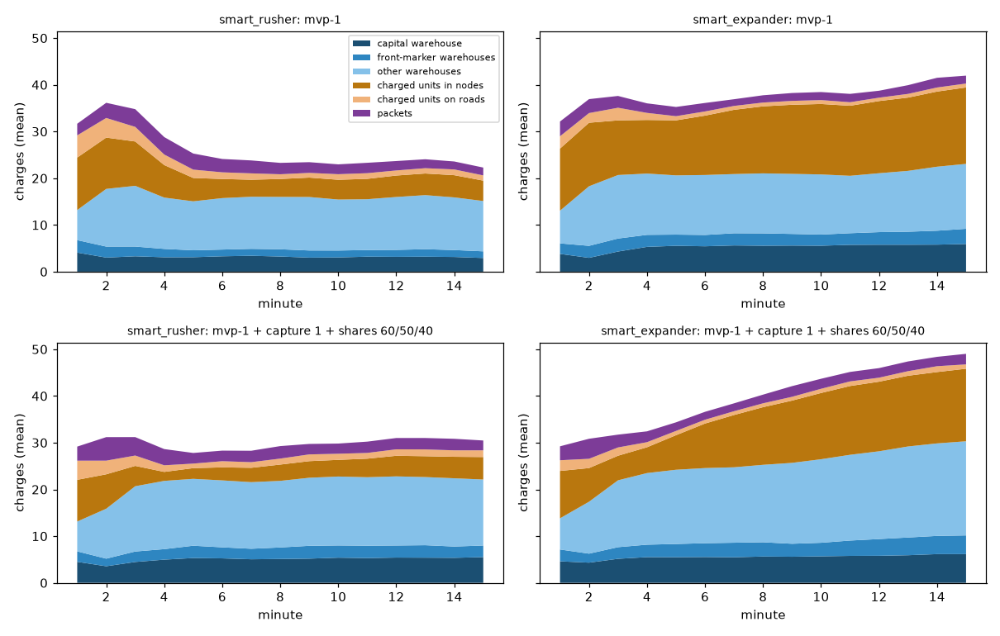

# Where the charges go (BAL-02, #40)

Analysis only: no rule, ruleset or bot changed. The question: the owner wants a decision on the charge economy and
the supply distribution, and BAL-02 found that charges hardly limit anything (iteration 1: halving `charges_per_cp`
changed no win rate; 61-94% of the production burns outside War). This report measures where the charges are and where
they end.

## Method (everything below is measured unless marked *inferred*)

- 150 matches per ruleset: 5 smart bots at `hard` (`smart_rusher`, `smart_expander`, `smart_strangler`,
  `smart_reactive`, `smart_turtle`), all 25 ordered pairs (mirrors included), the 3 pool maps (`crossroads`,
  `highway`, `ridge`), seeds 0 and 1. A personality row is the mean over its 60 player slots (all opponents).
- Rulesets: **A** = `rulesets/mvp-1.toml`; **B** = A with `capture.charge_cost = 1` and the BAL-02 iteration-3 shares
  (`economy` 60, `balance` 50, `war` 40). The bots know the capture cost (#580).
- A throwaway harness replays nothing: it plays the match with `run_headless` and an observer that, after every tick,
  splits each player's charges by place (capital warehouse, front-marker warehouses, other warehouses, charged units in
  nodes, charged units on roads, packets) and tallies the tick's events. It is equivalent to re-simulating a replay
  (same code path) and avoids the file round trip. The harness is not in the repo (see the last section).
- Conservation check: `start + produced = burned + fights + captures + packets lost + warehouses lost + starvation +
  attrition + end stock` holds exactly in every row below (residual 0.00). Attrition (units destroyed above capacity
  with their charges) was first an unexplained residual and is now accounted for by the `attrition` event.
- Caveats: 2 seeds per cell, one difficulty, mean over all opponents, so a personality row mixes matchups; win rates of
  48 matches per bot are only a side remark.

## Sources to sinks (share of `start + produced`, mean per player and match)

Start stock is 30 charges for everyone (maps: 14 in warehouses, 16 in charged start units). Production, in charges per
match: A rusher 86, expander 172, strangler 170, reactive 183, turtle 244; B rusher 146, expander 175, strangler 181,
reactive 180, turtle 215.

| ruleset | personality | in (start+prod.) | start % | burned % | fights % | captures % | packets lost % | warehouses lost % | starvation % | attrition % | left at end % |
|---|---|---|---|---|---|---|---|---|---|---|---|
| A | rusher | 116 | 26 | 24 | 11 | 0 | 21 | 8 | 6 | 4 | 25 |
| A | expander | 202 | 15 | 51 | 4 | 0 | 9 | 5 | 8 | 2 | 21 |
| A | strangler | 200 | 15 | 59 | 4 | 0 | 9 | 8 | 5 | 1 | 14 |
| A | reactive | 213 | 14 | 63 | 2 | 0 | 11 | 7 | 5 | 0 | 11 |
| A | turtle | 274 | 11 | 76 | 2 | 0 | 1 | 3 | 3 | 3 | 13 |
| B | rusher | 176 | 17 | 34 | 3 | 24 | 11 | 6 | 1 | 3 | 18 |
| B | expander | 205 | 15 | 47 | 1 | 16 | 4 | 3 | 1 | 2 | 24 |
| B | strangler | 211 | 14 | 49 | 2 | 17 | 8 | 6 | 1 | 1 | 16 |
| B | reactive | 210 | 14 | 65 | 1 | 13 | 4 | 6 | 0 | 0 | 10 |
| B | turtle | 245 | 12 | 69 | 0 | 6 | 0 | 1 | 1 | 6 | 17 |

"Burned" is the capital overflow only; the other loss columns are enemy action or cut-off (packets cut on a captured
road, a captured city's warehouse, starvation, units over capacity). Shots in fights are the smallest real use of a
charge: 1 to 12 per match.

## Where the stock sits

Mean total stock is 22-50 charges. After minute 3 the picture is stable: the capital holds 4-6 (of 6), the front-marker
cities 2-4, the other warehouses 10-20 (the surplus spreads over the rear, DEC-28 item 4.4), charged units 2-16, packets
1-4. The rushers' charged units drop from 9-11 to 2-5 after minute 3 (the start units spend their charges on the first
captures); in B the expander's stock grows to about 49 (charged units 15, other warehouses 20) because it captures
less. The storage ceiling (warehouses 14 at the start, plus upgrades) is what the production hits: that is the burn.

## Delivery to the front (mean per match, per player)

| ruleset | personality | produced | sent by dispatch | delivered | of it to marker cities | one-off transfers | marker city empty (% of marker ticks) | of those, capital has charges | capital full (% of all ticks) |
|---|---|---|---|---|---|---|---|---|---|
| A | rusher | 86 | 77 | 61 | 20 | 14 | 40 | 33 | 36 |
| A | expander | 172 | 71 | 55 | 17 | 8 | 25 | 24 | 65 |
| A | strangler | 170 | 55 | 40 | 16 | 8 | 27 | 27 | 78 |
| A | reactive | 183 | 55 | 35 | 13 | 10 | 25 | 25 | 79 |
| A | turtle | 244 | 25 | 24 | 10 | 3 | 9 | 9 | 93 |
| B | rusher | 146 | 85 | 78 | 30 | 19 | 37 | 36 | 58 |
| B | expander | 175 | 68 | 63 | 24 | 8 | 30 | 30 | 70 |
| B | strangler | 181 | 74 | 69 | 29 | 18 | 34 | 34 | 74 |
| B | reactive | 180 | 46 | 44 | 18 | 8 | 21 | 21 | 86 |
| B | turtle | 215 | 34 | 34 | 17 | 2 | 13 | 13 | 89 |

"Marker city" is a city (not the capital) with a front marker; all bots keep a marker placed in 88-100% of ticks.
Bots use `SetFront` 7-30 times and `UpgradeRoad` 0.5-8.6 times a match.

## Siege: what comes in and what waits (node fights with an attacker, at fight start)

| ruleset | attacker | sieges/match | attacker units / charged | defender units / charged | defender warehouse | defender has 0 charged | attacker takes the node |
|---|---|---|---|---|---|---|---|
| A | rusher | 7.8 | 2.6 / 2.3 | 1.3 / 0.8 | 0.2 | 33% | 87% |
| A | expander | 1.6 | 2.1 / 2.1 | 1.7 / 1.1 | 0.2 | 24% | 56% |
| A | strangler | 4.6 | 2.2 / 1.9 | 1.2 / 0.8 | 0.2 | 31% | 86% |
| B | rusher | 5.0 | 2.5 / 2.1 | 1.4 / 0.3 | 0.1 | 74% | 74% |
| B | expander | 1.0 | 2.1 / 1.8 | 2.0 / 0.3 | 0.1 | 79% | 29% |
| B | strangler | 3.5 | 2.7 / 2.4 | 1.5 / 0.3 | 0.2 | 75% | 84% |

(reactive and turtle behave like the strangler and the rusher respectively; omitted for space.)

## Findings and levers

1. **Production is far above what the storage can hold, for everyone except the rusher in A.** Four of five
   personalities burn 47-76% of everything they have; the stock stops at the warehouse ceiling. The rusher in A burns
   24% and ends with 25% unused. Levers: `economy.charges_per_cp`, the stance shares (60/50/40 raised the rusher's
   production from 86 to 146 and its burn from 28 to 61 charges), warehouse caps (`warehouse.start_by_kind`,
   `gain_per_level`, `max_level`). Cutting production for Balance and Economy is free for balance (iteration 1); it
   only matters for the rusher, and with `charge_cost = 1` the rusher spends 42 charges on captures: *inferred* that
   War at the old 25% (about 86 produced) still covers that demand about twice.
2. **Delivery, not production, limits the front.** Only 10-30 charges per match (1 to 2 per minute) reach a marker city
   against 86-244 produced. A marker city has an empty warehouse in 21-40% of marker ticks for the active bots, and in
   almost all of those ticks the capital holds charges (the capital is full during only 7-21% of marker ticks, measured
   but not tabled). So the loss is latency and throughput of the supply, not a lack of
   charges. Levers: `supply.dispatch_ticks`, `supply.amount_by_level` and `fast_speed_pct` (road levels: the bots buy
   few), the cost of `UpgradeRoad`, or a rule change (a captured city keeps part of its warehouse: needs a DEC).
3. **Enemy action eats more charges than fights do.** Packets cut on captured roads lose 11-21% of the rusher's
   charges (24 of 77 sent in A), lost warehouses 5-8%, against 3-11% shot in fights. Fights use 1 to 12 charges a match,
   so the charge economy only matters through captures (B) and through starving the front. Levers: whether a packet
   survives a captured road, what a capture does to the warehouse (DEC-26 item 4): both rule changes.
4. **With `charge_cost = 1` the defender is the one without charges.** At a siege the defender has 0.3 charged units
   in B against 0.8-1.1 in A, and 74-86% of defenders have none; the attacker brings 1.8-2.4. The rusher's capture
   spending is 24% of its charges, the expander's 16%. Combined with finding 2 the front is empty and a strike wins
   (rusher 74%, strangler 84%), except the expander as attacker (29%, 1.0 sieges). Lever: the supply speed of
   finding 2 decides who holds a city, not the number of charges.
5. **The start stock is large relative to the use.** 30 charges (15-26% of everything; for the rusher in A a quarter)
   fund the first 3 minutes of captures. A smaller start stock (`start_stock`, `start_charged` of the maps) would make
   the opening depend on the first production and supply, which is where the real bottleneck is (finding 2).
   *Inferred*, not tested.

## Toward permanent charge metrics

The owner wants these in every match (tournament JSONL, `mise run stats` on human replays). Do not add them in this
PR. The counting in the harness is written as pure functions (`stock_by_location`, `explained_change`) so it can be
ported to `gow_sim.analysis`.

**Computable from existing events (no new event, no state sampling).** Per player, from the event log: `charges_produced`
(already `charges_produced`), `charges_burned` (already), `charges_fights` (sum of `spent_
` of `fight_round`),
`charges_packets_lost` (`packet_lost`), `charges_warehouses_lost` (`warehouse_lost`, field `owner`), `charges_starved`
(`starvation` `warehouse + units`), `charges_attrition` (`attrition` `charged`), `charges_sent` and `charges_delivered`
(`packet_sent`, `packet_delivered`; transfers via `transfer_started`). `charges_captures` = `node_captured` count times
`capture.charge_cost` (needs the ruleset, which `analysis.py` already gets). Everything except `charges_fights`
uses own-player events; the fight rounds are public (FIGHT_KINDS).

**Needs state sampling (the recorder already samples `charge_stock` every tick).** `charges_end` and the stock by place
(`stock_cap_wh`, `stock_front_wh`, `stock_rear_wh`, `stock_units_node`, `stock_units_road`, `stock_packets`, mean per
minute), the bottleneck ticks (`front_empty_ticks`, `front_empty_cap_has_ticks`, `marker_ticks`, `cap_full_ticks`),
`delivered_to_front` (needs the markers at the tick; the own-only `front_set` event gives them for a replay), and the
siege composition (attacker and defender units and charged at fight start from `Fight.members`; `fight_group` carries
`units_before` and `charged_before`, so a post-hoc version is possible from events alone).

**Needs a new event or field.** Nothing for the accounting: the identity above closes exactly with existing events, so it
can be a property test in `test_properties.py`. Two optional additions: a `paid` field on `node_captured`
(public kind, so it needs a fog test and an `EVENT_FIELDS` entry; it would replace the ruleset lookup) and the charges
in the fight member list on `fight_started` (public already: a fog test of the new field). Both are conveniences.

Proposed names and units for `analysis.py` and the JSONL (integers, per player `[a, b]`, charges unless stated):
`charges_start`, `charges_produced` (exists), `charges_burned` (exists), `charges_fights`, `charges_captures`,
`charges_packets_lost`, `charges_warehouses_lost`, `charges_starved`, `charges_attrition`, `charges_end`,
`charges_sent`, `charges_delivered`, `charges_delivered_front`, `charges_transfers`, `stock_by_place_minute`
(6 lists by minute, hundredths of a charge), `front_empty_permille` and `front_empty_cap_has_permille` (per mille of
marker ticks), `siege_attacker_charged_centi` and `siege_defender_charged_centi` (mean in hundredths).
Tournament lines without the new fields stay readable (the same rule as for #310 and #166).
