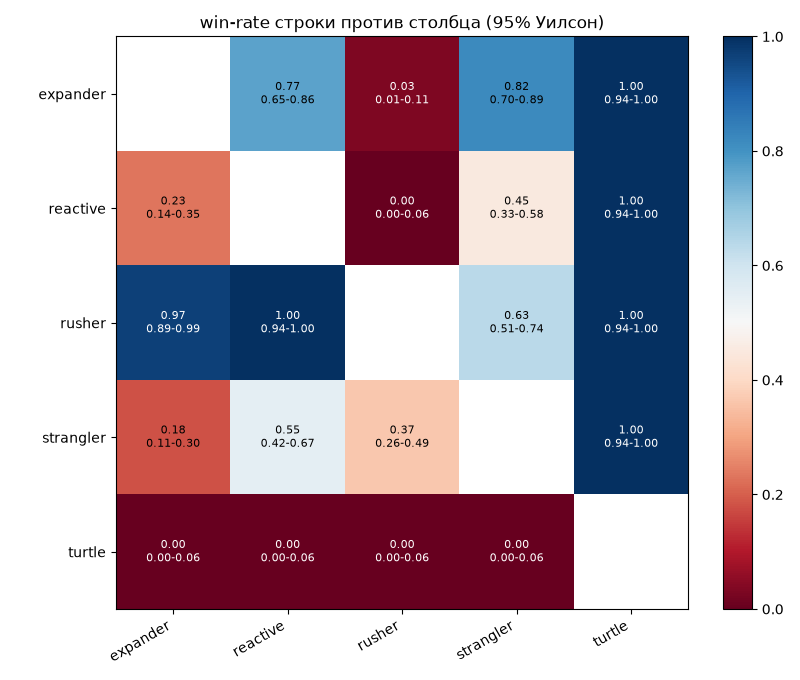
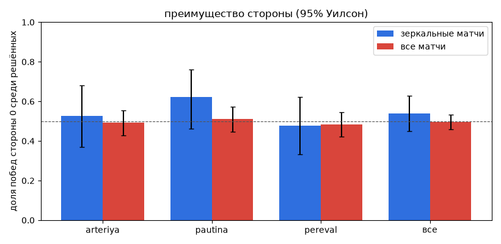
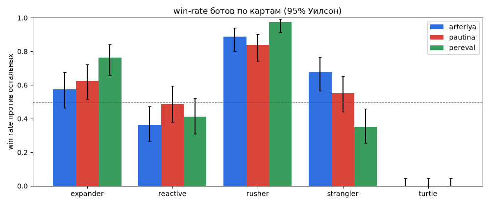

# Баланс-отчёт: `latest.jsonl`

Сгенерирован `uv run gow-bots report` (BOT-05, #38); формат входа: [README.md](README.md). Не редактировать руками.

## Обзор

- Матчей: 750; карты: arteriya, pautina, pereval; боты: expander, reactive, rusher, strangler, turtle.
- Сиды: 0..9 (10 шт.).
- Рулсет `3c114c6a3fde5be635a73d1cd7ff1783`, `SIM_VERSION` 1.
- Без победителя (ничья или не закончен): 35 (0.05).
- Причины окончания: `capital` 52, `double_defeat` 3, `draw` 32, `vp` 663.

## Проверки компетентности ботов

- [выполнено] `strangler` берёт хотя бы один город осадой в матче против `expander` в 1.00 [0.94; 1.00] матчей (порог 50%, n=60).
- [НЕ выполнено] `reactive` выигрывает у `rusher` чаще, чем `expander`: 0.00 [0.00; 0.06] против 0.03 [0.01; 0.11]; интервалы пересекаются.
- Win-rate `turtle` против остальных: 0.00 [0.00; 0.02], ничьих 0.00 (n=240).
  - по соперникам: expander 0.00, reactive 0.00, rusher 0.00, strangler 0.00.

## Матрица пар стратегий

Win-rate строки против столбца на обеих сторонах, 95% интервал Уилсона в скобках: `доля [нижняя; верхняя]`. Ничья считается не победой.

| строка бьёт столбец | expander | reactive | rusher | strangler | turtle |
|---|---|---|---|---|---|
| **expander** | - | 0.77 [0.65; 0.86] | 0.03 [0.01; 0.11] | 0.82 [0.70; 0.89] | 1.00 [0.94; 1.00] |
| **reactive** | 0.23 [0.14; 0.35] | - | 0.00 [0.00; 0.06] | 0.45 [0.33; 0.58] | 1.00 [0.94; 1.00] |
| **rusher** | 0.97 [0.89; 0.99] | 1.00 [0.94; 1.00] | - | 0.63 [0.51; 0.74] | 1.00 [0.94; 1.00] |
| **strangler** | 0.18 [0.11; 0.30] | 0.55 [0.42; 0.67] | 0.37 [0.26; 0.49] | - | 1.00 [0.94; 1.00] |
| **turtle** | 0.00 [0.00; 0.06] | 0.00 [0.00; 0.06] | 0.00 [0.00; 0.06] | 0.00 [0.00; 0.06] | - |

Доля ничьих в паре (по всем картам):

|  | expander | reactive | rusher | strangler | turtle |
|---|---|---|---|---|---|
| **expander** | - | 0.00 | 0.00 | 0.00 | 0.00 |
| **reactive** | 0.00 | - | 0.00 | 0.00 | 0.00 |
| **rusher** | 0.00 | 0.00 | - | 0.00 | 0.00 |
| **strangler** | 0.00 | 0.00 | 0.00 | - | 0.00 |
| **turtle** | 0.00 | 0.00 | 0.00 | 0.00 | - |

## Преимущество стороны

Доля побед стороны 0 среди матчей с победителем (`побед стороны 0 / решённых`, интервал Уилсона). Зеркальные матчи (бот против себя) измеряют перекос карты без разницы ботов; в полном турнире каждая пара играет обеими сторонами, поэтому второй столбец показывает перекос после усреднения по ботам. Интервал, содержащий 0.5, не даёт оснований говорить о перекосе.

| карта | зеркальные матчи: сторона 0 | все матчи: сторона 0 |
|---|---|---|
| arteriya | 0.53 [0.37; 0.68] (n=36) | 0.49 [0.43; 0.55] (n=236) |
| pautina | 0.62 [0.46; 0.76] (n=37) | 0.51 [0.45; 0.57] (n=237) |
| pereval | 0.48 [0.33; 0.62] (n=42) | 0.48 [0.42; 0.55] (n=242) |
| все карты | 0.54 [0.45; 0.63] (n=115) | 0.50 [0.46; 0.53] (n=715) |

## Метрики по ботам

Win-rate считается против других ботов (без зеркальных матчей); остальные метрики по всем матчам бота. «Запланированная атака» = приказ `Move` с `planned=true` на чужой или нейтральный узел; «успех осады» = захваты узлов врага / попытки осады.

| бот | матчей против других | win-rate [95%] | ничьи | доля запланированных атак | успех осад (взято/попыток) | захватов за матч | доля захватов в последние 3 мин |
|---|---|---|---|---|---|---|---|
| **expander** | 240 | 0.65 [0.59; 0.71] | 0.00 | 0.13 | 0.63 (4364/6973) | 25.69 | 0.14 |
| **reactive** | 240 | 0.42 [0.36; 0.48] | 0.00 | 0.04 | 0.89 (9571/10811) | 40.44 | 0.18 |
| **rusher** | 240 | 0.90 [0.86; 0.93] | 0.00 | 0.08 | 0.85 (9330/11016) | 43.64 | 0.23 |
| **strangler** | 240 | 0.53 [0.46; 0.59] | 0.00 | 0.05 | 0.85 (9861/11550) | 42.60 | 0.21 |
| **turtle** | 240 | 0.00 [0.00; 0.02] | 0.00 | 0.00 | 0.73 (308/423) | 8.15 | 0.03 |

## Разнообразие стратегий

Кого бот бьёт (больше побед, чем у соперника в их матчах); «значимо» = интервал Уилсона доли среди решённых матчей не содержит 0.5.

| бот | бьёт | бьёт значимо |
|---|---|---|
| **expander** | reactive, strangler, turtle | reactive, strangler, turtle |
| **reactive** | turtle | turtle |
| **rusher** | expander, reactive, strangler, turtle | expander, reactive, strangler, turtle |
| **strangler** | reactive, turtle | turtle |
| **turtle** | - | - |

- Доминирующая стратегия (бьёт всех остальных): rusher; значимо: rusher.
- Лучший средний win-rate: rusher 0.90 [0.86; 0.93]; худший: turtle 0.00 [0.00; 0.02]; разброс 0.90.
- Циклов «камень-ножницы-бумага» нет.

## Захваты в конце матча

Матч, в котором в последние 3 минуты никто ничего не берёт, обычно застыл. Матч, закончившийся раньше, считается по своим последним минутам.

| карта | матчей | матчей с захватом в последние 3 мин | доля захватов в последние 3 мин |
|---|---|---|---|
| arteriya | 250 | 0.58 (145/250) | 0.19 (2808/14800) |
| pautina | 250 | 0.66 (164/250) | 0.18 (3000/16786) |
| pereval | 250 | 0.64 (160/250) | 0.19 (3078/16571) |
| все карты | 750 | 0.63 (469/750) | 0.18 (8886/48157) |

## Уникальные исходы

`state_hash` различает любые два финальных состояния; «исход» = `(победитель, причина, VP, города)`. «Ячейка без вариативности» = карта + упорядоченная пара, где все сиды дали одно и то же финальное состояние (бот не зависит от сида).

| карта | матчей | уникальных состояний | уникальных исходов | ячеек без вариативности |
|---|---|---|---|---|
| arteriya | 250 | 221 | 211 | 0/25 |
| pautina | 250 | 228 | 220 | 0/25 |
| pereval | 250 | 238 | 226 | 0/25 |
| все карты | 750 | 687 | 657 | 0/75 |

## Разбивка по картам

Win-rate бота против остальных по картам:

| бот | arteriya | pautina | pereval |
|---|---|---|---|
| **expander** | 0.57 [0.47; 0.68] | 0.62 [0.52; 0.72] | 0.76 [0.66; 0.84] |
| **reactive** | 0.36 [0.27; 0.47] | 0.49 [0.38; 0.60] | 0.41 [0.31; 0.52] |
| **rusher** | 0.89 [0.80; 0.94] | 0.84 [0.74; 0.90] | 0.97 [0.91; 0.99] |
| **strangler** | 0.68 [0.57; 0.77] | 0.55 [0.44; 0.65] | 0.35 [0.25; 0.46] |
| **turtle** | 0.00 [0.00; 0.05] | 0.00 [0.00; 0.05] | 0.00 [0.00; 0.05] |

### arteriya (250 матчей)

| строка бьёт столбец | expander | reactive | rusher | strangler | turtle |
|---|---|---|---|---|---|
| **expander** | - | 0.65 | 0.00 | 0.65 | 1.00 |
| **reactive** | 0.35 | - | 0.00 | 0.10 | 1.00 |
| **rusher** | 1.00 | 1.00 | - | 0.55 | 1.00 |
| **strangler** | 0.35 | 0.90 | 0.45 | - | 1.00 |
| **turtle** | 0.00 | 0.00 | 0.00 | 0.00 | - |

### pautina (250 матчей)

| строка бьёт столбец | expander | reactive | rusher | strangler | turtle |
|---|---|---|---|---|---|
| **expander** | - | 0.70 | 0.00 | 0.80 | 1.00 |
| **reactive** | 0.30 | - | 0.00 | 0.65 | 1.00 |
| **rusher** | 1.00 | 1.00 | - | 0.35 | 1.00 |
| **strangler** | 0.20 | 0.35 | 0.65 | - | 1.00 |
| **turtle** | 0.00 | 0.00 | 0.00 | 0.00 | - |

### pereval (250 матчей)

| строка бьёт столбец | expander | reactive | rusher | strangler | turtle |
|---|---|---|---|---|---|
| **expander** | - | 0.95 | 0.10 | 1.00 | 1.00 |
| **reactive** | 0.05 | - | 0.00 | 0.60 | 1.00 |
| **rusher** | 0.90 | 1.00 | - | 1.00 | 1.00 |
| **strangler** | 0.00 | 0.40 | 0.00 | - | 1.00 |
| **turtle** | 0.00 | 0.00 | 0.00 | 0.00 | - |
