# Client visual style: research and guide (v3)

Issues: #202 (v1, PR #207), #208 (v2), #332 (v3, spike), #335 (round 2 of the map style, section 26), #337 (map objects and menu icons, section 28). Implementation: wave 3 (section 16), the owner's rounds 2-4 (sections 18, 19).

v1 answered the owner's 21 remarks after the playtest and relied on text sources.
v2 added the visual research (moodboard, section 2), the critique of the screens (section 3), proactive
improvements (section 4) and the wave 3 packages (section 16). **v3 (2026-10-21, #332)** checks the guide against what
is built: the critique of the screens against the `develop` screenshots (section 3), the statuses of the decisions (below), the summary rules of
animation (20), the icon language (21), constraints (22), the process of visual decisions (23), three directions of
the map style for the owner to choose from (24) and a recommendation (25). The document does not change the game rules: the source of
the rules is still `mechanics.md`. There is no separate file about style: we develop this document.

Mockups: [`mockups/ui-style.html`](mockups/ui-style.html) (v2, the match screen and the menu),
[`mockups/fight-arena.html`](mockups/fight-arena.html) (the fight arena, #327),
[`mockups/map-style.html`](mockups/map-style.html) (map style directions, #332),
[`mockups/map-style-2.html`](mockups/map-style-2.html) (round 2: volume, textures, fog, roads, #335),
[`mockups/objects-style.html`](mockups/objects-style.html) (units, cities, barracks and "Defense", menu icons, #337),
[`mockups/progress-style.html`](mockups/progress-style.html) (CP bar and the progress of barracks construction and recruiting, #430: **[awaiting the owner's decision]**; the owner asked for it on 2026-10-28, after the mechanics freeze, so the postponement of section 23 does not apply to it).,
[`mockups/start-menu.html`](mockups/start-menu.html) (the start menu and the pre-match screens, #471: **[awaiting the owner's decision]**, section 31; asked for before the release on 2026-10-28). All of them are
self-contained: open in a browser. The screenshots of our client and the images of the mockups are in
[`mockups/img/`](mockups/img/). We do not put other people's screenshots and assets into the repository: the moodboard has
only links and our descriptions.

**Variant ids** (AR1, BL1-1, IM1, SH1 ...) are Latin. Until 2026-10-27 many of them were Cyrillic:
closed PRs, issues and comments still use the old ids; the full mapping is in section 30.

**Statuses.** **[accepted]**: the owner's decision, in force, to be changed only by his decision.
**[proposed]**: a proposal of an agent or a detail the owner did not set; in force as
the default value until he answers otherwise. **[awaiting the owner's decision]**: the variants and the
recommendation are ready, there is no choice, there is no code. **[replaced]**: struck through, with a note of what replaced it.

| Section | Status | Checked 2026-10-21 against the screenshots |
| --- | --- | --- |
| 1 Owner's decisions | [accepted] | in force |
| 5 Principles | [accepted]; item 10 refined by section 20 | in force |
| 6 Palette | [accepted] (blue is own, red is the enemy, amber is the alert); the pair `--vp`/`--warn` [proposed] to be changed (R2) | implemented, R2 not fixed |
| 9 Map | [accepted] as implemented (#222, #224, #256, #272, #325); arena 9.9 [replaced by DEC-32] | implemented |
| 10, 11, 18, 19 HUD and menus | [accepted] by the decisions of the owner's rounds 2-4 | implemented |
| 13 Screens outside the match, IM1, IM11, IM13, IM20 | [proposed], package E; new design decisions on them are **postponed** until the mechanics are done (section 23) | **not done** (K6-K11) |
| 14.1 Sound, onboarding, package F | [proposed] | not checked |
| 20-23 (animation, icons, constraints, process) | 23 [accepted] (the owner's practice of 2026-10-21), 20-22 [proposed] | new |
| 24 Style directions | [accepted] 2026-10-21: D3 for the shading, without relief (refined by section 26); #332 closed | shading **implemented: #347, PR #409** (see 26.3) |
| 26 Map style, round 2 | [accepted] 2026-10-21 (26.3): BL1-1 with the highlight of the borders of the "pronounced" one, T2 (the baker on numpy and Pillow, WebP), F1 "Haze", R1 "Stripes", the packet as a square; #335 closed | waits for implementation: #344 (the baker, T2, the `artery` scene); **implemented: BL1-1 shading with the border glow (26.3) #347, PR #409; roads R1 "Stripes" and the square packet (26.1) #345, PR #367; fog F1 "Haze" (9.8) #346, PR #368** |
| 27 Orders, fight on the map, arena | [accepted] 2026-10-21 (27.3, shots: 29.4): orders and ribbons as now, IN3 "Sight", the bonus "◇ +N" on the head, LY2 "Over the haze", FX3, EF2 "Pointer" with "Dissolve and marks", arena AR1; #339 closed | waits for implementation: #330 (arena AR1, in progress), #353 (IN3, bonus), #354 (EF2, after #296); **implemented: fight effects FX3 #351, PR #373; layers LY2 "Over the haze" #346, PR #368; shots SH1 instead of the exchange arrows of the arena #352, PR #376** |
| 28 Map objects and menu icons | [accepted] 2026-10-21 (28.1): U1 and the row of squares U4, C1, B1, I1 (B2 later, no issue is opened); #337 closed | waits for implementation: the row of squares U4 (#433, moved from #348, waits for a mockup, #431), B1 (#349); **implemented: U1 as part of BL1 #347, PR #409; cities C1 (warehouse places filled / frame / dashed, the province as a hollow ring) #348, PR #437**; implemented (menu icons I1): PR #362 |
| 29 Shots in a fight | [accepted] 2026-10-21 (29.4): SH1 "Tracers", the strength "Stronger", the distance of the groups as now (46) | the strength "Stronger" and the common part (pools, the effects layer, the particle core) **implemented: #351, PR #373**; tracers SH1 **implemented: #352, PR #376** |

Contents:

1. Owner's decisions and what changed since v1
2. Moodboard
3. Critique of the current screens
4. Proactive improvements
5. Principles
6. Palette and tokens
7. Typography and interface scale
8. Icons, sounds and licenses
9. The map: visual language
10. Match HUD
11. Radial stance menu
12. Starvation warning
13. Screens outside the match
14. Sound, accessibility, localization
15. What is needed from the protocol and the API
16. Wave 3 work packages
17. Questions to the owner
18. UI round 2
19. The "Supply" layer
20. Animation: summary rules
21. Icon language
22. Constraints
23. The process of visual decisions
24. Directions of the map and unit style (#332)
25. Recommendation and the first tasks
26. Map style, round 2: volume, textures, fog, roads (#335)
27. Orders, the fight on the map and the arena in the chosen map style (#339)
28. Map objects and menu icons: units, cities, barracks and "Defense" (#337)
29. Shots in the fight on the map: animation variants (#339)
30. Variant id mapping (old Cyrillic to new Latin)
31. Start menu redesign (#471)

---

## 1. Owner's decisions and what changed since v1

Accepted by the owner (not reconsidered):

- own is always blue, the enemy is always red (in a live match for either player);
- stance: a radial menu on `Q`;
- "Exit" and a double `Esc` = a forfeit with confirmation;
- the "last seen" ghosts fade on the client after 2 minutes;
- road upgrade: ~~a city function on `U`~~ **[replaced by DEC-28, #311, #315]** a road upgrade mode on `U` (a click on a highlighted own road), there is no "Building" mode (DEC-16, #209);
- fog on the enemy's roads (DEC-17, #210).

Round 3 (#252, #254): the popups with facts looked like debugging and were removed (IM5 and the tooltips of
a city, a road and intent arrows no longer apply); one tooltip with the charges of a group remains.
The hint line at the bottom (`OrderHint`) and the fight estimate in the HUD were removed, the client has no game logic at all.
Travel time (#432): a small plate with a clock and the seconds (`ETA_LABEL` in `style.ts`, text 13 px kept on screen by `badgeScale`, so 13 px at a 60% map scale) on the road between the selected group and the hovered reachable city, above the road. Between two cities with a road it stands in the middle of it, between the city rims; with no road between them (the path is the server's, on hover `reach` carries only the total time, AGENTS.md 7.1) it stands on the last piece before the destination, not over a city on the way. The time is the server's (`reach`, plus the delay of a planned order); the placement is `etaSpot` in `etaLayout.ts`.

Already in place and taken into account here: a scheduled order only via `Shift`+click, the `P` key goes away
(#213); VP are awarded once per 30 s (#211); the "How to play" screen (CLI-13, #72); "juice" and sound
(CLI-12, #71); the leaderboard and the profile (LB-01, #78).

Decisions after v2 (all **[accepted]**):

- **2026-10-12, round 2** (#236, section 18), **2026-10-14, round 3** (#252, #254), **round 4** (#325): camera, radial menus, units in a city, "Supply", opaque order ribbons, warehouse squares.
- **2026-10-21, DEC-32** (#327, `mechanics.md`, section 4): a fight round of 2 s, the arena **V3** ("chips"), the stock of the ◇ bonus is visible to both sides in a fight, the display of the bonus shot **A1** (a different arrow and the caption "bonus attack"). Implementation: #329 (sim), #330 (client).
- **2026-10-21, process** (section 23): before a major visual decision, first an interactive HTML mockup with variants and an issue with a table, code after the owner chooses.

What v2 changes in v1:

| Was in v1 | Became in v2 | Why |
| --- | --- | --- |
| The enemy is orange `#ff8a3d`, red for alerts | the enemy is red `#e5484d`, alerts are amber `--warn`, selection is white | the owner's decision; red now means only "the enemy" |
| Yellow `--accent`: selection, CP, the current stance | CP are blue (this is the player's resource), selection is a white outline, yellow only for VP | yellow and amber are indistinguishable with color blindness (section 6) |
| The "Scheduled" switch with `P` in the card | the hint "`Shift`+click: scheduled" and the price of both variants | #213 |
| HUD body text 14 px, hints 12 px | body 15-16 px, minimum 13 px, micro captions 12 px; interface scale 100/125/150% | XAG 101 (section 7) |
| Screens outside the match were not considered | section 13 and package E | the playtest and the critique (section 3) |
| There is no sound, onboarding or settings | section 14 and package F | section 4 |
| Fight marker: a red cross | a white flash with the losses of both sides in the owners' colors | red is taken by the enemy |

---

## 2. Moodboard

How we looked: Steam pages (screenshot galleries), official sites, developer breakdowns,
Dribbble and Behance, Interface In Game. Game UI Database is behind a Cloudflare check (we did not bypass it),
so for it there is only the description of the sections. "What we take" describes a technique, not a picture.

| # | Reference | What we take |
| --- | --- | --- |
| 1 | Mini Metro ([Steam](https://store.steampowered.com/app/287980/Mini_Metro/), [visual breakdown](https://mechanicsofmagic.com/2023/04/22/visual-design-of-games-mini-metro/)) | The map takes the whole screen, the interface is pressed to the edges in small groups: resources at the bottom center, the score and the clock at the top right. The background is pale, the network reads first. The type of a station is encoded by shape, not by color |
| 2 | Mini Motorways ([Steam](https://store.steampowered.com/app/1127500/Mini_Motorways/), [sound](https://gamedeveloper.com/design/turning-road-noise-into-music-mini-motorways)) | A wide semi-transparent yellow "highlight" of a route with a number in a circle on top of the road: a direct model of our ribbon arrow. The sounds of actions are tuned to a common rhythm, the palettes for color-blind players switch as ready-made sets |
| 3 | Into the Breach ([Steam](https://store.steampowered.com/app/590380/Into_the_Breach/), [Gigazine: three readings](https://gigazine.net/gsc_news/en/20180501-game-design-subway-legibility)) | All the enemy's intents are drawn on the field before the turn. A segmented resource bar at the top left. The tile tooltip at the bottom right: the name and one line of the effect ("what will happen if…"). Each screen reads in three layers |
| 4 | The Battle of Polytopia ([Steam](https://store.steampowered.com/app/874390/The_Battle_of_Polytopia/)) | Three numbers at the top center, a small caption above each number ("Score", "Stars (+11)", "Turn"). Round buttons at the bottom right with a caption under each. A growth bar under a city made of segments |
| 5 | Hearts of Iron IV ([Steam](https://store.steampowered.com/app/394360/Hearts_of_Iron_IV/), [Battle plan](https://hoi4.paradoxwikis.com/Battle_plan)) | Wide semi-transparent offensive arrows over the map; the state of a plan by the outline style. An anti-example: dense panels cover half of the map |
| 6 | Bad North ([Steam](https://store.steampowered.com/app/688420/Bad_North_Jotunn_Edition/), [sound](https://gamingaudionews.com/2018/04/26/bad-norths-developers-talk-about-inspiration-behind-audio-and-gameplay/)) | A squad is marked by a small banner flag above it: a big sign reads at any scale. Almost no HUD. The sound principle: "close your eyes and you still understand the fight" |
| 7 | Dorfromantik ([Steam](https://store.steampowered.com/app/1455840/Dorfromantik/)) | The score at the top right, the remaining moves in a circle at the bottom right, the tasks on the map as white "bubbles" with a number. A short response to a successful action: a bounce, a sound, a highlight |
| 8 | Against the Storm ([Steam](https://store.steampowered.com/app/1336490/Against_the_Storm/), [Interface hotfix](https://eremitegames.com/interface-hotfix-we-hear-you/)) | Two opposing bars (blue and red) as a "tug of war". The lesson of the hotfix: minimalism without captions on icons failed, they had to bring back captions, padding and big checkboxes |
| 9 | Northgard ([Steam](https://store.steampowered.com/app/466560/Northgard/), [lobby screens](https://interfaceingame.com/games/northgard/)) | Territory borders as a thin glowing line in the owner's color along the edge of the area. Creating and joining a match as separate clean screens. An anti-example (console): a scatter of small symbols without tooltips |
| 10 | Old World ([Steam](https://store.steampowered.com/app/597180/Old_World/)) | Nested tooltips: a term inside a tooltip opens its own tooltip. Fog as dense clouds, a minimap at the bottom right, the portrait of the selected unit at the bottom left |
| 11 | Songs of Conquest ([Steam](https://store.steampowered.com/app/867210/Songs_of_Conquest/)) | The size of a squad in a small dark pill near the figure; the turn queue as a bar at the bottom |
| 12 | Diplomacy is Not an Option ([Steam](https://store.steampowered.com/app/1272320/Diplomacy_is_Not_an_Option/)) | A command card at the bottom center, resources in a thin line at the top: everything extra is at the edges |
| 13 | Age of Empires IV ([tutorial](https://ageofempires.com/news/quickstart-guide-age-of-empires-iv), [accessibility](https://www.ageofempires.com/age-iv-accessibility/)) | A separate "Learn" section: short challenges with medals. Graphs over time on the result screen, interface scale 100-150%, separate volume controls |
| 14 | StarCraft II ([replays](https://news.blizzard.com/en-us/article/424210/press-the-replay-button)) | A replay: a timeline with rewind, speed, resource and loss panels of both players. The mode "own, ally, enemy" recolors the units relative to the viewer (our "own are blue") |
| 15 | Clash Royale ([breakdown](https://mechanicsofmagic.com/?p=15995)) | A short 1v1 match: the last minute noticeably changes the pace and is shown in the interface. The price on every action button |
| 16 | generals.io ([breakdown](https://kam.mff.cuni.cz/~straka/blog/generals.html)) | A browser 1v1 on a graph with fog: the army number right on the tile, a table of the overall totals of the sides |
| 17 | Supremacy 1914 ([sound](https://www.playsupremacy.com/en/forums/1914/1914-news-updates/the-sound-of-supremacy-1914-patch-notes-6096e218), [legibility](https://www.playsupremacy.com/en/news/1914/focus-group-update)) | The sound of the map gets quieter with the distance from the camera. A separate effort on legibility after a focus group |
| 18 | Civilization VII ([patch 1.1.1](https://civilization.2k.com/civ-vii/game-update-notes/2025-mar-25-patch-1-1-1/)) | After the launch they had to strengthen the health bars and the unit flags and add a "quick move" without animations: markers must win against the map art |
| 19 | Dribbble: [LoL Gold Diff Timeline](https://dribbble.com/shots/24169430) | One graph of the difference around zero: above is blue, below is red; own events above the graph, the other side's below it; the periods of a fight are hatched. The same graph works as a replay timeline |
| 20 | Dribbble: [Overwatch 2 Match Summary](https://dribbble.com/shots/19021291) | The hierarchy of a result: a big word of the outcome, then the score, the map and the duration, then the details; the replay as a separate button |
| 21 | Dribbble: [Match Found Interaction](https://dribbble.com/shots/14980810) | The queue as one element in the center: a pulsing ring, a timer counting up, a status line, "Cancel" |
| 22 | Dribbble: [VALORANT StatsCenter](https://dribbble.com/shots/20140742) | A row of 4-6 big numbers with a small caption under each (KPI) above the details |
| 23 | Dribbble: [Hex Strategy Tactical UI](https://dribbble.com/shots/26852209) | A unit card: a name, a bar, a list of "key: value"; a hint line above the action buttons |
| 24 | Dribbble: [NORAD](https://dribbble.com/shots/9592604-NORAD), [Mini Metro Menu](https://dribbble.com/shots/26203344-Mini-Metro-Main-Menu-UI-Replication) | Dark panels with an outline instead of shadows, the accent only on the outline and the key number. The menu: flat plates with one geometric glyph |
| 25 | [Game UI Database](https://www.gameuidatabase.com/), [Interface In Game](https://interfaceingame.com/) | Galleries by screen type (timer, rank, result, lobby). To look through by hand before implementing package E |
| 26 | [Xbox Accessibility Guidelines 101/102](https://devdocs.xbox.com/build/game-principles/accessibility/xag-deep-dives/xag-101-text-display.md), [Game Accessibility Guidelines](https://gameaccessibilityguidelines.com/full-list/) | Text on PC at 1080p of at least 18 px glyph height, scale up to 200%; contrast 4.5:1 for text and 3:1 for icons; nothing important by color only or by sound only |

Cross-cutting conclusions that sections 4-16 rely on:

1. **The map on the whole screen, the interface at the edges** (1, 4, 7, 12). Ours takes about 60% of the screen.
2. **Three readings** (3): at first glance the owner, the score and the time; the second layer is CP and stance;
   the third is the hover tooltips.
3. **Intents are drawn on the map** (2, 3, 5), and the alert "they are coming for my city" is visible at once.
4. **Captions on icons are mandatory** (8, 9). Minimalism without captions does not work.
5. **The result of a match through time** (13, 14, 19, 20): a graph and key numbers, a link to the replay.
6. **A response to every action** (6, 7, 2): short, with sound, with an off switch.

---

## 3. Critique of the current screens

Updated 2026-10-21 (v3, #332) against the `develop` screenshots (4b32363): the `mise run shots` scenes (a 1280×800 window, the English language of the dev screen)
and a live match against a bot on a local server (Russian language, a map with a baked background). The v2 screenshots remain in
`mockups/img/v2-cur-*.png` as history; the v2 critique below was checked against them item by item.

| Live match, 25 s (a map with a baked background) | Scene `snapshot_clash` |
| --- | --- |
| 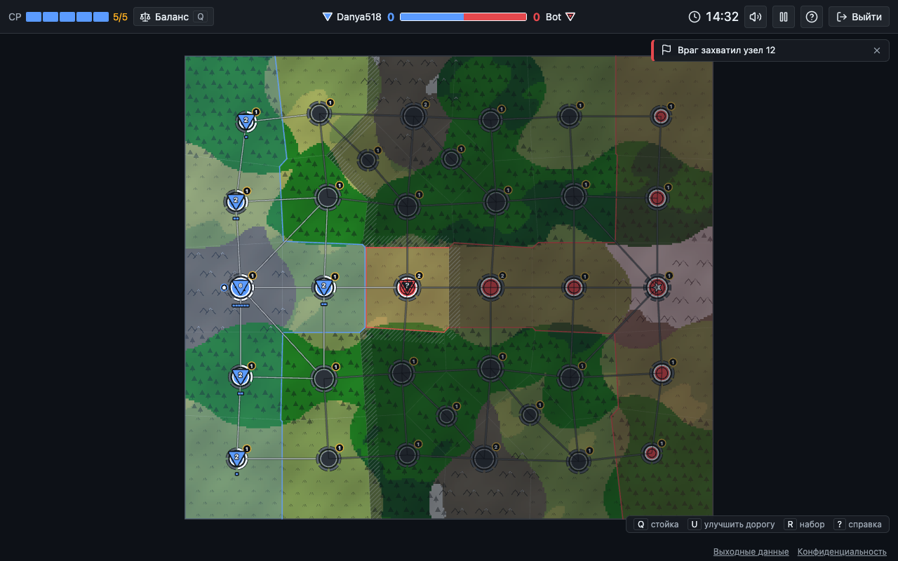 | 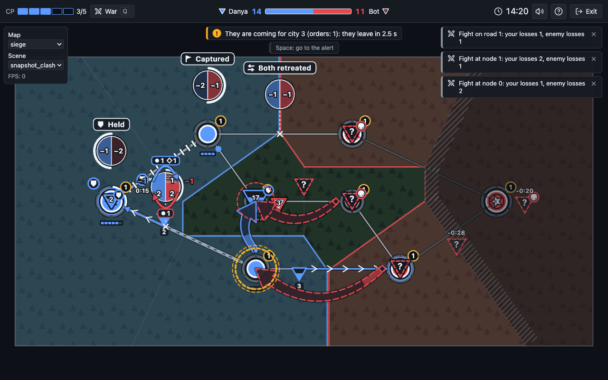 |
| **Scene `fights`: four fights** | **Scene `snapshot_fog`: fog** |
| 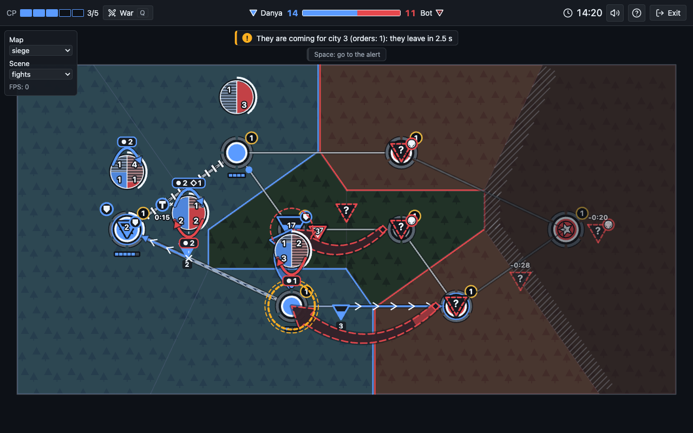 | 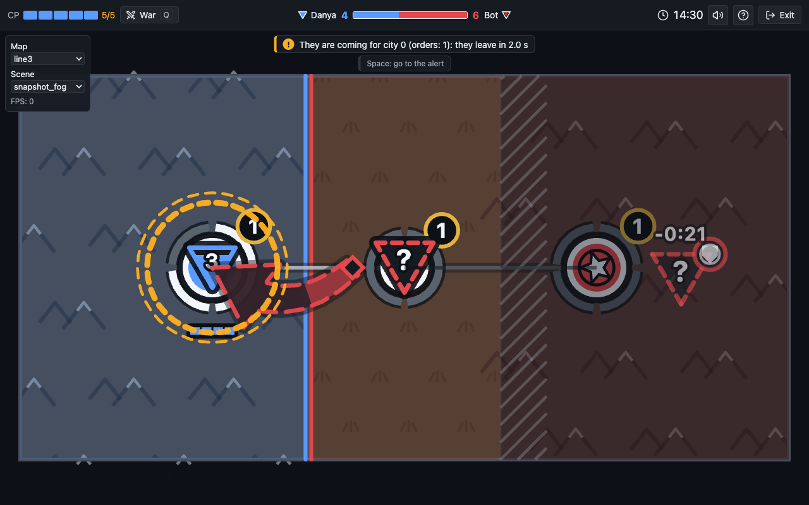 |

| Menu | Queue | Waiting room |
| --- | --- | --- |
| 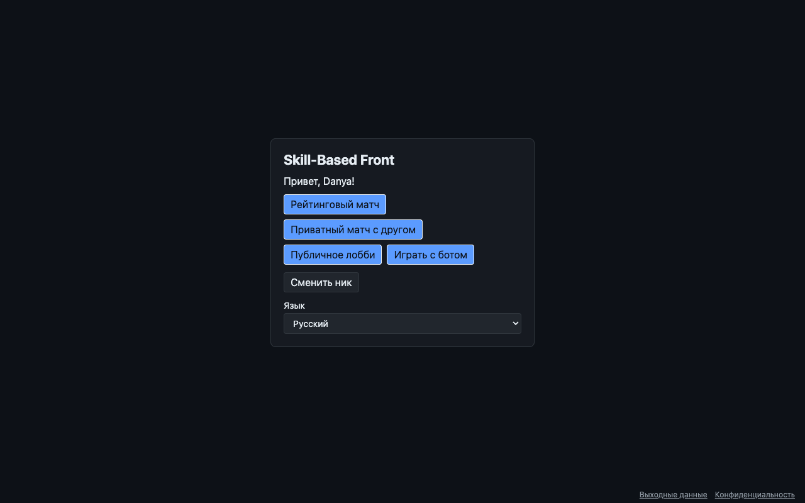 | 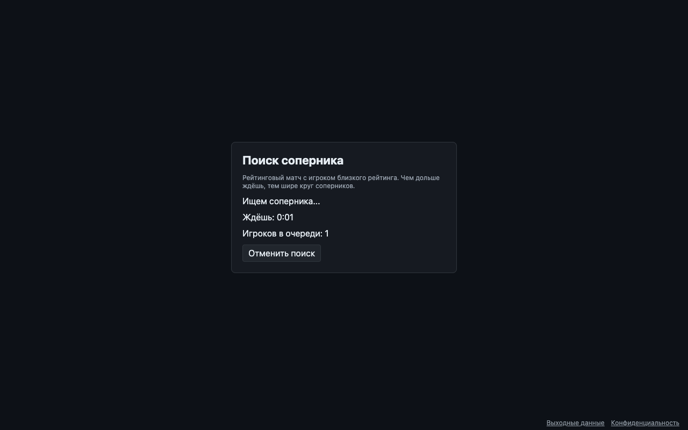 | 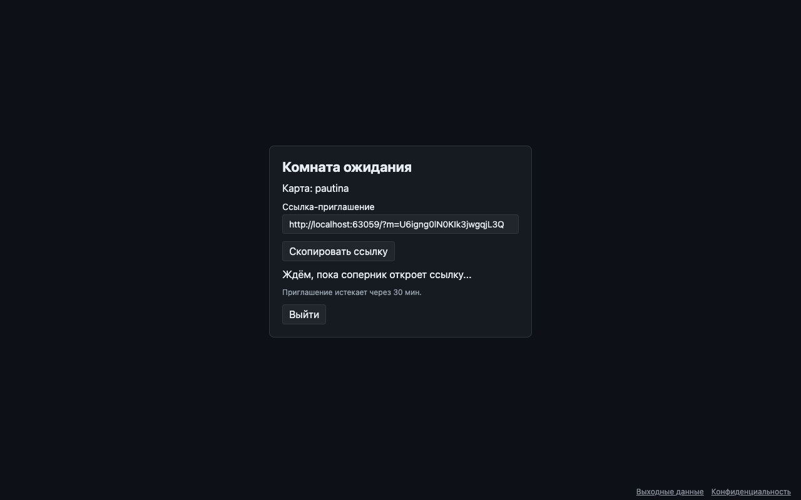 |
| **Result** | **Replay (the sample `?replay=dev`)** | |
| 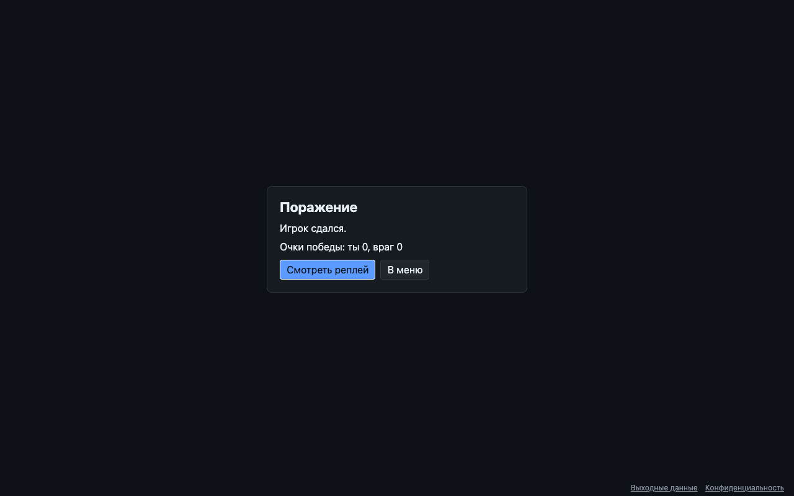 | 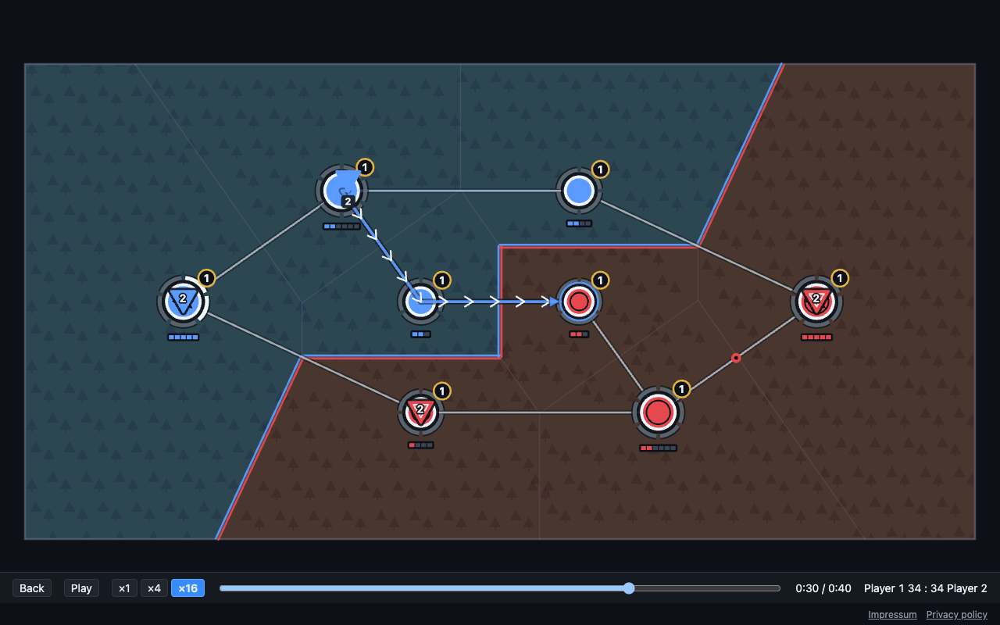 | |

### 3.1 What of the v2 critique is done, what is not

| # | What was bad in v2 | Status on 2026-10-21 |
| --- | --- | --- |
| K1 | The map takes about 60% of the screen, the panel is 300 px, the symbols are small | **done** (wave 3, #228, #247): the top bar is 48 px, the rest is the map; on a 40-node map it is square, so margins remain on the sides (about 20% of the width on each side at 1280×800) |
| K2 | For player 2 own is orange | **done**: own is always blue, the splash "You are blue. Your capital is here" (IM4) |
| K3 | The event feed is stuffed with VP | **done** (IM2): toasts only for events (a fight, a capture), there is no VP in the feed |
| K4 | The fog is dirty, three quarters of the map in hatching | **partly done**: the hatching only as a band at the border, but on small dev maps (`line3`, `siege`) the band is about 70 px and reads heavily; on a live map it is thin |
| K5 | There is no opponent's name and no tooltips | the nick is in the top bar; the tooltips were removed by the owner (#252), will not return |
| K6 | The result: an empty peak moment | **not done**: "Defeat, A player gave up, Victory points: you 0, enemy 0" and two buttons; no opponent's nick, graph, "play again" (IM1, package E) |
| K7 | The menu: four identical blue buttons | **not done**: five buttons, the main action is not highlighted |
| K8 | The queue is text only | **not done** (IM11) |
| K9 | The replay: "Player 1", "Player 2", a timeline without events | **not done** in the sample `?replay=dev` ("Player 1 34 : 34 Player 2", a slider without marks); the replays of real matches with nicks were not re-shot |
| K10 | The waiting room: the map is named by an id, there is no preview | **not done** ("Map: web") |
| K11 | Screens outside the match: a 420 px card on an empty background | **not done**: the same frame on all five screens |
| K12, K13 | Legal, loading and error states | not re-shot |
| K14 | Scattered buttons of the top bar | **done**: stance, sound, pause, help, "Exit" in one panel |

The result: **the match is brought up to the guide (packages A-D, rounds 2-4), the screens outside the match (package E) are untouched.**
The match remains the main screen of the game, so the critique below is about it; package E waits for a separate decision (section 24).

### 3.2 Legibility problems in the screenshots

The text contrast is fine: a measurement (the lightest pixels against the median of the background, approximately) gives for the ghost age captions
5.7 and 6.4:1, for the line "Space: go to the alert" 6.9:1, for the toast text 14.8:1 (the norm is 4.5:1). The problems are elsewhere.

| # | What is seen | Where | What to do |
| --- | --- | --- | --- |
| R1 | **Overlaps.** The ribbon of a scheduled order runs onto the icon and the amber ring of the target city; the fight arena lies on the capacity ring and on the caption "Held"; on a road with a fight the arena, the ribbon, the group icon and the packet are on top of each other (the picture at the center left) | `snapshot`, `snapshot_clash`, `fights` | the ribbon ends at the edge of the city ring, not in the center (rule D1, section 24); the arena V3 (DEC-32) with its own place above the city and a callout |
| R2 | **Two "yellow" marks side by side.** The VP icon (`--vp` `#e3b341`) and the alert ring (`--warn` `#ffb020`) stand at one city. ΔE in Lab (the same calculation as in section 6): 18.7 in the norm, 10.9 with protanopia, 13.6 with deuteranopia, 7.2 with tritanopia. This is the same "indistinguishable" pair because of which the yellow accent was removed in v2 | any scene with an alert | separate them: VP only as a white number on a dark pill (without a yellow ring) or the VP ring of a different shape; the alert stays amber with `!` and a dashed line. **[proposed]**, a small color fix, goes straight into code |
| R3 | **The territory is lost on a live map.** The owner's fill with alpha 0.2 on the baked background gives now a blue-gray, now a brown area; the owner's fill on the gray rocks is almost no different from the rocks themselves; the owner is carried mostly by the border | live match | the fill is still weak; the owner must read without color: a territory pattern (hatching of own and enemy at different angles, D2 of section 24) or a denser fill with leveling the background brightness under the territory; in achromatopsia (section 6) check every map edit |
| R4 | **Neutral cities merge with the dark forest**: a dark disc `#2b3139` with a gray ring on a dark green background is barely visible | live match | a neutral city is lighter than the background (a light ring fill or a backing); a small fix, straight into code |
| R5 | **Small signs.** The number in the triangle is 10 px (`COUNT_FONT_SIZE`), the warehouse segment is 5×4 map units, the VP icon is 17 units: on a 40-node map this is below the rule "a meaningful symbol not smaller than 20 px" (section 5, item 9) and "captions not smaller than 12 px" (section 7) | live match at the scale of the whole map | the unit number 12 px with an outline; the warehouse: into section 21 (icon language) |
| R6 | **Density at the top.** Three toasts in a row in the top right corner lie on the edge of the map and cover cities; under the bar the alert strip with the "Space" hint takes about 55 px | `snapshot_clash` | toasts not more than two, a compressed text ("Fight at node 1: −2 / −1"); the "Space" hint only on hover |
| R7 | **Fog on small maps.** The wide hatching and two age captions `-0:20`, `-0:28` on it look noisy | `snapshot_fog`, `snapshot_clash` | set the band width in screen pixels, not in map units (`FOG_BAND_WIDTH = 24` units give about 70 px on small maps) |
| R8 | **Relief competes with icons.** The mountain stamps ("^") look like intent arrows and road chevrons | `snapshot`, `snapshot_fog` | the stamps are rarer and quieter near cities (rule D1) |
| R9 | **Screens outside the match** (K6-K11): the same 420 px card, no hierarchy, no main action, no map preview | menu, queue, result | package E (section 16) |

### 3.3 The fight arena

An assessment of the current arena (a circle of halves, `fightView.ts`): it reads poorly. Numbers of 10-11 px on a half of a circle of 48 px diameter, the exchange of blows
is visible, but the sum "what happened in the round" does not read; with four fights (`fights`) the arenas lie on the ribbon and the icons (R1). The drawing of
arrows on the circle is good; the bonus stock icon ◇ is already at the arrow. **The arena will be replaced by V3 "chips"** per DEC-32 (#330), so
separate edits of the current arena are not needed: the criteria for V3 are in section 9.9 and section 20 (animation).

---

## 4. Proactive improvements

On top of the owner's 21 remarks. Selected by the influence on the first match and on the wish to play again.
Priority: P0 is needed before the closed playtest (REL-01, #88), P1 is desirable in the MVP, P2 after the MVP.
Effort: S up to a day, M 2-3 days, L more. "Needed": rules (`mechanics.md`, `SIM_VERSION`),
protocol (`PROTOCOL_VERSION`), API (HTTP), the owner's decision. The "When" column: **now** (wave 3)
or **later**.

| ID | Improvement | Why (section 2) | Prio. | Effort | Needed | When | Package |
| --- | --- | --- | --- | --- | --- | --- | --- |
| IM1 | **A result screen with the course of the match**: a big word of the outcome, the opponent's nick, the duration, 4 key numbers (cities at the end, units lost, charges delivered, VP peak) and a graph of the VP difference over time with marks of captures and fights; a click on a mark opens the replay at that tick | 13, 14, 19, 20, 22 | P0 | M | no: everything is in the frames file (`GET /api/replays/{id}`, `docs/design/replay-frames.md`) | now | E |
| IM2 | **An event filter**: VP awards do not get into the feed (the score is already in the top bar); toasts only for a fight, the capture and loss of a city, starvation, a rejected command; the rest in a slide-out log | 1, 3 | P0 | S | no | now | D |
| IM3 | **Nicks in the match, the result and the replay**: "Danya 4 : 6 Guest" in the top bar, the opponent's nick on the result, nicks in the replay | 14, 16 | P0 | S | protocol: nicks in `welcome`; API: nicks in the frames file or in the replay response | now | D, E |
| IM4 | **Match start**: for 3 s a plate "You are blue. Your capital is here" and a pulsing ring around the own capital, the camera fits the map | 3, 1 | P0 | S | no | now | D |
| IM5 | **Hover tooltips with numbers** for a city, a road, a group, an intent arrow: 1 title line and 2-4 "key: value" lines (capacity, warehouse, terrain with a modifier, width and what the next one gives), the term CP and "capacity" with a nested tooltip | 3, 10, 23 | P0 | M | no (the numbers from the player's view and `ruleset_public`) | now | D |
| IM6 | **A response to every action**: an accepted order: the ghost becomes solid and a short sound; a rejection: the ghost shakes and fades, a toast with the reason (`rejects.ts` already translates the codes) and a rejection sound | 7, 2 | P0 | S | no | now | C (map), F (sound) |
| IM7 | **The alert "they are coming for your city"**: an enemy intent with the target in your city gives an amber ring at the city and a line in the alert stack with a countdown of the delay and a jump via `Space` | 3 | P1 | S | `ruleset_public.orders.planned_delay_ticks` (already in the list of section 15) | now | C |
| IM8 | **A clear outcome of a fight**: at the place of the fight a white flash of 400 ms and two loss numbers in the colors of the sides; a bounce: a short arrow back along the edge; the capture of a city: a wave in the color of the new owner over the cell | 6, 7, 18 | P1 | M | no | now | B (part of CLI-12, #71) |
| IM9 | **Sound**: 8 events (order accepted, rejection, a fight nearby, city captured, city lost, starvation, opponent found, match end), a master volume and an off switch, no more than 4 sounds at once, a fight off-screen is quieter | 2, 6, 17 | P1 | M | the dependency `howler` (allowed by AGENTS.md, section 2) and CC0 sounds | now | F (CLI-12, #71) |
| IM10 | **First match hints**: 5 short contextual hints in the first match against a bot (pick a group, give an order, charges and the capital, `Shift`+click, the `Q` stance), each closes and does not appear again (`localStorage`); "How to play" (CLI-13) opens from the menu and from `?` | 13, 4 | P1 | M | no | now | F |
| IM11 | **A queue you cannot miss**: a search ring, a timer counting up, "Opponent found" with a sound and a change of the tab title (`(!) Opponent found`), a confirmation countdown ring | 21 | P1 | S | no | now | E |
| IM12 | **The last minute**: the timer becomes amber and bigger, one sound signal at 1:00 | 15 | P2 | S | no | now | D |
| IM13 | **A replay for analysis**: nicks, event marks on the timeline (fights, captures, stance changes), keys (`Space` pause, arrows ±5 s, `1`/`2`/`3` speed), a graph of the VP difference above the timeline (the same as in IM1) | 14, 19 | P1 | M | API: nicks (IM3) | now | E |
| IM14 | **Loading, empty and error states**: a skeleton of the lobby list, a clear empty state with an action, an error with a "Retry" button, connecting to a match with stages | 25 | P1 | S | no | now | E |
| IM15 | **Settings**: interface scale 100/125/150%, volume, "reduced motion" (plus `prefers-reduced-motion`), language; in the ☰ menu in a match and on the main screen | 13, 26 | P1 | S | no | now | F |
| IM16 | **Off-screen indicators**: when the camera is zoomed in, a fight, an alert or an enemy intent beyond the edge is shown by an arrow at the screen edge | 3 | P2 | S | no | later | D |
| IM17 | **Minimap** | 10 | P2 | M | no | **not doing**: the MVP maps fit the screen entirely (`Home`), the IM16 indicators are enough | - |
| IM18 | **Challenges with medals** (deliver charges, win a fight with a scheduled order, hold VP) | 13 | P2 | L | scenarios on the server or an offline mode | later, after REL-01 | - |
| IM19 | **A preview of the path and the travel time before sending an order** | 5, 3 | P2 | M | protocol: a path query to the server (the client does not compute paths, AGENTS.md 7.1); the owner's decision | later | - |
| IM20 | **Rating and nick in the menu corner**, the rating change on the result as an arrow | 22 | P1 | S | API: the rating in `/api/me` (LB-01, #78) | together with LB-01 | E |

Recommendation for the MVP now: IM1-IM6 (P0) and IM7-IM11, IM13-IM15 (P1). Later: IM16, IM18, IM19.
Not doing: IM17.

---

## 5. Principles

1. **The map on the whole screen, the interface at the edges.** Only the top bar is visible permanently; everything
   else appears on request or on an event (Mini Metro, Polytopia).
2. **Three readings** (Into the Breach). The first: who is where, the score, the time. The second: CP, stance,
   alerts. The third: hover tooltips and the selection card.
3. **Shape plus color, always** (AGENTS.md, 7.4). Own: blue and a single outline. The enemy:
   red and a double outline. A charge: a filled or an empty part of the figure. An alert: amber color,
   the `!` icon, a pulse and a countdown.
4. **Red means only "the enemy".** Errors, rejections and alerts are not red.
5. **One quantity, one variable.** The number of units sets the size of the triangle, the share of charged
   sets the fill, the capacity sets the size of a city, the road width sets the thickness.
6. **The enemy's intents in the same grammar as your own.** An own arrow differs from the enemy's by
   the outline, not by a new type of sign.
7. **A response to every action** within 100 ms: visible (a ghost, a highlight) and optionally audible.
   Nothing important by sound only.
8. **Every icon has a caption or a tooltip** (Against the Storm, Northgard).
9. **Minimum screen size.** A meaningful map symbol is not smaller than 20 px on the screen.
10. **Motion for response, not for decoration**: short (150-400 ms), switched off by the setting
    "reduced motion" and `prefers-reduced-motion`.

---

## 6. Palette and tokens

The values below are the only source of colors: the CSS variables `:root` (`app.css`) and the constants of
`style.ts`. There is one dark theme.

| Token | Value | Where |
| --- | --- | --- |
| `--bg` | `#0d1117` | the background of the canvas and the screens, outlines on the map, the "ink" of the stamps |
| `--surface` | `rgb(22 27 34 / 94%)` | HUD panels (almost opaque: XAG 102, complaints about Humankind) |
| `--surface-2` | `#21262d` | buttons, fields |
| `--border` | `#30363d` | frames |
| `--text` | `#e6edf3` | body text |
| `--text-dim` | `#9da7b3` | secondary text (the contrast on `--surface` not below 4.5:1) |
| `--paper` | `#f0f6fc` | white outlines of figures, **selection**, glyphs on the map |
| `--you` | `#5b9bff` | own: cities, units, charges, arrows, the CP bar |
| `--enemy` | `#e5484d` | the enemy |
| `--neutral` | `#8b949e` (outline), `#2b3139` (fill) | neutral cities |
| `--warn` | `#ffb020` | overcrowding, starvation, "they are coming for your city", the last minute |
| `--vp` | `#e3b341` | only the VP icon (motionless, with a number) |
| `--ok` | `--you` | confirmations in toasts use their own color, there is no separate green |
| `--terrain-plains` | `#3a4630` | the backing of plains |
| `--terrain-forest` | `#25392b` | the backing of forest |
| `--terrain-mountains` | `#4a453e` | the backing of mountains |

Palette check (the Machado 2009 simulation, full severity; ΔE in Lab, contrast per WCAG; the script
is in the PR description of #208):

| Pair | Normal | Protanopia | Deuteranopia | Tritanopia | Conclusion |
| --- | --- | --- | --- | --- | --- |
| `--you` / `--enemy` | 102 | 74 | 98 | 123 | always distinguishable |
| `--enemy` / `--warn` | 65 | 62 | 40 | 50 | distinguishable; an alert is still with the `!` icon |
| `--warn` / yellow `#ffd33d` | 19 | 11 | 8 | 19 | **indistinguishable**, so there is no yellow accent in v2 |
| magenta `#d65cff` / `--you` | 55 | 10 | 11 | 71 | rejected as an alert color |

- Contrast on `--bg`: `--you` 6.8:1, `--enemy` 4.8:1, `--warn` 10.3:1: all above 3:1 for icons
  (WCAG 1.4.11).
- **In grayscale** (achromatopsia) blue and red are close in lightness (brightness 0.33 and 0.22),
  so the single and the double outline are mandatory. Check: Chrome DevTools, Rendering, "Emulate
  vision deficiencies", the Achromatopsia mode; the sides must differ by the outline.
- **Replay:** if a participant of the match watches, their side is blue; otherwise player 1 is blue, player 2
  is red, with a caption with the nick next to it.

---

## 7. Typography and interface scale

- Font: the system stack `system-ui, -apple-system, 'Segoe UI', Roboto, 'Noto Sans', sans-serif`.
  A custom font (Inter, OFL) only if the difference between operating systems becomes noticeable in the playtest.
- Sizes at 100% scale: 16 px the body text of the screens and the selection card, 15 px HUD,
  13 px secondary, 12 px only key captions and micro captions above numbers. The VP score and the timer
  18 px bold. A screen title 24 px, the outcome word on the result 40 px.
  Rationale: XAG 101 requires on PC at 1080p at least 18 px of glyph height; the CSS `font-size`
  is larger than the glyph height, so 15-16 px in CSS is close to the lower bound, not with a margin.
- Interface scale 100/125/150% (IM15): `html { font-size }` and the HUD sizes in `rem`; the map
  is not scaled, its symbols keep the minimum screen size (9.5).
- All HUD numbers `font-variant-numeric: tabular-nums`.
- Captions on the map (PixiJS `Text`): 12-13 px on the screen, bold, with a dark 3 px outline, in a
  `--bg` "pill" with alpha 0.88 on a busy background.
- A small caption above a number (the Polytopia technique): "CP", "VP", "Time" 12 px `--text-dim`.

---

## 8. Icons, sounds and licenses

Constraints: CSP `img-src 'self' data:`, `font-src 'self'`, `media-src` per `apps/client/csp.ts`,
no external requests; a new dependency only with a justification (AGENTS.md, 0.5).

| Set | License | What it requires | Conclusion |
| --- | --- | --- | --- |
| [Lucide](https://lucide.dev) | ISC, plus MIT for the icons from Feather ([LICENSE](https://github.com/lucide-icons/lucide/blob/main/LICENSE)) | keep both notices | **chosen for the HUD** |
| [Tabler Icons](https://tabler.io/icons) | MIT | keep the notice | fallback |
| [game-icons.net](https://game-icons.net) | CC BY 3.0 | attribution of the author of every icon | not taking now |
| [Kenney](https://kenney.nl/assets) | CC0 ([support](https://kenney.nl/support)) | nothing (the Kenney logo must not be used) | **sounds** (the UI and interface signal packs) and a fallback for raster assets |

- **HUD: Lucide without an npm package.** About 16 icons (menu, CP, timer, exit, pause, help,
  three stances, "Defense", recruit, road, sound, settings, replay, copy) are copied into
  `hud/Icon.svelte` (a dictionary name → SVG markup, `currentColor`), without `{@html}`.
- **Map: our own figures in PixiJS `Graphics`** (triangles, rings, stamps, arrows).
- **Sounds: CC0 (Kenney) or our own**, `.ogg` and `.mp3` files in `apps/client/public/sounds/`,
  up to 300 KB in total. Check the license of each pack on its page when adding it.
  CSP: `media-src` is not set in `csp.ts`, so `default-src 'self'` applies, and loading through
  Web Audio goes under `connect-src 'self'`: our own files are allowed. [NOT SURE] whether Howler
  uses `data:` URIs in `<audio>` to unlock sound on mobile (then `media-src 'self' data:` is needed);
  to check: `grep -n "data:audio" node_modules/howler/dist/howler.js` and a production build
  `pnpm build && pnpm preview` with the browser console.
- **Attribution:** `apps/client/THIRD_PARTY_NOTICES.md` (Lucide, sounds, the font if it appears) and
  the "Licenses" section on the legal page. An asset without an entry in this file is a review error.

---

## 9. The map: visual language


The pictures above were taken from [`mockups/ui-style.html`](mockups/ui-style.html). Sizes are in world units of the map (cities
are about 100 units apart), unless "px on the screen" is said.

### 9.1 Layers

The order of the layers (AGENTS.md, 7.2): background → territory → roads → nodes → fog → groups →
intents → effects (the groups moved above the fog in #419, 9.8). Only the content is added:

- `background`: the baked background, a `--bg` dimming with alpha 0.18 (round 3: it was 0.3), terrain stamps; the owner's territory fill with alpha 0.2 (round 3, #272: it was 0.13, then 0.07, it got lost on the baked background);
- `territory`: a thin 1 px line (`CELL_LINE`, light, alpha 0.16) around every area, including between areas of one owner (a shared edge once; the map edge is not drawn); on top of it the border of the owner's area as a light 2 px line in the owner's color (Northgard), stronger;
- `nodes`: capacity rings and the warehouse bar;
- `groups`: packets under the triangles, motion trails under the packets;
- `effects`: the starvation countdown, the fight animation (arena, exchange of blows, losses, result; 9.9), the start ring (IM4), the alert (IM7).

### 9.2 Terrain on the map

- The terrain icon in the corner of a city is removed.
- A city cell (Voronoi, `voronoi.ts`) is filled with **stamps** in dark `--bg` "ink":
  forest as little fir trees, mountains as chevron peaks with a white cap, plains as rare tufts of grass. The alpha of
  the stamps is 0.28 (plains), 0.4 (forest), 0.46 (mountains) (round 3: relief more noticeable, it was 0.22, 0.32, 0.38).
- A stamp is drawn once in a `GraphicsContext`, turned into a texture
  (`renderer.generateTexture`) and laid out as sprites on a 34×30 grid (forest), 52×40 (mountains),
  30×26 (plains) with every second row shifted; the grid shift comes from the node id (the same on every
  run). Not closer than 30 units to the city center and 12 to the road axis.
- In the city tooltip (IM5) the terrain as a word and a number: "Mountains: defense +1, entry 70%" (from `ruleset_public`).

### 9.3 Roads: level 1..3 is the number of stripes (R1 "Stripes", #345)

The owner's decision of 2026-10-21 (26.3), implemented in #345 (PR #367); the former chevrons and the thickness by the formula `0.5 + 1.5·w` are removed.

| Level | Stripes | Stripe width |
| --- | --- | --- |
| 1 | 1 | 2 |
| 2 | 2 | 5.7 |
| 3 | 3 | 9.4 |

A stripe is 2 units, the gap is 1.7. The state of a road reads without color (by shape), and it is drawn by halves of the edge (DEC-21, the border at the middle):

| State | Look |
| --- | --- |
| Own internal (both ends belong to one player) | solid light stripes `#e6edf3` on a backing in the owner's color (alpha 0.62, wider than the stripes by 3.6) |
| Buffer (the owners of the ends differ or one has none) | a 7/5 dashed line in gray `#aab2bd` on a dark `--bg` backing (alpha 0.4), without the owner's color |
| A half in the fog (`HalfView.detail = fog`) | a dotted 1.5/4.5 line in gray, the `--bg` backing alpha 0.3: by the level the player knows (DEC-17) |
| Never seen (`EdgeView.detail = fog`, neither half has `seen`) | the same dotted line as any half in the fog, nothing else: no mark at the border point (the "?" disc was removed by the owner's decision, #348); level 1 per DEC-17 |
| Construction on an edge (DEC-28, item 7) | a striped ribbon under the stripes: a dark base, yellow slanted stripes (`--warn`), the done part as a solid stripe on top; a "1→2" plate in the middle, for an own construction the time `m:ss` under it |

- A road is redrawn only when the level, the owner of an end or a half in the fog changes, not every frame. At a 60% scale the stripes may stick together, the width, the dashes and the backing remain (the gray scale is checked).
- A road never seen looks like any road in the fog: the client does not tell "never seen" from "seen long ago" on the road itself (the memory of a half is a ghost at the border point, 9.8). `EdgeView` has no `seen` field since #296.
- The construction plate is not smaller than 20 px on the screen (section 22): it grows when the camera zooms out.
- The ghosts of half memory (#359) remain. The tick mark across every road at the border point was removed by the owner's decision of 2026-10-28 (#427): the border point stays in the rules and in vision, it is not drawn.
- Hover: a small circle with the width number in the middle. With an own city selected after `U`: the tooltip
  "Width 3: +0.5 capacity, +25% packet speed, 3 charges from the warehouse" (the numbers from `ruleset_public`).
- A construction in progress: running `--paper` hatching from the building city, the length grows toward the finishing tick.
  Another player's construction is visible only outside the fog (DEC-17).

### 9.4 Cities and capacity

- **Size by capacity class:** radius 11 at capacity up to 2, 14 at 3-4, 17 at 5-6, 20 at 7+ (round 3: cities smaller, it was 13, 17, 21, 25). A **province** has its own radius 9 whatever its capacity (C1, below).
- **The capacity ring** at the distance radius + 7: as many segments as the capacity, thickness 4 with
  a dark backing 7. For own cities there are as many white segments as there are units in the city; for enemy and
  neutral ones all segments are gray. At capacity above 10 a solid arc with a tick on every fifth.
- **Overcrowding:** the extra units as `--warn` segments on a second ring outside, a dashed `--warn`
  circle and a countdown (section 12).
- **Warehouse (C1, #348):** a bar of places under the ring (the Polytopia technique: segments, not a smooth fill), one 5 x 4 square per
  charge of warehouse capacity, the state by shape (ui-style 21): **filled** (gradient in the owner's color) = a charge, a **frame** = room
  for one, **dashed** = a place of a warehouse level that is not built yet. The dashed places come last and only on an own city when the
  city development is on: their number is `(warehouse_max_level - warehouse_level) * warehouse_gain_per_level` from the view
  (`warehouse_level`) and `ruleset_public.city_upgrades`, the filled and frame ones are `warehouse` of `warehouse_cap`. With the
  city development on, a foreign city that is a vision source shows only the filled places (its level and capacity stay hidden, DEC-21 item 3, DEC-26 item 10, AGENTS.md 4.4);
  one that is not has no bar. The «Supply» layer draws the same places.
- **Province (C1, #348; DEC-23):** a node without a city: no body, no warehouse, no VP, no recruit queue or barracks. It is a **hollow ring** of
  radius 9 on a dark plate (alpha 0.9): own, a blue ring 3.6 wide with a light ring 2.6 outside it; the opponent's, a red ring with the light ring
  outside and a second light ring inside; nobody's, a thin grey ring 2.4 wide. The side reads by the rings, not only by the hue. The capacity ring
  (3 segments) stays around it. A province is told from a city by shape (a hollow ring, no filled body), not by size alone.
- **Owner:** a color fill plus an outline: own a white outline 3; the enemy a white outline and a dark
  inner ring; neutral a gray outline 2.
- The capital: a white star inside (under the unit icon while the units are in the city). VP: a dark circle of radius 8.5 with a `--vp` rim and a number at the top right, outside the capacity ring (round 3, #274: inside the body it was covered by the unit icon).
- A road construction: a ribbon on the edge itself, a "1→2" plate in the middle (9.3); the city has no construction icon.
- **Place names (#449):** the name of every node from the map file (`MapNodeFile.name`, DEC-23, item 4) is a caption under the signs of the place (under the warehouse bar of a city, under the ring of a province), one pooled `Text` per node (`render/nameView.ts`, geometry and the zoom rule in `nameLayout.ts`). It keeps its size on screen at every zoom: a city 13 px bold, a province 12 px medium and lighter (alpha 0.78), both with a dark outline for roads and terrain, never below the 12 px minimum of section 22. A city caption hides below camera scale 0.45, a province caption below 0.7 (the province, the smaller and the more numerous, goes first). The captions are in the `nodes` layer: under the groups and the fog, over the cities. Toasts, alerts and menu titles name a place by the same name (`hud/nodeName.ts`), never by its number. Where the place of a caption is moved or the look of cities changes (#431), only `captionTop` changes.

### 9.5 Units: inverted triangles

- **Figure:** an inverted equilateral triangle ▽.
- **Size by the number of units:** side 24 (1-3), 30 (4-7), 36 (8-15), 42 (16+). An unknown number: 30.
- **Charge as a level:** from the tip a similar triangle in the owner's color is filled, the area equals
  the share of charged (`k = sqrt(charged / units)` by height). The empty part is `#161b22`.
- **Owner:** own a white outline 2.4; the enemy a white outline plus an inner dark outline at
  62% of the size; an enemy without numbers (`PRESENCE`): a dashed outline in the enemy color and a "?".
- **Mode:** "Defense" as a circle of radius 8 with a shield glyph at the upper right corner; "Attack" is not drawn.
- **The caption** "charged/units" in a dark pill under the tip (the Songs of Conquest technique): for
  the selected group, under the cursor, for own groups at a scale from 0.6, for the enemy where there are exact
  numbers.
- **Minimum size on the screen:** the side not smaller than 20 px, the mouse hit area not smaller than 28 px.
- **Movement:** without rotation, a trail as a line of width 10 and length 40 with an alpha gradient 0.7 → 0;
  oncoming stripes are spaced 18 units apart.
- **Selection:** a white `--paper` outline of the same triangle 1.45 times bigger, with a dark halo.

### 9.6 Supply packets

- **A square** 8 in the owner's color with a dark rim 1.5 (a charge is a square, section 21; #345) and a tail
  of two pale squares behind (6 and 5, alpha 0.6 and 0.3, at 8 and 14 units against the movement), on the road
  axis. A one-off transfer (`transfer`): a square 11 with a light rim and a **second outline** 15 in the owner's color,
  the tail 4 longer. The enemy's packet (replay) has a dark center. There are no round packets either on the map or in
  the "Supply" layer. With two charges or more the caption "×N".
- The position by `depart_tick` and `arrive_tick` (`packetProgress`). Inside the city circle
  (the distance less than the radius + 8) the packet shrinks to 30% and fades, "driving into" the icon; the warehouse
  segment flashes briefly.

### 9.7 Orders and intents

| What | Look | Who sees |
| --- | --- | --- |
| An ordinary order (own) | a thin line 3 with white chevrons every 26 units | only the own player |
| A scheduled order (own) | a wide ribbon, a **solid** outline | both |
| The enemy's scheduled order | a wide ribbon, a **dashed** 9/5 outline | both |
| Sent, awaiting confirmation | nothing is drawn (round 4: the flickering ghost and the dashed straight line to the target were removed; the order is shown by the snapshot) | the own player |
| Server rejection | the ghost shakes for 200 ms and fades, a toast with the reason (IM6) | the own player |

The ribbon arrow (HOI4, Mini Motorways):

- The axis (round 4, #325): one smooth curve from the edge of the source city (radius + 16) to the **center** of the target city,
  without kinks and without binding to every intermediate city. For an own order the curve bends
  toward the most distant point of the server's path (`order.path`, up to 30% of the chord, `pathBend`), if the path
  bends noticeably (not less than 12% of the chord). In all other cases (an order to a neighboring node, an enemy
  order that has no path, an almost straight path) the ribbon is an **arc to the left along the direction of movement** with a bend
  of 45% of the chord (`RIBBON.arcBend`, `orderBend`): it never lies as a straight arrow on top of a road, and
  oncoming orders along one road bend in different directions and do not overlap. The client does not
  search for a path (AGENTS.md 7.1).
- The body 16, the tail narrows to 60%, the arrowhead of width 38 and length 30.
- The ribbon is **not translucent**: under the fill lies an almost opaque dark backing (`RIBBON.underlay`,
  `--plate`, alpha 0.96), the road and the terrain under the ribbon are not visible. On top: a fill in the owner's color with alpha 0.55,
  an outline 2.2 with alpha 0.95, a dark stroke 6 with alpha 0.45.
- The delay (`planned_delay_ticks`, section 15): the whole ribbon is faintly outlined (fill alpha 0.14) and is filled
  from the start to the tip in the owner's color (alpha 0.55). When the delay is over, one smooth pulse
  (8 ticks, `departPulse`): the white fill swells and subsides (a sine squared, maximum alpha 0.5), the outline
  at the peak is wider by 2.2. The pulse "fixes" the order: after it the outline stays strengthened (width 3.2,
  alpha 1, the fill denser by 0.12). "Reduced motion": no swelling, the ribbon is fixed at once. After
  the departure the outline is dashed and "runs".
- An ordinary order: white chevrons run (30 units per second) along the whole remaining path to the target in one
  stream, through the nodes, not along the current edge; "reduced motion": the chevrons stand still. There is no dashed straight line to the target.
  The dotted preview line under the cursor remains only for a scheduled order (Shift).
- The target of an enemy intent: a dashed ring in the enemy color of radius radius + 20. If the target is in
  your city, the ring is `--warn` and there is a line in the alert stack (IM7).
- "Defense" without a target: a circle of radius 13 above the city with a shield glyph and a countdown arc.
- The arrow body is not thinner than 8 px on the screen.

### 9.8 Fog and ghosts

- **Haze F1** (the owner's decision, 26.3; implemented in #346, PR #368): the Voronoi cells of hidden cities (`detail = fog`)
  are filled with a cold gray veil `#252d38` with alpha 0.66 and a soft edge (a blur of 9 map px); there is no hatching. The veil
  is one `Graphics`, one `BlurFilter` (quality 2, filter resolution 0.25 of the cache texture) and `cacheAsTexture`:
  a frame draws one sprite, and the texture is rebuilt **only when the set of hidden cities changes** (not on every snapshot,
  not every frame); `FOG_VEIL` in `style.ts`, `veilCities`, `veilPolygon` in `fogLayout.ts`. The veil is clipped by the map
  rectangle (a mask inside the cache), the cell edges at the map border are pushed outward so that the veil does not get lighter at the edge. A road and a city
  under the veil darken together with it; there is no shadow along the edge (a half in the fog is carried by dots, 9.3). The light line along the border
  (`FOG_FRONT`) was removed by the owner's decision of 2026-10-22; to bring it back if the visibility border reads badly in the gray scale. Cities in the fog are drawn with the outline of the last
  known owner; ghosts and the range plates lie above the veil.
- **Layers LY2 "Over the haze"** (26.3, 27.3; #346): the `intents` layer is above `fog` in `LAYER_ORDER` (ribbons, target rings, the bonus,
  the ghost of an own order and a road construction do not dim: an intent is public, DEC-04). **The groups moved above the haze in #419** (the audit CLI-04,
  the smallest fix): since DEC-10 an own group on a road sees its own edge, and that edge lies in the veil of the hidden end city, so the army the player steers
  (and any enemy figure seen on that road) was dimmed. It is safe: the server sends an enemy figure only where it is seen, the memory ghosts live in the `fog` layer
  itself, and cities and roads still darken under the veil. The thin lines of ordinary orders lie in the same layer, under the figures of own groups. The
  corridor cut-out (the visible halves of a road cut out of the veil) was not done: the road itself stays under the haze. The dev scene `fog_road` shows the case.
- The "last seen" ghost: an enemy triangle dashed and an age caption "−1:10".
- **Range** (DEC-21, item 4, #359): where the view gives only a range of units, the enemy triangle has a dashed outline
  (like the "?") and a plate with "3-5" or "21+" under the tip instead of the number; there are no charges at the `range` level. Presence
  without numbers remains "?". The strings `range.closed` and `range.open` in the dictionaries.
- **The border point of an edge** (DEC-21, item 5) is not drawn (the tick mark across the road was removed, #427).
  A half of an edge in the fog (`HalfView.detail = fog`) is darkened like a road body in the fog; by halves, not by edge.
- **Half memory** (DEC-33, item 8): a ghost with an age at the border point, at the side of the road: the half of end `a`
  to the left of the direction a → b, the half of end `b` to the right. There is no position and direction in the memory.
- **An enemy figure** on a half (DEC-33): moves smoothly by `pos` between two snapshots (without extrapolation); a new `id`
  (an exit from the fog) is a new figure, the line is not drawn across a gap.
- **Fading:** up to 60 s alpha 0.6, from 60 to 120 s linearly to 0, after 120 s it is not drawn
  (`GHOST_FADE_START_S = 60`, `GHOST_HIDE_S = 120` in `style.ts`). Display only: the memory remains in
  `PlayerView`.

### 9.9 Fight, bounce, capture (IM8; a fight over time: DEC-24, #276)

> **v3: the arena below (a circle of halves) is replaced per DEC-32 by the V3 view "chips"** (#330, **[accepted]** 2026-10-21): a capsule per unit
> (charged: filled, discharged: empty with hatching, dead: dashed, one that changed in the round pulses), up to 8 chips per side, then "+N"
> with the exact number, a bonus stock icon ◇ with a number at each side, the caption "bonus attack" in a round with
> a virtual shot (the shot itself: the SH1 tracer on the map, #352), a round of 2 s. The rest of the description (the arena position, losses, result, bounce, capture) remains.
> A sample of the look: `mockups/fight-arena.html` and the arena in `mockups/map-style.html`.

A fight goes in rounds by the rules, so the animation shows the course of the fight, not a single flash. It is
drawn **only from server data**: the view field `fights` and the events `fight_round`, `fight_ended`
(`render/fightFx.ts` the pure part, `render/fightView.ts` the drawing); the client computes nothing.

- **The arena** above every fight in progress (#325, instead of the former arena with two numbers and the fight board): a circle of radius 24,
  on the left the own half (blue), on the right the enemy's (red; the side reads by position, not only by
  color). In a half there are the units of the side (the own groups of the fight from the view, for the enemy the exact `enemy_units`,
  `enemy_charged`): the **charged** fill the half from the bottom in the main color, the **discharged** above them
  in a lightened color with horizontal hatching (hatching and tone, not only color: AGENTS.md 7.4); a thin
  white line where they meet. On each part its number (the discharged above the line, the charged
  under it, a zero is not written). The arc around is filled until the next round (`next_round_tick`, the frame tick is fractional,
  so it is smooth). The arena of a fight in a city floats above the capacity ring, of a fight on an edge above the meeting point with a
  dashed callout and a cross at the point itself (`point / 2000`). Several fights on the map read each
  by its own arena, there are no windows.
- **Shots of the last round: tracers SH1** (the owner's decision of 2026-10-21, 29.4; #352; they replaced the arc exchange arrows above the
  arena and the plates with shot numbers on them: only the chips, the ◇ stock and the caption "bonus attack" remained on the arena plate).
  A shot is drawn on the **map between the groups** from the `fight_round` fields (`shots`, `virtual`, `losses`) and the same group places
  as the FX3 effects (`render/shotLayout.ts` the pure part, `render/shotView.ts` the drawing; the client does not compute the outcome).
  **A real shot**: a curved arc (a Bezier curve to the left of the path) with a tapering tail (8 segments in one `Graphics`,
  each denser than the previous, under a dark backing so that the tail reads also above a city of its own color; transparent at the end of the tail),
  a white core (dark for the enemy, the second shape of the side), a soft glow along the tail and a head: a **solid square ■**
  in the side's color (a charge, section 21; for the enemy a second, dark outline inside; for the own side a light spot), sparks behind the head.
  `FillGradient` for the tail was checked with a prototype (section 29, PR #376): under a CSP without `unsafe-eval` it works and is cheap, but in the app
  the gradient polygon was not drawn (on a separate test page it was), the cause was not found, so the tail is made of segments
  with a decreasing alpha. **A bonus shot** (all shots of the side are virtual): the tail is empty (two thin lines), behind the head
  three decreasing echo diamonds, the head is a **hollow diamond ◇** (for the enemy a double outline). **Cancellation** (both shots): two arcs bend
  in different directions of the path (a lens) and meet in the middle between the groups in 0.3 s, then a white ring, a ✕ and rays of two colors
  from FX3, nobody is hit. **A kill and a cancelled charge**: the shot arrives in 0.6 s, then the FX3 hit (a ring, a flash, sparks
  in a cone from the shooter, shards ▽ in the color of the side that lost, "−N"). **A silent charge**: there is no projectile, only the FX3 sign. **The path after
  the shot melts as an arc** for 0.5 s (a thin line, dashed for a bonus one), it does not break off. The times are in fractions of the round (`round_ticks`),
  not in seconds.
  **The distance between the groups did not change (46)**, so the free path between the tokens is only about 8-15 units (29.4, risk 1). A shot
  reads thanks to a **lengthened trail**: a path shorter than `MIN_REACH` (46, multiplied by 0.7 + 0.3 · strength and by the map scale) starts **behind
  the shooter** (the tail comes out from under its figure), the bend is not less than `MIN_BEND` (7 · scale), the tail is 55% of the path (multiplied by the same
  factor), of width 13 at the head; on a long path (farther than 46) the trail is not lengthened. The strength "Stronger" (`FIGHT_FX_STRENGTH` 1.6)
  sets the factor of the tail length and width (1.18, "medium" 0.7 + 0.3 = 1.0), the number of sparks (5 and 3), the brightness and the lengthening.
  The frame cost (head particles, glows, sparks and echo diamonds in the same two `ParticleContainer`; tails: a `Graphics` pool
  one per shot, up to 16): the numbers are in the description of PR #376.
- **The round losses** (FX3, #351) float up as a `−N` number above the group that lost units (above its figure on the map,
  not at the plate), from the hit: 1.0 s after it (0.5 round), they rise by 12 units and fade; with "reduced motion" they do not
  rise.
- **The end** (`fight_ended`), 3 s: the arena remains with the losses of the whole fight in the halves, the winner's half
  is outlined with a thick arc, the loser's is paler, above the arena a caption with an icon: "Captured" (a flag, the node
  passed to the winner), "Held" (a shield, the winner stayed, the node is not taken) or "Both retreated" (arrows, there is no winner).
  For the events of old replays (`fight`, `sim_version` before 10) only the arena with the losses, without a result.
- **A bounce** of the attacker: a short arrow back along the edge in the attacker's color with dashes, 1 s.
- **City capture**: a wave in the color of the new owner from the center over the cell, 500 ms, and a white ring from the city (the radius by the strength
  of the effects), a flag of the new owner above the city for 1.6 s (it fades during the last 1.0 s); a toast "City 7 captured".
- **Fight effects on the map FX3 "Expressive", the strength "Stronger"** (the owner's decision of 2026-10-21, sections 27.3 and 29.4; #351):
  on top of the arena, under the plates, in the `effects` layer, above the haze where the fight is visible. Everything is computed from the view fields and events
  (`fight_round`: shots, virtual, losses; `FightView`: charged, the ◇ stock, silent, `next_round_tick`), the client does not compute the outcome. The times are in fractions of the round `combat.round_ticks` (a round of 2 s: a wind-up of 0.35 s before the tick, a hit of 0.6 s after it, 0.3 s for oncoming
  shots, a flash, a ring, sparks and shards up to 1.0 s after the hit, "−N" 1.0 s, everything ends at 1.6 s, the wind-up of the next one from 1.65 s).
  They differ by shape (the gray scale): a real shot: a solid ring and square sparks ■; a bonus one: a dashed ring and
  hollow diamonds ◇ (the flash is paler); a kill: shards ▽ in the color of the side that lost and "−N"; cancellation (both sides shot): a ✕ in the
  middle between the groups, rays of the colors of both sides, nobody is hit; a silent charge: an amber crossed circle on the group
  (while `mute > 0`), a dim amber dashed ring on the round tick without a flash and the word "silent" in the first round; before the
  round (the wind-up) a glowing ring contracts on the group of the side that can shoot (it has a charge that is not silent, or a stock of
  ◇); contact (the start of a fight): a white ring of 0.6 s. The token that was hit "pops" in scale (1 → 1.35 → 1, 0.25 s).
  The strength is one constant `FIGHT_FX_STRENGTH` (1.6): the number of sparks and shards, the size of the flash and the ring, the length of the rays; the fallback
  "medium" is 1.0. Particles only with the built-in `ParticleContainer` (two for all fights: an ordinary and an additive one, one atlas of
  baked white shapes, `particles.ts`), no filters; pools, nothing is created per frame. The shot tracers (SH1): #352 on
  this basis. "Reduced motion" does not turn these effects off (the owner's decision of 2026-10-21).
- **Reduced motion**: no wave and no bounce arrow; the numbers do not rise, the arena, the losses, the result and the toasts remain.
  The tracers and the FX3 effects are not turned off by it (the owner's decision of 2026-10-21).
- Objects in pools (arenas, numbers, captions), nothing is created per frame, `destroy()` frees everything.

---

## 10. Match HUD

### 10.1 What to remove and where to move it

| Now (the 300 px side panel) | Becomes |
| --- | --- |
| Title, map and scene selection, FPS | on the dev screen only |
| Language, "Fit the map" | the ☰ menu (and `Home`) |
| "Help" with a text legend | an overlay on `?`: a picture legend and a key table, a link to "How to play" (CLI-13) |
| Inspector | hover tooltips (IM5) and the selection card |
| Orders panel: a hint, the "Scheduled" checkbox, stance buttons | the selection card (modes, the price of an ordinary one and of `Shift`+click); stance in the radial menu |
| "Forfeit" | "Exit" in the top bar (the owner's decision) |
| "Pause" as a separate button on the right | in the top bar next to "Exit" |
| Event log | toasts (IM2) and a slide-out log |

### 10.2 The top bar

Height 48 px, three columns:

```
┌──────────────────────────────────────────────────────────────────────────────────────────┐
│ ☰  CP ▮▮▮▯▯ 2.4/5  [⚖ Balance Q] │ ▽ Danya  4 ━━━━━━┿━━━ 6  Guest ▽ │ ◷ 11:30 │ 🔈 ⏸ ? [⇥ Exit] │
└──────────────────────────────────────────────────────────────────────────────────────────┘
```

- **CP:** a bar of `cap / 100` segments in the `--you` color, a partial segment is hatched; the number
  "2.4/5". At the ceiling the tooltip "CP at the ceiling: the excess is lost" (DEC-02).
- **Stance:** a chip with an icon, a name and `Q`; a click opens the radial menu.
- **The VP score as a "tug of war"** (Against the Storm): nicks, numbers and a common bar, the blue part on the left,
  the red on the right, a tick mark in the middle. Under the nick a triangle of its own shape (single and double outline).
- **The timer** 18 px with an icon; in the last minute `--warn` (IM12).
- **On the right:** sound on/off, pause (private matches only), `?`, "Exit".

### 10.3 The selection card

At the bottom left, width 340 px (at 100% scale), only when something is selected. Structure (Hex Strategy UI):
a title with a figure, a line of key numbers, action buttons with a price and a key, a hint line.

- group: units, charged, the place and the terrain; "Attack" `1`, "Defense" `2` with a price; the line "Click:
  order 1 CP. `Shift`+click: scheduled 2 CP" (#213);
- city: the owner, "standing / capacity", the warehouse, the terrain, VP; recruit `R` with a price (a road is upgraded in the `U` mode by clicking on it, #315);
- road: the width, what the next level will give and the price in charges.

### 10.4 Toasts, alerts, key hints

- **Toasts** at the top right: up to 3, fade after 6 s, a frame on the left in the color of the meaning (own, enemy,
  `--warn`, neutral) and an icon. A VP award is not shown as a toast (IM2).
- **The alert stack** at the center under the top bar: overcrowding (section 12) and "they are coming for your
  city" (IM7); one line per type with a number, `Space` leads the camera to the nearest one.
- **The key line** at the bottom right: `Q` stance, `U` upgrade a road (the road mode, #315), `R` recruit, `?` help; it hides
  after 3 matches (a counter in `localStorage`), it remains in `?`.
- **Exit:** the dialog "Leave the match? This is a forfeit: the match ends with your defeat." with the buttons
  "Forfeit and leave" and "Stay" (the default focus); a double `Esc` opens the same dialog.

---

## 11. The radial stance menu


- **The `Q` key.** Hold: a menu centered under the cursor, the choice by releasing in a sector, cancel in
  the hole of the ring (radius 34 px). The hit is exact: a sector is chosen only inside the drawn
  segment, the hole, the gaps and the area outside the ring choose nothing. A short press (less than 200 ms): the menu stays open, the choice
  by a click or `1`/`2`/`3`, `Esc` closes. A click on the stance chip opens the same menu at the chip.
- **Geometry:** three sectors of 116° with a gap, the outer radius 150 px, the inner 34 px.
  The order is fixed: "Economy" at the lower left, "Balance" at the top, "War" at the lower right. The hovered
  sector is lighter with a white outline; the current stance with a white frame and a check mark. In the center the name and
  the effect of the hovered sector (the Marioni technique).
- **Captions at the sectors are mandatory** (Against the Storm): an icon, a name, a key, two numbers:

| Stance | CP per minute | Charges per minute from the stance |
| --- | --- | --- |
| Economy | +3 | +18 |
| Balance | +6 | +12 |
| War | +9 | +6 |

The calculation for `mvp-0`: `cp.per_period = 100` once per `period_ticks = 50` (12 times a minute); the share into
charges `stance_to_charges_pct` 75/50/25, the rate `charges_per_cp = 2`. The caption at the bottom: "The capital
in any stance gives another +12 charges/min".

- **The change cooldown** `stance_cooldown_ticks = 100` (10 s): the sectors are muted, in the center a countdown
  arc. Without the `stance_ready_tick` field the menu sends the command and shows the rejection as a toast.
- **Accessibility:** `role="menu"`, the sectors are `menuitemradio` with `aria-checked`; everything from the keyboard.

---

## 12. The starvation warning

The rule (mechanics.md, section 9; SIM-07): as long as there are more of the owner's units standing in a city than its capacity,
`Node.over_ticks` grows; on the `capacity.attrition_ticks`-th tick in a row (30 ticks, 3 s) one
unit dies, the countdown starts anew. After a capture a grace of `grace_ticks` (5 s).

The display, in order of escalation (Mini Metro):

1. The extra units as `--warn` segments outside the capacity ring, a dashed `--warn` circle pulses
   (alpha 0.5 ↔ 1, 0.8 s; with "reduced motion" without a pulse).
2. A pill at the city: an arc filling over `attrition_ticks`, the `!` icon and "−1 2.4s"; during
   the grace the arc is gray and "grace 3s".
3. A line in the alert stack: "City 7 is overcrowded: 6 of 4. A unit is lost in 2.4 s", `Space` leads
   the camera; with several cities one line with a number.
4. The `attrition` event gives a toast "Overcapacity at node 7: a unit was lost" and a sound (IM9).

The client does not compute the overcrowding and the countdown (AGENTS.md, 7.1): the numbers come from the server (section 15).

---

## 13. Screens outside the match


### 13.1 The common frame

- The background of all screens outside the match: the baked background of one of the maps (`/api/maps/{id}/background.webp`) with
  a `--bg` dimming of 0.75 and a light blur (CSS `filter: blur(2px)`), without animation. Our own
  picture, there are no external assets.
- At the top left the name of the game (24 px, bold) and a motto line from CLI-13 "The capital produces
  charges, roads carry them, a unit without a charge is defenseless". At the top right the nick, the rating (IM20),
  language, sound, settings.
- The content in a panel of width 480 px (`--surface`, outline `--border`, radius 10), not 420 px
  in the middle of emptiness. Buttons: one primary (a `--you` fill), secondary ones with an outline, tertiary ones as a link
  (Kare Kapmaca, Mini Metro Menu).
- The legal links at the bottom right, as now.

### 13.2 Welcome and the menu

- Welcome: login by nick and password and registration (nick, password and repeat in one form) are switched by buttons under the main one (#374); without an account one plays as a guest, as before.
- Welcome: the nick field 44 px high, the "Play" button the full width, the nick format hint
  under the field 13 px, errors in the same place in `--warn` with an icon.
- The menu: **one main button "Ranked match"** the full width; below, in a 2×2 grid, the cards
  "Private match with a friend", "Public lobby", "Play against a bot", "How to play" (an icon, a name, an explanation line);
  below, the links "Set a password" (with a password: "Change the password"), "Log out" (#374; a guest without a password first gets a warning that the account will be lost), "Replays" (after LB-01). If a match is in progress: a banner "Match in progress:
  return" above everything else.

### 13.3 The lobby

- A list of cards: a nick, a map with a small preview (`maps/<id>.preview.png` or the background), the age of
  the entry "2 min"; a "Join" button on the right. Empty: a placeholder picture made of map symbols, a text and
  the main button "Create a public match". Loading: 3 skeleton lines (IM14).

### 13.4 The queue (IM11)

- In the center a search ring of 160 px (a rotating `--you` arc; with "reduced motion" motionless),
  inside a timer counting up 24 px; under it "Looking for an opponent" and "Players in the queue: 1".
- The widening of the search window by a line "Searching wider: ±250 rating" (if the server starts to provide it;
  now `QueueStatus` has no such field, without it there is no line).
- The bot offer as a separate card with its own main button, not one more button in a column.
- "Opponent found": the ring fills with the confirmation countdown, a sound, the tab title
  `(!) Opponent found`, the main button "Play".

### 13.5 The waiting room

- A map preview of 320×180 on the left, on the right the name of the map as a word (not an id), below two "seats": you and
  the opponent, each with a nick and a chip "Ready" or "Waiting". The invite link with a big
  "Copy" button while there is no opponent; "Leave" as a link.

### 13.6 The result (IM1)

The hierarchy (Overwatch 2 Match Summary, VALORANT):

1. The outcome word 40 px ("Victory" in the `--you` color, "Defeat" `--enemy`, "Draw" `--text`) and
   the reason in a line below.
2. A line "Danya 96 : 134 Guest · artery · 12:00", the rating change as an arrow (if ranked).
3. A row of 4 numbers with a caption: "Cities at the end", "Units lost", "Charges delivered", "VP peak".
4. A graph of the VP difference over time (LoL Gold Diff): above zero a blue fill, below a red one; the marks of
   own captures above the graph, the other side's under it; hover shows the time and the values; a click opens
   the replay at that tick.
5. Buttons: "Play again" (the main one: the same mode, a bot or the queue), "Watch the replay", "To the menu".

Data: the frames file (`GET /api/replays/{id}`) already contains `p` (CP, VP), `n` (the node owner) and
`g` (groups) every 0.5 s and all events. Computing the final numbers is a display of the file, not
game logic. While the file is not ready (seconds after the match), blocks 3 and 4 show a skeleton, blocks 1, 2
and 5 are visible at once from `match_end`.

### 13.7 The replay (IM13)

- At the top the nicks of the sides and the VP score in the same "tug of war" as in the match.
- At the bottom a timeline with event marks (fights as dots, captures as diamonds in the side's color) and a graph of the VP
  difference 40 px high above the timeline.
- Keys: `Space` pause, `←`/`→` ±5 s, `1`/`2`/`3` speed ×1/×4/×16, `Home` fit the map.
- A "view through the eyes of one side" is not done: the frames file has no fog memory (`replay-frames.md`).

### 13.8 The legal page

The same frame 13.1, the text of width 680 px, 16 px, line height 1.5; the language in the header, not at the bottom.

### 13.9 Loading, emptiness, errors (IM14)

| State | Look |
| --- | --- |
| Waiting up to 1 s | nothing |
| 1-10 s (the lobby list, the replay, the result) | a skeleton of the same shape as the content |
| Connecting to a match | stages in a line: "Loading the map → Connecting → Waiting for the first frame" |
| Empty | a picture of map symbols, one sentence, one main button |
| Error | the `!` icon in `--warn`, what happened in plain words, the buttons "Retry" and "To the menu" |

---

## 14. Sound, accessibility, localization

### 14.1 Sound (IM9)

- The library `howler` (allowed by AGENTS.md, section 2; rationale: sprites, a single volume,
  autoplay after a user gesture). An alternative without a dependency: the Web Audio API directly; the choice
  in the PR of package F.
- Events and character: an order accepted (a short click), a rejection (a dull "thud"), a fight in frame (a hit),
  a city captured (two rising notes), a city lost (falling ones), starvation (a quiet signal),
  opponent found (a bright signal), the end of the match (a chord of victory or defeat).
- No more than 4 sounds at once; identical events within 150 ms are merged; a fight out of
  frame is 50% quieter (Supremacy 1914). The volume and the off switch in the settings and in the top bar.
- Nothing important by sound only: every sound has a visible response (GAG).

### 14.2 Accessibility

- The palette is checked for three kinds of color blindness (section 6); achromatopsia relies on outlines.
- The contrast of text is 4.5:1, of icons and borders 3:1 (XAG 102, WCAG 1.4.11), computed against the
  lightest place of the background behind the panel (the snow on `artery`).
- The interface scale 100/125/150% (section 7).
- "Reduced motion": a setting plus `prefers-reduced-motion`; it turns off the pulse, flashes, waves,
  the running dashes; the numbers and the toasts remain.
- The keyboard focus is visible on all buttons (a `--paper` outline of 2 px); the radial menu and the dialogs
  are accessible from the keyboard.

### 14.3 Localization

- A measurement of the dictionaries: 263 common keys, Russian in total is 3% **shorter** than English, but short
  captions are up to 1.7 times longer (for example the Russian for "Impressum", "Invite link" and
  "Random map"). The narrow places break: chips, buttons, menu sectors.
- The rule: buttons and chips have `min-width` and word wrapping, without a fixed width;
  `text-overflow` truncation only for nicks.
- The check: a pseudo-locale (English strings +40% characters with diacritics) in the dev mode, a screenshot of
  all screens in it (W3C: short strings grow more than long ones).

---

## 15. What is needed from the protocol and the API

The rules and `SIM_VERSION` do not change: only display fields. A protocol change: `PROTOCOL_VERSION`++,
regenerate `protocol.gen.ts`; a new player-view field only with a fog test (AGENTS.md, 4.4 and 10).
HTTP API: regenerate `openapi.json` and `api.gen.ts`.

| Field | Where | Why | Package |
|---|---|---|---|
| `economy.stance_to_charges_pct`, `economy.charges_per_cp`, `economy.passive_amount`, `economy.passive_period_ticks`, `orders.stance_cooldown_ticks` | `RulesetPublic` | numbers in the radial menu | C |
| `orders.planned_delay_ticks`, `orders.defense_delay_ticks` | `RulesetPublic` | countdown on the arrow, alert IM7 | C |
| `stance_ready_tick` | `SelfView` | stance cooldown countdown | C (optional) |
| `capacity.attrition_ticks`, `capacity.grace_ticks` | `RulesetPublic` | attrition countdown arc | D |
| `attrition_in: int \| None`, `grace_left: int \| None` | `NodeView`, only own overcrowded nodes | attrition countdown | D |
| `nicks: tuple[str, str]` (by player id) | `WelcomeMsg` | nicks in the top bar and on the result screen (IM3) | D |
| `nicks` (by player id) | the frames file (`gow_server.frames`, an optional key, `format` does not change) | nicks in the replay and on the result chart | E |
| rating in `GET /api/me` | HTTP API | nick and rating in the menu (IM20) | LB-01 (#78) |
| the end tick of one's own construction, the opponent's visible construction | player view | construction hatching | implementation of DEC-16/17 (#209, #210) |

`attrition_in` is taken from `Node.over_ticks` in `gow_sim.view.project()`: `attrition_ticks - over_ticks`.
The fog test: for an opponent's node and a neutral node the field is always `None`. The opponent's nicks are not a secret
(they are visible in the waiting room and the queue), but we do not put them into `PlayerView`: they arrive once in
`welcome`.

---

## 16. Work packages of wave 3

Wave 3 starts after the implementation of DEC-16 and DEC-17 (#209, #210) and #213 (they change
`OrdersPanel.svelte`, `orderController.ts`, `shapes.ts`).

Six packages. Shared files: `render/style.ts` (each package adds its own section of constants),
`app.css` (the tokens are set by A, the others only add classes in their own components), the `i18n`
dictionaries (new keys only), the protocol (C, D and E raise `PROTOCOL_VERSION`: whoever merges later
rebases and raises it once more).

Common criteria for all packages: state is not conveyed by color alone; new strings through `t()`
in ru and en; PixiJS objects are destroyed; 60 FPS in the dev scene `demo` on a map of the server pool; the reference
snapshots of `apps/client/visual/` are updated; Vitest on pure functions; "reduced motion" turns off
the package's animations; the contrast of new elements is checked (section 14.2).

### A. Map: palette, terrain, roads, cities (`size:M`)

Files: `app.css` (tokens), `render/style.ts` (the palette and the map section), `render/mapView.ts`,
new `render/terrainView.ts` and `render/cityView.ts`, `render/entityView.ts` (only moving the
warehouse strip), `render/fogView.ts` (only the soft fog 9.8).

- [x] The tokens of section 6 in `app.css` and `style.ts`; colors on the map and in the HUD only from them.
- [x] Your own are blue with a single outline, the opponent is red with a double one in a live match for either player;
      in a replay by the rule of section 6.
- [x] Terrain stamps per 9.2, the terrain icon at the city is removed, the picture is the same on restart.
- [x] Background dimming 0.3; the territory border is a line in the owner's color (9.1).
- [x] Roads per 9.3 (thickness, lanes, a width dot on hover, construction as hatching, an
      enemy road in the fog by the last seen width).
- [x] Cities per 9.4 (size by capacity, ring, warehouse as segments, overflow `--warn`).
- [x] Fog per 9.8 (no solid hatching, hatching at the edge of vision).
- [x] A screenshot in the Achromatopsia mode (DevTools): the sides are distinguishable by outline; attached to the PR.

Done in #222. Differences from the package text: construction stayed the DEC-16 "crossbars" in the `--paper` color without a running animation
and without length growth (the protocol has no construction start tick); the city fog does not draw a disk on the city, the Voronoi cell
is darkened; colors in `app.css` are replaced with tokens, the HUD components (package D) with their own literals will be converted by D; the hint
"Width N: +…" at `U` belongs to the HUD (D), on the map there is only the width dot. The Achromatopsia screenshot was made with the filter
`grayscale(1)` on the canvas (the built-in browser has no DevTools vision-deficiency emulation).

### B. Map: units, packets, ghosts, fight (`size:M`)

Files: `render/shapes.ts`, `render/layout.ts`, `render/entityView.ts` (groups, enemies, packets),
`render/pick.ts`, `render/camera.ts` (only the on-screen scale of symbols), new
`render/effectsView.ts` (fight flash, bounce, capture wave).

- [x] Triangles per 9.5 (size, fill by charge, outlines, "?", "Defense", caption, selection
      in white).
- [x] A side of at least 20 px on screen, a hit area of at least 28 px; a test on `pick.ts`.
- [x] A movement trail, lanes of counter-movement of 18 units.
- [x] Packets per 9.6, no jump when they disappear from the snapshot.
- [x] Ghosts fade per 9.8; a test of the opacity-by-age function.
- [x] Fight, bounce and capture per 9.9 (IM8); with "reduced motion" only the numbers.

Implemented in #224. Deviations: the bounce is drawn only for own groups (the server sends `fight_group` only to the owner, the client does not guess the enemy's path, AGENTS.md 7.1); the flash of a warehouse segment when a packet enters a city is not done.

### C. Orders, intents, the radial menu (`size:M`)

Files: new `render/intentView.ts` (moved out of `entityView.ts` in the first commit),
`render/overlayView.ts`, new `hud/RadialMenu.svelte`, `match/keyEvents.ts`,
`match/orderController.ts`, `hud/OrdersPanel.svelte` (removal of the stance buttons); protocol:
`gow_protocol/ruleset.py` (+ `SelfView` optionally).

- [x] Arrows per 9.7: a ribbon for the scheduled orders of both sides, a thin one with chevrons for
      ordinary ones; your own by `order.path`, the enemy's as an arc; the delay countdown along the axis.
- [x] Ghost: confirmation by the `ack` makes it solid, a rejection: a 200 ms shake and fading (IM6);
      the event for sound is handed out through `orderUi` (subscription of package F).
- [x] The alert "they are coming for your city" (IM7): a `--warn` ring at the target and an entry in the shared alert list
      (`match/alerts.svelte.ts`, created by C, drawn by D).
- [x] The radial menu per section 11; test: for `mvp-0` you get 3/18, 6/12, 9/6.
- [x] `RulesetPublic` is extended with the fields of section 15; `PROTOCOL_VERSION`++, artifacts regenerated.

Done in #226. Differences from the package text: `SelfView.stance_ready_tick` is not added (optional in the guide): the stance cooldown
is shown by the server's rejection in the "Orders" panel, the countdown arc is not drawn in the menu. The rejection toast stays a
message of the "Orders" panel (toasts are made by D). The alert stack of D is for now replaced by the rows of `hud/AlertStrip.svelte`
(the same `match/alerts.svelte.ts`, `Space` takes the camera to the next alert), D will replace it with its own component.
The departure time of a scheduled order is computed as `created_tick + orders.planned_delay_ticks` (the field
`depart_tick` in `OrderView` does not go on the wire). The alert uses only the opponent's public intents and
the city owners (DEC-04, DEC-17), the client does not compute the arrival time: after the departure the row says
"already on the way". The running of the dashes is tied to the frame tick, not to the clock, so a frozen scene is motionless.
Also fixed the self-references of `--surface-2` and `--border` in `app.css` (left over from #222).

### D. Match HUD (`size:L`)

Files: `hud/Hud.svelte`, `hud/StatusBar.svelte` (becomes `TopBar.svelte`), `hud/SelectionPanel.svelte`
(the card), `hud/EventLog.svelte` (toasts and the log), `hud/eventText.ts` (the filter), new
`hud/Icon.svelte`, `hud/Tooltip.svelte`, `hud/HelpOverlay.svelte`, `hud/AlertStack.svelte`,
`hud/MenuSheet.svelte` (the ☰ menu), `hud/StartBanner.svelte`, new `render/alertView.ts`,
`apps/client/THIRD_PARTY_NOTICES.md`, `legal/LegalPage.svelte` (the "Licences" section); protocol:
`NodeView`, `WelcomeMsg.nicks`, `gow_sim.view.project()` and the fog test.

- [x] There is no side panel; the top bar per 10.2 (CP as `--you` segments, the stance chip, VP
      as a "tug of war" with nicks, timer, sound, pause, `?`, "Exit").
- [x] The selection card per 10.3 (no `P`, the price of an ordinary order and `Shift`+click).
- [x] Hover hints per IM5 for a city, road, group, arrow; a 300 ms delay.
- [x] Toasts and the log per 10.4; VP accrual does not reach the feed (a test on the filter, IM2).
- [x] The alert stack: overflow (section 12) and the entries of package C; `Space` takes the camera.
- [x] The match start per IM4 (a 3 s banner and a ring around your own capital).
- [x] "Exit" and a double `Esc` with a dialog per 10.4, they send `Forfeit`.
- [x] The last minute per IM12.
- [x] The `?` overlay with the legend and keys, a link to "How to play"; `Home` fits the map.
- [x] `MenuSheet.svelte` with the language and "Fit the map" and an empty slot for settings (F fills it).
- [x] Lucide icons in `Icon.svelte`; licences in `THIRD_PARTY_NOTICES.md` and on the legal page.
- [x] `NodeView.attrition_in`, `grace_left` and `WelcomeMsg.nicks` with tests; `PROTOCOL_VERSION`++.
- [x] `fitMap` accounts for the new HUD margins.

Done in #228 (on top of #226/#227). Differences from the package text: `StatusBar.svelte` is removed, the top bar is
`TopBar.svelte`; the selection card is assembled from `SelectionPanel.svelte` (facts, fight estimate) and
`OrdersPanel.svelte` (actions, mode prices, "Click: order … Shift+click: …"), the "Scheduled" checkbox stayed
in the card; the stance is only in the chip and the radial menu, giving up only through "Exit" (the stance button and "Forfeit" were removed from the orders
panel). Hover hints wait 300 ms of pointer rest; for the intent arrow `pickAt` gets an
optional list of ribbon axes (for hover only, a click does not find them, `PickHit` got the kind `intent`).
`vp_awarded` is moved to the hidden event kinds (neither a toast nor the log). The "Accepted" message for orders is removed:
an accepted order is visible on the map, a rejection arrives as a toast. Pause: the top bar button is shown in any match, not
only a private one (`welcome` has no private flag), the server answers with a rejection as a toast. The "How to play" link
in the help is inactive for now (there is no CLI-13 page). Sound: the top bar switch (`sbf.sound`) was removed in #410 (CLI-12): the game has no sound yet, and a switch that does nothing reads as a bug; package F brings the switch back with the sound. The key hint row: the match counter in `sbf.hints.matches`/`sbf.hints.last` (recorded on the privacy
page). Protocol: `PROTOCOL_VERSION` 8; `NodeView.attrition_in`/`grace_left` (only own cities,
the fog test `test_fog_overcrowding_countdown_is_never_shown_for_foreign_nodes`), `WelcomeMsg.nicks` (a bot: `Bot`),
`RulesetPublic.capacity`. The attrition warning: the badge at the city is drawn by `render/alertView.ts` from the same
server numbers; `Space` takes the camera first to the overcrowded cities, then to the targets of attacks. `MenuSheet` keeps an
empty slot for the settings of F (`data-slot="settings"`), in dev mode the map and scene choice and the FPS are in the same place. Added
the dev scene `overflow` (derived from `snapshot`) with references. A double `Esc` (600 ms) opens the exit dialog, the first
`Esc` still drops the selection; `J` opens the event log.

### E. Screens outside the match (`size:L`)

Files: `app/*.svelte` (except `MatchScreen.svelte` and `LiveMatch.svelte`), new `app/ScreenFrame.svelte`
(the frame of 13.1), `app/ResultSummary.svelte`, `app/VpDiffChart.svelte`, `app/resultStats.ts`
(pure functions over the frames file), `replay/ReplayViewer.svelte`, `replay/ReplayScreen.svelte`,
`legal/LegalPage.svelte` (only the frame; the "Licences" section is added by D as a separate block), `app.css`
(frame classes); server: `gow_server/frames.py` (`nicks`), a replay test.

- [ ] The frame of 13.1 on all screens outside the match; one main button per screen.
- [ ] Menu, greeting, lobby, waiting room per 13.2, 13.3, 13.5 (a map preview, the name as a word).
- [ ] The queue per 13.4 (ring, timer, bot card, sound and tab title when an
      opponent is found; sound through the API of package F, without it only the title).
- [ ] The result per 13.6: the outcome word, nicks, 4 numbers, a VP difference chart with marks, a click into the replay;
      a skeleton until the frames file is ready; Vitest on `resultStats.ts` modeled on `siege.frames.json`.
- [ ] The replay per 13.7: nicks, event marks, the chart above the timeline, keys.
- [ ] Loading, empty and error states per 13.9.
- [ ] `nicks` in the frames file (an optional key), a server test.

### F. Onboarding, sound, settings (`size:M`)

Files: new `src/audio/` (`sound.ts`, `sounds.ts`), `src/settings/` (`settings.svelte.ts`:
volume, scale, "reduced motion", in `localStorage` through `try/catch`), `src/onboarding/`
(`hints.svelte.ts`, `HintBubble.svelte`), `hud/MenuSheet.svelte` (only the settings block),
`apps/client/public/sounds/`, `apps/client/package.json` (`howler`, if chosen),
`apps/client/THIRD_PARTY_NOTICES.md` (the sounds block).

- [ ] Sounds per 14.1: 8 events, a limit of simultaneous ones, merging, quieter off-screen; a switch and
      volume; everything works when autoplay is forbidden (the user's first gesture).
- [ ] Settings per IM15; scale through `rem` (checked by snapshots at 150%); "reduced motion"
      is available to other packages as `settings.reducedMotion`.
- [ ] First-match hints per IM10: 5 hints on events (selection, the first order, the first
      packet delivery, the first `Shift`+click, the first stance change), each one once; a reset in the settings.
- [ ] Sound licences in `THIRD_PARTY_NOTICES.md`; the CSP is checked with a production build (`pnpm build && pnpm preview`).
- [ ] Closes the sound part of CLI-12 (#71); "How to play" (CLI-13, #72) stays its own issue.

Order: A and B first (they change the picture and the snapshots the most), then C and D, then E and F.
E and F can be done in parallel with A-D: they do not touch the map and match HUD files (except the settings
block in `MenuSheet.svelte`, which is created by D).

---

## 17. Questions for the owner

The default decisions are written above; if the owner answers differently, only this guide changes.

1. **The result screen and "Play again"** (IM1): the button repeats the same mode (a bot of the same level or
   the queue). By default: yes.
2. **First-match hints** (IM10): show them in the first match of any mode or only against
   a bot. By default: only against a bot.
3. **Sound** (IM9): on by default with a volume of 60%. By default: yes.
4. **The key hint row** hides after 3 matches. By default: yes.
5. **The direction of the map and unit style** (#332, section 24): D1 "Flat, polished", D2 "Staff paper map" or D3 "Soft volume". **Awaiting the owner's decision.** Recommendation: D1 now (section 25).

---

## 18. UI round 2, part 1 (#247, tracking #236)

Implemented by the owner's decisions of 2026-10-12; it **replaces** sections 10.3 (the selection card), the event
log and the match menu from 10.1 and 10.4, and the radial menus from section 11 (now one component).

| What | How it is now |
|---|---|
| Camera | Pan with the **right** mouse button (and the middle one), wheel: zoom at the cursor. The left button only selects and gives orders. The browser context menu on the map is disabled. `H` (or `Home`): fit the map |
| Selection card | Removed (`SelectionPanel`, `OrdersPanel`). Round 3 (#252, #254): the hints with facts and the bottom line (`OrderHint`) are gone too, the fight estimate is removed; what is left is the group's charges on hover and the travel time plate on the road to the target node (#432) |
| City menu | A click on your own city: a radial menu centered on the city circle (it follows the camera): "Recruit" (`R`), except for a city without a barracks (`has_barracks = false` with `city_upgrades.enabled`): there the sector is absent altogether, not grayed (#315); "Roads" is removed, roads are upgraded in the `U` mode (below); with `city_upgrades.enabled` there are also "Barracks" and "Warehouse", but a built barracks and a warehouse of the maximum level are not shown in the menu. The keys do the same without the menu. Your own barracks is visible on the map as a little-house icon to the left of the city ring; the built barracks of an enemy city adjacent to your own node, with the same little house (DEC-31, #319) |
| Group menu | A second click on an already selected own group (the first only selects, so the ring does not get in the way of an order): a small radial menu on the group: "Split" (`S`, a count slider), "Merge" (`G`), "Cancel" (`X`), "Defense" (`D`, on or off) |
| Radial menus | One component `hud/Radial.svelte` for the stance, road type, supply, city, group and split. All of them unfold from the center in 140 ms (scale 0.4 → 1 with opacity, ease-out; no animation with `prefers-reduced-motion` and "reduced motion"); the city ring is 54 px wide. Hover highlights a sector (by angle, as in CS:GO), an unavailable sector is dim. No more than one is open: opening a second one closes the first. They close with the same key that opened them, `Esc`, a click on the same object, and the modal ones (the stance after a `Q` tap, road type, supply, split) also with a click outside the menu. The city menu also closes after the barracks or the warehouse (the city is deselected with it, #426), but not after recruiting or cancelling a recruit (`R`, `X`, a sector): it stays open and the city selected, so several units are queued in a row (#450) |
| Stance | `Q`: the menu is static in the center of the screen, chosen with the cursor (hold and release, or tap and click) |
| `Esc` | Drops the selection and closes the menu. A double `Esc` opens the exit dialog only when nothing is selected and no menus are open |
| Log and match menu | Removed. The language is chosen before the game (greeting, menu, legal pages). In development mode the map and scene choice is in `DevPanel` |
| Unit icon | One number: the total of units; charges are the fill of the triangle; the exact "charged of" is in the hint |
| Road under the cursor | Is not highlighted and does not show the level; the level is read from the number of lanes of the road itself (R1, 9.3) |
| Order | An arrow from the start of the order to the target along the server's path, the unit moves along it, the part of the road already passed fades. The unit has no trail |
| Overflow and starvation | An amber pulsing ring of the city and small badges: `!` and the seconds until a unit is lost; `✂` and the seconds until starvation (DEC-19, the ring is dashed). The grace period after a capture: a thin gray ring. The dashed frame and the overflow segments are removed. The ring and the badge are not only color: pulse, dash, sign |
| Off-screen indicator | An arc at the screen edge (like a hit marker in a shooter) toward your own city outside the camera field, when the opponent is taking it, there is a fight in it, or a scheduled order is aimed at it. A solid arc: an event (6 s), a dashed one: an order. The data is only what the player legitimately sees (the events of own cities, public intents) |

Part 2 (#274, tracking #236): units in a city and area selection.

| What | How it is now |
|---|---|
| Units in a city | Your own units standing in a city, one icon in the middle of the city: an inverted triangle with a dark rim (so it does not merge with the city body), the number inside (total units), the fill by charges. Splitting a group does not change the picture. The opponent (as seen by the player; in a replay both sides) stands in the middle of the city in exactly the same way (the number inside or "?" without numbers) and shifts to the edge of the city only when there is already an icon of your own units in the middle; no slots under the city |
| Click on the icon | One group in a city: selects it, a second click opens the group menu. Several groups: the city is selected (if no group of them is selected) and a radial menu with a list of groups opens (units, charges, "Defense", a scheduled order; keys `1`..`9`). Choosing a sector selects the group; choosing an already selected one opens its menu (`S`, `D`, `X`, `G`) |
| Order by the icon | If a group elsewhere is selected, a click on the icon of the target city is a click on the city: the order is given there |
| City area | A click anywhere in the city cell (Voronoi) selects the city, including a click on a road outside the road selection mode; hover shows the order target in the same way. The city radial menu is centered on the city circle. A click outside the map drops the selection |
| Hint | Hover over the icon: the charged and discharged units of all the groups of the city |

Outside this package (after DEC-21 and DEC-23): city names, the city look by node kind and VP, the warehouse indicator above the city.

## 19. The "Supply" layer (#293, DEC-28)

A map mode on `Tab` or `F2`, a separate minimalist layer (`LAYER_ORDER`: `supply` on top of the others; while it is on, the layers `groups`, `intents`, `fog`, `effects` are hidden and the relief is replaced by a flat floor).

| What | How |
|---|---|
| Territory | A flat fill in the player's color (your own blue, the opponent red) denser than on the ordinary map, plus the border outline |
| Warehouse of your own city | The same strip of squares under the city as on the ordinary map (#325, `drawWarehouseBar`): one per unit of warehouse capacity; a colored square: a charge, a gray one: room. An enemy city has no warehouse (fog, DEC-04) |
| Front marker | A flag on a pole at the top left of the city, with the number 1 or 2 on the flag (the state is not only color) |
| Flow | An arrow along the road in its own lane (counter-flows on different sides of the road) with the number of charges on a plate; solid: auto-supply, a wider dashed one: a one-off transfer. One city can receive along several roads: an arrow on each |
| Packet | A circle on the road, a square for a transfer |
| Road level | The thickness of the road line (as on the ordinary map) |
| Cut-off city | A dashed amber ring and a `✂` plate with the time until starvation (`starve_in`) |
| Opponent | Only the territory and a hollow inverted triangle "he is here" where visible right now; no numbers, warehouses, packets or markers |
| Mode plate | The name, a hint, the "Rear minimum" slider, a legend in five words; the slider is the only part of the plate that catches the pointer |
| City menu | Radial: marker 1 (`1`), marker 2 (`2`), transfer (`3`); the sector of a marker already standing here is "remove", the sector of the other marker is dim when it is taken by another city; the price of a marker in the sector only if the ruleset sets it (`cost.front`) |
| Road upgrade (#311, #315) | A separate mode on `U`, on the ordinary map and in "Supply" (`Tab` does not drop it); exit: `U` again or `Esc` (before dropping the selection). In the mode all your own roads that the server allows to raise (`upgrade_gain`, without a build in progress) are highlighted with a dashed stripe (a shape, not a color); a click on such a road sends `upgrade_road` at once, the mode stays. At the bottom center a plate "Road upgrade mode [U]" with an exit hint (or "nothing to upgrade"). Under the cursor, after a pause, a hint: "Road: level N → N+1", "units +15%, supply +1", "0.5 CP, 15 s" (the numbers of the server and `ruleset_public`). Without the mode a click on a road upgrades nothing: it is a click on the city area |

---

## 20. Animation: summary rules

The rules are scattered over sections 5, 9, 11, 12, 14 and 18. Here they are in one place; the numbers are taken from those sections (implemented),
the new ones are marked **[proposed]**.

1. **Motion for feedback, not for decoration.** An animation shows a change of state (an order, a fight, a capture, an alert) or a countdown in progress.
   There are no pointless loops. One object has one effect at a time.
2. **One smooth pulse instead of blinking.** Attention can be drawn only with a smooth pulse (a sine, `0.5 - 0.5·cos`): alpha or
   scale change without jumps, without switching on and off. Blinking (a sharp toggle) is forbidden. The pulse frequency is below 3 Hz
   (WCAG 2.3.1): ours has a period of 0.8 s (1.25 Hz).
3. **Durations** (tick = 0.1 s, tick_hz 10):

| What | Duration | Curve |
|---|---|---|
| Feedback to an action (an order ghost, highlight) | up to 100 ms | at once |
| Unfolding of the radial menu | 140 ms, scale 0.4 → 1 with opacity | ease-out |
| Shake of the ghost on a server rejection | 200 ms | as implemented |
| Wave of a city capture | 500 ms | as implemented |
| Toast | up to 6 s on screen, appearing and leaving **[proposed]** 200 ms (`transition` on `opacity` and `transform`) | ease-out, ease-in |
| Pulse of pinning a scheduled order | 8 ticks (0.8 s), once | sine squared |
| Pulse of an alert and overflow (goes on while the state exists) | period 0.8 s, alpha 0.5 ↔ 1 | sine (rule 2) |
| Round losses "−N" | 1.0 s after the hit (0.5 of a round), rise by 12 units and fade | as implemented (#351) |
| A tracer shot on the map (SH1, #352) | flight 0.6 s (counter shots 0.3 s), the path fades for 0.5 s after the hit: fractions of the round `round_ticks` | flight linear, fade linear by alpha |
| The fight result on the arena | holds for 3 s, then fades | as implemented |
| Pulse of a changed V3 chip (DEC-32) **[proposed]** | once per round, 0.8 s, scale 1 → 1.2 → 1 | sine |
| Fading of a ghost | linear from 60 to 120 s | linear |

4. **Curves.** Appearing: ease-out; pulse: sine; movement along a road and countdown arcs: linear (the position is taken from snapshots, not from
   the client's time). There is no "bounce", overshoot or "rubber band".
5. **The simulation sets the pace.** The duration of fight animations is computed from `combat.round_ticks` and `tick_hz` (DEC-32), not with hard-coded seconds:
   if the round changes, the animation follows.
6. **"Reduced motion"** (the setting and `prefers-reduced-motion`): pulses, waves, the rise of numbers, running dashes and chevrons,
   shake, the chip pulse, the ribbon swelling are turned off. What stays: numbers, toasts (without a transition), states (the alert ring is static, but with `!`),
   the fight result. The meaning must not be lost without motion: every state has a static sign (section 21).
7. **FPS price** (section 22): only the position, scale and alpha of ready objects are animated; `Graphics` is not redrawn
   frame by frame for a static shape; effect objects live in pools; filters are not attached to animated objects.
8. **HUD (CSS):** `transition` only on `opacity` and `transform`; the `@media (prefers-reduced-motion: reduce)` block and the class of the
   "reduced motion" setting turn off all `animation` and `transition`.

---

## 21. The language of icons

The principle: **one shape means one thing**, and the shape reads without color (section 5, item 3; AGENTS.md, 7.4).

| Shape | What it means | Where |
|---|---|---|
| ▽ inverted triangle | a group of units; the fill from the tip = the share of charged; the number = units | map, arena chips (V3) |
| ■ square | a **charge**: a warehouse place (filled: there is a charge, a frame: room, dashed: a level not built yet, C1 #348), an auto-supply packet (with a tail of two pale squares), a one-off transfer on a road (larger, with a double outline), the warehouse stock on the "Supply" layer, the head of a real shot with a tail (the SH1 tracer) **[accepted]** (#325, #345, #352) | warehouse under a city, roads, "Supply", the fight map |
| a ring segment | one capacity place; filled with white: a unit stands there | the ring around a city |
| ◇ diamond | a bonus (virtual) shot and the bonus stock (DEC-32) | arena (stock and caption), the head and echo of a tracer |
| ✕ cross | the meeting point of a fight on an edge; two shots met and went out (FX3, #351; two arcs of SH1 tracers converge in it, #352) | map |
| a number in a circle with a rim | the VP of a city | at a city |
| a hollow ring | a province (DEC-23): no city, no warehouse, no VP (C1, #348) | map |
| shield / flag / little house / star | "Defense" / capture / barracks / capital | groups, cities, captions |
| `!` in an amber circle, a dashed ring | alert: overflow, they are coming for the city | around a city |
| `✂` | starvation (cut off from the capital, DEC-19) | city, "Supply" |
| dashed outline | what does not exist or is not visible exactly: the opponent's scheduled order, an enemy without numbers "?", a ghost, a killed chip; a bonus shot (a dashed hit ring) | map |
| an amber crossed circle, an amber dashed ring | a silent charge (DEC-24, F2): a sign on the group and a dim ring for one round tick (FX3, #351) | map, arena |

Checking against the map revealed one place where the language is broken (**[proposed]**, a small fix):

- **The diamond means both a bonus and the opponent's side** (a hollow diamond at the tail of an intent ribbon, `intentView.ts`: your own tail is a dot, the enemy's a diamond, so the side reads without color). Replace the mark of the opponent's side with a double ring (like the double outline of enemy shapes), keep the diamond for the bonus.

A new icon is added by an entry in this table (shape, meaning, where) and is checked in grayscale.

---

## 22. Constraints

| Constraint | Source | What it means for the style |
|---|---|---|
| **CSP** | `apps/client/csp.ts`, AGENTS.md, 7.2 | `img-src 'self' data:`, `font-src 'self'`, `style-src 'self'`: there are no static `style="..."` in the markup; PixiJS is connected by the module `pixi.js/unsafe-eval` instead of allowing `unsafe-eval`; textures are loaded without workers (`preferWorkers: false`, `worker-src 'none'`). No external fonts, images or CDN |
| **60 FPS on integrated graphics** | AGENTS.md, section 12 | the frame budget is about 16.7 ms. Check conditions: the dev scene `demo` on a map of the server pool (the DEC-27 maps have 45 to 55 nodes), FPS in the dev panel; in the worst case software WebGL (SwiftShader). Filters on every object, full-screen filters every frame, redrawing `Graphics` for static content are forbidden; shadows and gradients are baked into textures (measurements in section 24) |
| **Not only color** | AGENTS.md, 7.4 | every state has a shape, a pattern or a sign; every map edit is checked in grayscale (CSS `filter: grayscale(1)` on the canvas, as in #222; in the mockups a "grayscale" checkbox) |
| **Contrast** | WCAG 1.4.3, 1.4.11, XAG 102 | text 4.5:1, icons and borders 3:1; count against the lightest place of the background. A light map (D2) recounts everything |
| **Minimum size** | section 5, item 9, section 7 | a meaningful map symbol is not smaller than 20 px, a mouse hit area not less than 28 px, a caption not smaller than 12 px |
| **One dark theme** | section 6 | the HUD and screens are dark; a light map is admissible only as the owner's decision with an override of the tokens (D2) |
| **No game logic in the client** | AGENTS.md, 7.1 | the style must not require the client to compute an outcome, a path or a time: everything from the snapshot and events |
| **PixiJS outside Svelte reactivity** | AGENTS.md, 7.2 | the HUD updates once per snapshot; effect objects in pools; everything created is destroyed (`destroy({ children: true })`) |
| **Dependencies and assets** | AGENTS.md, 0.5, section 8 of this document | a new dependency only with a justification; an asset without an entry in `THIRD_PARTY_NOTICES.md` is a review error; we do not put generative images and third-party assets into the repository |
| **Background baking** | `maps:bake`, MAP-05 | the background is drawn at the baking stage, one pixel per map unit. **The rule "the baker on the standard library, PNG through zlib" was lifted by the owner's decision of 2026-10-21 (26.3):** the baker on `numpy` and `Pillow`, the WebP format (`.bg.webp`, at most 0.5 MB); implemented in #344 |

---

## 23. Visual decision process

The owner's practice (**[accepted]**, 2026-10-21; samples: `mockups/fight-arena.html` and issue #327, `mockups/map-style.html` and issue #332).

A **major visual decision** (a new map or unit style, a change of the icon shapes, a new arena or screen look, a rework of the HUD, anything that changes
the look of most frames or costs more than a day) **does not start with code.** The order:

1. **A mockup.** A self-contained interactive HTML in `docs/design/mockups/` (one file, opens from a file, no network, no generative
   services and no third-party assets, drawn with code): switchable variants of the same scene, **by default at least 3-4 design variants
   for each element plus the current look for comparison** (the owner, 2026-10-21; fewer only with a reason in the issue), switches for what affects readability
   (grayscale, "reduced motion", scale), the state in the address (`#dir=...`) for reproducible frames. The mockup engine, where there are rules,
   is checked against the tables of `mechanics.md` right on the page (like `simulate` in `fight-arena.html`).
2. **An issue with a table of variants** (labels `area:design`, `type:decision`): for each variant, whether a DEC, protocol, simulation, client is needed;
   an estimate (S, M, L and days); the FPS price; the risk. A recommendation with reasons. 2-3 PNG frames of the mockup. The field "**Owner's decision: awaiting
   the owner's decision**"; the issue is not closed until the owner has chosen.
3. **The owner's decision** is written into the issue; a game rule is formalized as a DEC in `mechanics.md` (section 7 of `orchestration.md`), a purely visual
   decision: an entry **[accepted]** with a date in this guide.
4. **Code** after the choice: separate implementation issues (the client after the server part, if there is one).

**New design rounds are postponed until the mechanics are done (the owner's decision, 2026-10-21).** All the accepted style decisions (sections 24-29) are implemented as written (issues #344-#354 and #330). **New** visual and UI decisions (a new round of mockups, a redesign, additional variants: for example, B2 "Building and rampart", the variants BL3-2 and BL3-3, AR2 and AR3, SH2-SH5) start only after all the key parts of the mechanics and game logic are done (the mechanics freeze, `mechanics.md`; tracking #282). Until then such items get no mockups and no issues, and are marked **postponed**; small edits and bugs of the existing interface go straight into code, as below.

**Small edits go straight into code**, without a mockup: a color, unifying a shape, spacing, sizes, fixing an overlap. The boundary: if an edit changes
the look of most frames or has a noticeable alternative, it is a major decision.

**The loop of an agent that changes the look** (commands: AGENTS.md, section 3; details: `apps/client/visual/README.md`): `mise run shots before` before the edit,
`mise run shots after` after it, read the PNGs of both (Read), edit until it looks right; `mise run test:visual`; links to the frames
(`mise run shots:publish <number>`) and the list of scenes viewed go into the PR description. The `visual` references are updated by the author of an intended edit.

---

## 24. Map and unit style directions (#332)

**Status: [accepted] 2026-10-21** (direction D3 for the shading part, refined by section 26). Issue #332 is closed with a reference to #335.

Mockup: [`mockups/map-style.html`](mockups/map-style.html): one scene (your own cities and a group on the way with its own order, the opponent's scheduled
order as a ribbon, a fight in a city as V3 with ◇ and the caption "bonus attack", an alert, fog with a ghost) in three visual languages;
a direction switch and the "All three" mode, grayscale, "reduced motion", the map at 60%. A frame by address, for example
`map-style.html#dir=paper&gray=1`.

| D1 Flat, polished | D2 Staff paper map | D3 Soft volume |
|---|---|---|
| 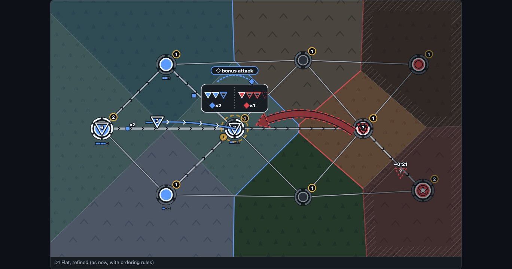 | 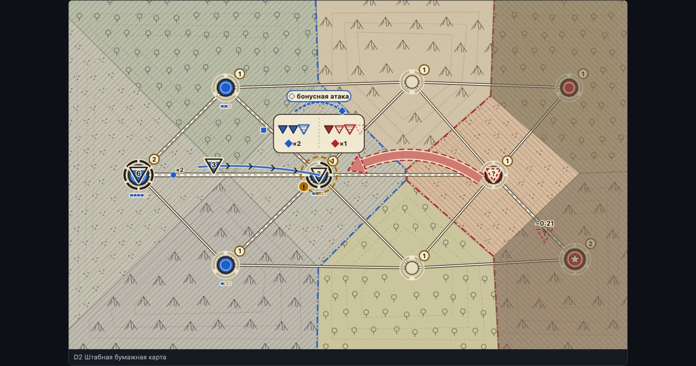 | 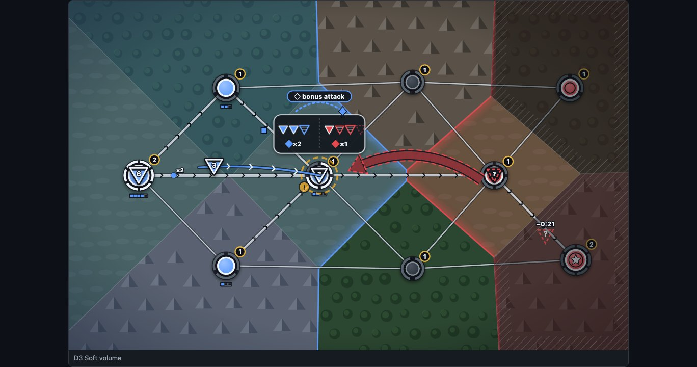 |

D2 in grayscale (the owner is distinguishable by the hatching angle and the dashed border, not by color): 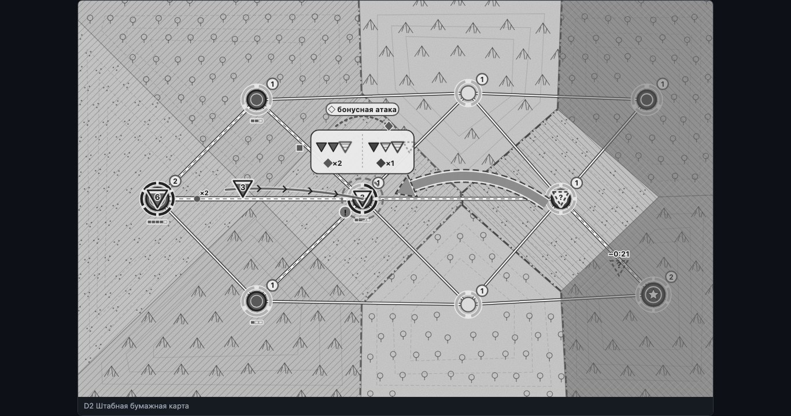

### 24.1 How each direction answers the problems of section 3.2

| Problem | D1 | D2 | D3 |
|---|---|---|---|
| R1 overlaps | the ribbon ends at the city ring, one backing under the icons | the same rule, the backing is paper | the same, shadows add depth but do not remove the overlap |
| R3 territory | angled hatching as a second sign + a denser fill | angled hatching and paper instead of a fill: the owner is visible without color | a border glow instead of a fill: more noticeable, but again by color |
| R4 neutral cities | lighter than the background | light paper, an ink outline | a volumetric gray disk with a highlight |
| R5 small signs | 12 px, a stroke | ink numbers on a light background: they read better | a number on a volumetric plate |
| R7 fog | a stripe in screen pixels | a gray "unexplored paper" + hatching of the stripe | darkening + a soft edge |
| "Recognizability" | as now, tidier | strong, unusual for the genre | a familiar "casual" look |

### 24.2 Table of variants

| | D1 Flat, polished | D2 Staff paper map | D3 Soft volume |
|---|---|---|---|
| Idea | the same flat dark language, strict ordering rules (section 24.5) | a light map: paper, contour lines, territory hatching, roads as on a map, borders in pencil | a dark map with volume: gradients, soft shadows, border glow, highlights on roads |
| DEC / protocol / simulation | no / no / no | no / no / no | no / no / no |
| In PixiJS | the constants of `style.ts`, stamps sparser, the ribbon end at the ring, a backing under the icons; `Graphics` as now | two token themes (`style.ts` becomes a theme), dark ink instead of the white outline, territory hatching with `TilingSprite`; the HUD stays dark | city and unit icons into sprites with a baked shadow (`generateTexture`), a border glow layer with `BlurFilter` and a cache (`cacheAsTexture`), a road highlight |
| Baking the backgrounds (`maps:bake`) | the biome palette is quieter (a small edit) | **a new baker**: paper with grain, contours from the height field (marching squares), stamps instead of biome color | relief shading (hillshade), soft biome transitions; the file is larger |
| Libraries | none | none (optionally the `NoiseFilter` of `pixi.js` itself; better to bake the grain) | none required; `pixi-filters` 6.1.5 only for convenience (section 24.3) |
| FPS price | zero | low: the background is one texture, hatching is a tile | moderate when baking, high with filters on every object (section 24.4) |
| Risk | low; does not give a recognizable style | **high**: a light map under a dark HUD, all the "white outlines" and the selection are redone, the 3:1 contrast is recounted, new references | medium: the "softness" of small signs at 20 px, texture memory, a harder pool and selection |
| Estimate (client) | M, 2-3 tasks, 3-5 days in total | L, 5-8 days (themes 2, baker 2, signs 2, references and contrast 1-2) | L, 5-8 days (sprites and cache 3, baker 1-2, FPS check 1, references 1) |
| Grayscale | as now + hatching | the best: hatching and dashes (section 24.1) | as now, colors without a new sign |

### 24.3 Libraries: compatibility with pixi.js 8.21 (checked with `npm view` on 2026-10-21)

The project is on `pixi.js` `^8.21.0` (8.21.0 in `node_modules`; 8.22.0 is in the registry).

| Package | Version | PixiJS peer dependency | Conclusion |
|---|---|---|---|
| `pixi-filters` | 6.1.5 (updated 2025-11-29, MIT) | `pixi.js >=8.0.0-0` | **compatible** with 8.21; needed only for DropShadow, Glow, Outline; all of this is done with the built-in `BlurFilter` and textures. Work under a CSP without `unsafe-eval`: not checked (section 24.4) |
| `@pixi/particle-emitter` | 5.0.10 (2026-01-08, MIT) | `@pixi/*` `>=6.0.4 <8.0.0` | **incompatible**: only PixiJS 6 and 7 |
| `@barvynkoa/particle-emitter` | 0.0.1 (2024-05-27, MIT) | `pixi.js >=6.0.4 <9.0.0` | declares compatibility, but it is the single version 0.0.1 with no updates for two years: we do not take it without a check |
| built into `pixi.js` 8.21 | `ParticleContainer`, `Particle`, `BlurFilter`, `ColorMatrixFilter`, `DisplacementFilter`, `NoiseFilter` (present in `node_modules/pixi.js/lib`) | | **enough** for fight sparks, grain and blur without dependencies |

Conclusion: no new dependencies are needed for any of the three directions; particles (fight sparks, dust) are made, if needed, with the built-in `ParticleContainer`.

### 24.4 Measurement: the per-frame price of the techniques

What was measured: the frame draw time in `pixi.js` 8.21 with the `pixi.js/unsafe-eval` import, as in the client. The scene is not from the game but
synthetic: 40 cities (a circle with a white outline and a ring of 6 segments), 40 roads, 40 moving triangles, a window of
1280×800, software WebGL (SwiftShader, `--use-angle=swiftshader`), per frame `renderer.render` and reading one pixel
(without it the driver does not wait for the end of drawing), the median of the frames. The script is one-off and is not in the repository; to repeat it, you need
a page with an `Application`, the modes from the table and the measurement itself.

| Technique | ms per frame | relative to flat |
|---|---|---|
| Flat: cities as `Graphics` (as now) | 29.9 and 30.5 | 1.00 |
| Cities as sprites with a baked shadow (`generateTexture`) | 25.1 and 25.7 | 0.84 |
| A city shadow as a filter (`BlurFilter` on each of the 40) | 46.7 and 48.0 | 1.55 |
| Border glow: a layer with `BlurFilter` every frame | 57.3 and 59.3 | 1.9 |
| The same, the layer cached (`cacheAsTexture`) | 20.2 (one series) | 0.66 |
| Grain: `NoiseFilter` on the whole scene | 19.4 (one series) | 0.64 |
| A 1280×800 background as one texture on top of flat | 41.5 and 41.6 | 1.4 |

How to read it. Two calm series out of five were taken; in the others the machine was busy with other processes (load average 30-55), the spread
was many-fold. The absolute numbers of a software render say nothing about integrated graphics: look at the ratios. Conclusions:

1. **A filter on every object and an uncached blur layer** (+55% and +90% per frame): this must not be done.
2. **Baked textures and cached layers cost no more than flat drawing**, and caching a static layer (the territory border, stamps) even makes it cheaper.
3. A full-screen filter in this measurement costs no more than flat. This is a feature of the software render (the frame is drawn without MSAA smoothing), on a GPU the price is different: **before choosing D2 with grain** measure on integrated graphics, better to bake the grain into the background.
4. A large background texture is noticeable by itself in the software render (+40%); the game already has a baked background, so for D2 and D3 it is not an addition but a replacement.
5. The `TilingSprite` hatching for D2 does not take part in the measurement: measure the price in a prototype.

Compatibility with the CSP: under the project's policy (`script-src 'self'`, no `unsafe-eval`) the pages with a `BlurFilter` on a layer, a `NoiseFilter` and
sprites with baked shadows rendered without a single violation (one of the five runs, "a shadow as a filter on each of 40 objects", did not
fit into 120 s because of the machine load, there were no CSP violations in it). `pixi-filters` under the CSP **[NOT SURE]**: not checked, because it was not added to the
project; to check: add it in a branch, `mise run preview` and a browser console without CSP errors.

### 24.5 Rules of D1 (if chosen) **[proposed]**

1. The ribbon and the order arrows end at the edge of the city ring (radius + 20), they do not go over the icon and the alert ring.
2. Relief stamps are no closer than 40 units to the city center (now 30) and quieter at the intersection with roads; mountain stamps do not look like road chevrons.
3. Under any icon on top of the map there is one `--plate` backing and one set of outlines: city 3, unit 2.4, arena chip 1.6.
4. A neutral city is lighter than the background; the VP icon has no yellow ring (separation from the alert, R2).
5. The unit number is 12 px with a stroke; a warehouse and capacity segment is no smaller than 6 px (at map scale 1).
6. The territory owner: color, border and angled hatching (your own "/", the opponent "\"): three signs, two of which are not color.
7. Fog: the hatching stripe is in screen pixels, not in map units.
8. Every map edit: frames before and after (`mise run shots`) and one frame in grayscale.

---

## 25. Recommendation and first tasks

**Recommendation: D1 "Flat, polished" now, with one technique from D2** (the hatching direction as a second, non-color sign of the territory owner).
Grounds:

1. The problems of section 3.2 (overlaps R1, the yellow pair R2, weak territory R3, neutral cities R4, small signs R5, fog R7) are
   unfinished ordering and contrast, not a lack of style; D1 closes them without changing the map language, which the owner has already worn in during rounds 2-4.
2. Before the closed playtest (REL-01, #88) the readability of the fight (V3, #330) and of the screens outside the match (package E) matters more than a new look: D2 and D3 cost
   5-8 days each and take this time.
3. D2 and D3 carry a real risk (section 24): a light map flips the "white outline" rule and the HUD contrast, soft volume runs into
   FPS on integrated graphics. D2 makes sense if the owner wants a recognizable style: then it is worth doing as a separate theme branch when
   D1 and V3 are already delivered, and first as a prototype on one map (baking paper and contours, 1-2 days).

**The first tasks after choosing D1** (by issues, each a separate PR, client, no DEC, protocol or simulation):

1. **D1-a. Order and contrast** (S-M, 1-2 days): the order ribbon ends at the edge of the city ring (R1); the VP icon has no yellow ring (R2);
   neutral cities are lighter than the background (R4); the unit number is 12 px (R5); the mark of the opponent's side on the ribbon tail is a double ring instead of
   a diamond (section 21). `visual` references and the before and after frames in the PR.
2. **D1-b. Territory without color** (S-M, 1-2 days): the owner hatching in a `TilingSprite` (your own "/", the opponent "\"), the fill is leveled by
   the background brightness; a grayscale check on the live maps `artery` and `web`.
3. **D1-c. Background and fog** (S, up to 1 day): stamps sparser and quieter near cities (R8), the fog stripe width in screen pixels (R7), the biome palette of
   `maps:bake` quieter (the background does not compete with the territory); `maps:bake` and updating the references.

Regardless of the choice: the V3 arena (#330, after #329) and the screens outside the match (package E, K6-K11) go in their own order; D1-a..c do not intersect with them
by files, except `fightView.ts` (not touched).

If the owner chooses D2 or D3: the first task will be **a prototype on one map** (baking the background and a token theme, an FPS measurement on
`demo`/`artery`), not a full implementation; the decision to continue is made by the frames and the measurement.

---

## 26. Map style, round 2: object volume, textures, fog, roads (#335)

**Status: four blocks [accepted] 2026-10-21 (section 26.3).** Issue #335 is closed; implementation: #344 (the T2 baker and WebP, a scene on a real map), #345 (roads R1, the packet), #346 (fog F1, layers LY2), #347 (BL1 shading and border highlighting).

**The owner's decision on #332, 2026-10-21 (partial) [accepted].** He liked D3 "Soft volume" for the shading part (gradients, soft shadows, border glow, highlights), the textures in general look better; **no semi-3D landscape**: no hillshade and no "lit hills", the relief stays flat in presentation. The final choice of the direction on #332 (D1, D2, D3 or "change nothing") stays with the owner; the statuses of sections 24 and 25 are not changed by this section.

Mockup: [`mockups/map-style-2.html`](mockups/map-style-2.html): a scene on a **fragment of the real map `arteriya`** (now `artery`, #390) (nodes 3-16: your own cities and groups, a fight with the DEC-32 arena, a group's order, the opponent's scheduled order, the territory border, fog with a ghost, roads of levels 1-3, construction on an edge, packets). Four independent blocks with switches, "all variants of a block side by side", grayscale, "reduced motion", scale 60% / 100% / 200%, a strip of signs 1:1 on three backgrounds, a road matrix, biome samples; a frame by address, for example `map-style-2.html#sh=1&tx=2&fg=2&rd=1&gray=1`. The textures are drawn by the script [`mockups/src/map_textures.py`](mockups/src/map_textures.py) (numpy and Pillow, deterministic, the biome field of the current baker; run `uv run python docs/design/mockups/src/map_textures.py` from the root).

| BL1 Shading (now, restrained, pronounced) | BL2 Textures (now, T1, T2, T3) |
|---|---|
| 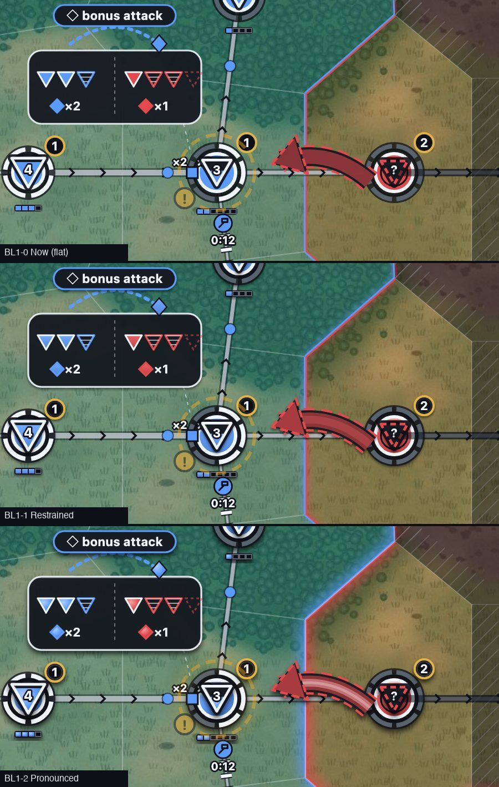 | 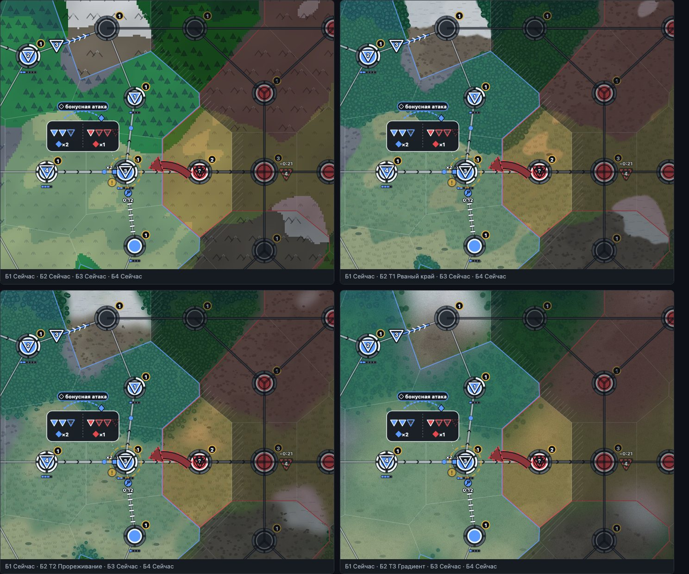 |

| BL3 Fog (now, F1, F2, F3) | BL4 Roads (a matrix of levels and states) |
|---|---|
| 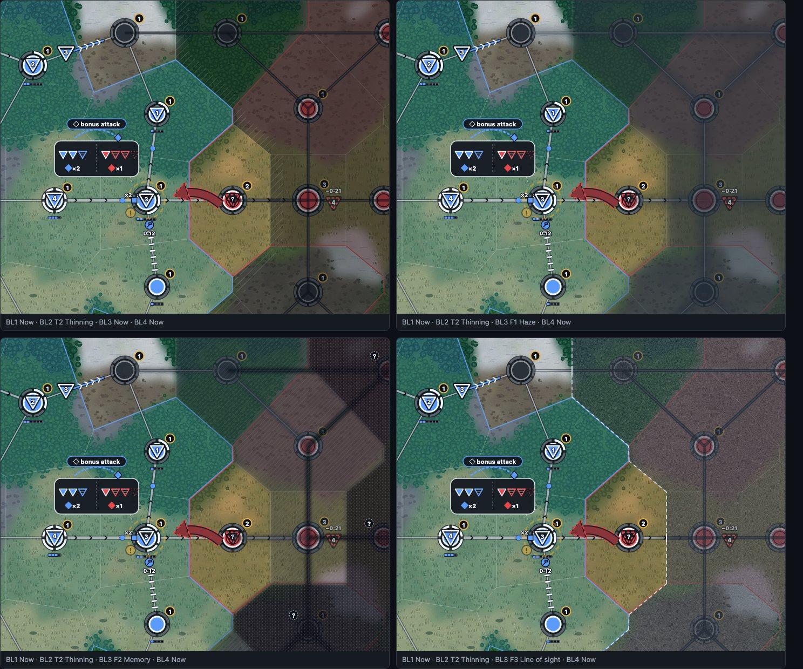 | 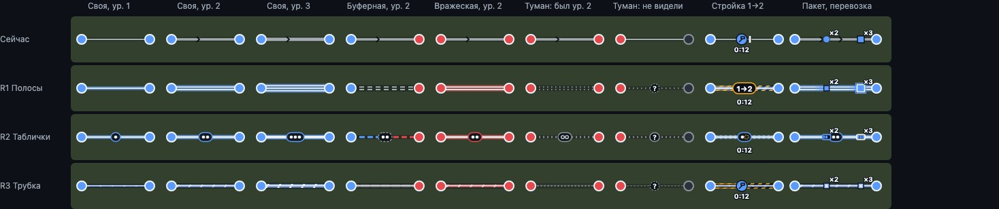 |

### 26.1 Table of variants

The FPS prices are taken from the measurement of section 24.4 (software WebGL, ratios to flat drawing: sprites with a baked shadow 0.84; a glow layer every frame 1.9, with a cache 0.66; a full-screen `NoiseFilter` 0.64); "about" means an estimate from these measurements, not a new measurement. The mockup is drawn in SVG, the PixiJS techniques are checked against the contents of `pixi.js` 8.21 (24.3), not with a prototype. There are no new packages in any variant. All the fog variants (BL3) use only `detail`, `seen`, `width` and public ownership: nothing beyond section 10 of `mechanics.md`.

| Block and variant | What changes (PixiJS, baking) | FPS price | Risk | Estimate | DEC, protocol |
|---|---|---|---|---|---|
| **BL1-1 Restrained** | sprites from `generateTexture` with a gradient and a 1.5 px shadow for cities, triangles, icons, arena chips; the border: a `BlurFilter` 3 px layer + `cacheAsTexture`; baking does not change | about 0.8-1.0 | low-medium; after #330 (a shared file `fightView.ts`) | M, 3-4 days | no, no |
| **BL1-2 Pronounced** | the same, a radial gradient, a highlight, a 3 px shadow, a 5.5 px glow | about 0.9-1.1, more texture memory | medium: the highlight makes a neutral city a "button", the shadow thickens the outline on snow | L, 5-6 days | no, no |
| **BL2-1 T1 Ragged edge** | the background is one texture, the `TerrainView` stamps (about 1300 sprites) are turned off; **a new baker**: a noise mask, detail sprites | not higher than the current one | low-medium: background formats, trees at the edge stick together | M-L, 3-5 days | no, no |
| **BL2-2 T2 Thinning** | the same, plus a narrow color stripe and a detail density field (they thin out and shrink toward the edge) | the same | low-medium | M-L, 3-5 days | no, no |
| **BL2-3 T3 Gradient** | the same, a wide blend, pale details, grain in the background | the same | medium: the borders are "soapy" at a large scale | M, 2-3 days | no, no |
| **BL3-1 Haze** | a 66% veil with a soft edge: polygons, `BlurFilter` 9 px, `cacheAsTexture`, recomputed when the set of cells changes; `fogView.ts` | about 0.66 with a cache (1.9 without) | low; in grayscale the border only by brightness | S, 1 day | no, no |
| **BL3-2 Memory** | three states: visible, "seen" (the veil darkens with the age of `seen.tick`, hatching), "never" (a dark veil, dots, "?"); `TilingSprite` patterns, cached layers | about 0.7-0.9 | low-medium: more states, a hint is needed | M, 2-3 days | no, no (`NodeView.seen`, `EdgeView.seen` already exist) |
| **BL3-3 Line of sight** | a grainy veil, a dashed border, a tick on the road at the border point, gradient roads | about 0.8-1.0 | medium: small signs compete with BL4 | M, 3 days | the middle of the edge: no, no; the border by the DEC-21 halves: **needs protocol/DEC-21 in PlayerView** (#233, #329), is not proposed as the main one |
| **BL4-1 Lanes** | level = the number of lanes, your own road with an owner backing, a buffer one dashed, fog with dots, "?" for a never seen one, a construction ribbon with a "1→2" plate, a square packet; `mapView.ts`, `layout.ts`, `entityView.ts` | about 1.0 | low; at 60% the lanes stick together | M, 2-3 days | no, no |
| **BL4-2 Plates** | a line and a plate with 1-3 dots on the edge, a buffer one split at the border point by the colors of its ends, wagons | about 1.0-1.05 | medium: about 44 more small signs | M, 3 days | no, no |
| **BL4-3 Tube** | a tube with a gradient and a highlight, an owner glow, running lights (number = level), a `TilingSprite` with scrolling | moderate, measure in a prototype | medium-high: animation, the "reduced motion" mode is mandatory | L, 4-6 days | no, no |

**The baker (BL2).** The rule of section 22 ("the baker on the standard library, PNG through zlib") is either kept (pure Python, a PNG of 2.2-2.6 MB per map against 0.12 MB now; 3-octave noise on 1600×1000 in pure Python 0.6 s, blur and sprites were not measured), or lifted for numpy and Pillow (they are already in `uv.lock` through matplotlib, declare them in `tools/maps/pyproject.toml`; WebP 0.27-0.29 MB, JPEG 0.30-0.35 MB, 2-3 s per map; `.bg.png` → `.bg.webp` changes the path on the server and in the client). The sizes of the whole-map background 1600×1000 (PNG / JPEG / WebP): T1 2.2 MB / 334 KB / 266 KB; T2 2.5 MB / 345 KB / 280 KB; T3 2.4 MB / 298 KB / 287 KB.

**The supply packet (BL4).** By the language of icons (section 21) a charge is a square, and the packet was round: the decision is independent of the choice of roads; the square was done in #345.

### 26.2 Recommendation

1. **BL1-1 Restrained.** It gives the depth of D3 at a minimal price for small signs (a 1:1 strip in the mockup: the number and the outline read on forest, plains and snow).
2. **BL2-2 T2 Thinning, the baker on numpy and Pillow.** The most "natural" transition without blur, the objects on top read, the file is 8 times smaller than the PNG. A fallback: keep the textures, a quieter palette (D1-c from section 25).
3. **BL3-2 Memory against the unknown.** The only variant that carries information (how outdated the knowledge is, where we have not been at all) on the data that is already in `PlayerView`; a fallback: BL3-1 (a day of work).
4. **BL4-1 Lanes** and the square packet. The level reads without color, your own road differs from a buffer one, the fog memory is visible; no animation.

In total about 10-15 days of client work, four separate PRs (after #330 and #329), no DEC, protocol or simulation; outside the client only the baker (BL2).

### 26.3 The owner's decision

**[accepted] 2026-10-21** (the owner, by the mockup `mockups/map-style-2.html`; the decision field: issue #335).

- BL1 Shading: **BL1-1 "Restrained", but the territory border highlighting as in "Pronounced"** (a border glow of 5.5 px and brighter, the rest as in "restrained").
- BL2 Textures: **T2 "Thinning"**; the baker: **(b) numpy and Pillow, the WebP format** (declare `numpy` and `Pillow` in `tools/maps/pyproject.toml`, lift the rule of section 22 about the standard library, `.bg.png` → `.bg.webp`).
- BL3 Fog: **BL3-1 "Haze"** (F1; not the recommended BL3-2, the owner's decision).
- BL4 Roads: **BL4-1 "Lanes"** (R1); the supply packet: **a square**.

The implementation issues were opened after the choice per section 27: #344, #345, #346, #347 (order and parallelism: the description of each issue and tracking #282, section 11). BL1-1 in the description of #335 included "an order ribbon as a tube of two layers"; the decision on #339 "the look of the arrow and ribbons as now" is later and more specific, so the ribbons do not change.

**Implemented (#347, PR #409).** Cities (body with the capital star, capacity ring, warehouse bar, VP badge, barracks mark), group triangles (U1: plate, charge fill, outline with its rim, shield), the shield badge of an intent and the plate and chips of the arena are baked sprites (`apps/client/src/render/bake.ts`, `bakedShapes.ts`): the fill gradient is +16% to white at the top and -14% to black at the bottom, the shadow 1.5 px down (stacked outlines, no blur filter), a light rim at the top of an owned object (not on a neutral city). The recruit queue and the build bar stay vectors (their progress changes every snapshot). The territory glow is a `BlurFilter` layer inside one `cacheAsTexture` container, clipped to the owner's cells, rebuilt only when an owner changes; its parameters follow the "pronounced" ones (a line at 0.85); the numbers were matched to the mockup frame by eye, not copied: the line is 12 wide (mockup 10) and the PixiJS blur strength 4.5, because strength 5.5 gave a visibly weaker glow than the mockup's SVG blur of 5.5. The order ribbons are as before. In grayscale the glow of the two sides is equally light, so the border reads but the owner of the area does not by the glow alone (cities and tokens carry it, as before); an area pattern is R3 and is not done here.

---

## 27. Orders, the fight on the map and the arena in the chosen map style (#339)

**Status: [accepted] 2026-10-21 (section 27.3, shots: 29.4).** Issue #339 is closed; implementation: #330 (arena AR1), #346 (layers LY2), #351 (FX3), #352 (SH1), #353 (IN3, the bonus on the head), #354 (EF2). A continuation of #335: the map style is chosen (section 26.3), the current order ribbons next to it "do not look very good" (the owner, 2026-10-21).

Mockup: [`mockups/orders-style.html`](mockups/orders-style.html): self-contained, opens from a file, no network; **the same map `arteriya` (now `artery`, #390) and the chosen style** (restrained shading with the border highlighting of "pronounced", T2, haze F1, lanes R1, a square packet). Six scenes, each with axes with variant switches (**3-4 variants per element plus the current look**, section 23), "side by side" shows all the variants of an axis, scenarios, a clock with a time slider (play, pause, speed), grayscale, "reduced motion", scale 60% / 100% / 200%, a frame by address (`orders-style.html#s=plan&rib=4&side=3&p=1&t=2.6`). The fight engine in the mockup plays the DEC-24 and DEC-32 rules round by round and is checked against the table of examples of `mechanics.md` on the page (scene 6).

| Ordinary orders (scene 1) | Scheduled orders (scene 2) |
|---|---|
| 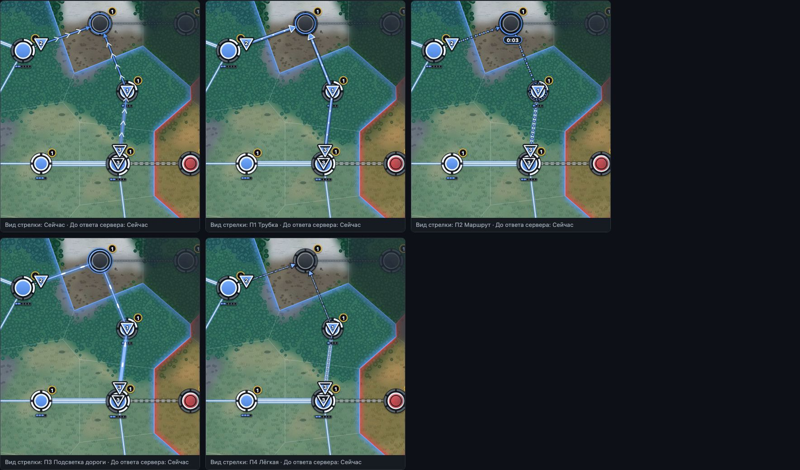 | 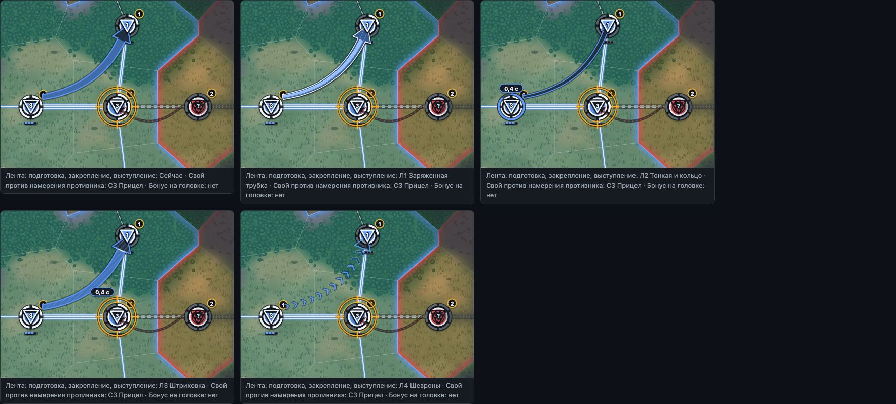 |

| The fight on the map (scene 4) | An enemy in the vision zone (scene 5) |
|---|---|
| 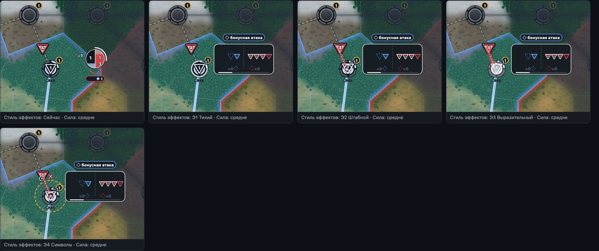 | 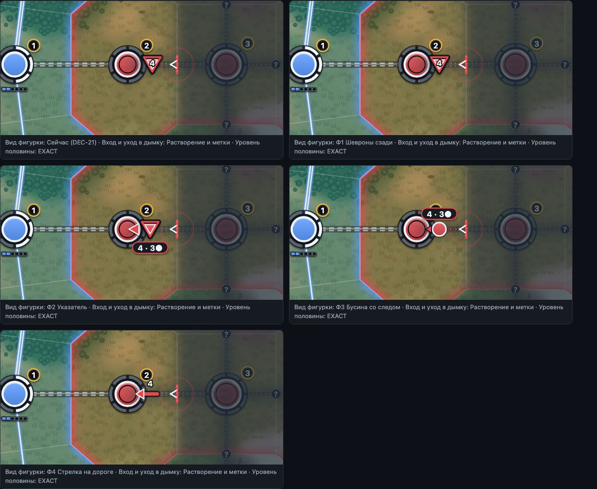 |

| The V3 arena and more than 8 units (scene 6) |
|---|
| 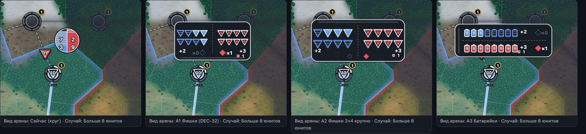 |

### 27.1 Scenes, axes and recommendations

FPS prices: an estimate from the number of PixiJS objects per frame and the measurement of section 24.4 (the ratio to flat drawing), not a new measurement; before implementing each block a prototype with a measurement on integrated graphics is needed. Particles only with the built-in `ParticleContainer`. "Needs protocol" is marked on the variants that need new data.

| Scene and axis | Variants | Recommendation | Estimate | DEC, protocol |
|---|---|---|---|---|
| 1 An ordinary order: the look of the arrow (your own path through several nodes and an adjacent node, movement, cancel) | Now, OR1 Tube, OR2 Route (dots, rings on nodes, the arrival time from `ack.arrive_tick`), OR3 Road highlight, OR4 Light | OR2 | S-M, 1-2 days | no, no |
| 1 The ghost before the `ack`, a rejection | Now (nothing), GH1 Dashes, GH2 Dispatch ring, GH3 Target marked | GH3 or GH2 (GH1 draws a straight line that may not exist: the client does not know the path before the `ack`) | S, 0.5 day | no, no |
| 2 Scheduled: preparation 3 s, pinning (one pulse, a strengthened outline), departure | Now, SC1 Charged tube, SC2 Thin ribbon and a countdown ring, SC3 Hatching, SC4 Chevrons (the delay lights the chevrons one by one) | SC4 | M, 2-3 days | no, no |
| 2 Your own against the opponent's intent (the size and composition are not visible) | Now, IN1 Size sign ("?" for the opponent), IN2 Two tiers, IN3 Crosshair (a thin arrow, a crosshair ring on the target) | IN3 | S, 1 day | no, no |
| 2 The bonus on the head | no, yes ("◇ +N") | no (after the decision about the protocol) | S | **needs protocol**: a bonus field in `OrderView` (DEC-29 computes the cap on the server at the departure tick) |
| 3 Counter and crossing ribbons | Now, CR1 Lanes along the road, CR2 Low arcs, CR3 Single stripe | CR2 | S, 0.5 day | no, no |
| 3 A ribbon over the R1 road, borders and in the F1 haze | Now, LY1 Glass, LY2 Over the haze, LY3 Gap, LY4 Hollow in the haze | LY4 (fallback LY2) | M, 1.5-2 days | no, no |
| 4 The fight on the map: the style and strength of effects (closing in, 2 s rounds, bonus shots with the caption "bonus attack" per A1, death, bounce, capture, a fight on an edge at the meeting point, three fights at once) | Now, FX1 Quiet, FX2 Staff, FX3 Expressive (particles), FX4 Symbols; strength: weaker, medium, stronger | FX2, strength "medium"; FX3 as the second step after a measurement | M, 2 days (FX3: 3 days) | no, no (data: `FightView`, `fight_round`) |
| 5 An enemy group in the vision zone (DEC-33): the look of the figure, entering and leaving the haze, the half level | Now (a mark in the middle of the half), EF1 Chevrons behind, EF2 Pointer, EF3 Bead with a trail, EF4 Arrow on the road; entering and leaving: Hard, From under the haze, Dissolve, Dissolve and marks | EF1 and "Dissolve and marks" | M, 2-3 days after the protocol | DEC-33 is accepted; **needs protocol** (`EdgeView.enemy_groups`, #296) |
| 6 The V3 arena (DEC-32) | Now (a circle), AR1 Chips (as in DEC-32), AR2 Chips 2×4 large, AR3 Batteries | AR2 (or AR1 in screen pixels) | M, 2-3 days (#330) | DEC-32 is accepted; protocol: the ◇ stock (#329) and a field of silent charges (27.2) |

In total the recommended set: the client about 13-17 days, 5-6 separate PRs after #330 and #329; no new dependencies.

### 27.2 Checking the V3 arena chips against DEC-24 and DEC-32 (conclusions for #330)

The check was done on the mockup page (scene 6): the engine, whose rules are taken from `mechanics.md`, reproduces the rows of the DEC-24 table (examples 2, 3, 6, 8, 9, 15: the number of rounds and the outcome) without discrepancies, then the chips are built from the player view fields (`units + losses`, `charged`, `losses`, the ◇ stock) and compared with the engine state after every round.

1. **Up to 8 units on each side the chips are correct**: the number of chips = `units + losses`, charged = `charged`, killed = `losses`; at every step of all the checked fights it matched the engine (rounds 1-4, including bonus shots and mountains).
2. **A silent charge on plains is shown wrongly** (DEC-24, item F2: a defender on plains has one charged unit that does not shoot in every round): the chip is drawn charged, but the side does not shoot, the viewer waits for a shot. The view field does not give this (`enemy_charged` is all the charges). **A "silent charges" field is needed for each side in `PlayerView.fights`** (protocol, better in #329, while `PROTOCOL_VERSION` is raised once) and a sign on such a chip (in the mockup: an amber crossed circle).
3. **"+N" with more than 8 loses the state of the hidden chips.** The order "charged, discharged, killed" shows the first eight: a row of eight charged and "+3" reads as "11 charged", though the hidden ones may be discharged. A proposal: next to "+N" a small number of how many hidden ones are charged (in the mockup: a dot and a number under "+N").
4. **Reinforcement** (DEC-24, item D) increases `units`, the number of chips grows (count `units + losses`, not the initial composition); new chips appear with a pulse.
5. **What changes in a round.** One shot per side per round (`shots_per_round = 1`): one charged chip of the side goes out, and one discharged one is killed (a charged one, only if there are no discharged ones). 1-2 chips per side should pulse, not all; which exactly cannot be learned from the view, this is a visual convention (the last charged one goes out, the last discharged one dies).
6. **The ◇ stock** is visible from contact (DEC-32, item 3): +1 for the defender in the mountains, the accumulated "Defense" and the plan bonus of the joining group; it grows on the tick when a reinforcement with a bonus joins. The caption "bonus attack" only in a round where `last_round.virtual > 0`.
7. **Size.** A chip of 15 units (AR1) is smaller than a meaningful symbol of 20 px (section 22) and at 60% smaller than 10 px; AR2 (19 units) meets the rule at 100%. The arena is worth drawing in **screen pixels** (the size neither grows nor falls with the map scale), like a plate.

### 27.3 The owner's decision

**The choice was received on 2026-10-21** (frame: `orders-style.html#s=arena&side=3&bonus=1&lay=2&scn_cross=layer&fx=3&k=1&scn_fight=three&mv=2&rev=3&scn_enemy=out&arena=1&case=2&act=arena`; recorded in the decision field of issue #339):

- [x] An ordinary order: the look of the arrow **as now**; before the server's answer **as now**
- [x] Scheduled: the ribbon of preparation, pinning, departure **as now**; your own against the opponent's intent **IN3 "Crosshair"**; the bonus on the head **yes** (the protocol is added in #329: a forecast of the plan bonus in the `OrderView` of your own group)
- [x] Counter and crossings: how the ribbons are separated **as now**; layers **LY2 "Over the haze"**
- [x] The fight on the map: the effect style **FX3 "Expressive"**; strength **"Stronger"** (a choice by shots of 2026-10-21, section 29.4, replaces the former "medium"); shots **SH1 "Tracers"** (29.4)
- [x] An enemy group in the vision zone: **EF2 "Pointer"**; entering and leaving **"Dissolve and marks"**
- [x] The V3 arena: **AR1 "Chips"**
- The switches "Half level" and "Case" in the mockup were a preview, not a choice: the half level is set by the DEC-21 terrain table.

---

## 28. Map objects and menu icons: units, cities, barracks and "Defense" (#337)

**Status: [accepted] 2026-10-21 (section 28.1).** Issue #337 is closed; implementation: #347 (U1 as part of BL1), #348 (cities C1; the row of squares U4 was split off into #433), #349 (icons B1), #350 (menu icons I1). B2 "Building and rampart" is postponed, no issue is opened.

Basis: the owner's choice on #335 (recorded by issue #335): BL1 shading "Restrained" with the border highlighting as in "Pronounced", texture T2, fog F1 "Haze", roads R1 "Lanes". Mockup [`mockups/objects-style.html`](mockups/objects-style.html): the same scene (a fragment of `arteriya`, now `artery`, nodes 0-16, nodes 12 and 13 are shown as provinces) in this style and four blocks of 4 variants each plus "Now". What a variant shows the player is taken only from the fog rules of `mechanics.md` (DEC-04, DEC-21, DEC-26, DEC-30, DEC-31); no variant needs new data, a protocol or a DEC. The mockup background texture is drawn by the script [`mockups/src/objects_texture.py`](mockups/src/objects_texture.py) (functions of `map_textures.py`). Modes: grayscale, "reduced motion", map scale 60% / 100% / 150%, "all variants side by side", samples on four backgrounds; a frame by address, for example `objects-style.html#u=2&c=1&b=1&i=1&sc=60&gray=1`. The samples of each block are shown at 100% and 60%: meaningful signs keep the minimum size on screen (a group 20 px as now, the barracks and "Defense" icons in the new variants 16 px, like `symbolScale` of groups).

| Block | Variants | Recommendation | Estimate |
|---|---|---|---|
| 1 Units | Now ▽, U1 ▽ in the BL1 style, U2 Batteries, U3 Banner, U4 Token | U1 as the basis; the row of charge squares from U4 as a separate decision | S-M, 1-4 days |
| 2 Cities | Now, C1 A BL1 circle (warehouse places by level, a province as a hollow ring), C2 Tower, C3 Card, C4 Wheel | C1 | S-M, 1-4 days |
| 3 Barracks and "Defense" | Now, B1 Icons, B2 Building and rampart, B3 Barriers, B4 Status line | B1 | S-M, 1-3 days |
| 4 Menu icons | Now (font symbols), I1 Line, I2 Disks, I3 Squares, I4 Two-tone | I1 | S, 1 day |

| Units (100%, samples) | Cities (samples) |
|---|---|
| 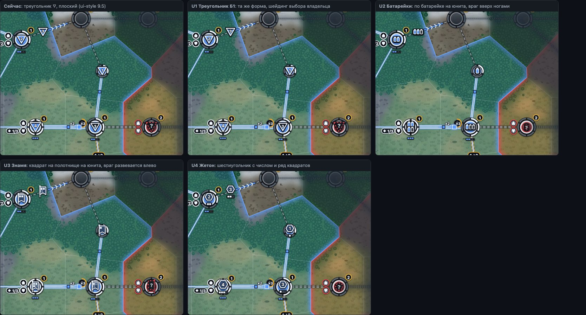 | 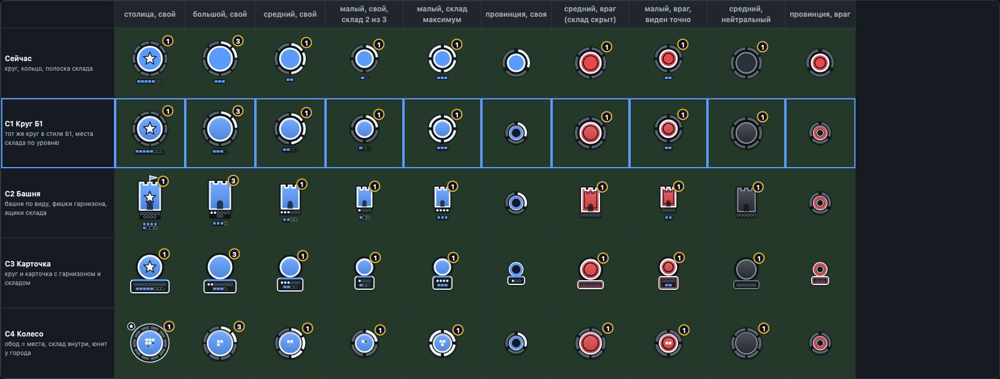 |

| Barracks and "Defense" (samples) | Icons and menu |
|---|---|
| 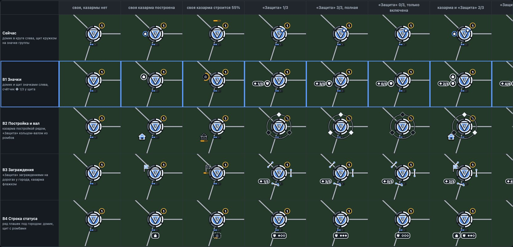 | 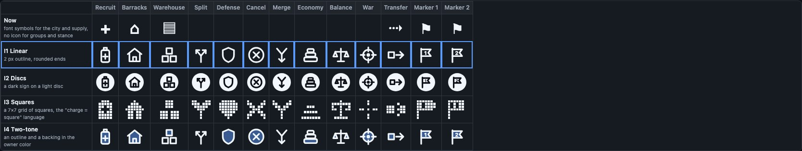 |

FPS prices: estimates from the measurement of section 24.4 (the ratio to flat drawing); the HUD menu icons do not affect the map FPS. A detailed table for each variant (what changes in PixiJS and Svelte, risk, days) is in issue #337 and on the mockup page.

### 28.1 The owner's decision

**The choice was received on 2026-10-21** (the owner accepted all the recommendations; the decision field: issue #337).

- [x] Units: **U1** as the basis; the row of charge squares from U4 on top of U1: **yes** (a square per charge: filled = charged, empty = discharged; "+N" for long rows, as with arena chips)
- [x] Cities: **C1** (including the hollow province ring and the dotted warehouse places)
- [x] Barracks and "Defense": **B1 "Icons"** (B2 "Building and rampart" a possible later step, **postponed**)
- [x] Menu icons: **I1 "Line"**

---

## 29. Shots in the fight on the map: animation variants (#339)

**Status: [accepted] 2026-10-21 (section 29.4).** Issue #339 is closed; implementation: #351 (FX3, the common part), #352 (SH1). Basis: the owner's choice of 2026-10-21 on scene 4 (section 27.3): the FX3 "Expressive" effects, strength medium, arena AR1; the owner wants the shots themselves to look better and "not so banal".

Mockup: [`mockups/fight-shots.html`](mockups/fight-shots.html): self-contained, opens from a file, no network; the same fight scene and the same map style as in `orders-style.html` (BL1 with border highlighting, T2, F1, R1, arena AR1), the fight engine is the same (the DEC-24 and DEC-32 rules round by round, checked against the table on the page). Six rows of the "Shot" switch: the current FX3 and five new ones. Switches: strength (weaker, medium, stronger), one fight or three at once, five fight scenarios (forest: a bonus against a real one, cancellation, bounce; forest: the bonus kills, capture; plains: the defender's silent charge; mountains: the defender's bonus; edge: the meeting point), the distance between groups (in FX3 they stood 46 units apart, shots need more: 110 by default), slow motion ×0.25 for analysis, grayscale, scale 60% / 100% / 200%, "all side by side", the AR1 arena on and off, a time slider and "scenario rounds" buttons (a frame 0.5 s before the round tick). "Reduced motion" is not needed for the fight animation (the owner), it is absent from the mockup. A frame by address, for example `fight-shots.html#v=5&s=hold&p=1&t=5.42`.

| Cancellation (frame 5.42 s, all variants side by side) | Kill (9.82 s) |
|---|---|
| 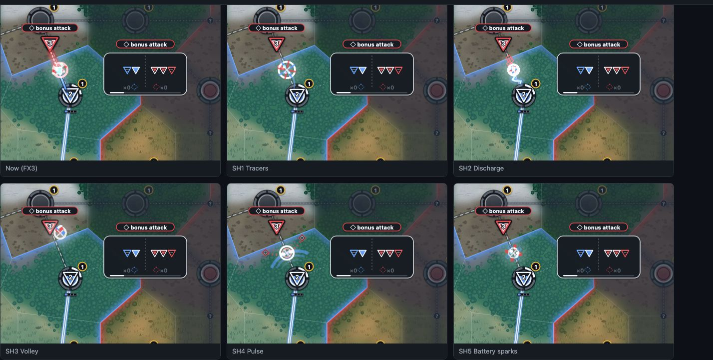 | 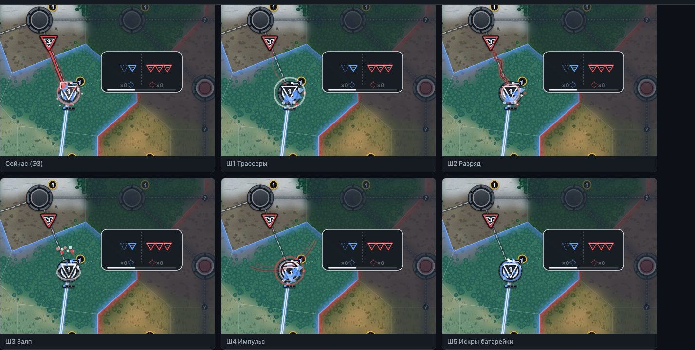 |

| Three fights at once, SH5 | Grayscale, cancellation |
|---|---|
| 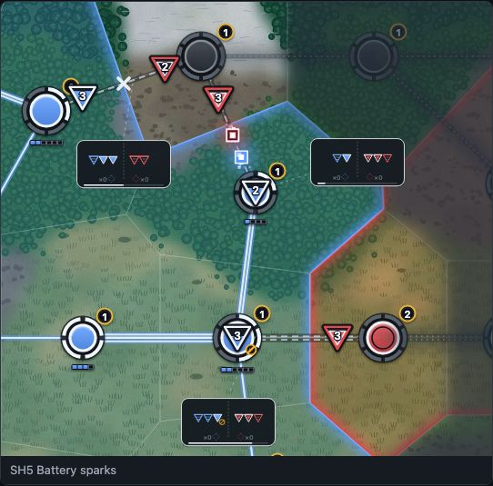 | 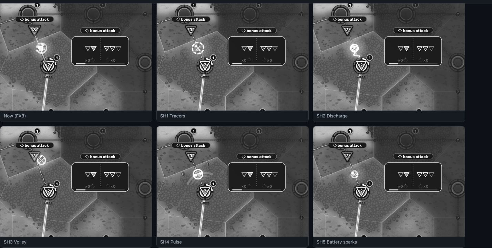 |

### 29.1 What every variant must distinguish (by the round rules)

The same in all variants (this set is also what is checked in grayscale; a shape, not only color, AGENTS.md, 7.4):

| State | Sign |
|---|---|
| a real shot | a solid square ■ in the side's color (a charge, section 21), spends a charge |
| a bonus (virtual) shot | a hollow diamond ◇, a thinner and paler body, a plate "◇ bonus attack" at the shooter (and in the AR1 arena) |
| cancellation (a shot against a shot) | both shots meet in the middle (equal speed, after 0.3 s instead of 0.6 s), a collision, a cross of two small strokes; nobody is hit |
| killing a unit | the shot arrives, ▽ fragments in the loser's color, "−N" |
| a silent charge (DEC-24, item F2: plains) | an amber sign on the group, a dim dashed ring for a round tick, no projectile, no flash; the caption "silent" in the first round |
| bounce, capture | as in FX3: a dashed arrow back, a wave and a flag |
| side | color and shape: the opponent has a double outline on the shot head and a dark core of the body |

Time: a round is 2 s (DEC-32); a wind-up of 0.35 s before the tick, the flight of a killing shot 0.6 s, fading and fragments up to 1.0 s after the hit, "−N" 1.0 s; everything ends at 1.6 s, the wind-up of the next round from 1.65 s (checked on the page). The data is the same as for the arena: `last_round` (shots, bonus ones, losses) and the field of silent ones (section 27.2); the client does not compute the outcome, it shows the fields.

### 29.2 Table of variants

The frame price: **a calculation of the page, not a measurement.** A dry run of the "three fights" scene counts what the same frame would put on the PixiJS side (a Graphics primitive 1, a sprite from a pool 0.5, text 2, a `ParticleContainer` particle 0.05), and ties it to FX3 from #339 (the worst frame 1.10-1.25, taken 1.18; the average about 1.03). Common to all: an effects layer, pools, one particle atlas and two `ParticleContainer`s for all fights (an ordinary one and an additive one; the blend mode is set by the container), four baked head textures (a square and a diamond, your own and the opponent's), glows as sprites with a baked gradient, no filters; about 1.5 days for everything common, it is included in the estimate of FX3. Whether anything else is needed: no DEC, no protocol (except the silent-ones field, already in the list of #329), no simulation.

| Variant | What changes in PixiJS | Frame price, three fights (calculation) | Risk | Estimate |
|---|---|---|---|---|
| Now (FX3) | a straight tracer with an outline and a glow, a ring, a flash, sparks, small square fragments | worst 1.18, average 1.03 (Graphics 18, sprites 5, particles 11) | looks like one more line; cancellation does not differ from a hit | chosen, 3 days |
| SH1 Tracers | a Bezier curve, a tail as a tapering polygon with a gradient, a head sprite, sparks; counter shots bend to different sides and meet; a bonus one: an empty tail and echo diamonds | 1.17 / 1.03 (17, 4, 16) | low; the most familiar look; the gradient fill of a polygon in Pixi: `FillGradient`, check with a prototype | M, 3 days |
| SH2 Discharge | lightning: a polyline of 9 points with a grain per shot (the shape does not jitter, WCAG 2.3.1), three stroke passes, branches; a bonus one: a chain of hollow diamonds and a dash; counter ones converge into a "knot" | 1.27 / 1.04 (30, 6, 8) | medium: the most expensive and the brightest with three fights, hides the token at the hit place | M-L, 3-4 days |
| SH3 Volley | a ballistic arc, a shadow sprite on the ground, an aiming dashed arc; a collision in the air, fragments fall; a scorch mark | 1.15 / 1.03 (11, 8, 24) | medium: the upward arc goes onto neighboring nodes, worse at 60%; "artillery" against the battery theme | M-L, 4 days |
| SH4 Pulse | a fan of three arcs (`Graphics`), interference rings on cancellation, a push of the group by 8 units on a hit | 1.18 / 1.03 (20, 1, 16) | medium: there is no "head", the square and the diamond do not read, real and bonus are held only by solid and dashed; stands out of the language of icons | M, 3 days |
| SH5 Battery sparks (**recommendation**) | a cell ■ (the same square as a charge in the warehouse) with a tail of sparks: particles of one container; wind-up: sparks are drawn to the group; cancellation: a "short circuit", the cells burst into small ones; kill: sparks upward and a dashed ghost of the lost ▽ | 1.13 / 1.02 (11, 3, 34): cheaper than FX3 | low-medium: the most particles (in one container); in grayscale the sparks drown in the glow, the difference is held by the head shape (checked) | M, 3-4 days |

### 29.3 Recommendation

**SH5 "Battery sparks":** it is the only variant that grows out of the theme of the game (a battery unit, a charge as energy), it uses the already settled language (■ charge, ◇ bonus, the row of charge squares in #337), gives a cancellation that looks like a collision ("a short circuit") and not like one more line, and by the calculation costs no more than FX3 (the weight is in particles, not in Graphics). A fallback: **SH1 "Tracers"** (the most familiar and reliable, but the most banal). **SH2 "Discharge"** is the most spectacular, but the most expensive and noisy with three fights; take it if "wow" matters most and you are ready to spend frame time. Strength "medium": FX3 from #339 is already chosen, "stronger" in SH5 adds sparks and the size of flashes.

### 29.4 The owner's decision

**The choice was received on 2026-10-21** (the owner, by the mockup `fight-shots.html`; recorded in the decision field of issue #339):

- [x] Shots: **SH1 "Tracers"** (not the recommended SH5: the owner's decision)
- [x] Strength: **"Stronger"** (a coefficient of 1.6 on the length and brightness of the trails and the number of sparks; the price of FX3 about +40%; replaces the former "medium" from 27.3)
- [x] The distance between groups in a fight on the map: **as now (46)**

**Risks recorded next to the choice:**

1. At a distance of 46 the tracer track is short, the bend is almost invisible. If the shot does not read, **lengthen the trail (the tail, the fading path), not move the groups apart**: the placement of groups stays as now.
2. A tail as a polygon with a gradient on `FillGradient` in `pixi.js` 8.21 must be **checked with a prototype** before implementation (a CSP without `unsafe-eval`, the frame price on integrated graphics).
3. "Stronger" costs about +40% to the price of FX3 ("dangerous for weak graphics"): a measurement with a prototype before the main work, a fallback knob: the strength constant (#351, #352).

Implementation: #351 (FX3: the effects infrastructure, fight events, strength), then #352 (the SH1 shots).

---

## 30. Variant id mapping (old Cyrillic to new Latin)

Since 2026-10-27 (#401) all variant ids are Latin. The rule: **the Cyrillic prefix is replaced by the Latin one, the numbers and the sub-numbers are kept**
(the table gives every prefix; for example, sub-id 2-3 of block BL2 keeps its number). The new prefixes are two letters and do not collide with the ids that were already Latin
(D1-D3 directions, K1-K14 and R1-R9 of section 3, T1-T3, F1-F3, U1-U4, C1-C4, B1-B4, I1-I4 of section 28, V1-V3 arena views, packages A-F, priorities P0-P2).

| Old (Cyrillic) | New (Latin) | What it names | Where |
| --- | --- | --- | --- |
| А1, А2, А3 | AR1, AR2, AR3 | views of the fight arena (A1 chips, A2 chips 2×4 large, A3 batteries) | section 27, `orders-style.html`, `fight-shots.html` |
| Б1, Б2, Б3, Б4 | BL1, BL2, BL3, BL4 | blocks of map style round 2: shading, textures, fog, roads | section 26, `map-style-2.html` |
| Б1-0, Б1-1, Б1-2 | BL1-0, BL1-1, BL1-2 | shading variants (now, restrained, pronounced) | section 26 |
| Б2-0, Б2-1, Б2-2, Б2-3 | BL2-0, BL2-1, BL2-2, BL2-3 | texture variants (now, T1, T2, T3) | section 26 |
| Б3-0, Б3-1, Б3-2, Б3-3 | BL3-0, BL3-1, BL3-2, BL3-3 | fog variants (now, haze, memory, line of sight) | section 26 |
| Б4-0, Б4-1, Б4-2, Б4-3 | BL4-0, BL4-1, BL4-2, BL4-3 | road variants (now, lanes, plates, tube) | section 26 |
| Г1, Г2, Г3 | GH1, GH2, GH3 | the ghost of an order before the server's `ack` (dashes, dispatch ring, target marked) | section 27 |
| К6-К11 | K6-K11 | not a new id: the Cyrillic letter К was a typo for the Latin K of section 3.1 | section 3.1 |
| Л1, Л2, Л3, Л4 | SC1, SC2, SC3, SC4 | the scheduled order ribbon (charged tube, thin ribbon and a ring, hatching, chevrons) | section 27 |
| П1, П2, П3, П4 | OR1, OR2, OR3, OR4 | the look of an ordinary order arrow (tube, route, road highlight, light) | section 27 |
| Р1, Р2, Р3 | CR1, CR2, CR3 | how counter and crossing ribbons are separated | section 27 |
| С1, С2, С3 | IN1, IN2, IN3 | own order against the opponent's intent (size sign, two tiers, crosshair) | section 27 |
| Сл1, Сл2, Сл3, Сл4 | LY1, LY2, LY3, LY4 | layers: ribbon over the road, the border and the haze (glass, over the haze, gap, hollow) | section 27 |
| У1-У20 | IM1-IM20 | the improvements of section 4 | sections 4, 13, 14, 16, 17 |
| Ф1, Ф2, Ф3, Ф4 | EF1, EF2, EF3, EF4 | the look of an enemy figure in the vision zone (DEC-33) | section 27 |
| Ш1, Ш2, Ш3, Ш4, Ш5 | SH1, SH2, SH3, SH4, SH5 | the look of shots in a fight (tracers, discharge, volley, pulse, battery sparks) | section 29 |
| Э1, Э2, Э3, Э4 | FX1, FX2, FX3, FX4 | the style of fight effects on the map (quiet, staff, expressive, symbols) | sections 9.9, 27 |

Not renamed: the ids that were already Latin and mean something else: **A1 and A2 of DEC-32** (the display of the bonus shot in `fight-arena.html`: A1 an arrow and a caption, A2 a history strip), V1-V3 (arena views), D1-D3, T1-T3, F1-F3, R1-R9, K1-K14, U1-U4, C1-C4, B1-B4, I1-I4.
In the code comments of the mockups the Latin spellings E1-E3 (for IN1-IN3, the target marker of an intent), E3 (for FX3) and A1, A3 (for AR1, AR3) were also unified to the new ids.

---

## 31. Start menu redesign (#471)

Status: **[awaiting the owner's decision]**. The owner asked for the redesign before the release on 2026-10-28 (the item "Start menu: redesign" of #252 and #282 section 2), so the postponement of section 23 does not apply to it. It supersedes the proposal of section 13.2 for the menu and the welcome screen once chosen; sections 13.3 to 13.9 stay as the default for the other screens until then.

Mockup: [`mockups/start-menu.html`](mockups/start-menu.html), frames in [`mockups/img/start-menu/`](mockups/img/start-menu/). It shows the current look (**Now**) and four variants for the same 15 states: welcome (and its error), menu for a guest, an account in calibration k/5 (DEC-34) and a rated account, the account menu, a match in progress, the queue (searching, long wait with the bot offer, opponent found, confirmed), the queue ban with the time left, a network error, and the bot, friend, lobby and replays places.

| Id | Variant | Client effort | Risk |
| --- | --- | --- | --- |
| Now | the 420 px card, four equal buttons | none | no main action, no ban time, no calibration |
| A | **Front**: the real pool map as the postcard, a text rail with one huge Play, the queue shown on the map | M, 2-3 days | low to medium |
| B | **Capital**: the menu is a small map, the capital is Play, the cities are the modes | L, 4-5 days | medium to high |
| C | **Ledger**: type and hotkeys, a list and a detail pane, no picture | S, 1-1.5 days | low (weakest first impression) |
| D | **Versus**: your triangle against an empty "?" slot, one selector, one Play, settings inline | L, 4-5 days | medium (biggest refactor) |

No variant needs a DEC, a protocol change or a server change. Optional inputs that do not depend on the choice: the rating in `GET /api/me` and a match list for the Replays row (LB-01, #78), the "How to play" screen (#72). **Recommendation: A**, with C as the fast fallback; the reasons, the list of what the implementation touches and the questions to the owner are in #471.

**Owner's decision:** awaiting the owner's decision.
