# Client visual style: research and guide (v3)

Issues: #202 (v1, PR #207), #208 (v2), #332 (v3, spike), #335 (round 2 of the map style, section 26), #337 (map objects and menu icons, section 28). Implementation: wave 3 (section 16), the owner's rounds 2-4 (sections 18, 19).

v1 answered the owner's 21 remarks after the playtest and relied on text sources.
v2 added the visual research (moodboard, section 2), the critique of the screens (section 3), proactive
improvements (section 4) and the wave 3 packages (section 16). **v3 (2026-10-21, #332)** checks the guide against what
is built: the critique of the screens against the `develop` screenshots (section 3), the statuses of the decisions (below), the summary rules of
animation (20), the icon language (21), constraints (22), the process of visual decisions (23), three directions of
the map style for the owner to choose from (24) and a recommendation (25). The document does not change the game rules: the source of
the rules is still `mechanics.md`. There is no separate file about style: we develop this document.

Mockups: [`mockups/ui-style.html`](mockups/ui-style.html) (v2, the match screen and the menu),
[`mockups/fight-arena.html`](mockups/fight-arena.html) (the fight arena, #327),
[`mockups/map-style.html`](mockups/map-style.html) (map style directions, #332),
[`mockups/map-style-2.html`](mockups/map-style-2.html) (round 2: volume, textures, fog, roads, #335),
[`mockups/objects-style.html`](mockups/objects-style.html) (units, cities, barracks and "Defense", menu icons, #337),
[`mockups/progress-style.html`](mockups/progress-style.html) (CP bar and the progress of barracks construction, warehouse upgrades and recruiting, #430: **[accepted]** 2026-10-28, section 32; the owner asked for it on 2026-10-28, after the mechanics freeze, so the postponement of section 23 does not apply to it),
[`mockups/start-menu.html`](mockups/start-menu.html) (the start menu and the pre-match screens, #471: **[awaiting the owner's decision]**, section 31; asked for before the release on 2026-10-28),
[`mockups/lobby-invite-bot.html`](mockups/lobby-invite-bot.html) (the lobby, invite and bot screens in the language of the new menu, #473: **[awaiting the owner's decision]**, section 34; planned before the release, owner, 2026-10-29),
[`mockups/tokens-cities-orders.html`](mockups/tokens-cities-orders.html) (planned orders, unit tokens, cities and provinces, #431, round 1; asked for before the release on 2026-10-28) its round 2 [`mockups/tokens-cities-orders-r2.html`](mockups/tokens-cities-orders-r2.html) and round 3 [`mockups/tokens-cities-orders-r3.html`](mockups/tokens-cities-orders-r3.html) and round 4 [`mockups/tokens-cities-orders-r4.html`](mockups/tokens-cities-orders-r4.html) (planned orders ODb **[accepted]**, units and cities stay as they are, 2026-10-29, section 33), [`mockups/provinces-defense.html`](mockups/provinces-defense.html) (provinces in the current look, the "Defense" counter and the barracks placement, #431, #349: **[awaiting the owner's decision]**, section 35),
[`mockups/menu-background.html`](mockups/menu-background.html) (the background of the start menu: animation concepts and a dedicated menu map, #474: **[awaiting the owner's decision]**, section 36; asked for before the release on 2026-10-28). All of them are
[`mockups/leaderboard-profile.html`](mockups/leaderboard-profile.html) (the leaderboard and the player profile in the language of the start menu and the lobby screens, #78: **[awaiting the owner's decision]**, section 38; a new screen, so a mockup first),
[`mockups/map-geography.html`](mockups/map-geography.html) (map geography: water cells, rivers as area borders, areas touch only along roads, #537, DEC-36: **[accepted]** 2026-10-29, W4 Painted without a dark line along water, section 39; the owner's feedback on #429, 2026-10-29),
[`mockups/supply-terrain.html`](mockups/supply-terrain.html) (nicer supply lines in the Supply view, a terrain and vision concept, rivers and lakes as visual borders, #429: **[awaiting the owner's decision]**, section 37; moved before the release by the owner, 2026-10-29),
[`mockups/map-overlays.html`](mockups/map-overlays.html) (the Supply mode panel, the travel-time marker of an order, the recruit and city-upgrade icons of the city menu, #627: **[accepted]**, section 40; the owner's review of 2026-10-30),
[`mockups/out-of-game-style.html`](mockups/out-of-game-style.html) (five complete style directions for every screen outside the match, the opening scene and an in-game carry-over, #826: **[awaiting the owner's decision]**, section 50),
self-contained: open in a browser. The screenshots of our client and the images of the mockups are in
[`mockups/img/`](mockups/img/). We do not put other people's screenshots and assets into the repository: the moodboard has
only links and our descriptions.

**Variant ids** (AR1, BL1-1, IM1, SH1 ...) are Latin. Until 2026-10-27 many of them were Cyrillic:
closed PRs, issues and comments still use the old ids; the full mapping is in section 30.

**Statuses.** **[accepted]**: the owner's decision, in force, to be changed only by his decision.
**[proposed]**: a proposal of an agent or a detail the owner did not set; in force as
the default value until he answers otherwise. **[awaiting the owner's decision]**: the variants and the
recommendation are ready, there is no choice, there is no code. **[replaced]**: struck through, with a note of what replaced it.

| Section | Status | Checked 2026-10-21 against the screenshots |
| --- | --- | --- |
| 1 Owner's decisions | [accepted] | in force |
| 5 Principles | [accepted]; item 10 refined by section 20 | in force |
| 6 Palette | [accepted] (blue is own, red is the enemy, amber is the alert); the pair `--vp`/`--warn` [proposed] to be changed (R2) | implemented, R2 not fixed |
| 9 Map | [accepted] as implemented (#222, #224, #256, #272, #325); arena 9.9 [replaced by DEC-32] | implemented |
| 10, 11, 18, 19 HUD and menus | [accepted] by the decisions of the owner's rounds 2-4 | implemented |
| 13 Screens outside the match, IM1, IM11, IM13, IM20 | [proposed], package E; new design decisions on them are **postponed** until the mechanics are done (section 23) | **not done** (K6-K11) |
| 14.1 Sound, onboarding, package F | [proposed] | not checked |
| 20-23 (animation, icons, constraints, process) | 23 [accepted] (the owner's practice of 2026-10-21), 20-22 [proposed] | new |
| 24 Style directions | [accepted] 2026-10-21: D3 for the shading, without relief (refined by section 26); #332 closed | shading **implemented: #347, PR #409** (see 26.3) |
| 26 Map style, round 2 | [accepted] 2026-10-21 (26.3): BL1-1 with the highlight of the borders of the "pronounced" one, T2 (the baker on numpy and Pillow, WebP), F1 "Haze", R1 "Stripes", the packet as a square; #335 closed | waits for implementation: #344 (the baker, T2, the `artery` scene); **implemented: BL1-1 shading with the border glow (26.3) #347, PR #409; roads R1 "Stripes" and the square packet (26.1) #345, PR #367; fog F1 "Haze" (9.8) #346, PR #368** |
| 27 Orders, fight on the map, arena | [accepted] 2026-10-21 (27.3, shots: 29.4): orders and ribbons as now, IN3 "Sight", the bonus "◇ +N" on the head, LY2 "Over the haze", FX3, EF2 "Pointer" with "Dissolve and marks", arena AR1; #339 closed | waits for implementation: #330 (arena AR1, in progress), **implemented: IN3 "Crosshair" and the bonus on the head #353 (the bonus pill came with #330); EF2 "Pointer" with "Dissolve and marks" #354; fight effects FX3 #351, PR #373; layers LY2 "Over the haze" #346, PR #368; shots SH1 instead of the exchange arrows of the arena #352, PR #376** |
| 28 Map objects and menu icons | [accepted] 2026-10-21 (28.1): U1 and the row of squares U4, C1, B1, I1 (B2 later, no issue is opened); #337 closed | waits for implementation: the row of squares U4 (#433, moved from #348, waits for a mockup, #431), B1 (#349); **implemented: U1 as part of BL1 #347, PR #409; cities C1 (warehouse places filled / frame / dashed, the province as a hollow ring) #348, PR #437**; implemented (menu icons I1): PR #362; the icon of the list of the groups of a city (`stackGroup`, #350): see the PR that closes #350 |
| 33 Planned orders, units, cities | [accepted] 2026-10-29: planned orders ODb; units and cities stay as they are now; rounds 1-4 kept for reference | **ODb implemented: #519** |
| 35 Provinces, the Defense counter, the barracks placement | [awaiting the owner's decision] (#431 provinces, #349 counter and placement) | mockup only |
| 32 Progress indicators | [accepted] 2026-10-28 (32): CP bar C "Track", queue, barracks and warehouse build A "Cells", the alert ring for a unit ready with no room and for production stopped by a fight; #430 closed | **implemented: #439** |
| 29 Shots in a fight | [accepted] 2026-10-21 (29.4): SH1 "Tracers", the strength "Stronger", the distance of the groups as now (46) | the strength "Stronger" and the common part (pools, the effects layer, the particle core) **implemented: #351, PR #373**; tracers SH1 **implemented: #352, PR #376** |

Contents:

1. Owner's decisions and what changed since v1
2. Moodboard
3. Critique of the current screens
4. Proactive improvements
5. Principles
6. Palette and tokens
7. Typography and interface scale
8. Icons, sounds and licenses
9. The map: visual language
10. Match HUD
11. Radial stance menu
12. Starvation warning
13. Screens outside the match
14. Sound, accessibility, localization
15. What is needed from the protocol and the API
16. Wave 3 work packages
17. Questions to the owner
18. UI round 2
19. The "Supply" layer
20. Animation: summary rules
21. Icon language
22. Constraints
23. The process of visual decisions
24. Directions of the map and unit style (#332)
25. Recommendation and the first tasks
26. Map style, round 2: volume, textures, fog, roads (#335)
27. Orders, the fight on the map and the arena in the chosen map style (#339)
28. Map objects and menu icons: units, cities, barracks and "Defense" (#337)
29. Shots in the fight on the map: animation variants (#339)
30. Variant id mapping (old Cyrillic to new Latin)
31. Start menu redesign (#471)
32. Progress indicators: CP bar and the cells of builds and recruiting (#430, #439)
33. Planned orders, unit tokens, cities and provinces (#431)
34. Lobby, invite and bot screens (#473)
35. Provinces in the current look, the "Defense" counter and the barracks placement (#431, #349)
36. Start menu background: animation and a menu map (#474)
37. Supply lines, terrain and vision, rivers and lakes (#429)
38. Leaderboard and player profile (#78)
39. Map geography: water cells, rivers as area borders (#537, DEC-36)

---

## 1. Owner's decisions and what changed since v1

Accepted by the owner (not reconsidered):

- own is always blue, the enemy is always red (in a live match for either player);
- stance: a radial menu on `Q`;
- "Exit" and a double `Esc` = a forfeit with confirmation;
- the "last seen" ghosts fade on the client after 2 minutes;
- road upgrade: ~~a city function on `U`~~ **[replaced by DEC-28, #311, #315]** a road upgrade mode on `U` (a click on a highlighted own road), there is no "Building" mode (DEC-16, #209);
- fog on the enemy's roads (DEC-17, #210).

Round 3 (#252, #254): the popups with facts looked like debugging and were removed (IM5 and the tooltips of
a city, a road and intent arrows no longer apply); one tooltip with the charges of a group remains.
The hint line at the bottom (`OrderHint`) and the fight estimate in the HUD were removed, the client has no game logic at all.
Travel time (#432, #448): a small plate with a clock and the seconds (`ETA_LABEL` in `style.ts`, text 13 px kept on screen by `badgeScale`, so 13 px at a 60% map scale) above the route of the hovered reachable city. The route is the server's (`ReachNode.path`, the one the travel time is for, the same as the `ack` of a move there); the client draws it and computes no path (AGENTS.md 7.1). The route is lit up: a solid white band (`ROUTE_BAND`) along each road, from city rim to city rim, so it is shape and not only colour; the dotted preview of a planned order (Shift) follows the same route. The plate stands in the middle of the route between the two end rims, above the road; where the middle falls on a city on the way, or too near it, the plate slides along the route to the first place that clears the city, to the longer side. The time is the server's (`reach`, plus the delay of a planned order); the placement is `etaSpot` in `etaLayout.ts`.

Already in place and taken into account here: a scheduled order only via `Shift`+click, the `P` key goes away
(#213); VP are awarded once per 30 s (#211); the "How to play" screen (CLI-13, #72); "juice" and sound
(CLI-12, #71); the leaderboard and the profile (LB-01, #78).

Decisions after v2 (all **[accepted]**):

- **2026-10-12, round 2** (#236, section 18), **2026-10-14, round 3** (#252, #254), **round 4** (#325): camera, radial menus, units in a city, "Supply", opaque order ribbons, warehouse squares.
- **2026-10-21, DEC-32** (#327, `mechanics.md`, section 4): a fight round of 2 s, the arena **V3** ("chips"), the stock of the ◇ bonus is visible to both sides in a fight, the display of the bonus shot **A1** (a different arrow and the caption "bonus attack"). Implementation: #329 (sim), #330 (client).
- **2026-10-21, process** (section 23): before a major visual decision, first an interactive HTML mockup with variants and an issue with a table, code after the owner chooses.

What v2 changes in v1:

| Was in v1 | Became in v2 | Why |
| --- | --- | --- |
| The enemy is orange `#ff8a3d`, red for alerts | the enemy is red `#e5484d`, alerts are amber `--warn`, selection is white | the owner's decision; red now means only "the enemy" |
| Yellow `--accent`: selection, CP, the current stance | CP are blue (this is the player's resource), selection is a white outline, yellow only for VP | yellow and amber are indistinguishable with color blindness (section 6) |
| The "Scheduled" switch with `P` in the card | the hint "`Shift`+click: scheduled" and the price of both variants | #213 |
| HUD body text 14 px, hints 12 px | body 15-16 px, minimum 13 px, micro captions 12 px; interface scale 100/125/150% | XAG 101 (section 7) |
| Screens outside the match were not considered | section 13 and package E | the playtest and the critique (section 3) |
| There is no sound, onboarding or settings | section 14 and package F | section 4 |
| Fight marker: a red cross | a white flash with the losses of both sides in the owners' colors | red is taken by the enemy |

---

## 2. Moodboard

How we looked: Steam pages (screenshot galleries), official sites, developer breakdowns,
Dribbble and Behance, Interface In Game. Game UI Database is behind a Cloudflare check (we did not bypass it),
so for it there is only the description of the sections. "What we take" describes a technique, not a picture.

| # | Reference | What we take |
| --- | --- | --- |
| 1 | Mini Metro ([Steam](https://store.steampowered.com/app/287980/Mini_Metro/), [visual breakdown](https://mechanicsofmagic.com/2023/04/22/visual-design-of-games-mini-metro/)) | The map takes the whole screen, the interface is pressed to the edges in small groups: resources at the bottom center, the score and the clock at the top right. The background is pale, the network reads first. The type of a station is encoded by shape, not by color |
| 2 | Mini Motorways ([Steam](https://store.steampowered.com/app/1127500/Mini_Motorways/), [sound](https://gamedeveloper.com/design/turning-road-noise-into-music-mini-motorways)) | A wide semi-transparent yellow "highlight" of a route with a number in a circle on top of the road: a direct model of our ribbon arrow. The sounds of actions are tuned to a common rhythm, the palettes for color-blind players switch as ready-made sets |
| 3 | Into the Breach ([Steam](https://store.steampowered.com/app/590380/Into_the_Breach/), [Gigazine: three readings](https://gigazine.net/gsc_news/en/20180501-game-design-subway-legibility)) | All the enemy's intents are drawn on the field before the turn. A segmented resource bar at the top left. The tile tooltip at the bottom right: the name and one line of the effect ("what will happen if…"). Each screen reads in three layers |
| 4 | The Battle of Polytopia ([Steam](https://store.steampowered.com/app/874390/The_Battle_of_Polytopia/)) | Three numbers at the top center, a small caption above each number ("Score", "Stars (+11)", "Turn"). Round buttons at the bottom right with a caption under each. A growth bar under a city made of segments |
| 5 | Hearts of Iron IV ([Steam](https://store.steampowered.com/app/394360/Hearts_of_Iron_IV/), [Battle plan](https://hoi4.paradoxwikis.com/Battle_plan)) | Wide semi-transparent offensive arrows over the map; the state of a plan by the outline style. An anti-example: dense panels cover half of the map |
| 6 | Bad North ([Steam](https://store.steampowered.com/app/688420/Bad_North_Jotunn_Edition/), [sound](https://gamingaudionews.com/2018/04/26/bad-norths-developers-talk-about-inspiration-behind-audio-and-gameplay/)) | A squad is marked by a small banner flag above it: a big sign reads at any scale. Almost no HUD. The sound principle: "close your eyes and you still understand the fight" |
| 7 | Dorfromantik ([Steam](https://store.steampowered.com/app/1455840/Dorfromantik/)) | The score at the top right, the remaining moves in a circle at the bottom right, the tasks on the map as white "bubbles" with a number. A short response to a successful action: a bounce, a sound, a highlight |
| 8 | Against the Storm ([Steam](https://store.steampowered.com/app/1336490/Against_the_Storm/), [Interface hotfix](https://eremitegames.com/interface-hotfix-we-hear-you/)) | Two opposing bars (blue and red) as a "tug of war". The lesson of the hotfix: minimalism without captions on icons failed, they had to bring back captions, padding and big checkboxes |
| 9 | Northgard ([Steam](https://store.steampowered.com/app/466560/Northgard/), [lobby screens](https://interfaceingame.com/games/northgard/)) | Territory borders as a thin glowing line in the owner's color along the edge of the area. Creating and joining a match as separate clean screens. An anti-example (console): a scatter of small symbols without tooltips |
| 10 | Old World ([Steam](https://store.steampowered.com/app/597180/Old_World/)) | Nested tooltips: a term inside a tooltip opens its own tooltip. Fog as dense clouds, a minimap at the bottom right, the portrait of the selected unit at the bottom left |
| 11 | Songs of Conquest ([Steam](https://store.steampowered.com/app/867210/Songs_of_Conquest/)) | The size of a squad in a small dark pill near the figure; the turn queue as a bar at the bottom |
| 12 | Diplomacy is Not an Option ([Steam](https://store.steampowered.com/app/1272320/Diplomacy_is_Not_an_Option/)) | A command card at the bottom center, resources in a thin line at the top: everything extra is at the edges |
| 13 | Age of Empires IV ([tutorial](https://ageofempires.com/news/quickstart-guide-age-of-empires-iv), [accessibility](https://www.ageofempires.com/age-iv-accessibility/)) | A separate "Learn" section: short challenges with medals. Graphs over time on the result screen, interface scale 100-150%, separate volume controls |
| 14 | StarCraft II ([replays](https://news.blizzard.com/en-us/article/424210/press-the-replay-button)) | A replay: a timeline with rewind, speed, resource and loss panels of both players. The mode "own, ally, enemy" recolors the units relative to the viewer (our "own are blue") |
| 15 | Clash Royale ([breakdown](https://mechanicsofmagic.com/?p=15995)) | A short 1v1 match: the last minute noticeably changes the pace and is shown in the interface. The price on every action button |
| 16 | generals.io ([breakdown](https://kam.mff.cuni.cz/~straka/blog/generals.html)) | A browser 1v1 on a graph with fog: the army number right on the tile, a table of the overall totals of the sides |
| 17 | Supremacy 1914 ([sound](https://www.playsupremacy.com/en/forums/1914/1914-news-updates/the-sound-of-supremacy-1914-patch-notes-6096e218), [legibility](https://www.playsupremacy.com/en/news/1914/focus-group-update)) | The sound of the map gets quieter with the distance from the camera. A separate effort on legibility after a focus group |
| 18 | Civilization VII ([patch 1.1.1](https://civilization.2k.com/civ-vii/game-update-notes/2025-mar-25-patch-1-1-1/)) | After the launch they had to strengthen the health bars and the unit flags and add a "quick move" without animations: markers must win against the map art |
| 19 | Dribbble: [LoL Gold Diff Timeline](https://dribbble.com/shots/24169430) | One graph of the difference around zero: above is blue, below is red; own events above the graph, the other side's below it; the periods of a fight are hatched. The same graph works as a replay timeline |
| 20 | Dribbble: [Overwatch 2 Match Summary](https://dribbble.com/shots/19021291) | The hierarchy of a result: a big word of the outcome, then the score, the map and the duration, then the details; the replay as a separate button |
| 21 | Dribbble: [Match Found Interaction](https://dribbble.com/shots/14980810) | The queue as one element in the center: a pulsing ring, a timer counting up, a status line, "Cancel" |
| 22 | Dribbble: [VALORANT StatsCenter](https://dribbble.com/shots/20140742) | A row of 4-6 big numbers with a small caption under each (KPI) above the details |
| 23 | Dribbble: [Hex Strategy Tactical UI](https://dribbble.com/shots/26852209) | A unit card: a name, a bar, a list of "key: value"; a hint line above the action buttons |
| 24 | Dribbble: [NORAD](https://dribbble.com/shots/9592604-NORAD), [Mini Metro Menu](https://dribbble.com/shots/26203344-Mini-Metro-Main-Menu-UI-Replication) | Dark panels with an outline instead of shadows, the accent only on the outline and the key number. The menu: flat plates with one geometric glyph |
| 25 | [Game UI Database](https://www.gameuidatabase.com/), [Interface In Game](https://interfaceingame.com/) | Galleries by screen type (timer, rank, result, lobby). To look through by hand before implementing package E |
| 26 | [Xbox Accessibility Guidelines 101/102](https://devdocs.xbox.com/build/game-principles/accessibility/xag-deep-dives/xag-101-text-display.md), [Game Accessibility Guidelines](https://gameaccessibilityguidelines.com/full-list/) | Text on PC at 1080p of at least 18 px glyph height, scale up to 200%; contrast 4.5:1 for text and 3:1 for icons; nothing important by color only or by sound only |

Cross-cutting conclusions that sections 4-16 rely on:

1. **The map on the whole screen, the interface at the edges** (1, 4, 7, 12). Ours takes about 60% of the screen.
2. **Three readings** (3): at first glance the owner, the score and the time; the second layer is CP and stance;
   the third is the hover tooltips.
3. **Intents are drawn on the map** (2, 3, 5), and the alert "they are coming for my city" is visible at once.
4. **Captions on icons are mandatory** (8, 9). Minimalism without captions does not work.
5. **The result of a match through time** (13, 14, 19, 20): a graph and key numbers, a link to the replay.
6. **A response to every action** (6, 7, 2): short, with sound, with an off switch.

---

## 3. Critique of the current screens

Updated 2026-10-21 (v3, #332) against the `develop` screenshots (4b32363): the `mise run shots` scenes (a 1280×800 window, the English language of the dev screen)
and a live match against a bot on a local server (Russian language, a map with a baked background). The v2 screenshots remain in
`mockups/img/v2-cur-*.png` as history; the v2 critique below was checked against them item by item.

| Live match, 25 s (a map with a baked background) | Scene `snapshot_clash` |
| --- | --- |
| 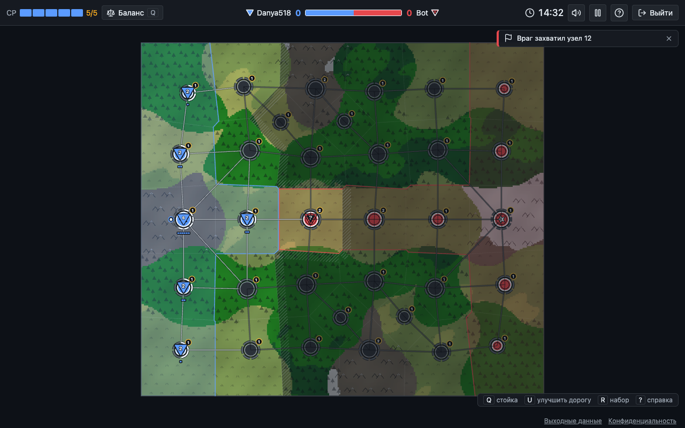 | 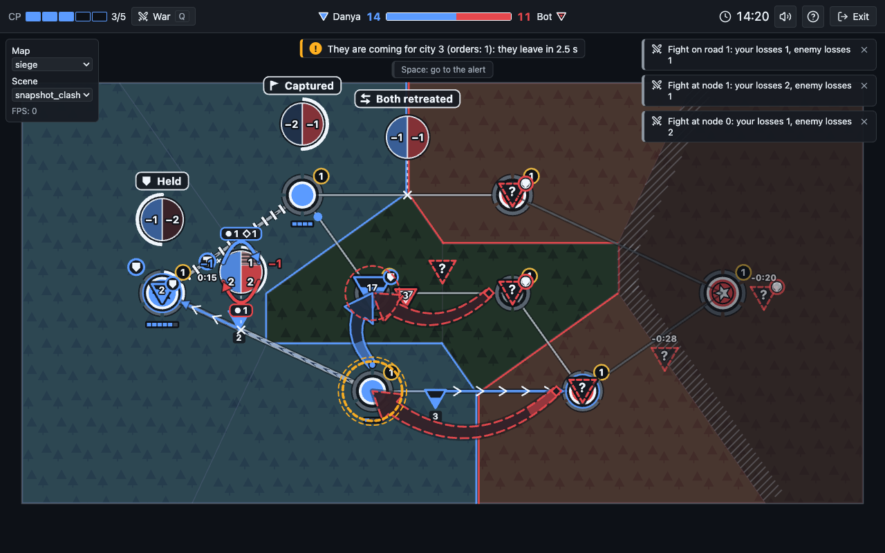 |
| **Scene `fights`: four fights** | **Scene `snapshot_fog`: fog** |
| 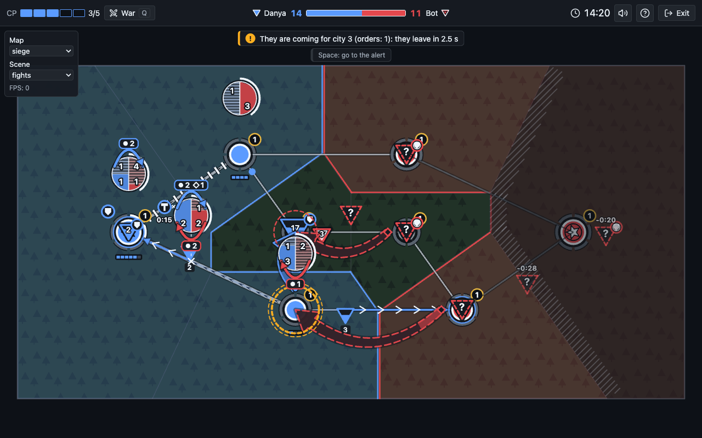 | 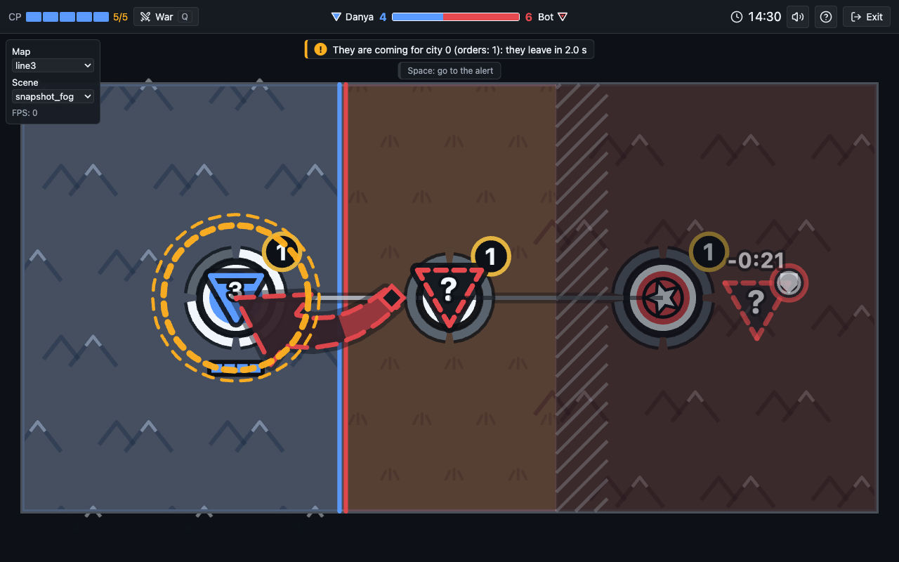 |

| Menu | Queue | Waiting room |
| --- | --- | --- |
| 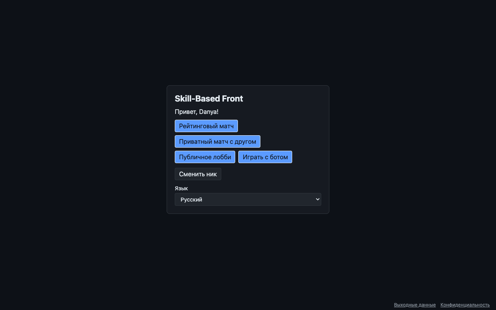 | 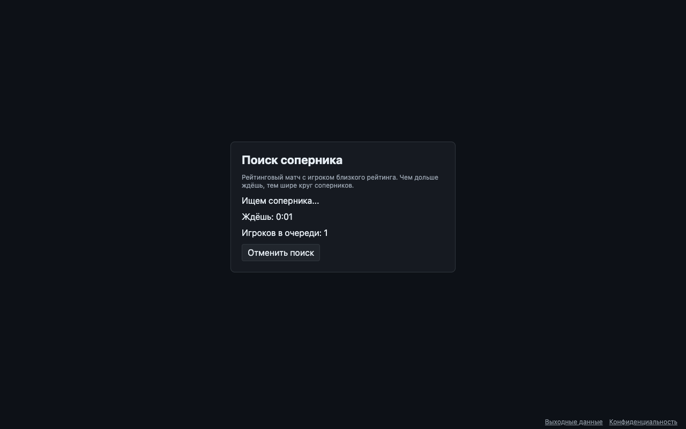 | 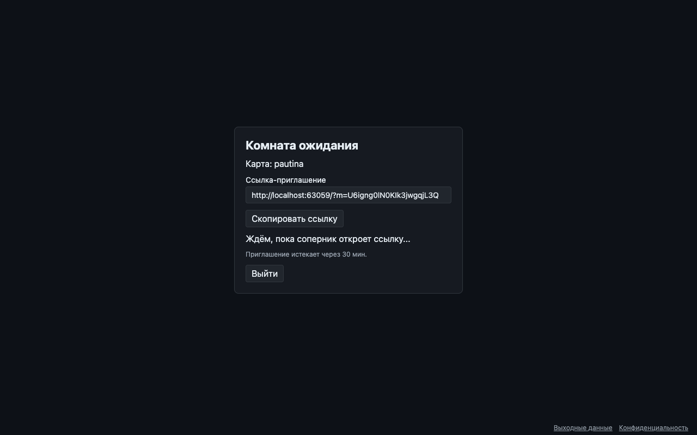 |
| **Result** | **Replay (the sample `?replay=dev`)** | |
| 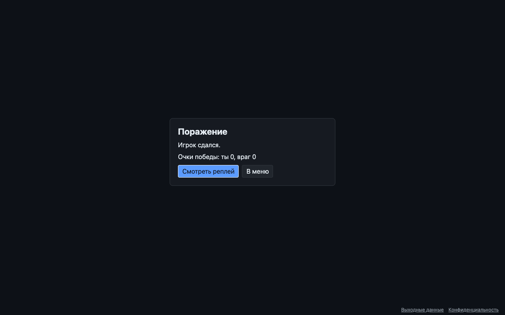 | 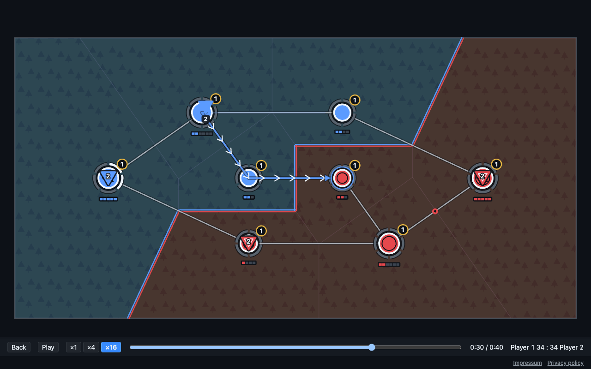 | |

### 3.1 What of the v2 critique is done, what is not

| # | What was bad in v2 | Status on 2026-10-21 |
| --- | --- | --- |
| K1 | The map takes about 60% of the screen, the panel is 300 px, the symbols are small | **done** (wave 3, #228, #247): the top bar is 48 px, the rest is the map; on a 40-node map it is square, so margins remain on the sides (about 20% of the width on each side at 1280×800) |
| K2 | For player 2 own is orange | **done**: own is always blue, the splash "You are blue. Your capital is here" (IM4) |
| K3 | The event feed is stuffed with VP | **done** (IM2): toasts only for events (a fight, a capture), there is no VP in the feed |
| K4 | The fog is dirty, three quarters of the map in hatching | **partly done**: the hatching only as a band at the border, but on small dev maps (`line3`, `siege`) the band is about 70 px and reads heavily; on a live map it is thin |
| K5 | There is no opponent's name and no tooltips | the nick is in the top bar; the tooltips were removed by the owner (#252), will not return |
| K6 | The result: an empty peak moment | **not done**: "Defeat, A player gave up, Victory points: you 0, enemy 0" and two buttons; no opponent's nick, graph, "play again" (IM1, package E) |
| K7 | The menu: four identical blue buttons | **not done**: five buttons, the main action is not highlighted |
| K8 | The queue is text only | **not done** (IM11) |
| K9 | The replay: "Player 1", "Player 2", a timeline without events | **not done** in the sample `?replay=dev` ("Player 1 34 : 34 Player 2", a slider without marks); the replays of real matches with nicks were not re-shot |
| K10 | The waiting room: the map is named by an id, there is no preview | **not done** ("Map: web") |
| K11 | Screens outside the match: a 420 px card on an empty background | **not done**: the same frame on all five screens |
| K12, K13 | Legal, loading and error states | not re-shot |
| K14 | Scattered buttons of the top bar | **done**: stance, sound, pause, help, "Exit" in one panel |

The result: **the match is brought up to the guide (packages A-D, rounds 2-4), the screens outside the match (package E) are untouched.**
The match remains the main screen of the game, so the critique below is about it; package E waits for a separate decision (section 24).

### 3.2 Legibility problems in the screenshots

The text contrast is fine: a measurement (the lightest pixels against the median of the background, approximately) gives for the ghost age captions
5.7 and 6.4:1, for the line "Space: go to the alert" 6.9:1, for the toast text 14.8:1 (the norm is 4.5:1). The problems are elsewhere.

| # | What is seen | Where | What to do |
| --- | --- | --- | --- |
| R1 | **Overlaps.** The ribbon of a scheduled order runs onto the icon and the amber ring of the target city; the fight arena lies on the capacity ring and on the caption "Held"; on a road with a fight the arena, the ribbon, the group icon and the packet are on top of each other (the picture at the center left) | `snapshot`, `snapshot_clash`, `fights` | the ribbon ends at the edge of the city ring, not in the center (rule D1, section 24); the arena V3 (DEC-32) with its own place above the city and a callout |
| R2 | **Two "yellow" marks side by side.** The VP icon (`--vp` `#e3b341`) and the alert ring (`--warn` `#ffb020`) stand at one city. ΔE in Lab (the same calculation as in section 6): 18.7 in the norm, 10.9 with protanopia, 13.6 with deuteranopia, 7.2 with tritanopia. This is the same "indistinguishable" pair because of which the yellow accent was removed in v2 | any scene with an alert | separate them: VP only as a white number on a dark pill (without a yellow ring) or the VP ring of a different shape; the alert stays amber with `!` and a dashed line. **[proposed]**, a small color fix, goes straight into code |
| R3 | **The territory is lost on a live map.** The owner's fill with alpha 0.2 on the baked background gives now a blue-gray, now a brown area; the owner's fill on the gray rocks is almost no different from the rocks themselves; the owner is carried mostly by the border | live match | the fill is still weak; the owner must read without color: a territory pattern (hatching of own and enemy at different angles, D2 of section 24) or a denser fill with leveling the background brightness under the territory; in achromatopsia (section 6) check every map edit |
| R4 | **Neutral cities merge with the dark forest**: a dark disc `#2b3139` with a gray ring on a dark green background is barely visible | live match | a neutral city is lighter than the background (a light ring fill or a backing); a small fix, straight into code |
| R5 | **Small signs.** The number in the triangle is 10 px (`COUNT_FONT_SIZE`), the warehouse segment is 5×4 map units, the VP icon is 17 units: on a 40-node map this is below the rule "a meaningful symbol not smaller than 20 px" (section 5, item 9) and "captions not smaller than 12 px" (section 7) | live match at the scale of the whole map | the unit number 12 px with an outline; the warehouse: into section 21 (icon language) |
| R6 | **Density at the top.** Three toasts in a row in the top right corner lie on the edge of the map and cover cities; under the bar the alert strip with the "Space" hint takes about 55 px | `snapshot_clash` | toasts not more than two, a compressed text ("Fight at node 1: −2 / −1"); the "Space" hint only on hover |
| R7 | **Fog on small maps.** The wide hatching and two age captions `-0:20`, `-0:28` on it look noisy | `snapshot_fog`, `snapshot_clash` | set the band width in screen pixels, not in map units (`FOG_BAND_WIDTH = 24` units give about 70 px on small maps) |
| R8 | **Relief competes with icons.** The mountain stamps ("^") look like intent arrows and road chevrons | `snapshot`, `snapshot_fog` | the stamps are rarer and quieter near cities (rule D1) |
| R9 | **Screens outside the match** (K6-K11): the same 420 px card, no hierarchy, no main action, no map preview | menu, queue, result | package E (section 16) |

### 3.3 The fight arena

An assessment of the current arena (a circle of halves, `fightView.ts`): it reads poorly. Numbers of 10-11 px on a half of a circle of 48 px diameter, the exchange of blows
is visible, but the sum "what happened in the round" does not read; with four fights (`fights`) the arenas lie on the ribbon and the icons (R1). The drawing of
arrows on the circle is good; the bonus stock icon ◇ is already at the arrow. **The arena will be replaced by V3 "chips"** per DEC-32 (#330), so
separate edits of the current arena are not needed: the criteria for V3 are in section 9.9 and section 20 (animation).

---

## 4. Proactive improvements

On top of the owner's 21 remarks. Selected by the influence on the first match and on the wish to play again.
Priority: P0 is needed before the closed playtest (REL-01, #88), P1 is desirable in the MVP, P2 after the MVP.
Effort: S up to a day, M 2-3 days, L more. "Needed": rules (`mechanics.md`, `SIM_VERSION`),
protocol (`PROTOCOL_VERSION`), API (HTTP), the owner's decision. The "When" column: **now** (wave 3)
or **later**.

| ID | Improvement | Why (section 2) | Prio. | Effort | Needed | When | Package |
| --- | --- | --- | --- | --- | --- | --- | --- |
| IM1 | **A result screen with the course of the match**: a big word of the outcome, the opponent's nick, the duration, 4 key numbers (cities at the end, units lost, charges delivered, VP peak) and a graph of the VP difference over time with marks of captures and fights; a click on a mark opens the replay at that tick | 13, 14, 19, 20, 22 | P0 | M | no: everything is in the frames file (`GET /api/replays/{id}`, `docs/design/replay-frames.md`) | now | E |
| IM2 | **An event filter**: VP awards do not get into the feed (the score is already in the top bar); toasts only for a fight, the capture and loss of a city, starvation, a rejected command; the rest in a slide-out log | 1, 3 | P0 | S | no | now | D |
| IM3 | **Nicks in the match, the result and the replay**: "Ember 4 : 6 Guest" in the top bar, the opponent's nick on the result, nicks in the replay | 14, 16 | P0 | S | protocol: nicks in `welcome`; API: nicks in the frames file or in the replay response | now | D, E |
| IM4 | **Match start**: for 3 s a plate "You are blue. Your capital is here" and a pulsing ring around the own capital, the camera fits the map | 3, 1 | P0 | S | no | now | D |
| IM5 | **Hover tooltips with numbers** for a city, a road, a group, an intent arrow: 1 title line and 2-4 "key: value" lines (capacity, warehouse, terrain with a modifier, width and what the next one gives), the term CP and "capacity" with a nested tooltip | 3, 10, 23 | P0 | M | no (the numbers from the player's view and `ruleset_public`) | now | D |
| IM6 | **A response to every action**: an accepted order: the ghost becomes solid and a short sound; a rejection: the ghost shakes and fades, a toast with the reason (`rejects.ts` already translates the codes) and a rejection sound | 7, 2 | P0 | S | no | now | C (map), F (sound) |
| IM7 | **The alert "they are coming for your city"**: an enemy intent with the target in your city gives an amber ring at the city and a line in the alert stack with a countdown of the delay and a jump via `Space` | 3 | P1 | S | `ruleset_public.orders.planned_delay_ticks` (already in the list of section 15) | now | C |
| IM8 | **A clear outcome of a fight**: at the place of the fight a white flash of 400 ms and two loss numbers in the colors of the sides; a bounce: a short arrow back along the edge; the capture of a city: a wave in the color of the new owner over the cell | 6, 7, 18 | P1 | M | no | now | B (part of CLI-12, #71) |
| IM9 | **Sound**: 8 events (order accepted, rejection, a fight nearby, city captured, city lost, starvation, opponent found, match end), a master volume and an off switch, no more than 4 sounds at once, a fight off-screen is quieter | 2, 6, 17 | P1 | M | the dependency `howler` (allowed by AGENTS.md, section 2) and CC0 sounds | now | F (CLI-12, #71) |
| IM10 | **First match hints**: 5 short contextual hints in the first match against a bot (pick a group, give an order, charges and the capital, `Shift`+click, the `Q` stance), each closes and does not appear again (`localStorage`); "How to play" (CLI-13) opens from the menu and from `?` | 13, 4 | P1 | M | no | now | F |
| IM11 | **A queue you cannot miss**: a search ring, a timer counting up, "Opponent found" with a sound and a change of the tab title (`(!) Opponent found`), a confirmation countdown ring | 21 | P1 | S | no | now | E |
| IM12 | **The last minute**: the timer becomes amber and bigger, one sound signal at 1:00 | 15 | P2 | S | no | now | D |
| IM13 | **A replay for analysis**: nicks, event marks on the timeline (fights, captures, stance changes), keys (`Space` pause, arrows ±5 s, `1`/`2`/`3` speed), a graph of the VP difference above the timeline (the same as in IM1) | 14, 19 | P1 | M | API: nicks (IM3) | now | E |
| IM14 | **Loading, empty and error states**: a skeleton of the lobby list, a clear empty state with an action, an error with a "Retry" button, connecting to a match with stages | 25 | P1 | S | no | now | E |
| IM15 | **Settings**: interface scale 100/125/150%, volume, "reduced motion" (plus `prefers-reduced-motion`), language; in the ☰ menu in a match and on the main screen | 13, 26 | P1 | S | no | now | F |
| IM16 | **Off-screen indicators**: when the camera is zoomed in, a fight, an alert or an enemy intent beyond the edge is shown by an arrow at the screen edge | 3 | P2 | S | no | later | D |
| IM17 | **Minimap** | 10 | P2 | M | no | **not doing**: the MVP maps fit the screen entirely (`Home`), the IM16 indicators are enough | - |
| IM18 | **Challenges with medals** (deliver charges, win a fight with a scheduled order, hold VP) | 13 | P2 | L | scenarios on the server or an offline mode | later, after REL-01 | - |
| IM19 | **A preview of the path and the travel time before sending an order** | 5, 3 | P2 | M | protocol: a path query to the server (the client does not compute paths, AGENTS.md 7.1); the owner's decision | later | - |
| IM20 | **Rating and nick in the menu corner**, the rating change on the result as an arrow | 22 | P1 | S | API: the rating in `/api/me` (LB-01, #78) | together with LB-01 | E |

Recommendation for the MVP now: IM1-IM6 (P0) and IM7-IM11, IM13-IM15 (P1). Later: IM16, IM18, IM19.
Not doing: IM17.

---

## 5. Principles

1. **The map on the whole screen, the interface at the edges.** Only the top bar is visible permanently; everything
   else appears on request or on an event (Mini Metro, Polytopia).
2. **Three readings** (Into the Breach). The first: who is where, the score, the time. The second: CP, stance,
   alerts. The third: hover tooltips and the selection card.
3. **Shape plus color, always** (AGENTS.md, 7.4). Own: blue and a single outline. The enemy:
   red and a double outline. A charge: a filled or an empty part of the figure. An alert: amber color,
   the `!` icon, a pulse and a countdown.
4. **Red means only "the enemy".** Errors, rejections and alerts are not red.
5. **One quantity, one variable.** The number of units sets the size of the unit, the share of charged
   sets the fill, the capacity sets the size of a city, the road width sets the thickness.
6. **The enemy's intents in the same grammar as your own.** An own arrow differs from the enemy's by
   the outline, not by a new type of sign.
7. **A response to every action** within 100 ms: visible (a ghost, a highlight) and optionally audible.
   Nothing important by sound only.
8. **Every icon has a caption or a tooltip** (Against the Storm, Northgard).
9. **Minimum screen size.** A meaningful map symbol is not smaller than 20 px on the screen.
10. **Motion for response, not for decoration**: short (150-400 ms), switched off by the setting
    "reduced motion" and `prefers-reduced-motion`.

---

## 6. Palette and tokens

**Superseded for the interface by section 58 (#841):** the CSS variables below now point at the Lapis and
Engraved tokens (`--bg` is `var(--stone-bg)`, `--you` is `var(--own)` and so on). The table stays the palette
of the map (`render/style.ts`) until the map's Engraved piece (#829).

The values below are the only source of colors: the CSS variables `:root` (`app.css`) and the constants of
`style.ts`. There is one dark theme.

| Token | Value | Where |
| --- | --- | --- |
| `--bg` | `#0d1117` | the background of the canvas and the screens, outlines on the map, the "ink" of the stamps |
| `--surface` | `rgb(22 27 34 / 94%)` | HUD panels (almost opaque: XAG 102, complaints about Humankind) |
| `--surface-2` | `#21262d` | buttons, fields |
| `--border` | `#30363d` | frames |
| `--text` | `#e6edf3` | body text |
| `--text-dim` | `#9da7b3` | secondary text (the contrast on `--surface` not below 4.5:1) |
| `--paper` | `#f0f6fc` | white outlines of figures, **selection**, glyphs on the map |
| `--you` | `#5b9bff` | own: cities, units, charges, arrows, the CP bar |
| `--enemy` | `#e5484d` | the enemy |
| `--neutral` | `#8b949e` (outline), `#2b3139` (fill) | neutral cities |
| `--warn` | `#ffb020` | overcrowding, starvation, "they are coming for your city", the last minute |
| `--vp` | `#e3b341` | only the VP icon (motionless, with a number) |
| `--ok` | `--you` | confirmations in toasts use their own color, there is no separate green (the green of `--badge-up` below is for the advantage badge only) |
| `--badge-up` | `#3ddc72` | **[accepted]** (owner 2026-11-07, #791) only the advantage badge: green chevrons up, always over a dark outline (section 45) |
| `--badge-down` | `#ff4f4f` | **[accepted]** (owner 2026-11-07, #791) only the disadvantage badge: red chevrons down, always over a dark outline (section 45) |
| `--terrain-plains` | `#3a4630` | the backing of plains |
| `--terrain-forest` | `#25392b` | the backing of forest |
| `--terrain-mountains` | `#4a453e` | the backing of mountains |

Palette check (the Machado 2009 simulation, full severity; ΔE in Lab, contrast per WCAG; the script
is in the PR description of #208):

| Pair | Normal | Protanopia | Deuteranopia | Tritanopia | Conclusion |
| --- | --- | --- | --- | --- | --- |
| `--you` / `--enemy` | 102 | 74 | 98 | 123 | always distinguishable |
| `--enemy` / `--warn` | 65 | 62 | 40 | 50 | distinguishable; an alert is still with the `!` icon |
| `--warn` / yellow `#ffd33d` | 19 | 11 | 8 | 19 | **indistinguishable**, so there is no yellow accent in v2 |
| magenta `#d65cff` / `--you` | 55 | 10 | 11 | 71 | rejected as an alert color |

- Contrast on `--bg`: `--you` 6.8:1, `--enemy` 4.8:1, `--warn` 10.3:1: all above 3:1 for icons
  (WCAG 1.4.11).
- **In grayscale** (achromatopsia) blue and red are close in lightness (brightness 0.33 and 0.22),
  so the single and the double outline are mandatory. Check: Chrome DevTools, Rendering, "Emulate
  vision deficiencies", the Achromatopsia mode; the sides must differ by the outline.
- **Replay:** if a participant of the match watches, their side is blue; otherwise player 1 is blue, player 2
  is red, with a caption with the nick next to it.

---

## 7. Typography and interface scale

- Font: the system stack `system-ui, -apple-system, 'Segoe UI', Roboto, 'Noto Sans', sans-serif`.
  A custom font (Inter, OFL) only if the difference between operating systems becomes noticeable in the playtest.
- Sizes at 100% scale: 16 px the body text of the screens and the selection card, 15 px HUD,
  13 px secondary, 12 px only key captions and micro captions above numbers. The VP score and the timer
  18 px bold. A screen title 24 px, the outcome word on the result 40 px.
  Rationale: XAG 101 requires on PC at 1080p at least 18 px of glyph height; the CSS `font-size`
  is larger than the glyph height, so 15-16 px in CSS is close to the lower bound, not with a margin.
- Interface scale 100/125/150% (IM15): `html { font-size }` and the HUD sizes in `rem`; the map
  is not scaled, its symbols keep the minimum screen size (9.5).
- All HUD numbers `font-variant-numeric: tabular-nums`.
- Captions on the map (PixiJS `Text`): 12-13 px on the screen, bold, with a dark 3 px outline, in a
  `--bg` "pill" with alpha 0.88 on a busy background.
- A small caption above a number (the Polytopia technique): "CP", "VP", "Time" 12 px `--text-dim`.

---

## 8. Icons, sounds and licenses

Constraints: CSP `img-src 'self' data:`, `font-src 'self'`, `media-src` per `apps/client/csp.ts`,
no external requests; a new dependency only with a justification (AGENTS.md, 0.5).

| Set | License | What it requires | Conclusion |
| --- | --- | --- | --- |
| [Lucide](https://lucide.dev) | ISC, plus MIT for the icons from Feather ([LICENSE](https://github.com/lucide-icons/lucide/blob/main/LICENSE)) | keep both notices | **chosen for the HUD** |
| [Tabler Icons](https://tabler.io/icons) | MIT | keep the notice | fallback |
| [game-icons.net](https://game-icons.net) | CC BY 3.0 | attribution of the author of every icon | not taking now |
| [Kenney](https://kenney.nl/assets) | CC0 ([support](https://kenney.nl/support)) | nothing (the Kenney logo must not be used) | **sounds** (the UI and interface signal packs) and a fallback for raster assets |

- **HUD: Lucide without an npm package.** About 16 icons (menu, CP, timer, exit, pause, help,
  three stances, "Defense", recruit, road, sound, settings, replay, copy) are copied into
  `hud/Icon.svelte` (a dictionary name → SVG markup, `currentColor`), without `{@html}`.
- **Map: our own figures in PixiJS `Graphics`** (triangles, rings, stamps, arrows).
- **Generated icon and art candidates (SpriteCook, owner, 2026-10-30):** allowed in mockups and, after the owner picks one, as
  client assets; section 22 lists the conditions.
- **Sounds: made in code (#71).** Short tones from the Web Audio API (`apps/client/src/audio/recipes.ts`, played by
  `engine.ts`): no sound files, no `howler`, no extra CSP rule. A sound pack with files would need its license in
  `apps/client/THIRD_PARTY_NOTICES.md` and a check of `media-src` in `csp.ts`.
- **Attribution:** `apps/client/THIRD_PARTY_NOTICES.md` (Lucide, sounds, the font if it appears) and
  the "Licenses" section on the legal page. An asset without an entry in this file is a review error.

---

## 9. The map: visual language

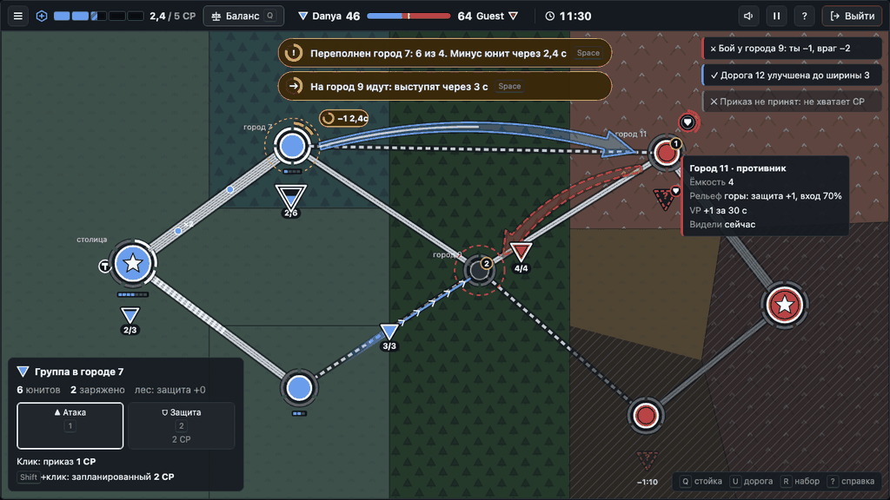

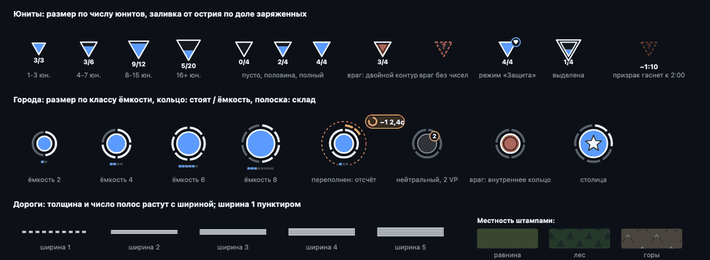

The pictures above were taken from [`mockups/ui-style.html`](mockups/ui-style.html). Sizes are in world units of the map (cities
are about 100 units apart), unless "px on the screen" is said.

### 9.1 Layers

The order of the layers (AGENTS.md, 7.2): background → territory → roads → nodes → fog → groups →
intents → effects (the groups moved above the fog in #419, 9.8). Only the content is added:

- `background`: the baked background, a `--bg` dimming with alpha 0.18 (round 3: it was 0.3), terrain stamps; the owner's territory fill with alpha 0.2 (round 3, #272: it was 0.13, then 0.07, it got lost on the baked background);
- `territory`: a thin 1 px line (`CELL_LINE`, light, alpha 0.16) around every area, including between areas of one owner (a shared edge once; the map edge is not drawn); on top of it the border of the owner's area as a light 2 px line in the owner's color (Northgard), stronger;
- `nodes`: capacity rings and the warehouse bar;
- `groups`: packets under the helmets, motion trails under the packets;
- `effects`: the starvation countdown, the fight animation (arena, exchange of blows, losses, result; 9.9), the start ring (IM4), the alert (IM7).

### 9.2 Terrain on the map

- The terrain icon in the corner of a city is removed.
- A city cell (Voronoi, `voronoi.ts`) is filled with **stamps** in dark `--bg` "ink":
  forest as little fir trees, mountains as chevron peaks with a white cap, plains as rare tufts of grass. The alpha of
  the stamps is 0.28 (plains), 0.4 (forest), 0.46 (mountains) (round 3: relief more noticeable, it was 0.22, 0.32, 0.38).
- A stamp is drawn once in a `GraphicsContext`, turned into a texture
  (`renderer.generateTexture`) and laid out as sprites on a 34×30 grid (forest), 52×40 (mountains),
  30×26 (plains) with every second row shifted; the grid shift comes from the node id (the same on every
  run). Not closer than 30 units to the city center and 12 to the road axis.
- In the city tooltip (IM5) the terrain as a word and a number: "Mountains: defense +1, entry 70%" (from `ruleset_public`).

### 9.3 Roads: level 1..3 is the number of stripes (R1 "Stripes", #345)

The owner's decision of 2026-10-21 (26.3), implemented in #345 (PR #367); the former chevrons and the thickness by the formula `0.5 + 1.5·w` are removed.

| Level | Stripes | Stripe width |
| --- | --- | --- |
| 1 | 1 | 2 |
| 2 | 2 | 5.7 |
| 3 | 3 | 9.4 |

A stripe is 2 units, the gap is 1.7. The state of a road reads without color (by shape), and it is drawn by halves of the edge (DEC-21, the border at the middle):

| State | Look |
| --- | --- |
| Own internal (both ends belong to one player) | solid light stripes `#e6edf3` on a backing in the owner's color (alpha 0.62, wider than the stripes by 3.6) |
| Buffer (the owners of the ends differ or one has none) | a 7/5 dashed line in gray `#aab2bd` on a dark `--bg` backing (alpha 0.4), without the owner's color |
| A half in the fog (`HalfView.detail = fog`) | a dotted 1.5/4.5 line in gray, the `--bg` backing alpha 0.3: by the level the player knows (DEC-17) |
| Never seen (`EdgeView.detail = fog`, neither half has `seen`) | the same dotted line as any half in the fog, nothing else: no mark at the border point (the "?" disc was removed by the owner's decision, #348); level 1 per DEC-17 |
| Construction on an edge (DEC-28, item 7) | a striped ribbon under the stripes: a dark base, yellow slanted stripes (`--warn`), the done part as a solid stripe on top; a "1→2" plate in the middle, for an own construction the time `m:ss` under it |

- A road is redrawn only when the level, the owner of an end or a half in the fog changes, not every frame. At a 60% scale the stripes may stick together, the width, the dashes and the backing remain (the gray scale is checked).
- A road never seen looks like any road in the fog: the client does not tell "never seen" from "seen long ago" on the road itself (the memory of a half is a ghost at the border point, 9.8). `EdgeView` has no `seen` field since #296.
- The construction plate is not smaller than 20 px on the screen (section 22): it grows when the camera zooms out.
- The ghosts of half memory (#359) remain. The tick mark across every road at the border point was removed by the owner's decision of 2026-10-28 (#427): the border point stays in the rules and in vision, it is not drawn.
- Hover: a small circle with the width number in the middle. With an own city selected after `U`: the tooltip
  "Width 3: +0.5 capacity, +25% packet speed, 3 charges from the warehouse" (the numbers from `ruleset_public`).
- A construction in progress: running `--paper` hatching from the building city, the length grows toward the finishing tick.
  Another player's construction is visible only outside the fog (DEC-17).

### 9.4 Cities and capacity

- **Size by capacity class:** radius 11 at capacity up to 2, 14 at 3-4, 17 at 5-6, 20 at 7+ (round 3: cities smaller, it was 13, 17, 21, 25). A **province** has its own radius 9 whatever its capacity (C1, below).
- **The capacity ring** at the distance radius + 7: as many segments as the capacity, thickness 4 with
  a dark backing 7. For own cities there are as many white segments as there are units in the city; for enemy and
  neutral ones all segments are gray. At capacity above 10 a solid arc with a tick on every fifth.
- **Overcrowding:** the extra units as `--warn` segments on a second ring outside, a dashed `--warn`
  circle and a countdown (section 12).
- **Warehouse (C1, #348):** a bar of places under the ring (the Polytopia technique: segments, not a smooth fill), one 5 x 4 square per
  charge of warehouse capacity, the state by shape (ui-style 21): **filled** (gradient in the owner's color) = a charge, a **frame** = room
  for one, **dashed** = a place of a warehouse level that is not built yet. The dashed places come last and only on an own city when the
  city development is on: their number is `(warehouse_max_level - warehouse_level) * warehouse_gain_per_level` from the view
  (`warehouse_level`) and `ruleset_public.city_upgrades`, the filled and frame ones are `warehouse` of `warehouse_cap`. With the
  city development on, a foreign city that is a vision source shows only the filled places (its level and capacity stay hidden, DEC-21 item 3, DEC-26 item 10, AGENTS.md 4.4);
  one that is not has no bar. The «Supply» layer draws the same places.
- **Province (C1, #348; DEC-23; PB "Pale dot", #431):** a node without a city: no warehouse, no VP, no recruit queue or barracks. It is a **small pale dot**
  of radius 6.5, no dark plate (so no centre that reads as a target): a pale tint of the owner (the owner's colour moved half way to white) with a
  thin darker outline 1.4 wide and a dark casing; the opponent's dot has a second thin light ring 3.4 outside it, so the side reads without the hue;
  nobody's is a paler, see-through grey dot with a dashed outline. The capacity ring (3 segments, radius 16) stays around it and the garrison token
  lies on top, so the capacity reads at any size. A province is told from a city by shape (a small dot, no body with a rim), not by size alone.
- **Owner:** a color fill plus an outline: own a white outline 3; the enemy a white outline and a dark
  inner ring; neutral a gray outline 2.
- The capital: a white star inside (under the unit icon while the units are in the city). VP: a dark circle of radius 8.5 with a `--vp` rim and a number at the top right, outside the capacity ring (round 3, #274: inside the body it was covered by the unit icon).
- **Progress marks (A "Cells", #439, section 32):** above the capacity ring of an own city one dark plate with the recruit queue (DEC-25) and, above it, one with the barracks or warehouse build (DEC-26). A cell is one unit of the thing; its state is a pattern: **dashed frame** = a free queue slot (only on the selected city), **frame with a dot** = a unit queued, **hatch growing to a bright head line** = in production or in the build, **solid amber cell with a dashed amber ring** = ready with no room (`recruit_waiting`), the same **dashed amber ring round the hatched cell** = production stopped by a fight in the city (DEC-25, item 9). The build plate is one wide cell behind a round badge with the kind: a house = barracks, stacked squares = warehouse (both builds share the slot). Cells are 16 x 10, the build cell 36 x 10; the hatch is coarse (a stripe 4.5 every 9 along x + y) so it does not alias at 60% scale. The plates are baked sprites (`queueMarkSpec`, `buildMarkSpec` in `bakedShapes.ts`), the growing part in whole pixels, so a look costs one texture; the ring is a sprite of its own and pulses (steady with "less motion"). The mark is hidden in the Supply view.
- A road construction: a ribbon on the edge itself, a "1→2" plate in the middle (9.3); the city has no construction icon.
- **Place names (#449):** the name of every node from the map file (`MapNodeFile.name`, DEC-23, item 4) is a caption under the signs of the place (under the warehouse bar of a city, under the ring of a province), one pooled `Text` per node (`render/nameView.ts`, geometry and the zoom rule in `nameLayout.ts`). It keeps its size on screen at every zoom: a city 13 px bold, a province 12 px medium and lighter (alpha 0.78), both with a dark outline for roads and terrain, never below the 12 px minimum of section 22. A city caption hides below camera scale 0.45, a province caption below 0.7 (the province, the smaller and the more numerous, goes first). The captions are in the `nodes` layer: under the groups and the fog, over the cities. Toasts, alerts and menu titles name a place by the same name (`hud/nodeName.ts`), never by its number. Where the place of a caption is moved or the look of cities changes (#431), only `captionTop` changes.

### 9.5 Units: helmets **[accepted]**

The owner's choice of 2026-11-07 on #775: variant **Full** of `mockups/unit-helmets-r2.html`, with his corrections
(#784), and the chevron badges of section 45. Since 2026-11-07 (#801) the helmets are the only unit look: there is no
viewer setting.

- **Figure:** a side view of a combat helmet (`units/helmet.ts`): own **Rim** (a dome with a light brim line), the
  opponent's **Cut** (a rounder dome with a cut-out at the ear, no brim). Both carry a **chin strap** everywhere: on
  roads, in a city, in a province, in the arena. Fixed facing: own right, the opponent's left; the sprites are baked
  facing right and flipped with `scale.x = -1`, so a facing costs no texture. The owner reads from the silhouette and
  the facing, not from the hue alone (AGENTS.md 7.4).
- **Size by the number of units:** the size step `UNIT_SIDES` is 24 (1-3), 30 (4-7), 36 (8-15), 42 (16+), an unknown
  number 30 (`unitSide`); the helmet is 1.34 times the step wide (`HELMET_SCALE`), in a city 8% smaller
  (`HELMET_INSIDE`), so the strap stays inside the ring. The step also sets the minimum size on screen (20 px) and the
  mouse hit area (28 px).
- **Charge as a level (#508):** the dome fills from its lowest point by `charged / units` of its height (linear: 1 of 4
  charged fills a quarter), with a smooth straight edge: **no dividers, no bands**. The empty part is `#161b22`.
- **Charge motion (#508):** whenever `charged` or `units` change (a fight drains it, supply fills it, a merge or a split)
  the shown fill eases to the new height in 320 ms, ease-out cubic, driven by real time (frame-rate independent),
  from the value shown now when the target changes mid-way. The fill is one baked sprite of the full dome, shown from
  the bottom by a crop of its texture frame (`BakedSprite.cropBottom`): no texture per frame and no mask. A new token,
  a token with unknown numbers, a memory (ghost) and "less motion" show the level at once. The easing is the small
  module `render/tween.ts` (`EaseTween`), reusable for any displayed number.
- **The number:** one number, all the units (`countLabel`), in the middle of the dome, on a road and in a city; no
  `3/5` chip. A range («3-5») stays in the pill under the helmet; an enemy figure on a road keeps its plate (DEC-33).
- **Contrast:** a dark casing (6.4) round the dome, the strap and the brim, plus the light edge of the dome and the
  light strap and brim (the owner's colour mixed half with paper): one of the two reads at 3:1 on every terrain.
  Unknown (`PRESENCE`) and memory: a faint plate, the dome dashed in a pale tone on a dark casing, "?" in the middle.
- **Corners:** the top right corner carries the badges of section 45; the "Defense" shield (economy v1 only) sits at
  the top left; "Attack" is not drawn.
- **Movement:** without rotation, a trail as a line of width 10 and length 40 with an alpha gradient 0.7 → 0;
  oncoming stripes are spaced 18 units apart.
- **Selection and hover:** a white `--paper` line with a dark halo round the whole silhouette, strap and brim included
  (the level line of the distance to the helmet, `helmetOutline`), 7.5 and 6 world units out (`HELMET_FRAME`),
  flipped with the opponent.
- **Arena chips:** helmets with a strap, one pitch wide, own facing right, the opponent's left (they look at each
  other); charged filled, discharged hatched, killed dashed.
- **Elsewhere:** the shards of a killed unit are helmet domes; the fog ghost is a dashed helmet; the presence mark of
  the «Supply» view is a hollow enemy helmet; the undo cue ring (#764) clears the strap. Outside the map every unit
  icon is a helmet (`units/HelmetIcon.svelte`): the top bar, `UnitMark` (menus, queue, result, board, split menu),
  the replay `SideMark`, the mark of `FrontTop`, the menu backdrop (`menuMotion.ts`), the list of the groups of a
  city (`stackHelmet`), the legend of the help, the units of the How to play page.

#### 9.5.1 Superseded: inverted triangles (owner, 2026-11-07)

The inverted triangle ▽ (filled from the tip, faint dividers per unit, a single outline for own units and a double
one for the opponent's, selection as the same triangle 1.45 times bigger) was the unit look until #784 and then a
viewer setting ("Units: Helmets / Triangles", `sbf.units`). The owner removed it on 2026-11-07 (#801); the code and the
`visual` references of the triangles are gone. A value `sbf.units` left in a browser is ignored. The triangles that
are not units stay: arrow heads, the pointer head of an enemy figure, the starving `!` mark, the toll plate's down
triangle, the valve caps of the «Supply» view.

### 9.6 Supply packets

- **A square** 8 in the owner's color with a dark rim 1.5 (a charge is a square, section 21; #345) and a tail
  of two pale squares behind (6 and 5, alpha 0.6 and 0.3, at 8 and 14 units against the movement), on the road
  axis. A one-off transfer (`transfer`): a square 11 with a light rim and a **second outline** 15 in the owner's color,
  the tail 4 longer. The enemy's packet (replay) has a dark center. There are no round packets either on the map or in
  the "Supply" layer. With two charges or more the caption "×N".
- The position by `depart_tick` and `arrive_tick` (`packetProgress`). Inside the city circle
  (the distance less than the radius + 8) the packet shrinks to 30% and fades, "driving into" the icon; the warehouse
  segment flashes briefly.

### 9.7 Orders and intents

| What | Look | Who sees |
| --- | --- | --- |
| An ordinary order (own) | a thin line 3 with white chevrons every 26 units | only the own player |
| A scheduled order (own) | a wide ribbon, a **solid** outline | both |
| The enemy's scheduled order (ODb, #519) | the same ribbon with a **double outline** (two thin lines) and a dashed ring round the target (below); the IN3 thin arrow and crosshair (#353) are gone | both |
| Sent, awaiting confirmation | nothing is drawn (round 4: the flickering ghost and the dashed straight line to the target were removed; the order is shown by the snapshot) | the own player |
| Server rejection | the ghost shakes for 200 ms and fades, a toast with the reason (IM6) | the own player |

The ribbon arrow (HOI4, Mini Motorways):

- **ODb "Low relief"** (#431 round 3, **[accepted]** 2026-10-29, **implemented #519**): the look of both sides' scheduled orders. The mockup is
  `mockups/tokens-cities-orders-r3.html`, variant ODb; the constants are `RIBBON` in `style.ts`, the layout is `intentLayout.ts`, the drawing `IntentView.drawRibbon`.
- The axis: one smooth arc without kinks and without binding to every intermediate city. It **always bulges toward the top of the screen** (round 3
  fix), so it never runs over the caption that hangs under its source or its target: `orderBend` gives the arc 45% of the chord (`RIBBON.arcBend`) with the sign
  that bulges up for the direction (an arrow going right: negative, going left: positive). An own order bends toward the most distant point of the server's path
  (`order.path`, up to 30% of the chord, `pathBend`) only when that path bends noticeably (at least 12%) **and** bulges up; otherwise the arc. The consequence:
  two opposite orders along one road bulge to the same side and lie over each other (the earlier look bent them apart). The client does not search for a path (AGENTS.md 7.1).
- The ends: the tail starts `RIBBON.startGap` (22) outside the circle of the source and is pushed on until it is 26 from the barracks mark (the B1 column) and 20 from the
  VP badge (`tailStart`). The own head stops 5 outside the capacity ring of the target (`signRim`); the opponent's stops on its ring (32 outside the circle).
- The body 16, the tail narrows to 60%, the head 38 x 30; **the body and the head are one closed outline**, no separately outlined head. The body is not thinner than 8 px on the screen.
- Layers, bottom to top (all flat fills and strokes in the one `Graphics` of the `intents` layer, redrawn every frame, **no filter**): a cast shadow (the outline moved by (1, 2)
  world units, `--bg` at 0.35); the **opaque** dark backing (`RIBBON.underlay`, `--plate`, 0.96: the road and the terrain below do not show through); the tint (owner colour 0.14) and the fill
  (0.72 while the delay fills it, 0.74 after the departure); a faint inner rim (a stroke 2.4, the owner colour lightened by 0.5, alpha 0.38; half of it lies under the casing, as in the mockup, so it
  only lifts the edge a little); the departure pulse; the outline. **Own:** a dark casing (3.4, 0.7) under one line 1.6 in the lightened owner colour (`lighten` 0.15), a dot at the tail (r 4).
  **The opponent's:** a double outline (a stroke 5.2 in its colour with a 2 plate stroke on top: two thin lines) and a ring in a ring at the tail (r 5.2 and 2.4: the own tail is a dot, so the
  side reads without the hue; the chevron of section 46 is the bonus). Nothing of the size or composition of the group is drawn for the opponent (DEC-04, DEC-21).
- The delay (`planned_delay_ticks`, section 15): the whole ribbon is a faint tint (0.14) and is filled from the tail to the head (`ribbonFilled`, 0.72) with a paper line 2 across the ribbon at the
  front of the fill (`frontLine`). When the delay is over, one smooth pulse (8 ticks, `departPulse`): a paper-white fill swells and subsides (a sine squared, maximum alpha 0.5) and the own
  line is wider by 2 at the peak. After it the ribbon is one flat tone, and **a soft band of light (18 long, alpha 0.3) runs along it every 1.8 s** (`sheenSpan`, `ribbonSlice`); there are
  no running dashes any more. "Reduced motion": no swelling and no band.
- An ordinary order: white chevrons run (30 units per second) along the whole remaining path to the target in one
  stream, through the nodes, not along the current edge; "reduced motion": the chevrons stand still. There is no dashed straight line to the target.
  The dotted preview line under the cursor remains only for a scheduled order (Shift).
- **The target of the opponent's intent (ODb):** a dashed ring (5 / 4, 2 wide, a dark casing 4.5) of radius (city radius + 29), clear of the VP badge, **open at the bottom** (0.75 rad each side
  of straight down) so the caption of the city sits in the gap; the head of the ribbon stops on it. In the enemy colour; over **your** city `--warn` (amber), and it then pulses (opacity 0.45
  to 1 every 0.9 s, `ringOpacity`; steady with "less motion") and there is a line in the alert stack (IM7). A ring is not colour alone. The crosshair of IN3 (two rings, four ticks, a halo) is gone.
- The bonus of an own scheduled order "^ +N" (the green chevron of a bonus since #797; DEC-29, #330: `OrderView.bonus`, a pill, dashed while a forecast) sits **on the outer (upper) side of the arc**, 62 units before its end (`bonusSpot`), never over the target, its VP or its caption.
- **The stack limit before the order (#468, DEC-20):** with a group selected, the server's `reach` answer lists the nodes the group is too big for (`split`); they have the dashed ring.
  When the pointer rests on one, a tip by the pointer says «Too big to go to {place}: split the group first (S)» with the split icon (a shape and words, not the colour): the order is not sent
  and nothing is computed in the client, the list is the server's (the same text as the rejection `STACK_LIMIT`, which stays for an order sent anyway). `SplitTip.svelte`,
  `OrderController.ui.current.splitHover`. The tip waits 300 ms of rest like the other map tips; it has no map cost (HTML).
- "Defense" without a target: a circle of radius 13 above the city with a shield glyph and a countdown arc.
- The arrow body is not thinner than 8 px on the screen.

### 9.8 Fog and ghosts

- **Haze F1** (the owner's decision, 26.3; implemented in #346, PR #368): the Voronoi cells of hidden cities (`detail = fog`)
  are filled with a cold gray veil `#252d38` with alpha 0.66 and a soft edge (a blur of 9 map px); there is no hatching. The veil
  is one `Graphics`, one `BlurFilter` (quality 2, filter resolution 0.25 of the cache texture) and `cacheAsTexture`:
  a frame draws one sprite, and the texture is rebuilt **only when the set of hidden cities changes** (not on every snapshot,
  not every frame); `FOG_VEIL` in `style.ts`, `veilCities`, `veilPolygon` in `fogLayout.ts`. The veil is clipped by the map
  rectangle (a mask inside the cache), the cell edges at the map border are pushed outward so that the veil does not get lighter at the edge. A road and a city
  under the veil darken together with it; there is no shadow along the edge (a half in the fog is carried by dots, 9.3). The light line along the border
  (`FOG_FRONT`) was removed by the owner's decision of 2026-10-22; to bring it back if the visibility border reads badly in the gray scale. Cities in the fog are drawn with the outline of the last
  known owner; ghosts and the range plates lie above the veil.
- **Layers LY2 "Over the haze"** (26.3, 27.3; #346): the `intents` layer is above `fog` in `LAYER_ORDER` (ribbons, target rings, the bonus,
  the ghost of an own order and a road construction do not dim: an intent is public, DEC-04). **The groups moved above the haze in #419** (the audit CLI-04,
  the smallest fix): since DEC-10 an own group on a road sees its own edge, and that edge lies in the veil of the hidden end city, so the army the player steers
  (and any enemy figure seen on that road) was dimmed. It is safe: the server sends an enemy figure only where it is seen, the memory ghosts live in the `fog` layer
  itself, and cities and roads still darken under the veil. The thin lines of ordinary orders lie in the same layer, under the figures of own groups. The
  corridor cut-out (the visible halves of a road cut out of the veil) was not done: the road itself stays under the haze. The dev scene `fog_road` shows the case.
- The "last seen" ghost: an enemy helmet dashed and an age caption "−1:10".
- **Range** (DEC-21, item 4, #359): where the view gives only a range of units, the enemy helmet is dashed
  (like the "?") and a plate with "3-5" or "21+" under it instead of the number; there are no charges at the `range` level. Presence
  without numbers remains "?". The strings `range.closed` and `range.open` in the dictionaries.
- **The border point of an edge** (DEC-21, item 5) is not drawn (the tick mark across the road was removed, #427).
  A half of an edge in the fog (`HalfView.detail = fog`) is darkened like a road body in the fog; by halves, not by edge.
- **Half memory** (DEC-33, item 8): a ghost with an age at the border point, at the side of the road: the half of end `a`
  to the left of the direction a → b, the half of end `b` to the right. There is no position and direction in the memory.
- **An enemy figure** on a half (DEC-33): moves smoothly by `pos` between two snapshots (without extrapolation); a new `id`
  (an exit from the fog) is a new figure, the line is not drawn across a gap. **EF2 "Pointer" (#354):** a ▽ token (as a group), a solid
  red **pointer head** with a light outline in front of it, 30 units from the centre along the road toward the nearest node it goes to (`toward_b`),
  and a **plate with the level** under it: «4 · 3●» (EXACT: units and charged), «3-5» (RANGE, «21+» open); at PRESENCE there is no plate, the token is
  dashed with its «?». The level reads without the hue: head (direction), plate (numbers), dashes (unknown). **Dissolve and marks:** the figure is over the haze and its
  opacity goes from 0 to 1 over 24 units from the border point inside the visible half (`FIGURE.dissolve`), so it never pops out of the fog;
  a figure first seen within 40 units of the border point (not on the first frame of the view) came out of the fog there: **one ring** spreads from the point
  over 0.8 s (not with "less motion") and a **tick** across the road with a chevron into the visible half stays for 2 s. When it goes back into the fog the
  half memory (above) stays at the border point and a **dashed tick** across the road marks the point while the memory is drawn. Code: `figureLayout.ts` (pure), `figureView.ts`,
  `fogView.ts` (the dashed tick). Several figures in one half: each has its own plate; a plate is 16 units tall and sits 26 under the token centre, so
  two figures nearer than that along a road overlap; no merging rule yet (see the PR of #354).
- **Fading:** up to 60 s alpha 0.6, from 60 to 120 s linearly to 0, after 120 s it is not drawn
  (`GHOST_FADE_START_S = 60`, `GHOST_HIDE_S = 120` in `style.ts`). Display only: the memory remains in
  `PlayerView`.

### 9.9 Fight, bounce, capture (IM8; a fight over time: DEC-24, #276)

> **v3: the arena below (a circle of halves) is replaced per DEC-32 by the V3 view "chips"** (#330, **[accepted]** 2026-10-21): a capsule per unit
> (charged: filled, discharged: empty with hatching, dead: dashed, one that changed in the round pulses), up to 8 chips per side, then "+N"
> with the exact number, a bonus stock icon ◇ with a number at each side, the caption "bonus attack" in a round with
> a virtual shot (the shot itself: the SH1 tracer on the map, #352), a round of 2 s. The rest of the description (the arena position, losses, result, bounce, capture) remains.
> A sample of the look: `mockups/fight-arena.html` and the arena in `mockups/map-style.html`.

A fight goes in rounds by the rules, so the animation shows the course of the fight, not a single flash. It is
drawn **only from server data**: the view field `fights` and the events `fight_round`, `fight_ended`
(`render/fightFx.ts` the pure part, `render/fightView.ts` the drawing); the client computes nothing.

- **The arena** above every fight in progress (#325, instead of the former arena with two numbers and the fight board): a circle of radius 24,
  on the left the own half (blue), on the right the enemy's (red; the side reads by position, not only by
  color). In a half there are the units of the side (the own groups of the fight from the view, for the enemy the exact `enemy_units`,
  `enemy_charged`): the **charged** fill the half from the bottom in the main color, the **discharged** above them
  in a lightened color with horizontal hatching (hatching and tone, not only color: AGENTS.md 7.4); a thin
  white line where they meet. On each part its number (the discharged above the line, the charged
  under it, a zero is not written). The arc around is filled until the next round (`next_round_tick`, the frame tick is fractional,
  so it is smooth). The arena of a fight in a city floats above the capacity ring, of a fight on an edge above the meeting point with a
  dashed callout and a cross at the point itself (`point / 2000`). Several fights on the map read each
  by its own arena, there are no windows.
- **Shots of the last round: tracers SH1** (the owner's decision of 2026-10-21, 29.4; #352; they replaced the arc exchange arrows above the
  arena and the plates with shot numbers on them: only the chips, the ◇ stock and the caption "bonus attack" remained on the arena plate).
  A shot is drawn on the **map between the groups** from the `fight_round` fields (`shots`, `virtual`, `losses`) and the same group places
  as the FX3 effects (`render/shotLayout.ts` the pure part, `render/shotView.ts` the drawing; the client does not compute the outcome).
  **A real shot**: a curved arc (a Bezier curve to the left of the path) with a tapering tail (8 segments in one `Graphics`,
  each denser than the previous, under a dark backing so that the tail reads also above a city of its own color; transparent at the end of the tail),
  a white core (dark for the enemy, the second shape of the side), a soft glow along the tail and a head: a **solid square ■**
  in the side's color (a charge, section 21; for the enemy a second, dark outline inside; for the own side a light spot), sparks behind the head.
  `FillGradient` for the tail was checked with a prototype (section 29, PR #376): under a CSP without `unsafe-eval` it works and is cheap, but in the app
  the gradient polygon was not drawn (on a separate test page it was), the cause was not found, so the tail is made of segments
  with a decreasing alpha. **A bonus shot** (all shots of the side are virtual; the owner's choice of 2026-11-07, #812, variant 7 "Octagram" of round 3, section 48): the same tail, glow, underlay,
  timing and colour as a real shot, the head is **two squares, one turned 45 degrees against the other and turning the other way, with a small square in the middle** (no rays, no echoes). The chevron is no longer
  shot as a projectile anywhere (not the head, the echoes or the sparks); it stays the static badge of the unit (section 45). The arena has no bonus animation. **Cancellation** (both shots): two arcs bend
  in different directions of the path (a lens) and meet in the middle between the groups in 0.3 s, then a white ring, a ✕ and rays of two colors
  from FX3, nobody is hit. **A kill and a cancelled charge**: the shot arrives in 0.6 s, then the FX3 hit (a ring, a flash, sparks
  in a cone from the shooter, shards ▽ in the color of the side that lost, "−N"). **A silent charge**: there is no projectile, only the FX3 sign. **The path after
  the shot melts as an arc** for 0.5 s (a thin line, dashed for a bonus one), it does not break off. The times are in fractions of the round (`round_ticks`),
  not in seconds.
  **The distance between the groups did not change (46)**, so the free path between the tokens is only about 8-15 units (29.4, risk 1). A shot
  reads thanks to a **lengthened trail**: a path shorter than `MIN_REACH` (46, multiplied by 0.7 + 0.3 · strength and by the map scale) starts **behind
  the shooter** (the tail comes out from under its figure), the bend is not less than `MIN_BEND` (7 · scale), the tail is 55% of the path (multiplied by the same
  factor), of width 13 at the head; on a long path (farther than 46) the trail is not lengthened. The strength "Stronger" (`FIGHT_FX_STRENGTH` 1.6)
  sets the factor of the tail length and width (1.18, "medium" 0.7 + 0.3 = 1.0), the number of sparks (5 and 3), the brightness and the lengthening.
  The frame cost (head particles, glows, sparks and echo diamonds in the same two `ParticleContainer`; tails: a `Graphics` pool
  one per shot, up to 16): the numbers are in the description of PR #376.
- **The round losses** (FX3, #351) float up as a `−N` number above the group that lost units (above its figure on the map,
  not at the plate), from the hit: 1.0 s after it (0.5 round), they rise by 12 units and fade; with "reduced motion" they do not
  rise.
- **The end** (`fight_ended`), 3 s (the owner's choice of 2026-11-07, #812, variant 9 "Kill feed", section 48): beside the node, up and to the right of it, two rows, own then the opponent's,
  each a helmet chip of the side and the losses of the whole fight (`−N`); the winner's row has a thick light outline and the verdict glyph (a flag: the node passed to the winner; a shield:
  the winner stayed, the node is not taken), the other row a thin grey outline and no glyph. When nobody won there is no outline and no glyph. The words "Captured", "Held" and "Both retreated" are gone from the map.
  For the events of old replays (`fight`, `sim_version` before 10) the rows stand without an outline or a glyph.
- **A bounce** of the attacker: a short arrow back along the edge in the attacker's color with dashes, 1 s.
- **City capture** ("Fitted", the owner's choice of 2026-11-08, #819, section 49): the new owner's colour floods the area from the city in the shape of the area and
  reaches the whole border at once in 1.0 s; the border lines, the glow and the roads join as the front reaches them; one flash at the city and a ring of the owner's colour
  (the enemy's captures: no flash, the lights at half); a flag of the new owner above the city for 1.6 s (it fades during the last 1.0 s); a toast "City 7 captured".
- **Fight effects on the map FX3 "Expressive", the strength "Stronger"** (the owner's decision of 2026-10-21, sections 27.3 and 29.4; #351):
  on top of the arena, under the plates, in the `effects` layer, above the haze where the fight is visible. Everything is computed from the view fields and events
  (`fight_round`: shots, virtual, losses; `FightView`: charged, the ◇ stock, silent, `next_round_tick`), the client does not compute the outcome. The times are in fractions of the round `combat.round_ticks` (a round of 2 s: a wind-up of 0.35 s before the tick, a hit of 0.6 s after it, 0.3 s for oncoming
  shots, a flash, a ring, sparks and shards up to 1.0 s after the hit, "−N" 1.0 s, everything ends at 1.6 s, the wind-up of the next one from 1.65 s).
  They differ by shape (the gray scale): a real shot: a solid ring and square sparks ■; a bonus one: a dashed ring and
  hollow diamonds ◇ (the flash is paler); a kill: shards ▽ in the color of the side that lost and "−N"; cancellation (both sides shot): a ✕ in the
  middle between the groups, rays of the colors of both sides, nobody is hit; a silent charge: an amber crossed circle on the group
  (while `mute > 0`), a dim amber dashed ring on the round tick without a flash and the word "silent" in the first round; before the
  round (the wind-up) a glowing ring contracts on the group of the side that can shoot (it has a charge that is not silent, or a stock of
  ◇); contact (the start of a fight): a white ring of 0.6 s. The token that was hit "pops" in scale (1 → 1.35 → 1, 0.25 s).
  The strength is one constant `FIGHT_FX_STRENGTH` (1.6): the number of sparks and shards, the size of the flash and the ring, the length of the rays; the fallback
  "medium" is 1.0. Particles only with the built-in `ParticleContainer` (two for all fights: an ordinary and an additive one, one atlas of
  baked white shapes, `particles.ts`), no filters; pools, nothing is created per frame. The shot tracers (SH1): #352 on
  this basis. "Reduced motion" does not turn these effects off (the owner's decision of 2026-10-21).
- **Reduced motion**: no wave and no bounce arrow; the numbers do not rise, the arena, the losses, the result and the toasts remain.
  The tracers and the FX3 effects are not turned off by it (the owner's decision of 2026-10-21).
- Objects in pools (arenas, numbers, captions), nothing is created per frame, `destroy()` frees everything.

---

## 10. Match HUD

### 10.1 What to remove and where to move it

| Now (the 300 px side panel) | Becomes |
| --- | --- |
| Title, map and scene selection, FPS | on the dev screen only |
| Language, "Fit the map" | the ☰ menu (and `Home`) |
| "Help" with a text legend | an overlay on `?`: a picture legend and a key table, a link to "How to play" (CLI-13) |
| Inspector | hover tooltips (IM5) and the selection card |
| Orders panel: a hint, the "Scheduled" checkbox, stance buttons | the selection card (modes, the price of an ordinary one and of `Shift`+click); stance in the radial menu |
| "Forfeit" | "Exit" in the top bar (the owner's decision) |
| "Pause" as a separate button on the right | in the top bar next to "Exit" |
| Event log | toasts (IM2) and a slide-out log |

### 10.2 The top bar

Height 48 px, three columns:

```
┌──────────────────────────────────────────────────────────────────────────────────────────┐
│ ☰  CP ▮▮▮▯▯ 2.4/5  [⚖ Balance Q] │ ▽ Ember  4 ━━━━━━┿━━━ 6  Guest ▽ │ ◷ 11:30 │ 🔈 ⏸ ? [⇥ Exit] │
└──────────────────────────────────────────────────────────────────────────────────────────┘
```

- **CP (C "Track", #439):** one notched pill track in the `--you` color, 120 x 12, a notch at every whole CP below the cap, a small white
  head marker over the growing end; the number "2.4/5". At the cap the head goes and a dashed amber ring (pulsing) and the word `MAX` come
  (a shape and a word, not a colour: AGENTS.md 7.4), with the tooltip "CP are at the cap: new ones are lost" (DEC-02). HTML/CSS in
  `TopBar.svelte`, the numbers in `topBar.ts` (`cpTrack`); no map cost.
- **Stance:** a chip with an icon, a name and `Q`; a click opens the radial menu. Economy v2 shows it only under `[stances]` (DEC-44, `ruleset_public.stances`).
- **Stance progress** (DEC-44, only under `[stances]`): right of the CP number two thin bars, one over the other: the next CP (the term "CP") and the next charge of the own capital (the charge dot), each filled by `me.cp_ticks` and `me.capital_ticks` over the period of the stance; the tooltip tells the seconds left and that a stance change resets both. A bar, its label and a text, not colour alone.
- **The VP score as a "tug of war"** (Against the Storm): nicks, numbers and a common bar, the blue part on the left,
  the red on the right, a tick mark in the middle. Beside the nick a helmet of its own shape (Rim facing right, Cut facing left).
- **The timer** 18 px with an icon; in the last minute `--warn` (IM12).
- **On the right:** sound on/off, pause (private matches only), `?`, "Exit".

### 10.3 The selection card

At the bottom left, width 340 px (at 100% scale), only when something is selected. Structure (Hex Strategy UI):
a title with a figure, a line of key numbers, action buttons with a price and a key, a hint line.

- group: units, charged, the place and the terrain; "Attack" `1`, "Defense" `2` with a price; the line "Click:
  order 1 CP. `Shift`+click: scheduled 2 CP" (#213);
- city: the owner, "standing / capacity", the warehouse, the terrain, VP; recruit `R` with a price (a road is upgraded in the `U` mode by clicking on it, #315);
- road: the width, what the next level will give and the price in charges.

### 10.4 Toasts, alerts, key hints

- **Toasts** at the top right: up to 3, fade after 6 s, a frame on the left in the color of the meaning (own, enemy,
  `--warn`, neutral) and an icon. A VP award is not shown as a toast (IM2).
- **The alert stack** at the center under the top bar: overcrowding (section 12) and "they are coming for your
  city" (IM7); one line per type with a number, `Space` leads the camera to the nearest one.
- **The key line** at the bottom right: `Q` stance, `U` upgrade a road (the road mode, #315), `R` recruit, `?` help; it hides
  after 3 matches (a counter in `localStorage`), it remains in `?`.
- **Exit:** the dialog "Leave the match? This is a forfeit: the match ends with your defeat." with the buttons
  "Forfeit and leave" and "Stay" (the default focus); a double `Esc` opens the same dialog.

---

## 11. The radial stance menu

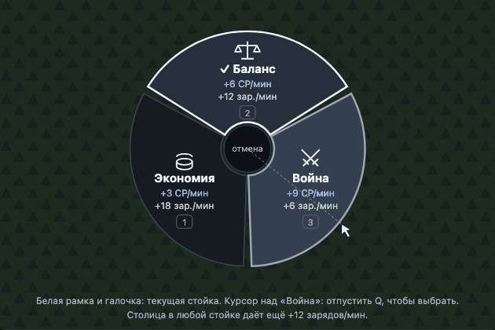

- **The `Q` key.** Hold: a menu centered under the cursor, the choice by releasing in a sector, cancel in
  the hole of the ring (radius 34 px). The hit is exact: a sector is chosen only inside the drawn
  segment, the hole, the gaps and the area outside the ring choose nothing. A short press (less than 200 ms): the menu stays open, the choice
  by a click or `1`/`2`/`3`, `Esc` closes. A click on the stance chip opens the same menu at the chip.
- **Geometry:** three sectors of 116° with a gap, the outer radius 150 px, the inner 34 px.
  The order is fixed: "Economy" at the lower left, "Balance" at the top, "War" at the lower right. The hovered
  sector is lighter with a white outline; the current stance with a white frame and a check mark. In the center the name and
  the effect of the hovered sector (the Marioni technique).
- **Captions at the sectors are mandatory** (Against the Storm): an icon, a name, a key, two numbers:

| Stance | CP per minute | Charges per minute from the stance |
| --- | --- | --- |
| Economy | +3 | +18 |
| Balance | +6 | +12 |
| War | +9 | +6 |

The calculation for `mvp-0`: `cp.per_period = 100` once per `period_ticks = 50` (12 times a minute); the share into
charges `stance_to_charges_pct` 75/50/25, the rate `charges_per_cp = 2`. The caption at the bottom: "The capital
in any stance gives another +12 charges/min".

- **The change cooldown** `stance_cooldown_ticks = 100` (10 s): the sectors are muted, in the center a countdown
  arc. Without the `stance_ready_tick` field the menu sends the command and shows the rejection as a toast.
- **Accessibility:** `role="menu"`, the sectors are `menuitemradio` with `aria-checked`; everything from the keyboard.

---

## 12. The starvation warning

The rule (mechanics.md, section 9; SIM-07): as long as there are more of the owner's units standing in a city than its capacity,
`Node.over_ticks` grows; on the `capacity.attrition_ticks`-th tick in a row (30 ticks, 3 s) one
unit dies, the countdown starts anew. After a capture a grace of `grace_ticks` (5 s).

The display, in order of escalation (Mini Metro):

1. The extra units as `--warn` segments outside the capacity ring, a dashed `--warn` circle pulses
   (alpha 0.5 ↔ 1, 0.8 s; with "reduced motion" without a pulse).
2. A pill at the city: an arc filling over `attrition_ticks`, the `!` icon and "−1 2.4s"; during
   the grace the arc is gray and "grace 3s".
3. A line in the alert stack: "City 7 is overcrowded: 6 of 4. A unit is lost in 2.4 s", `Space` leads
   the camera; with several cities one line with a number.
4. The `attrition` event gives a toast "Overcapacity at node 7: a unit was lost" and a sound (IM9).

The client does not compute the overcrowding and the countdown (AGENTS.md, 7.1): the numbers come from the server (section 15).

---

## 13. Screens outside the match

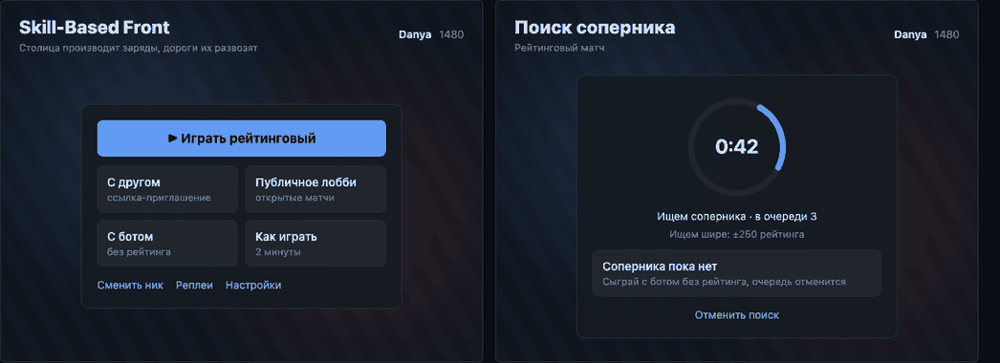

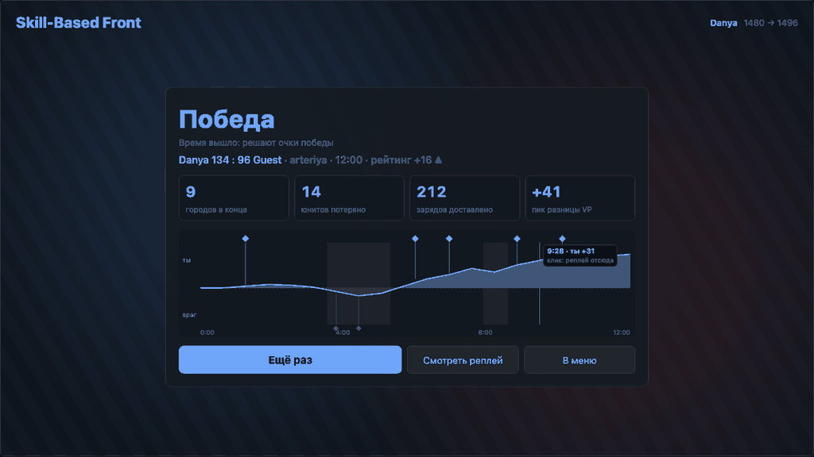

### 13.1 The common frame

- The background of all screens outside the match: the baked background of one of the maps (`/api/maps/{id}/background.webp`) with
  a `--bg` dimming of 0.75 and a light blur (CSS `filter: blur(2px)`), without animation. Our own
  picture, there are no external assets.
- At the top left the name of the game (24 px, bold) and a motto line from CLI-13 "The capital produces
  charges, roads carry them, a unit without a charge is defenseless". At the top right the nick, the rating (IM20),
  language, sound, settings.
- The content in a panel of width 480 px (`--surface`, outline `--border`, radius 10), not 420 px
  in the middle of emptiness. Buttons: one primary (a `--you` fill), secondary ones with an outline, tertiary ones as a link
  (Kare Kapmaca, Mini Metro Menu).
- The legal links at the bottom right, as now.

### 13.2 Welcome and the menu

- Welcome: login by nick and password and registration (nick, password and repeat in one form) are switched by buttons under the main one (#374); without an account one plays as a guest, as before.
- Welcome: the nick field 44 px high, the "Play" button the full width, the nick format hint
  under the field 13 px, errors in the same place in `--warn` with an icon.
- The menu: **one main button "Ranked match"** the full width; below, in a 2×2 grid, the cards
  "Private match with a friend", "Public lobby", "Play against a bot", "How to play" (an icon, a name, an explanation line);
  below, the links "Set a password" (with a password: "Change the password"), "Log out" (#374; a guest without a password first gets a warning that the account will be lost), "Replays" (after LB-01). If a match is in progress: a banner "Match in progress:
  return" above everything else.

### 13.3 The lobby

- A list of cards: a nick, a map with a small preview (`maps/<id>.preview.png` or the background), the age of
  the entry "2 min"; a "Join" button on the right. Empty: a placeholder picture made of map symbols, a text and
  the main button "Create a public match". Loading: 3 skeleton lines (IM14).

### 13.4 The queue (IM11)

- In the center a search ring of 160 px (a rotating `--you` arc; with "reduced motion" motionless),
  inside a timer counting up 24 px; under it "Looking for an opponent" and "Players in the queue: 1".
- The widening of the search window by a line "Searching wider: ±250 rating" (if the server starts to provide it;
  now `QueueStatus` has no such field, without it there is no line).
- The bot offer as a separate card with its own main button, not one more button in a column.
- "Opponent found": the ring fills with the confirmation countdown, a sound, the tab title
  `(!) Opponent found`, the main button "Play".

### 13.5 The waiting room

- A map preview of 320×180 on the left, on the right the name of the map as a word (not an id), below two "seats": you and
  the opponent, each with a nick and a chip "Ready" or "Waiting". The invite link with a big
  "Copy" button while there is no opponent; "Leave" as a link.

### 13.6 The result (IM1)

The hierarchy (Overwatch 2 Match Summary, VALORANT):

1. The outcome word 40 px ("Victory" in the `--you` color, "Defeat" `--enemy`, "Draw" `--text`) and
   the reason in a line below.
2. A line "Ember 96 : 134 Guest · artery · 12:00", the rating change as an arrow (if ranked).
3. The numbers of the player with a caption (#824, owner 2026-11-08; built: `app/ResultScreen.svelte`): "Match
   length", "Units killed", "Units lost", "Cities captured", "Provinces captured", "Attacks won" and "Defenses held"
   (each as "won of all"). The server counts them over the whole match from the events (`gow_sim.analysis.ResultTally`,
   `match_end.stats`); the client counts nothing. Definitions, per player `p` (the other is `q`):
   - **Units killed**: units of `q` destroyed in fights: the `losses` of `q` of every fight round (killed by shots),
     plus the units of `q` that died at the end of a fight by DEC-24, item G3 (a returning group that bounced in the
     node it lost). Over-capacity attrition is no kill.
   - **Units lost**: units of `p` destroyed by the same fight rules, plus every unit of `p` that died of over-capacity
     attrition (DEC-12): a lost unit is lost whatever killed it. Not counted: a returning group that walks into its
     lost, empty node and cannot pay the capture (DEC-38, item 4; its event has no unit count). Starvation spends
     charges, not units; a retreat loses nothing.
   - **Cities captured**, **Provinces captured**: every capture by `p` (a fight won or a walk into an empty node;
     neutral and enemy nodes, a recapture counts again), split by the kind of the node; the capital is a city.
   - **Attacks won**: of the node fights that ended in a node `p` did not own when the fight started (an enemy node, or
     a neutral node both players entered), those that ended with `p` capturing the node. A walk into an empty node is
     a capture but no attack; a meeting on a road is neither attack nor defense.
   - **Defenses held**: of the node fights `q` started in a node of `p` that ended, those after which the node is still
     `p`'s (a `q` win that cannot pay the capture, DEC-38, also holds).
   - A fight still going when the match ends counts its kills and losses, but is neither an attack nor a defense.
   "VP peak" (VP never decrease, so it equalled the final VP), "Cities at the end" and "Charges delivered" were removed
   (#824).
4. A graph of the VP difference over time (LoL Gold Diff): above zero a blue fill, below a red one; the marks of
   own captures above the graph, the other side's under it; hover shows the time and the values; a click opens
   the replay at that tick.
5. Buttons: "Play again" (the main one: the same mode, a bot or the queue), "Watch the replay", "To the menu".

Data: the frames file (`GET /api/replays/{id}`) already contains `p` (CP, VP), `n` (the node owner) and
`g` (groups) every 0.5 s and all events. Computing the final numbers is a display of the file, not
game logic. While the file is not ready (seconds after the match), blocks 3 and 4 show a skeleton, blocks 1, 2
and 5 are visible at once from `match_end`.

### 13.7 The replay (IM13)

Built in #599 (the UI catch-up #593): `replay/ReplayViewer.svelte`, `ReplayTimeline.svelte`.

- The top bar is the match's (10.2): "Back" with the `Esc` chip on the left; in the middle the two sides, each a
  helmet and a nick (the header key `nicks` of the frames file when it has one, otherwise "Player 1" and
  "Player 2"), the VP numbers and the same "tug of war"; on the right the "View as" choice.
- **View as:** "Player 1", "Player 2", "Both" (a segmented choice, the pressed one filled and bold). A side makes that
  side blue and puts it on the left (ui-style 6, "Replay"); "Both" is player 1 blue, player 2 red. The choice
  redraws the map for the other side on the same frame, without a reload. A replay opens as the viewer's own side
  when the app knows it: the result screen passes it, a link finds it by the viewer's nick in `nicks`; otherwise "Both".
- **Fog** (#600): a toggle after the choice (the `F` chip, `aria-pressed`; pressed is filled and bold like the
  choice). With a side chosen and the fog on, the map is that player's live view at that tick: the veil ("Haze",
  BL3-1), ranges and presence instead of numbers, memory ghosts that fade by the replay time (so a seek is stable),
  the enemy figures on roads, no enemy warehouse. All of it is copied from the frame key `v` of the file (#598,
  `docs/design/replay-frames.md`, "Vision"); the client decides nothing about vision. A side opens with its fog;
  turning it off shows the whole map with that side blue. "Both" never has fog. The toggle is unavailable (dashed
  border, dim text, a tooltip and a screen reader description with the reason) on "Both" ("Pick a player to see their
  fog of war") and for a file from before #598 ("This replay does not record what each player saw"), where the side
  choice still swaps the colours.
- At the bottom one bar: the timeline (a styled track over a native range, so the keyboard and screen readers work;
  fights are dots on the track, captures are diamonds above it in the side's colour: blue single outline for the blue
  side, red with the inner outline for the other), then play (the main blue button with the `Space` chip), the speeds
  with their keys, the time, and a hint line (arrows, `Home`, the legend of the marks). The VP-difference graph is not done.
- At the end of the match a chip under the top bar names the winner (a helmet and the nick) or "Draw".
- Keys: `Space` pause, `←`/`→` ±5 s, `1`/`2`/`3` speed ×1/×4/×16, `F` the fog, `Home` fit the map, `Esc` back; they are on the
  buttons as key chips (and in `aria-keyshortcuts`), the arrows and `Home` in the hint line.
- Phone width (up to 640 px): the top bar is two rows (back and score, then the choice), the bottom bar two rows
  (the timeline, then play, speeds and time); key chips, nicks and the hint line are not shown.
- Before the file is there (loading, "Preparing", every error) the screen uses the frame of the menu (13.1) with the
  backdrop map: an eyebrow "Replay", a big word (with the spinner while waiting, the amber `!` for a failure), one
  plain line, and the rows "Try again" (`Enter`, only for a lost connection or a timeout) and "Back" (`Esc`).

### 13.8 The legal page

The same frame 13.1, the text of width 680 px, 16 px, line height 1.5; the language in the header, not at the bottom.

### 13.9 Loading, emptiness, errors (IM14)

| State | Look |
| --- | --- |
| Waiting up to 1 s | nothing |
| 1-10 s (the lobby list, the replay, the result) | a skeleton of the same shape as the content |
| Connecting to a match | stages in a line: "Loading the map → Connecting → Waiting for the first frame" |
| Empty | a picture of map symbols, one sentence, one main button |
| Error | the `!` icon in `--warn`, what happened in plain words, the buttons "Retry" and "To the menu" |

---

## 14. Sound, accessibility, localization

### 14.1 Sound (IM9)

- **Done (#71): the Web Audio API directly, no dependency, no files** (`apps/client/src/audio/`; CSP unchanged).
  Each sound is a few synthesized tones (`recipes.ts`). The set: a round of a fight (a dull hit), a unit of yours lost
  (a falling buzz: your loss in a fight round, or attrition), a node captured (two rising notes) or lost (two falling),
  an order accepted (a tiny tick, on the `ack`), the end of the match (win, defeat, draw). No sound for rejections,
  starvation or the queue (not in the first set).
- An event sounds when the map draws its tick (like the toasts), so the sound does not run ahead of the picture; a
  sound older than 0.5 s when it is due is dropped (a hidden tab draws no frames: no burst on return), and nothing
  plays while the tab is hidden. The round hit is skipped under "less motion" (the setting or `prefers-reduced-motion`).
- At most 4 sounds at once; the same sound again within 150 ms is dropped. One mute button in the top bar (key `M`,
  also in the help list) and a volume slider in the help sheet (`?`); both are remembered per browser
  (`localStorage`, `sbf.sound`: `muted`, `volume` 0..100; default on, 60).
- Nothing important by sound only: every sound has a visible response (GAG).

### 14.2 Accessibility

- The palette is checked for three kinds of color blindness (section 6); achromatopsia relies on outlines.
- The contrast of text is 4.5:1, of icons and borders 3:1 (XAG 102, WCAG 1.4.11), computed against the
  lightest place of the background behind the panel (the snow on `artery`).
- The interface scale 100/125/150% (section 7).
- "Reduced motion": a setting plus `prefers-reduced-motion`; it turns off the pulse, flashes, waves,
  the running dashes; the numbers and the toasts remain.
- **Motion transitions (#508):** everything below runs on real time (frame-rate independent) and is instant with
  "reduced motion". The first frame of a scene always shows it as it is. Positions of groups and packets stay as
  they were (snapshots 2 ticks behind, no extrapolation); what was missing is the soft edges:
  - a group token that appears fades and swells in (220 ms, from 0.78); one that leaves the snapshot fades out where it
    stood (an arrival into a city icon, a kill) and is destroyed when gone; a token that returns while fading is taken back;
  - a token whose number of units changes (a merge, a split, a loss) swells to 1.14 and settles in 260 ms;
  - the charge fill eases (section 9.5); a captured city keeps its old body on top of the new one and fades it out
    (120 ms since #819); the territory floods from the city in 1.0 s (section 49, it replaced the 450 ms cross-fade);
  - the wheel zoom sets a goal and the camera eases to it around the pointer (time constant 80 ms; a spin adds
    notches to the goal); "Fit map" and the jump to an alert glide 380 ms (ease-out); a drag takes over at once;
  - not changed, on purpose: the fog veil is one cached blurred texture, a cross-fade of two such layers would
    double-darken the areas hidden in both (it flips as before); a reversal of an enemy figure's pointer head.
  - `/?scene=demo&motion` (dev only) makes the live demo move (a marching group that merges into the city icon and
    splits out, charges cycling), `?map=<name>` picks the map: for looking at all of this and for FPS checks.
- The keyboard focus is visible on all buttons (a `--paper` outline of 2 px); the radial menu and the dialogs
  are accessible from the keyboard.

### 14.3 Localization

- A measurement of the dictionaries: 263 common keys, Russian in total is 3% **shorter** than English, but short
  captions are up to 1.7 times longer (for example the Russian for "Impressum", "Invite link" and
  "Random map"). The narrow places break: chips, buttons, menu sectors.
- The rule: buttons and chips have `min-width` and word wrapping, without a fixed width;
  `text-overflow` truncation only for nicks.
- The check: a pseudo-locale (English strings +40% characters with diacritics) in the dev mode, a screenshot of
  all screens in it (W3C: short strings grow more than long ones).

---

## 15. What is needed from the protocol and the API

The rules and `SIM_VERSION` do not change: only display fields. A protocol change: `PROTOCOL_VERSION`++,
regenerate `protocol.gen.ts`; a new player-view field only with a fog test (AGENTS.md, 4.4 and 10).
HTTP API: regenerate `openapi.json` and `api.gen.ts`.

| Field | Where | Why | Package |
|---|---|---|---|
| `economy.stance_to_charges_pct`, `economy.charges_per_cp`, `economy.passive_amount`, `economy.passive_period_ticks`, `orders.stance_cooldown_ticks` | `RulesetPublic` | numbers in the radial menu | C |
| `orders.planned_delay_ticks`, `orders.defense_delay_ticks` | `RulesetPublic` | countdown on the arrow, alert IM7 | C |
| `stance_ready_tick` | `SelfView` | stance cooldown countdown | C (optional) |
| `capacity.attrition_ticks`, `capacity.grace_ticks` | `RulesetPublic` | attrition countdown arc | D |
| `attrition_in: int \| None`, `grace_left: int \| None` | `NodeView`, only own overcrowded nodes | attrition countdown | D |
| `nicks: tuple[str, str]` (by player id) | `WelcomeMsg` | nicks in the top bar and on the result screen (IM3) | D |
| `nicks` (by player id) | the frames file (`gow_server.frames`, an optional key, `format` does not change) | nicks in the replay and on the result chart | E |
| rating in `GET /api/me` | HTTP API | nick and rating in the menu (IM20) | LB-01 (#78) |
| the end tick of one's own construction, the opponent's visible construction | player view | construction hatching | implementation of DEC-16/17 (#209, #210) |

`attrition_in` is taken from `Node.over_ticks` in `gow_sim.view.project()`: `attrition_ticks - over_ticks`.
The fog test: for an opponent's node and a neutral node the field is always `None`. The opponent's nicks are not a secret
(they are visible in the waiting room and the queue), but we do not put them into `PlayerView`: they arrive once in
`welcome`.

---

## 16. Work packages of wave 3

Wave 3 starts after the implementation of DEC-16 and DEC-17 (#209, #210) and #213 (they change
`OrdersPanel.svelte`, `orderController.ts`, `shapes.ts`).

Six packages. Shared files: `render/style.ts` (each package adds its own section of constants),
`app.css` (the tokens are set by A, the others only add classes in their own components), the `i18n`
dictionaries (new keys only), the protocol (C, D and E raise `PROTOCOL_VERSION`: whoever merges later
rebases and raises it once more).

Common criteria for all packages: state is not conveyed by color alone; new strings through `t()`
in ru and en; PixiJS objects are destroyed; 60 FPS in the dev scene `demo` on a map of the server pool; the reference
snapshots of `apps/client/visual/` are updated; Vitest on pure functions; "reduced motion" turns off
the package's animations; the contrast of new elements is checked (section 14.2).

### A. Map: palette, terrain, roads, cities (`size:M`)

Files: `app.css` (tokens), `render/style.ts` (the palette and the map section), `render/mapView.ts`,
new `render/terrainView.ts` and `render/cityView.ts`, `render/entityView.ts` (only moving the
warehouse strip), `render/fogView.ts` (only the soft fog 9.8).

- [x] The tokens of section 6 in `app.css` and `style.ts`; colors on the map and in the HUD only from them.
- [x] Your own are blue with a single outline, the opponent is red with a double one in a live match for either player;
      in a replay by the rule of section 6.
- [x] Terrain stamps per 9.2, the terrain icon at the city is removed, the picture is the same on restart.
- [x] Background dimming 0.3; the territory border is a line in the owner's color (9.1).
- [x] Roads per 9.3 (thickness, lanes, a width dot on hover, construction as hatching, an
      enemy road in the fog by the last seen width).
- [x] Cities per 9.4 (size by capacity, ring, warehouse as segments, overflow `--warn`).
- [x] Fog per 9.8 (no solid hatching, hatching at the edge of vision).
- [x] A screenshot in the Achromatopsia mode (DevTools): the sides are distinguishable by outline; attached to the PR.

Done in #222. Differences from the package text: construction stayed the DEC-16 "crossbars" in the `--paper` color without a running animation
and without length growth (the protocol has no construction start tick); the city fog does not draw a disk on the city, the Voronoi cell
is darkened; colors in `app.css` are replaced with tokens, the HUD components (package D) with their own literals will be converted by D; the hint
"Width N: +…" at `U` belongs to the HUD (D), on the map there is only the width dot. The Achromatopsia screenshot was made with the filter
`grayscale(1)` on the canvas (the built-in browser has no DevTools vision-deficiency emulation).

### B. Map: units, packets, ghosts, fight (`size:M`)

Files: `render/shapes.ts`, `render/layout.ts`, `render/entityView.ts` (groups, enemies, packets),
`render/pick.ts`, `render/camera.ts` (only the on-screen scale of symbols), new
`render/effectsView.ts` (fight flash, bounce, capture wave).

- [x] Triangles per 9.5 (size, fill by charge, outlines, "?", "Defense", caption, selection
      in white).
- [x] A side of at least 20 px on screen, a hit area of at least 28 px; a test on `pick.ts`.
- [x] A movement trail, lanes of counter-movement of 18 units.
- [x] Packets per 9.6, no jump when they disappear from the snapshot.
- [x] Ghosts fade per 9.8; a test of the opacity-by-age function.
- [x] Fight, bounce and capture per 9.9 (IM8); with "reduced motion" only the numbers.

Implemented in #224. Deviations: the bounce is drawn only for own groups (the server sends `fight_group` only to the owner, the client does not guess the enemy's path, AGENTS.md 7.1); the flash of a warehouse segment when a packet enters a city is not done.

### C. Orders, intents, the radial menu (`size:M`)

Files: new `render/intentView.ts` (moved out of `entityView.ts` in the first commit),
`render/overlayView.ts`, new `hud/RadialMenu.svelte`, `match/keyEvents.ts`,
`match/orderController.ts`, `hud/OrdersPanel.svelte` (removal of the stance buttons); protocol:
`gow_protocol/ruleset.py` (+ `SelfView` optionally).

- [x] Arrows per 9.7: a ribbon for the scheduled orders of both sides, a thin one with chevrons for
      ordinary ones; your own by `order.path`, the enemy's as an arc; the delay countdown along the axis.
- [x] Ghost: confirmation by the `ack` makes it solid, a rejection: a 200 ms shake and fading (IM6);
      the event for sound is handed out through `orderUi` (subscription of package F).
- [x] The alert "they are coming for your city" (IM7): a `--warn` ring at the target and an entry in the shared alert list
      (`match/alerts.svelte.ts`, created by C, drawn by D).
- [x] The radial menu per section 11; test: for `mvp-0` you get 3/18, 6/12, 9/6.
- [x] `RulesetPublic` is extended with the fields of section 15; `PROTOCOL_VERSION`++, artifacts regenerated.

Done in #226. Differences from the package text: `SelfView.stance_ready_tick` is not added (optional in the guide): the stance cooldown
is shown by the server's rejection in the "Orders" panel, the countdown arc is not drawn in the menu. The rejection toast stays a
message of the "Orders" panel (toasts are made by D). The alert stack of D is for now replaced by the rows of `hud/AlertStrip.svelte`
(the same `match/alerts.svelte.ts`, `Space` takes the camera to the next alert), D will replace it with its own component.
The departure time of a scheduled order is computed as `created_tick + orders.planned_delay_ticks` (the field
`depart_tick` in `OrderView` does not go on the wire). The alert uses only the opponent's public intents and
the city owners (DEC-04, DEC-17), the client does not compute the arrival time: after the departure the row says
"already on the way". The running of the dashes is tied to the frame tick, not to the clock, so a frozen scene is motionless.
Also fixed the self-references of `--surface-2` and `--border` in `app.css` (left over from #222).

### D. Match HUD (`size:L`)

Files: `hud/Hud.svelte`, `hud/StatusBar.svelte` (becomes `TopBar.svelte`), `hud/SelectionPanel.svelte`
(the card), `hud/EventLog.svelte` (toasts and the log), `hud/eventText.ts` (the filter), new
`hud/Icon.svelte`, `hud/Tooltip.svelte`, `hud/HelpOverlay.svelte`, `hud/AlertStack.svelte`,
`hud/MenuSheet.svelte` (the ☰ menu), `hud/StartBanner.svelte`, new `render/alertView.ts`,
`apps/client/THIRD_PARTY_NOTICES.md`, `legal/LegalPage.svelte` (the "Licences" section); protocol:
`NodeView`, `WelcomeMsg.nicks`, `gow_sim.view.project()` and the fog test.

- [x] There is no side panel; the top bar per 10.2 (CP as `--you` segments, the stance chip, VP
      as a "tug of war" with nicks, timer, sound, pause, `?`, "Exit").
- [x] The selection card per 10.3 (no `P`, the price of an ordinary order and `Shift`+click).
- [x] Hover hints per IM5 for a city, road, group, arrow; a 300 ms delay.
- [x] Toasts and the log per 10.4; VP accrual does not reach the feed (a test on the filter, IM2).
- [x] The alert stack: overflow (section 12) and the entries of package C; `Space` takes the camera.
- [x] The match start per IM4 (a 3 s banner and a ring around your own capital).
- [x] "Exit" and a double `Esc` with a dialog per 10.4, they send `Forfeit`.
- [x] The last minute per IM12.
- [x] The `?` overlay with the legend and keys, a link to "How to play"; `Home` fits the map.
- [x] `MenuSheet.svelte` with the language and "Fit the map" and an empty slot for settings (F fills it).
- [x] Lucide icons in `Icon.svelte`; licences in `THIRD_PARTY_NOTICES.md` and on the legal page.
- [x] `NodeView.attrition_in`, `grace_left` and `WelcomeMsg.nicks` with tests; `PROTOCOL_VERSION`++.
- [x] `fitMap` accounts for the new HUD margins.

Done in #228 (on top of #226/#227). Differences from the package text: `StatusBar.svelte` is removed, the top bar is
`TopBar.svelte`; the selection card is assembled from `SelectionPanel.svelte` (facts, fight estimate) and
`OrdersPanel.svelte` (actions, mode prices, "Click: order … Shift+click: …"), the "Scheduled" checkbox stayed
in the card; the stance is only in the chip and the radial menu, giving up only through "Exit" (the stance button and "Forfeit" were removed from the orders
panel). Hover hints wait 300 ms of pointer rest; for the intent arrow `pickAt` gets an
optional list of ribbon axes (for hover only, a click does not find them, `PickHit` got the kind `intent`).
`vp_awarded` is moved to the hidden event kinds (neither a toast nor the log). The "Accepted" message for orders is removed:
an accepted order is visible on the map, a rejection arrives as a toast. Pause: the top bar button is shown in any match, not
only a private one (`welcome` has no private flag), the server answers with a rejection as a toast. The "How to play" link
in the help is inactive for now (there is no CLI-13 page). Sound: the top bar switch (`sbf.sound`) was removed in #410 (CLI-12): the game has no sound yet, and a switch that does nothing reads as a bug; package F brings the switch back with the sound. The key hint row: the match counter in `sbf.hints.matches`/`sbf.hints.last` (recorded on the privacy
page). Protocol: `PROTOCOL_VERSION` 8; `NodeView.attrition_in`/`grace_left` (only own cities,
the fog test `test_fog_overcrowding_countdown_is_never_shown_for_foreign_nodes`), `WelcomeMsg.nicks` (a bot: `Bot`),
`RulesetPublic.capacity`. The attrition warning: the badge at the city is drawn by `render/alertView.ts` from the same
server numbers; `Space` takes the camera first to the overcrowded cities, then to the targets of attacks. `MenuSheet` keeps an
empty slot for the settings of F (`data-slot="settings"`), in dev mode the map and scene choice and the FPS are in the same place. Added
the dev scene `overflow` (derived from `snapshot`) with references. A double `Esc` (600 ms) opens the exit dialog, the first
`Esc` still drops the selection; `J` opens the event log.

### E. Screens outside the match (`size:L`)

Files: `app/*.svelte` (except `MatchScreen.svelte` and `LiveMatch.svelte`), new `app/ScreenFrame.svelte`
(the frame of 13.1), `app/ResultSummary.svelte`, `app/VpDiffChart.svelte`, `app/resultStats.ts`
(pure functions over the frames file), `replay/ReplayViewer.svelte`, `replay/ReplayScreen.svelte`,
`legal/LegalPage.svelte` (only the frame; the "Licences" section is added by D as a separate block), `app.css`
(frame classes); server: `gow_server/frames.py` (`nicks`), a replay test.

- [ ] The frame of 13.1 on all screens outside the match; one main button per screen.
- [ ] Menu, greeting, lobby, waiting room per 13.2, 13.3, 13.5 (a map preview, the name as a word).
- [ ] The queue per 13.4 (ring, timer, bot card, sound and tab title when an
      opponent is found; sound through the API of package F, without it only the title).
- [ ] The result per 13.6: the outcome word, nicks, 4 numbers, a VP difference chart with marks, a click into the replay;
      a skeleton until the frames file is ready; Vitest on `resultStats.ts` modeled on `siege.frames.json`.
- [ ] The replay per 13.7: nicks, event marks, the chart above the timeline, keys.
- [ ] Loading, empty and error states per 13.9.
- [ ] `nicks` in the frames file (an optional key), a server test.

### F. Onboarding, sound, settings (`size:M`)

Files: new `src/audio/` (`sound.ts`, `sounds.ts`), `src/settings/` (`settings.svelte.ts`:
volume, scale, "reduced motion", in `localStorage` through `try/catch`), `src/onboarding/`
(`hints.svelte.ts`, `HintBubble.svelte`), `hud/MenuSheet.svelte` (only the settings block),
`apps/client/public/sounds/`, `apps/client/package.json` (`howler`, if chosen),
`apps/client/THIRD_PARTY_NOTICES.md` (the sounds block).

- [ ] Sounds per 14.1: 8 events, a limit of simultaneous ones, merging, quieter off-screen; a switch and
      volume; everything works when autoplay is forbidden (the user's first gesture).
- [ ] Settings per IM15; scale through `rem` (checked by snapshots at 150%); "reduced motion"
      is available to other packages as `settings.reducedMotion`.
- [ ] First-match hints per IM10: 5 hints on events (selection, the first order, the first
      packet delivery, the first `Shift`+click, the first stance change), each one once; a reset in the settings.
- [ ] Sound licences in `THIRD_PARTY_NOTICES.md`; the CSP is checked with a production build (`pnpm build && pnpm preview`).
- [ ] Closes the sound part of CLI-12 (#71); "How to play" (CLI-13, #72) stays its own issue.

Order: A and B first (they change the picture and the snapshots the most), then C and D, then E and F.
E and F can be done in parallel with A-D: they do not touch the map and match HUD files (except the settings
block in `MenuSheet.svelte`, which is created by D).

---

## 17. Questions for the owner

The default decisions are written above; if the owner answers differently, only this guide changes.

1. **The result screen and "Play again"** (IM1): the button repeats the same mode (a bot of the same level or
   the queue). By default: yes.
2. **First-match hints** (IM10): show them in the first match of any mode or only against
   a bot. By default: only against a bot.
3. **Sound** (IM9): on by default with a volume of 60%. By default: yes.
4. **The key hint row** hides after 3 matches. By default: yes.
5. **The direction of the map and unit style** (#332, section 24): D1 "Flat, polished", D2 "Staff paper map" or D3 "Soft volume". **Awaiting the owner's decision.** Recommendation: D1 now (section 25).

---

## 18. UI round 2, part 1 (#247, tracking #236)

Implemented by the owner's decisions of 2026-10-12; it **replaces** sections 10.3 (the selection card), the event
log and the match menu from 10.1 and 10.4, and the radial menus from section 11 (now one component).

| What | How it is now |
|---|---|
| Camera | Pan with the **right** mouse button (and the middle one), wheel: zoom at the cursor. The left button only selects and gives orders. The browser context menu on the map is disabled. `H` (or `Home`): fit the map |
| Selection card | Removed (`SelectionPanel`, `OrdersPanel`). Round 3 (#252, #254): the hints with facts and the bottom line (`OrderHint`) are gone too, the fight estimate is removed; what is left is the group's charges on hover and the travel time plate on the road to the target node (#432) |
| City menu | A click on your own city: a radial menu centered on the city circle (it follows the camera): "Recruit" (`R`), except for a city without a barracks (`has_barracks = false` with `city_upgrades.enabled`): there the sector is absent altogether, not grayed (#315); "Roads" is removed, roads are upgraded in the `U` mode (below); with `city_upgrades.enabled` there are also "Barracks" and "Warehouse", but a built barracks and a warehouse of the maximum level are not shown in the menu. The keys do the same without the menu. Your own barracks is visible on the map as a little-house icon to the left of the city ring; the built barracks of an enemy city adjacent to your own node, with the same little house (DEC-31, #319) |
| Group menu | A second click on an already selected own group (the first only selects, so the ring does not get in the way of an order): a small radial menu on the group: "Split" (`S`, a count slider), "Merge" (`G`), "Cancel" (`X`), "Defense" (`D`, on or off) |
| Radial menus | One component `hud/Radial.svelte` for the stance, supply, city, group and split. All of them unfold from the center in 140 ms (scale 0.4 → 1 with opacity, ease-out; no animation with `prefers-reduced-motion` and "reduced motion"); the city ring is 54 px wide. Hover highlights a sector (by angle, as in CS:GO), an unavailable sector is dim. No more than one is open: opening a second one closes the first. They close with the same key that opened them, `Esc`, a click on the same object, and the modal ones (the stance after a `Q` tap, supply, split) also with a click outside the menu. The city menu also closes after the barracks or the warehouse (the city is deselected with it, #426), but not after recruiting or cancelling a recruit (`R`, `X`, a sector): it stays open and the city selected, so several units are queued in a row (#450) |
| Stance | `Q`: the menu is static in the center of the screen, chosen with the cursor (hold and release, or tap and click) |
| `Esc` | Drops the selection and closes the menu. A double `Esc` opens the exit dialog only when nothing is selected and no menus are open |
| Log and match menu | Removed. The language is chosen before the game (greeting, menu, legal pages). In development mode the map and scene choice is in `DevPanel` |
| Unit icon | One number: the total of units; charges are the fill of the helmet; the exact "charged of" is in the hint |
| Road under the cursor | Is not highlighted and does not show the level; the level is read from the number of lanes of the road itself (R1, 9.3) |
| Order | An arrow from the start of the order to the target along the server's path, the unit moves along it, the part of the road already passed fades. The unit has no trail |
| Overflow and starvation | An amber pulsing ring of the city and small badges: `!` and the seconds until a unit is lost; `✂` and the seconds until starvation (DEC-19, the ring is dashed). The grace period after a capture: a thin gray ring. The dashed frame and the overflow segments are removed. The ring and the badge are not only color: pulse, dash, sign |
| Off-screen indicator | An arc at the screen edge (like a hit marker in a shooter) toward your own city outside the camera field, when the opponent is taking it, there is a fight in it, or a scheduled order is aimed at it. A solid arc: an event (6 s), a dashed one: an order. The data is only what the player legitimately sees (the events of own cities, public intents) |

Part 2 (#274, tracking #236): units in a city and area selection.

| What | How it is now |
|---|---|
| Units in a city | Your own units standing in a city, one icon in the middle of the city: a helmet with a dark casing (so it does not merge with the city body), the number inside (total units), the fill by charges. Splitting a group does not change the picture. The opponent (as seen by the player; in a replay both sides) stands in the middle of the city in exactly the same way (the number inside or "?" without numbers) and shifts to the edge of the city only when there is already an icon of your own units in the middle; no slots under the city |
| Click on the icon | One group in a city: selects it, a second click opens the group menu. Several groups: the city is selected (if no group of them is selected) and a radial menu with a list of groups opens (units, charges, "Defense", a scheduled order; keys `1`..`9`). Choosing a sector selects the group; choosing an already selected one opens its menu (`S`, `D`, `X`, `G`) |
| Order by the icon | If a group elsewhere is selected, a click on the icon of the target city is a click on the city: the order is given there |
| City area | A click anywhere in the city cell (Voronoi) selects the city, including a click on a road outside the road selection mode; hover shows the order target in the same way. The city radial menu is centered on the city circle. A click outside the map drops the selection |
| Hint | Hover over the icon: the charged and discharged units of all the groups of the city |

Outside this package (after DEC-21 and DEC-23): city names, the city look by node kind and VP, the warehouse indicator above the city.

## 19. The "Supply" layer (#293, DEC-28)

A map mode on `Tab` or `F2`, a separate minimalist layer (`LAYER_ORDER`: `supply` on top of the others; while it is on, the layers `groups`, `intents`, `fog`, `effects` are hidden and the relief is replaced by a flat floor).

| What | How |
|---|---|
| Territory | A flat fill in the player's color (your own blue, the opponent red) denser than on the ordinary map, plus the border outline |
| Warehouse of your own city | The same strip of squares under the city as on the ordinary map (#325, `drawWarehouseBar`): one per unit of warehouse capacity; a colored square: a charge, a gray one: room. An enemy city has no warehouse (fog, DEC-04). Economy v2: an own province has one place (`city_upgrades.warehouse_province`, DEC-41 item 13, #679), drawn the same way on the ordinary map and here |
| Front marker | A flag on a pole at the top left of the city, with the number 1 or 2 on the flag (the state is not only color) |
| Flow | An arrow along the road in its own lane (counter-flows on different sides of the road) with the number of charges on a plate; solid: auto-supply, a wider dashed one: a one-off transfer. One city can receive along several roads: an arrow on each |
| Packet | A circle on the road, a square for a transfer |
| Road level | The thickness of the road line (as on the ordinary map) |
| Cut-off city | A dashed amber ring and a `✂` plate with the time until starvation (`starve_in`) |
| Opponent | Only the territory and a hollow enemy helmet "he is here" where visible right now; no numbers, warehouses, packets or markers |
| Mode plate | The name, a hint, the "Rear minimum" slider, a legend in five words; the slider is the only part of the plate that catches the pointer |
| Click (#678) | The layer is not the ordinary map: a click on a city, a province, a road area or a unit icon opens the supply menu where it has entries and does nothing else; it never selects the object and never opens the city, group or stack menu. A click on empty ground drops the selection as usual |
| City menu | Radial: marker 1 (`1`), marker 2 (`2`), transfer (`3`); the sector of a marker already standing here is "remove", the sector of the other marker is dim when it is taken by another city; the price of a marker in the sector only if the ruleset sets it (`cost.front`) |
| Road upgrade (#311, #315) | A separate mode on `U`, on the ordinary map and in "Supply" (`Tab` does not drop it); exit: `U` again or `Esc` (before dropping the selection). In the mode all your own roads that the server allows to raise (`upgrade_gain`, without a build in progress) are highlighted with a dashed stripe (a shape, not a color); a click on such a road sends `upgrade_road` at once, the mode stays. At the bottom center a plate "Road upgrade mode [U]" with an exit hint (or "nothing to upgrade"). Under the cursor, after a pause, a hint: "Road: level N → N+1", "units +15%, supply +1", "0.5 CP, 15 s" (the numbers of the server and `ruleset_public`). Without the mode a click on a road upgrades nothing: it is a click on the city area |

---

## 20. Animation: summary rules

The rules are scattered over sections 5, 9, 11, 12, 14 and 18. Here they are in one place; the numbers are taken from those sections (implemented),
the new ones are marked **[proposed]**.

1. **Motion for feedback, not for decoration.** An animation shows a change of state (an order, a fight, a capture, an alert) or a countdown in progress.
   There are no pointless loops. One object has one effect at a time.
2. **One smooth pulse instead of blinking.** Attention can be drawn only with a smooth pulse (a sine, `0.5 - 0.5·cos`): alpha or
   scale change without jumps, without switching on and off. Blinking (a sharp toggle) is forbidden. The pulse frequency is below 3 Hz
   (WCAG 2.3.1): ours has a period of 0.8 s (1.25 Hz).
3. **Durations** (tick = 0.1 s, tick_hz 10):

| What | Duration | Curve |
|---|---|---|
| Feedback to an action (an order ghost, highlight) | up to 100 ms | at once |
| Unfolding of the radial menu | 140 ms, scale 0.4 → 1 with opacity | ease-out |
| Shake of the ghost on a server rejection | 200 ms | as implemented |
| Flood of a city capture (#819, section 49) | 1.0 s, the city flips in 120 ms, the flash 0.32 s | ease-out quad, the flash fades squared |
| Toast | up to 6 s on screen, appearing and leaving **[proposed]** 200 ms (`transition` on `opacity` and `transform`) | ease-out, ease-in |
| Pulse of pinning a scheduled order | 8 ticks (0.8 s), once | sine squared |
| Pulse of an alert and overflow (goes on while the state exists) | period 0.8 s, alpha 0.5 ↔ 1 | sine (rule 2) |
| Round losses "−N" | 1.0 s after the hit (0.5 of a round), rise by 12 units and fade | as implemented (#351) |
| A tracer shot on the map (SH1, #352) | flight 0.6 s (counter shots 0.3 s), the path fades for 0.5 s after the hit: fractions of the round `round_ticks` | flight linear, fade linear by alpha |
| The fight result on the arena | holds for 3 s, then fades | as implemented |
| Pulse of a changed V3 chip (DEC-32) **[proposed]** | once per round, 0.8 s, scale 1 → 1.2 → 1 | sine |
| Fading of a ghost | linear from 60 to 120 s | linear |

4. **Curves.** Appearing: ease-out; pulse: sine; movement along a road and countdown arcs: linear (the position is taken from snapshots, not from
   the client's time). There is no "bounce", overshoot or "rubber band".
5. **The simulation sets the pace.** The duration of fight animations is computed from `combat.round_ticks` and `tick_hz` (DEC-32), not with hard-coded seconds:
   if the round changes, the animation follows.
6. **"Reduced motion"** (the setting and `prefers-reduced-motion`): pulses, waves, the rise of numbers, running dashes and chevrons,
   shake, the chip pulse, the ribbon swelling are turned off. What stays: numbers, toasts (without a transition), states (the alert ring is static, but with `!`),
   the fight result. The meaning must not be lost without motion: every state has a static sign (section 21).
7. **FPS price** (section 22): only the position, scale and alpha of ready objects are animated; `Graphics` is not redrawn
   frame by frame for a static shape; effect objects live in pools; filters are not attached to animated objects.
8. **HUD (CSS):** `transition` only on `opacity` and `transform`; the `@media (prefers-reduced-motion: reduce)` block and the class of the
   "reduced motion" setting turn off all `animation` and `transition`.

---

## 21. The language of icons

The principle: **one shape means one thing**, and the shape reads without color (section 5, item 3; AGENTS.md, 7.4).

| Shape | What it means | Where |
|---|---|---|
| helmet (own Rim facing right, the opponent's Cut facing left) | a group of units; the fill from the bottom of the dome = the share of charged; the number = units (9.5; the ▽ triangle was superseded 2026-11-07) | map, arena chips |
| ■ square | a **charge**: a warehouse place (filled: there is a charge, a frame: room, dashed: a level not built yet, C1 #348), an auto-supply packet (with a tail of two pale squares), a one-off transfer on a road (larger, with a double outline), the warehouse stock on the "Supply" layer, the head of a real shot with a tail (the SH1 tracer) **[accepted]** (#325, #345, #352) | warehouse under a city, roads, "Supply", the fight map |
| a ring segment | one capacity place; filled with white: a unit stands there | the ring around a city |
| ^ chevron up (green, on a dark outline) | a bonus (#797, section 46, was ◇): a bonus (virtual) shot, the plan bonus, the badge of an advantage (section 45); **green = a "Defense" or plan bonus gathered, hollow (light contour, dark inside) = room or still asked for** (the counter of "Defense", D1, #349, DEC-30; a row of up to 6, above it "^ ×2 ^ ×6") | the plan pill and the Shift counter, the plan banner, the tooltips, the capsule beside the shield at a city, the arena badges, the help legend, How to play |
| ✕ cross | the meeting point of a fight on an edge; two shots met and went out (FX3, #351; two arcs of SH1 tracers converge in it, #352) | map |
| a number in a circle with a rim | the VP of a city | at a city |
| a small pale dot | a province (DEC-23): no city, no warehouse, no VP (PB, #431; was a hollow ring, C1, #348) | map |
| shield / flag / little house / star | "Defense" / capture / barracks / capital; the barracks of the opponent has a light inner ring and a smaller house (B1, #349) | groups, cities, captions |
| rank chevrons + / watchtower / depot + (raster, SpriteCook, R5) | recruit a unit / build the barracks / raise the warehouse: the actions of the city radial menu (#627); the blue plus is the action, the paper lines the object. The map keeps its own barracks sign (the little house) | city radial menu |
| hourglass on a dark disc (raster, SpriteCook, E4) and a comet running along the route | the travel time of a move order to the hovered node and the route it takes (#627) | map, before the click |
| `!` in an amber circle, a dashed ring | alert: overflow, they are coming for the city | around a city |
| a cell (a wide frame) | one unit of a count or a duration: a CP, a queued unit, a build; **frame + dot** queued, **hatch + head line** in progress, **solid** done or ready, **dashed frame** a free slot; the dashed amber ring and `MAX` on a full bar (#439) | HUD CP bar, queue and build plates at a city |
| `✂` | starvation (cut off from the capital, DEC-19) | city, "Supply" |
| dashed outline | what does not exist or is not visible exactly: the opponent's scheduled order, an enemy without numbers "?", a ghost, a killed chip; a bonus shot (a dashed hit ring) | map |
| an amber crossed circle, an amber dashed ring | a silent charge (DEC-24, F2): a sign on the group and a dim ring for one round tick (FX3, #351); under `combat.terrain_burn` (DEC-45) the sign means a charge that burns in the first round and is gone after it. In the arena the chevrons down replaced it (#791) | map (fight effects) |
| chevrons ^ up (green) / v down (red), with a dark outline | **[accepted]** (owner 2026-11-07, #791, variant 8 "Chevrons" of #776) an advantage (a bonus shot: mountains, a planned order in a fight) / a disadvantage (plains: a charge silenced or burned); the count by strokes, up to three, then one chevron and a number, "9+" (section 45) | the top right corner of a defender's icon in a city (terrain only), the top right corner of an arena chip |

Checking against the map revealed one place where the language is broken (**[proposed]**, a small fix):

- **The diamond means both a bonus and the opponent's side** (**fixed in #353**: the opponent's tail is a ring in a ring; it was a hollow diamond at the tail of an intent ribbon, `intentView.ts`: your own tail is a dot, the enemy's a diamond, so the side reads without color). Replace the mark of the opponent's side with a double ring (like the double outline of enemy shapes), keep the diamond for the bonus.

A new icon is added by an entry in this table (shape, meaning, where) and is checked in grayscale.

---

## 22. Constraints

| Constraint | Source | What it means for the style |
|---|---|---|
| **CSP** | `apps/client/csp.ts`, AGENTS.md, 7.2 | `img-src 'self' data:`, `font-src 'self'`, `style-src 'self'`: there are no static `style="..."` in the markup; PixiJS is connected by the module `pixi.js/unsafe-eval` instead of allowing `unsafe-eval`; textures are loaded without workers (`preferWorkers: false`, `worker-src 'none'`). No external fonts, images or CDN |
| **60 FPS on integrated graphics** | AGENTS.md, section 12 | the frame budget is about 16.7 ms. Check conditions: the dev scene `demo` on a map of the server pool (the DEC-27 maps have 45 to 55 nodes), FPS in the dev panel; in the worst case software WebGL (SwiftShader). Filters on every object, full-screen filters every frame, redrawing `Graphics` for static content are forbidden; shadows and gradients are baked into textures (measurements in section 24) |
| **Not only color** | AGENTS.md, 7.4 | every state has a shape, a pattern or a sign; every map edit is checked in grayscale (CSS `filter: grayscale(1)` on the canvas, as in #222; in the mockups a "grayscale" checkbox) |
| **Contrast** | WCAG 1.4.3, 1.4.11, XAG 102 | text 4.5:1, icons and borders 3:1; count against the lightest place of the background. A light map (D2) recounts everything |
| **Minimum size** | section 5, item 9, section 7 | a meaningful map symbol is not smaller than 20 px, a mouse hit area not less than 28 px, a caption not smaller than 12 px. **Exception [accepted]** (owner 2026-11-07, #791): an advantage or disadvantage badge is a mark on a symbol, not a symbol of its own: 11 units on the map with a floor of 8 px on screen, 9 px on an arena chip (section 45); it is read together with its unit and its terrain, never alone |
| **One dark theme** | section 6 | the HUD and screens are dark; a light map is admissible only as the owner's decision with an override of the tokens (D2) |
| **No game logic in the client** | AGENTS.md, 7.1 | the style must not require the client to compute an outcome, a path or a time: everything from the snapshot and events |
| **PixiJS outside Svelte reactivity** | AGENTS.md, 7.2 | the HUD updates once per snapshot; effect objects in pools; everything created is destroyed (`destroy({ children: true })`) |
| **Dependencies and assets** | AGENTS.md, 0.5, section 8 of this document | a new dependency only with a justification; an asset without an entry in `THIRD_PARTY_NOTICES.md` is a review error; we do not put third-party assets (other people's screenshots, packs without a checked license) into the repository |
| **Generated art (SpriteCook)** | the owner, 2026-10-30 (supersedes "no generative images") | icon and art candidates may be generated with SpriteCook (MCP tools `mcp__plugin_spritecook_spritecook__*`, project "Skill-Based Front"). Conditions: the cheapest model that does the job, several candidates per call (a sheet), the cost checked first (`list_generation_models`) and the credits named in the PR; the shown images go to `docs/design/mockups/assets/<name>/` as small PNG or WebP with the SpriteCook asset ids next to them; a picked icon goes into the client only as a static file under `img-src 'self'` (or redrawn as an SVG for `hud/icons.ts`), on the map through the baked sprites of AGENTS.md 7.2, with an entry in `THIRD_PARTY_NOTICES.md` (generator, date, the SpriteCook terms for the account's plan checked at that time); the icon language of section 21 and the checks of this table (grayscale, contrast, minimum size) apply to it as to a drawn icon |
| **Background baking** | `maps:bake`, MAP-05 | the background is drawn at the baking stage, one pixel per map unit. **The rule "the baker on the standard library, PNG through zlib" was lifted by the owner's decision of 2026-10-21 (26.3):** the baker on `numpy` and `Pillow`, the WebP format (`.bg.webp`, at most 0.5 MB); implemented in #344 |

---

## 23. Visual decision process

The owner's practice (**[accepted]**, 2026-10-21; samples: `mockups/fight-arena.html` and issue #327, `mockups/map-style.html` and issue #332).

A **major visual decision** (a new map or unit style, a change of the icon shapes, a new arena or screen look, a rework of the HUD, anything that changes
the look of most frames or costs more than a day) **does not start with code.** The order:

1. **A mockup.** A self-contained interactive HTML in `docs/design/mockups/` (one file, opens from a file by double click, no network, no third-party
   assets; drawn with code, generated images from `mockups/assets/<name>/` referenced by a relative path): switchable variants of the same scene
   plus the current look, in **two rounds** (the owner, 2026-11-07; replaces "at least 10 variants" of 2026-10-30): **round 1 is broad**, many clearly
   different directions (12 or more, not tweaks of one idea) at the game's finish level, no placeholders, foreign styles dropped; **round 2 is deep**,
   several fully polished variations of the direction the owner picked. **A whole-style round** (one complete UI style across many
   screens, as #826) is capped at **5 complete directions** per round (the owner, 2026-11-08), an exception to the 12 or more of a
   normal round 1. Every variant is checked against a style-fit list of the existing look
   (palette, strokes, rims, glow, easing and timings of the current effects) before it goes on the page, and is drawn with the game's own material
   (real baked frames, gradients, rims, soft glow, eased motion): nothing flat, crude or unfinished. Weak variants are pruned with
   `design:design-critique` before the owner sees them. **As little text and as few tables as possible
   on the page** (the owner, 2026-10-30): only switches between elements and variants, a side-by-side comparison of 2 to 4 variants, and time
   controls (play, pause, scrub) where something moves; the explanations go into the issue. **In-match designs show only the mechanics of the played ruleset, and keep in-match text to a minimum (no legend panels)** (the owner, 2026-11-08): every element is checked against the played ruleset and the client before it is drawn, and meaning comes from shape, hatch, motion and position; text stays only where a number is the information. Switches for what affects readability
   (grayscale, "reduced motion"), the state in the address (`#el=...&v=...`) for reproducible frames. The mockup engine, where there are rules,
   is checked against the tables of `mechanics.md` right on the page (like `simulate` in `fight-arena.html`).
   **Design tools are mandatory** (the owner, 2026-10-30): `design:design-critique` (pruning, the recommendation), `design:accessibility-review`
   (contrast on the map background, state not by colour alone, AGENTS.md 7.4), `design:ux-copy` for every string left; SpriteCook for icon and
   art candidates (section 22). A tool that is not installed is named to the owner first, before the work, not replaced silently.
2. **An issue with a table of variants** (labels `area:design`, `type:decision`): for each variant, whether a DEC, protocol, simulation, client is needed;
   an estimate (S, M, L and days); the FPS price; the risk. A recommendation with reasons. 2-3 PNG frames of the mockup. The field "**Owner's decision: awaiting
   the owner's decision**"; the issue is not closed until the owner has chosen.
3. **The owner's decision** is written into the issue; a game rule is formalized as a DEC in `mechanics.md` (section 7 of `orchestration.md`), a purely visual
   decision: an entry **[accepted]** with a date in this guide.
4. **Code** after the choice: separate implementation issues (the client after the server part, if there is one).

**New design rounds are postponed until the mechanics are done (the owner's decision, 2026-10-21).** All the accepted style decisions (sections 24-29) are implemented as written (issues #344-#354 and #330). **New** visual and UI decisions (a new round of mockups, a redesign, additional variants: for example, B2 "Building and rampart", the variants BL3-2 and BL3-3, AR2 and AR3, SH2-SH5) start only after all the key parts of the mechanics and game logic are done (the mechanics freeze, `mechanics.md`; tracking #282). Until then such items get no mockups and no issues, and are marked **postponed**; small edits and bugs of the existing interface go straight into code, as below.

**Small edits go straight into code**, without a mockup: a color, unifying a shape, spacing, sizes, fixing an overlap. The boundary: if an edit changes
the look of most frames or has a noticeable alternative, it is a major decision.

**The loop of an agent that changes the look** (commands: AGENTS.md, section 3; details: `apps/client/visual/README.md`): `mise run shots before` before the edit,
`mise run shots after` after it, read the PNGs of both (Read), edit until it looks right; `mise run test:visual`; links to the frames
(`mise run shots:publish <number>`) and the list of scenes viewed go into the PR description. The `visual` references are updated by the author of an intended edit.

---

## 24. Map and unit style directions (#332)

**Status: [accepted] 2026-10-21** (direction D3 for the shading part, refined by section 26). Issue #332 is closed with a reference to #335.

Mockup: [`mockups/map-style.html`](mockups/map-style.html): one scene (your own cities and a group on the way with its own order, the opponent's scheduled
order as a ribbon, a fight in a city as V3 with ◇ and the caption "bonus attack", an alert, fog with a ghost) in three visual languages;
a direction switch and the "All three" mode, grayscale, "reduced motion", the map at 60%. A frame by address, for example
`map-style.html#dir=paper&gray=1`.

| D1 Flat, polished | D2 Staff paper map | D3 Soft volume |
|---|---|---|
| 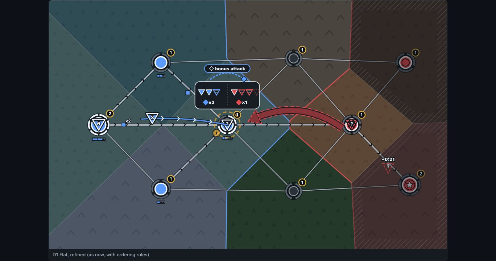 | 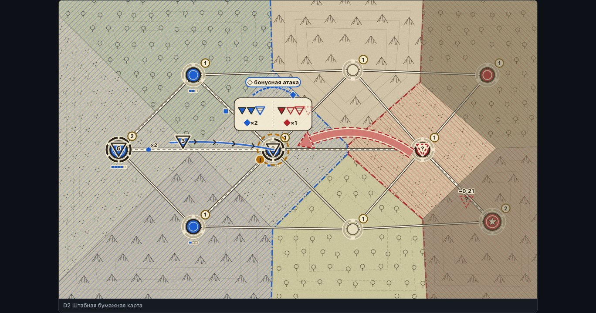 | 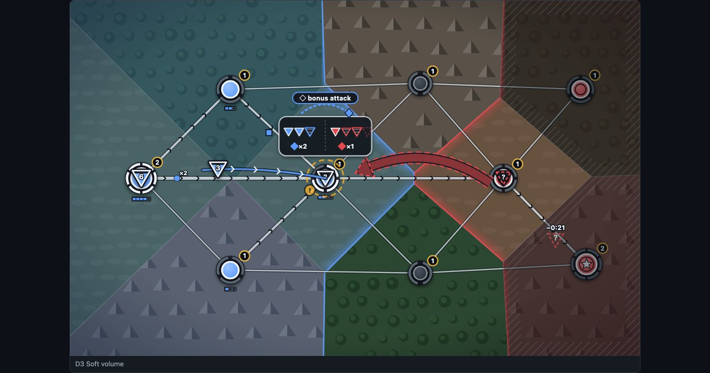 |

D2 in grayscale (the owner is distinguishable by the hatching angle and the dashed border, not by color): 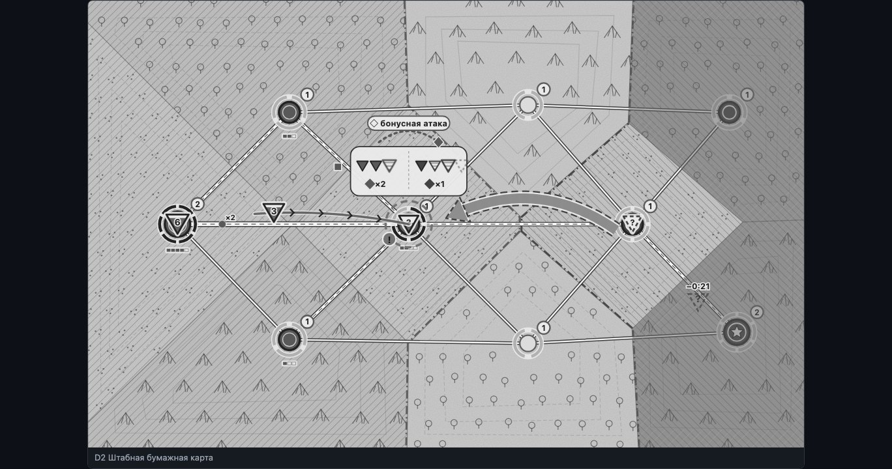

### 24.1 How each direction answers the problems of section 3.2

| Problem | D1 | D2 | D3 |
|---|---|---|---|
| R1 overlaps | the ribbon ends at the city ring, one backing under the icons | the same rule, the backing is paper | the same, shadows add depth but do not remove the overlap |
| R3 territory | angled hatching as a second sign + a denser fill | angled hatching and paper instead of a fill: the owner is visible without color | a border glow instead of a fill: more noticeable, but again by color |
| R4 neutral cities | lighter than the background | light paper, an ink outline | a volumetric gray disk with a highlight |
| R5 small signs | 12 px, a stroke | ink numbers on a light background: they read better | a number on a volumetric plate |
| R7 fog | a stripe in screen pixels | a gray "unexplored paper" + hatching of the stripe | darkening + a soft edge |
| "Recognizability" | as now, tidier | strong, unusual for the genre | a familiar "casual" look |

### 24.2 Table of variants

| | D1 Flat, polished | D2 Staff paper map | D3 Soft volume |
|---|---|---|---|
| Idea | the same flat dark language, strict ordering rules (section 24.5) | a light map: paper, contour lines, territory hatching, roads as on a map, borders in pencil | a dark map with volume: gradients, soft shadows, border glow, highlights on roads |
| DEC / protocol / simulation | no / no / no | no / no / no | no / no / no |
| In PixiJS | the constants of `style.ts`, stamps sparser, the ribbon end at the ring, a backing under the icons; `Graphics` as now | two token themes (`style.ts` becomes a theme), dark ink instead of the white outline, territory hatching with `TilingSprite`; the HUD stays dark | city and unit icons into sprites with a baked shadow (`generateTexture`), a border glow layer with `BlurFilter` and a cache (`cacheAsTexture`), a road highlight |
| Baking the backgrounds (`maps:bake`) | the biome palette is quieter (a small edit) | **a new baker**: paper with grain, contours from the height field (marching squares), stamps instead of biome color | relief shading (hillshade), soft biome transitions; the file is larger |
| Libraries | none | none (optionally the `NoiseFilter` of `pixi.js` itself; better to bake the grain) | none required; `pixi-filters` 6.1.5 only for convenience (section 24.3) |
| FPS price | zero | low: the background is one texture, hatching is a tile | moderate when baking, high with filters on every object (section 24.4) |
| Risk | low; does not give a recognizable style | **high**: a light map under a dark HUD, all the "white outlines" and the selection are redone, the 3:1 contrast is recounted, new references | medium: the "softness" of small signs at 20 px, texture memory, a harder pool and selection |
| Estimate (client) | M, 2-3 tasks, 3-5 days in total | L, 5-8 days (themes 2, baker 2, signs 2, references and contrast 1-2) | L, 5-8 days (sprites and cache 3, baker 1-2, FPS check 1, references 1) |
| Grayscale | as now + hatching | the best: hatching and dashes (section 24.1) | as now, colors without a new sign |

### 24.3 Libraries: compatibility with pixi.js 8.21 (checked with `npm view` on 2026-10-21)

The project is on `pixi.js` `^8.21.0` (8.21.0 in `node_modules`; 8.22.0 is in the registry).

| Package | Version | PixiJS peer dependency | Conclusion |
|---|---|---|---|
| `pixi-filters` | 6.1.5 (updated 2025-11-29, MIT) | `pixi.js >=8.0.0-0` | **compatible** with 8.21; needed only for DropShadow, Glow, Outline; all of this is done with the built-in `BlurFilter` and textures. Work under a CSP without `unsafe-eval`: not checked (section 24.4) |
| `@pixi/particle-emitter` | 5.0.10 (2026-01-08, MIT) | `@pixi/*` `>=6.0.4 <8.0.0` | **incompatible**: only PixiJS 6 and 7 |
| `@barvynkoa/particle-emitter` | 0.0.1 (2024-05-27, MIT) | `pixi.js >=6.0.4 <9.0.0` | declares compatibility, but it is the single version 0.0.1 with no updates for two years: we do not take it without a check |
| built into `pixi.js` 8.21 | `ParticleContainer`, `Particle`, `BlurFilter`, `ColorMatrixFilter`, `DisplacementFilter`, `NoiseFilter` (present in `node_modules/pixi.js/lib`) | | **enough** for fight sparks, grain and blur without dependencies |

Conclusion: no new dependencies are needed for any of the three directions; particles (fight sparks, dust) are made, if needed, with the built-in `ParticleContainer`.

### 24.4 Measurement: the per-frame price of the techniques

What was measured: the frame draw time in `pixi.js` 8.21 with the `pixi.js/unsafe-eval` import, as in the client. The scene is not from the game but
synthetic: 40 cities (a circle with a white outline and a ring of 6 segments), 40 roads, 40 moving triangles, a window of
1280×800, software WebGL (SwiftShader, `--use-angle=swiftshader`), per frame `renderer.render` and reading one pixel
(without it the driver does not wait for the end of drawing), the median of the frames. The script is one-off and is not in the repository; to repeat it, you need
a page with an `Application`, the modes from the table and the measurement itself.

| Technique | ms per frame | relative to flat |
|---|---|---|
| Flat: cities as `Graphics` (as now) | 29.9 and 30.5 | 1.00 |
| Cities as sprites with a baked shadow (`generateTexture`) | 25.1 and 25.7 | 0.84 |
| A city shadow as a filter (`BlurFilter` on each of the 40) | 46.7 and 48.0 | 1.55 |
| Border glow: a layer with `BlurFilter` every frame | 57.3 and 59.3 | 1.9 |
| The same, the layer cached (`cacheAsTexture`) | 20.2 (one series) | 0.66 |
| Grain: `NoiseFilter` on the whole scene | 19.4 (one series) | 0.64 |
| A 1280×800 background as one texture on top of flat | 41.5 and 41.6 | 1.4 |

How to read it. Two calm series out of five were taken; in the others the machine was busy with other processes (load average 30-55), the spread
was many-fold. The absolute numbers of a software render say nothing about integrated graphics: look at the ratios. Conclusions:

1. **A filter on every object and an uncached blur layer** (+55% and +90% per frame): this must not be done.
2. **Baked textures and cached layers cost no more than flat drawing**, and caching a static layer (the territory border, stamps) even makes it cheaper.
3. A full-screen filter in this measurement costs no more than flat. This is a feature of the software render (the frame is drawn without MSAA smoothing), on a GPU the price is different: **before choosing D2 with grain** measure on integrated graphics, better to bake the grain into the background.
4. A large background texture is noticeable by itself in the software render (+40%); the game already has a baked background, so for D2 and D3 it is not an addition but a replacement.
5. The `TilingSprite` hatching for D2 does not take part in the measurement: measure the price in a prototype.

Compatibility with the CSP: under the project's policy (`script-src 'self'`, no `unsafe-eval`) the pages with a `BlurFilter` on a layer, a `NoiseFilter` and
sprites with baked shadows rendered without a single violation (one of the five runs, "a shadow as a filter on each of 40 objects", did not
fit into 120 s because of the machine load, there were no CSP violations in it). `pixi-filters` under the CSP **[NOT SURE]**: not checked, because it was not added to the
project; to check: add it in a branch, `mise run preview` and a browser console without CSP errors.

### 24.5 Rules of D1 (if chosen) **[proposed]**

1. The ribbon and the order arrows end at the edge of the city ring (radius + 20), they do not go over the icon and the alert ring.
2. Relief stamps are no closer than 40 units to the city center (now 30) and quieter at the intersection with roads; mountain stamps do not look like road chevrons.
3. Under any icon on top of the map there is one `--plate` backing and one set of outlines: city 3, unit 2.4, arena chip 1.6.
4. A neutral city is lighter than the background; the VP icon has no yellow ring (separation from the alert, R2).
5. The unit number is 12 px with a stroke; a warehouse and capacity segment is no smaller than 6 px (at map scale 1).
6. The territory owner: color, border and angled hatching (your own "/", the opponent "\"): three signs, two of which are not color.
7. Fog: the hatching stripe is in screen pixels, not in map units.
8. Every map edit: frames before and after (`mise run shots`) and one frame in grayscale.

---

## 25. Recommendation and first tasks

**Recommendation: D1 "Flat, polished" now, with one technique from D2** (the hatching direction as a second, non-color sign of the territory owner).
Grounds:

1. The problems of section 3.2 (overlaps R1, the yellow pair R2, weak territory R3, neutral cities R4, small signs R5, fog R7) are
   unfinished ordering and contrast, not a lack of style; D1 closes them without changing the map language, which the owner has already worn in during rounds 2-4.
2. Before the closed playtest (REL-01, #88) the readability of the fight (V3, #330) and of the screens outside the match (package E) matters more than a new look: D2 and D3 cost
   5-8 days each and take this time.
3. D2 and D3 carry a real risk (section 24): a light map flips the "white outline" rule and the HUD contrast, soft volume runs into
   FPS on integrated graphics. D2 makes sense if the owner wants a recognizable style: then it is worth doing as a separate theme branch when
   D1 and V3 are already delivered, and first as a prototype on one map (baking paper and contours, 1-2 days).

**The first tasks after choosing D1** (by issues, each a separate PR, client, no DEC, protocol or simulation):

1. **D1-a. Order and contrast** (S-M, 1-2 days): the order ribbon ends at the edge of the city ring (R1); the VP icon has no yellow ring (R2);
   neutral cities are lighter than the background (R4); the unit number is 12 px (R5); the mark of the opponent's side on the ribbon tail is a double ring instead of
   a diamond (section 21). `visual` references and the before and after frames in the PR.
2. **D1-b. Territory without color** (S-M, 1-2 days): the owner hatching in a `TilingSprite` (your own "/", the opponent "\"), the fill is leveled by
   the background brightness; a grayscale check on the live maps `artery` and `web`.
3. **D1-c. Background and fog** (S, up to 1 day): stamps sparser and quieter near cities (R8), the fog stripe width in screen pixels (R7), the biome palette of
   `maps:bake` quieter (the background does not compete with the territory); `maps:bake` and updating the references.

Regardless of the choice: the V3 arena (#330, after #329) and the screens outside the match (package E, K6-K11) go in their own order; D1-a..c do not intersect with them
by files, except `fightView.ts` (not touched).

If the owner chooses D2 or D3: the first task will be **a prototype on one map** (baking the background and a token theme, an FPS measurement on
`demo`/`artery`), not a full implementation; the decision to continue is made by the frames and the measurement.

---

## 26. Map style, round 2: object volume, textures, fog, roads (#335)

**Status: four blocks [accepted] 2026-10-21 (section 26.3).** Issue #335 is closed; implementation: #344 (the T2 baker and WebP, a scene on a real map), #345 (roads R1, the packet), #346 (fog F1, layers LY2), #347 (BL1 shading and border highlighting).

**The owner's decision on #332, 2026-10-21 (partial) [accepted].** He liked D3 "Soft volume" for the shading part (gradients, soft shadows, border glow, highlights), the textures in general look better; **no semi-3D landscape**: no hillshade and no "lit hills", the relief stays flat in presentation. The final choice of the direction on #332 (D1, D2, D3 or "change nothing") stays with the owner; the statuses of sections 24 and 25 are not changed by this section.

Mockup: [`mockups/map-style-2.html`](mockups/map-style-2.html): a scene on a **fragment of the real map `arteriya`** (now `artery`, #390) (nodes 3-16: your own cities and groups, a fight with the DEC-32 arena, a group's order, the opponent's scheduled order, the territory border, fog with a ghost, roads of levels 1-3, construction on an edge, packets). Four independent blocks with switches, "all variants of a block side by side", grayscale, "reduced motion", scale 60% / 100% / 200%, a strip of signs 1:1 on three backgrounds, a road matrix, biome samples; a frame by address, for example `map-style-2.html#sh=1&tx=2&fg=2&rd=1&gray=1`. The textures are drawn by the script [`mockups/src/map_textures.py`](mockups/src/map_textures.py) (numpy and Pillow, deterministic, the biome field of the current baker; run `uv run python docs/design/mockups/src/map_textures.py` from the root).

| BL1 Shading (now, restrained, pronounced) | BL2 Textures (now, T1, T2, T3) |
|---|---|
| 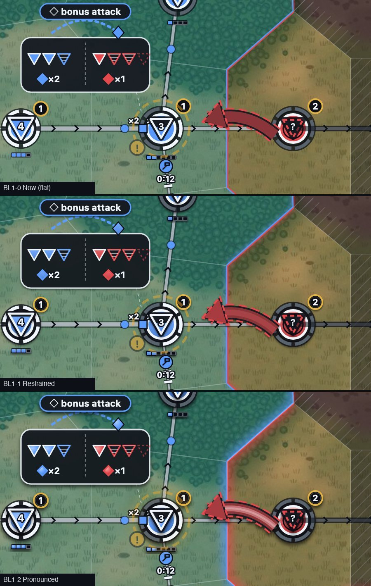 | 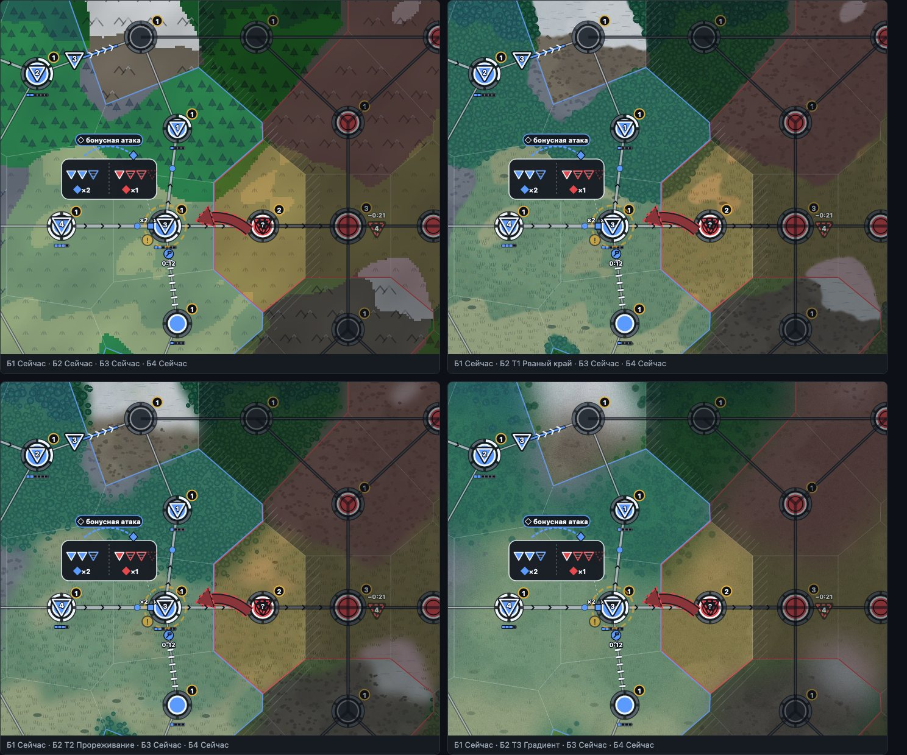 |

| BL3 Fog (now, F1, F2, F3) | BL4 Roads (a matrix of levels and states) |
|---|---|
| 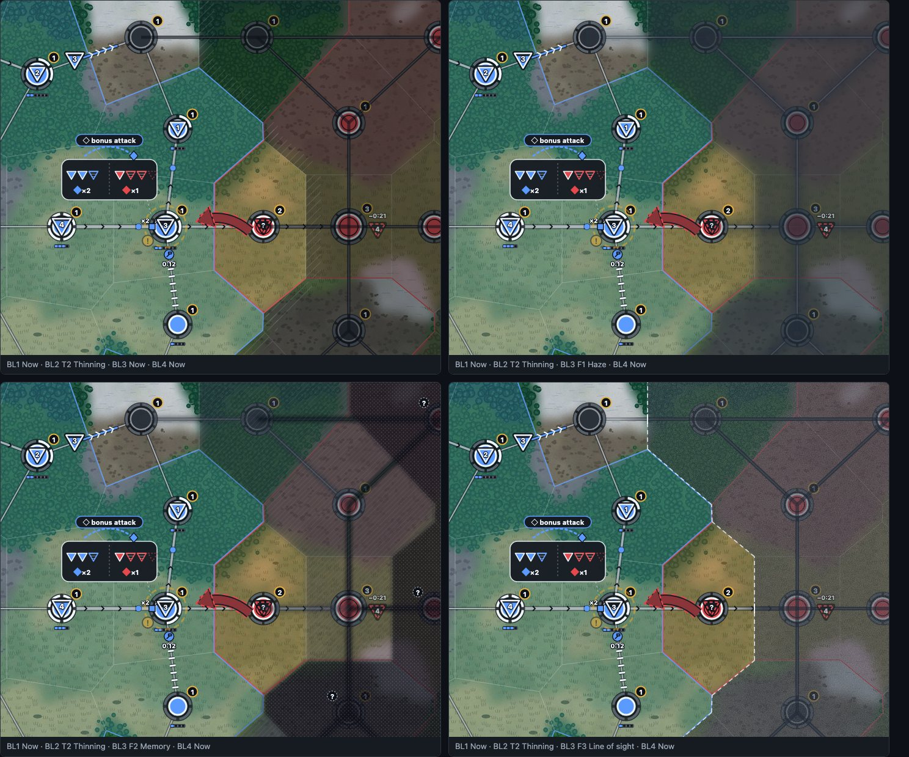 | 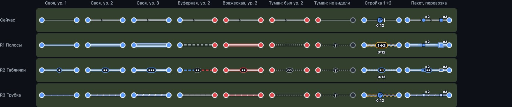 |

### 26.1 Table of variants

The FPS prices are taken from the measurement of section 24.4 (software WebGL, ratios to flat drawing: sprites with a baked shadow 0.84; a glow layer every frame 1.9, with a cache 0.66; a full-screen `NoiseFilter` 0.64); "about" means an estimate from these measurements, not a new measurement. The mockup is drawn in SVG, the PixiJS techniques are checked against the contents of `pixi.js` 8.21 (24.3), not with a prototype. There are no new packages in any variant. All the fog variants (BL3) use only `detail`, `seen`, `width` and public ownership: nothing beyond section 10 of `mechanics.md`.

| Block and variant | What changes (PixiJS, baking) | FPS price | Risk | Estimate | DEC, protocol |
|---|---|---|---|---|---|
| **BL1-1 Restrained** | sprites from `generateTexture` with a gradient and a 1.5 px shadow for cities, triangles, icons, arena chips; the border: a `BlurFilter` 3 px layer + `cacheAsTexture`; baking does not change | about 0.8-1.0 | low-medium; after #330 (a shared file `fightView.ts`) | M, 3-4 days | no, no |
| **BL1-2 Pronounced** | the same, a radial gradient, a highlight, a 3 px shadow, a 5.5 px glow | about 0.9-1.1, more texture memory | medium: the highlight makes a neutral city a "button", the shadow thickens the outline on snow | L, 5-6 days | no, no |
| **BL2-1 T1 Ragged edge** | the background is one texture, the `TerrainView` stamps (about 1300 sprites) are turned off; **a new baker**: a noise mask, detail sprites | not higher than the current one | low-medium: background formats, trees at the edge stick together | M-L, 3-5 days | no, no |
| **BL2-2 T2 Thinning** | the same, plus a narrow color stripe and a detail density field (they thin out and shrink toward the edge) | the same | low-medium | M-L, 3-5 days | no, no |
| **BL2-3 T3 Gradient** | the same, a wide blend, pale details, grain in the background | the same | medium: the borders are "soapy" at a large scale | M, 2-3 days | no, no |
| **BL3-1 Haze** | a 66% veil with a soft edge: polygons, `BlurFilter` 9 px, `cacheAsTexture`, recomputed when the set of cells changes; `fogView.ts` | about 0.66 with a cache (1.9 without) | low; in grayscale the border only by brightness | S, 1 day | no, no |
| **BL3-2 Memory** | three states: visible, "seen" (the veil darkens with the age of `seen.tick`, hatching), "never" (a dark veil, dots, "?"); `TilingSprite` patterns, cached layers | about 0.7-0.9 | low-medium: more states, a hint is needed | M, 2-3 days | no, no (`NodeView.seen`, `EdgeView.seen` already exist) |
| **BL3-3 Line of sight** | a grainy veil, a dashed border, a tick on the road at the border point, gradient roads | about 0.8-1.0 | medium: small signs compete with BL4 | M, 3 days | the middle of the edge: no, no; the border by the DEC-21 halves: **needs protocol/DEC-21 in PlayerView** (#233, #329), is not proposed as the main one |
| **BL4-1 Lanes** | level = the number of lanes, your own road with an owner backing, a buffer one dashed, fog with dots, "?" for a never seen one, a construction ribbon with a "1→2" plate, a square packet; `mapView.ts`, `layout.ts`, `entityView.ts` | about 1.0 | low; at 60% the lanes stick together | M, 2-3 days | no, no |
| **BL4-2 Plates** | a line and a plate with 1-3 dots on the edge, a buffer one split at the border point by the colors of its ends, wagons | about 1.0-1.05 | medium: about 44 more small signs | M, 3 days | no, no |
| **BL4-3 Tube** | a tube with a gradient and a highlight, an owner glow, running lights (number = level), a `TilingSprite` with scrolling | moderate, measure in a prototype | medium-high: animation, the "reduced motion" mode is mandatory | L, 4-6 days | no, no |

**The baker (BL2).** The rule of section 22 ("the baker on the standard library, PNG through zlib") is either kept (pure Python, a PNG of 2.2-2.6 MB per map against 0.12 MB now; 3-octave noise on 1600×1000 in pure Python 0.6 s, blur and sprites were not measured), or lifted for numpy and Pillow (they are already in `uv.lock` through matplotlib, declare them in `tools/maps/pyproject.toml`; WebP 0.27-0.29 MB, JPEG 0.30-0.35 MB, 2-3 s per map; `.bg.png` → `.bg.webp` changes the path on the server and in the client). The sizes of the whole-map background 1600×1000 (PNG / JPEG / WebP): T1 2.2 MB / 334 KB / 266 KB; T2 2.5 MB / 345 KB / 280 KB; T3 2.4 MB / 298 KB / 287 KB.

**The supply packet (BL4).** By the language of icons (section 21) a charge is a square, and the packet was round: the decision is independent of the choice of roads; the square was done in #345.

### 26.2 Recommendation

1. **BL1-1 Restrained.** It gives the depth of D3 at a minimal price for small signs (a 1:1 strip in the mockup: the number and the outline read on forest, plains and snow).
2. **BL2-2 T2 Thinning, the baker on numpy and Pillow.** The most "natural" transition without blur, the objects on top read, the file is 8 times smaller than the PNG. A fallback: keep the textures, a quieter palette (D1-c from section 25).
3. **BL3-2 Memory against the unknown.** The only variant that carries information (how outdated the knowledge is, where we have not been at all) on the data that is already in `PlayerView`; a fallback: BL3-1 (a day of work).
4. **BL4-1 Lanes** and the square packet. The level reads without color, your own road differs from a buffer one, the fog memory is visible; no animation.

In total about 10-15 days of client work, four separate PRs (after #330 and #329), no DEC, protocol or simulation; outside the client only the baker (BL2).

### 26.3 The owner's decision

**[accepted] 2026-10-21** (the owner, by the mockup `mockups/map-style-2.html`; the decision field: issue #335).

- BL1 Shading: **BL1-1 "Restrained", but the territory border highlighting as in "Pronounced"** (a border glow of 5.5 px and brighter, the rest as in "restrained").
- BL2 Textures: **T2 "Thinning"**; the baker: **(b) numpy and Pillow, the WebP format** (declare `numpy` and `Pillow` in `tools/maps/pyproject.toml`, lift the rule of section 22 about the standard library, `.bg.png` → `.bg.webp`).
- BL3 Fog: **BL3-1 "Haze"** (F1; not the recommended BL3-2, the owner's decision).
- **[decided] BL3-2, BL3-3 (#516, item 2):** stay as now (owner, 2026-10-30, #516); a later rework would be a separate effort.
- BL4 Roads: **BL4-1 "Lanes"** (R1); the supply packet: **a square**.

The implementation issues were opened after the choice per section 27: #344, #345, #346, #347 (order and parallelism: the description of each issue and tracking #282, section 11). BL1-1 in the description of #335 included "an order ribbon as a tube of two layers"; the decision on #339 "the look of the arrow and ribbons as now" is later and more specific, so the ribbons do not change.

**Implemented (#347, PR #409).** Cities (body with the capital star, capacity ring, warehouse bar, VP badge, barracks mark), group triangles (U1: plate, charge fill, outline with its rim, shield), the shield badge of an intent and the plate and chips of the arena are baked sprites (`apps/client/src/render/bake.ts`, `bakedShapes.ts`): the fill gradient is +16% to white at the top and -14% to black at the bottom, the shadow 1.5 px down (stacked outlines, no blur filter), a light rim at the top of an owned object (not on a neutral city). The recruit queue and the build bar stay vectors (their progress changes every snapshot). The territory glow is a `BlurFilter` layer inside one `cacheAsTexture` container, clipped to the owner's cells, rebuilt only when an owner changes; its parameters follow the "pronounced" ones (a line at 0.85); the numbers were matched to the mockup frame by eye, not copied: the line is 12 wide (mockup 10) and the PixiJS blur strength 4.5, because strength 5.5 gave a visibly weaker glow than the mockup's SVG blur of 5.5. The order ribbons are as before. In grayscale the glow of the two sides is equally light, so the border reads but the owner of the area does not by the glow alone (cities and tokens carry it, as before); an area pattern is R3 and is not done here.

---

## 27. Orders, the fight on the map and the arena in the chosen map style (#339)

**Status: [accepted] 2026-10-21 (section 27.3, shots: 29.4).** Issue #339 is closed; implementation: #330 (arena AR1), #346 (layers LY2), #351 (FX3), #352 (SH1), #353 (IN3, the bonus on the head), #354 (EF2). A continuation of #335: the map style is chosen (section 26.3), the current order ribbons next to it "do not look very good" (the owner, 2026-10-21).

Mockup: [`mockups/orders-style.html`](mockups/orders-style.html): self-contained, opens from a file, no network; **the same map `arteriya` (now `artery`, #390) and the chosen style** (restrained shading with the border highlighting of "pronounced", T2, haze F1, lanes R1, a square packet). Six scenes, each with axes with variant switches (**3-4 variants per element plus the current look**, section 23), "side by side" shows all the variants of an axis, scenarios, a clock with a time slider (play, pause, speed), grayscale, "reduced motion", scale 60% / 100% / 200%, a frame by address (`orders-style.html#s=plan&rib=4&side=3&p=1&t=2.6`). The fight engine in the mockup plays the DEC-24 and DEC-32 rules round by round and is checked against the table of examples of `mechanics.md` on the page (scene 6).

| Ordinary orders (scene 1) | Scheduled orders (scene 2) |
|---|---|
| 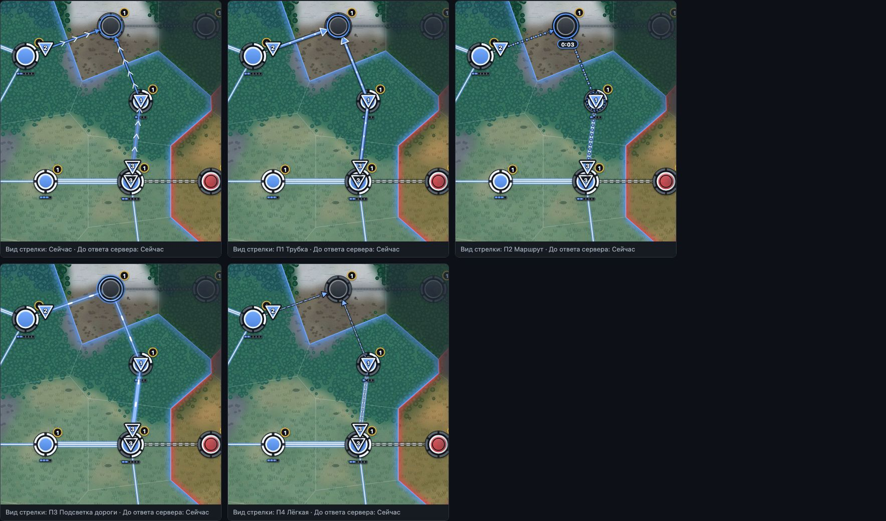 | 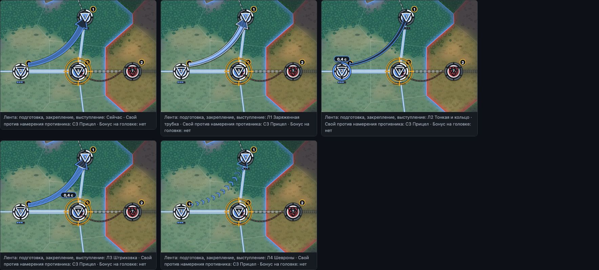 |

| The fight on the map (scene 4) | An enemy in the vision zone (scene 5) |
|---|---|
| 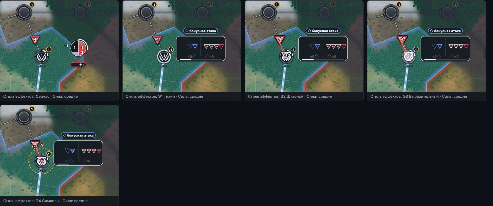 | 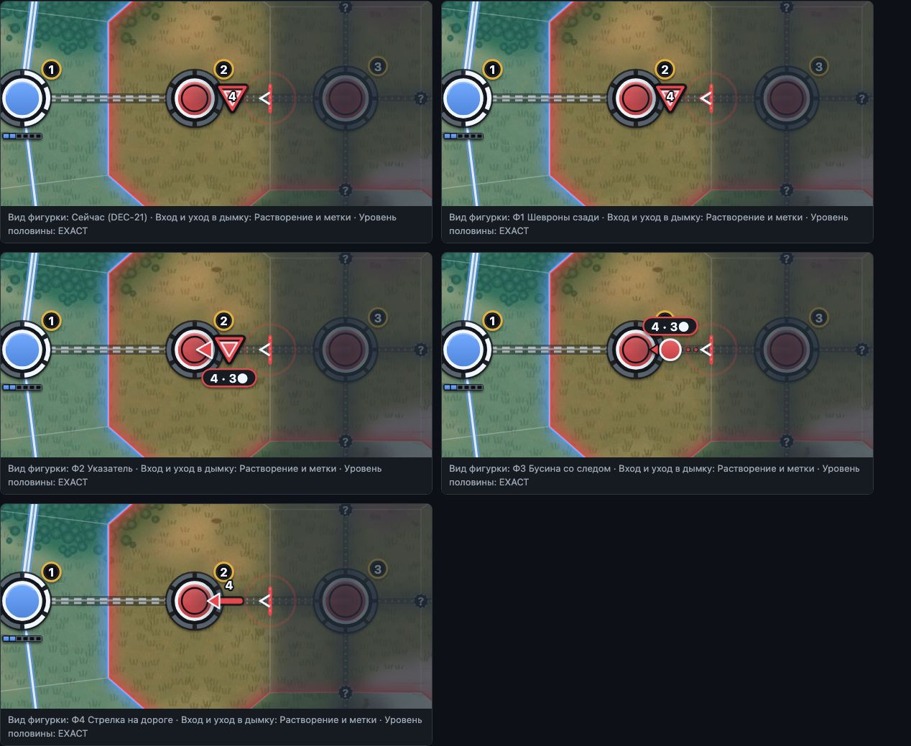 |

| The V3 arena and more than 8 units (scene 6) |
|---|
| 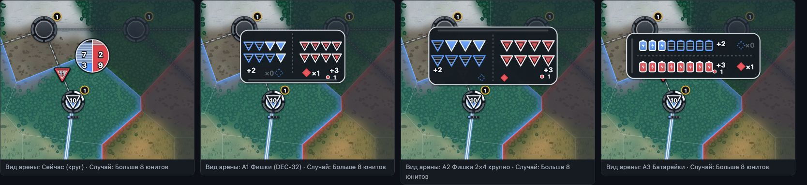 |

### 27.1 Scenes, axes and recommendations

FPS prices: an estimate from the number of PixiJS objects per frame and the measurement of section 24.4 (the ratio to flat drawing), not a new measurement; before implementing each block a prototype with a measurement on integrated graphics is needed. Particles only with the built-in `ParticleContainer`. "Needs protocol" is marked on the variants that need new data.

| Scene and axis | Variants | Recommendation | Estimate | DEC, protocol |
|---|---|---|---|---|
| 1 An ordinary order: the look of the arrow (your own path through several nodes and an adjacent node, movement, cancel) | Now, OR1 Tube, OR2 Route (dots, rings on nodes, the arrival time from `ack.arrive_tick`), OR3 Road highlight, OR4 Light | OR2 | S-M, 1-2 days | no, no |
| 1 The ghost before the `ack`, a rejection | Now (nothing), GH1 Dashes, GH2 Dispatch ring, GH3 Target marked | GH3 or GH2 (GH1 draws a straight line that may not exist: the client does not know the path before the `ack`) | S, 0.5 day | no, no |
| 2 Scheduled: preparation 3 s, pinning (one pulse, a strengthened outline), departure | Now, SC1 Charged tube, SC2 Thin ribbon and a countdown ring, SC3 Hatching, SC4 Chevrons (the delay lights the chevrons one by one) | SC4 | M, 2-3 days | no, no |
| 2 Your own against the opponent's intent (the size and composition are not visible) | Now, IN1 Size sign ("?" for the opponent), IN2 Two tiers, IN3 Crosshair (a thin arrow, a crosshair ring on the target) | IN3 | S, 1 day | no, no |
| 2 The bonus on the head | no, yes ("◇ +N") | no (after the decision about the protocol) | S | **needs protocol**: a bonus field in `OrderView` (DEC-29 computes the cap on the server at the departure tick) |
| 3 Counter and crossing ribbons | Now, CR1 Lanes along the road, CR2 Low arcs, CR3 Single stripe | CR2 | S, 0.5 day | no, no |
| 3 A ribbon over the R1 road, borders and in the F1 haze | Now, LY1 Glass, LY2 Over the haze, LY3 Gap, LY4 Hollow in the haze | LY4 (fallback LY2) | M, 1.5-2 days | no, no |
| 4 The fight on the map: the style and strength of effects (closing in, 2 s rounds, bonus shots with the caption "bonus attack" per A1, death, bounce, capture, a fight on an edge at the meeting point, three fights at once) | Now, FX1 Quiet, FX2 Staff, FX3 Expressive (particles), FX4 Symbols; strength: weaker, medium, stronger | FX2, strength "medium"; FX3 as the second step after a measurement | M, 2 days (FX3: 3 days) | no, no (data: `FightView`, `fight_round`) |
| 5 An enemy group in the vision zone (DEC-33): the look of the figure, entering and leaving the haze, the half level | Now (a mark in the middle of the half), EF1 Chevrons behind, EF2 Pointer, EF3 Bead with a trail, EF4 Arrow on the road; entering and leaving: Hard, From under the haze, Dissolve, Dissolve and marks | EF1 and "Dissolve and marks" | M, 2-3 days after the protocol | DEC-33 is accepted; **needs protocol** (`EdgeView.enemy_groups`, #296) |
| 6 The V3 arena (DEC-32) | Now (a circle), AR1 Chips (as in DEC-32), AR2 Chips 2×4 large, AR3 Batteries | AR2 (or AR1 in screen pixels) | M, 2-3 days (#330) | DEC-32 is accepted; protocol: the ◇ stock (#329) and a field of silent charges (27.2) |

In total the recommended set: the client about 13-17 days, 5-6 separate PRs after #330 and #329; no new dependencies.

### 27.2 Checking the V3 arena chips against DEC-24 and DEC-32 (conclusions for #330)

The check was done on the mockup page (scene 6): the engine, whose rules are taken from `mechanics.md`, reproduces the rows of the DEC-24 table (examples 2, 3, 6, 8, 9, 15: the number of rounds and the outcome) without discrepancies, then the chips are built from the player view fields (`units + losses`, `charged`, `losses`, the ◇ stock) and compared with the engine state after every round.

1. **Up to 8 units on each side the chips are correct**: the number of chips = `units + losses`, charged = `charged`, killed = `losses`; at every step of all the checked fights it matched the engine (rounds 1-4, including bonus shots and mountains).
2. **A silent charge on plains is shown wrongly** (DEC-24, item F2: a defender on plains has one charged unit that does not shoot in every round): the chip is drawn charged, but the side does not shoot, the viewer waits for a shot. The view field does not give this (`enemy_charged` is all the charges). **A "silent charges" field is needed for each side in `PlayerView.fights`** (protocol, better in #329, while `PROTOCOL_VERSION` is raised once) and a sign on such a chip (in the mockup: an amber crossed circle).
3. **"+N" with more than 8 loses the state of the hidden chips.** The order "charged, discharged, killed" shows the first eight: a row of eight charged and "+3" reads as "11 charged", though the hidden ones may be discharged. A proposal: next to "+N" a small number of how many hidden ones are charged (in the mockup: a dot and a number under "+N").
4. **Reinforcement** (DEC-24, item D) increases `units`, the number of chips grows (count `units + losses`, not the initial composition); new chips appear with a pulse.
5. **What changes in a round.** One shot per side per round (`shots_per_round = 1`): one charged chip of the side goes out, and one discharged one is killed (a charged one, only if there are no discharged ones). 1-2 chips per side should pulse, not all; which exactly cannot be learned from the view, this is a visual convention (the last charged one goes out, the last discharged one dies).
6. **The ◇ stock** is visible from contact (DEC-32, item 3): +1 for the defender in the mountains, the accumulated "Defense" and the plan bonus of the joining group; it grows on the tick when a reinforcement with a bonus joins. The caption "bonus attack" only in a round where `last_round.virtual > 0`.
7. **Size.** A chip of 15 units (AR1) is smaller than a meaningful symbol of 20 px (section 22) and at 60% smaller than 10 px; AR2 (19 units) meets the rule at 100%. The arena is worth drawing in **screen pixels** (the size neither grows nor falls with the map scale), like a plate.

### 27.3 The owner's decision

**The choice was received on 2026-10-21** (frame: `orders-style.html#s=arena&side=3&bonus=1&lay=2&scn_cross=layer&fx=3&k=1&scn_fight=three&mv=2&rev=3&scn_enemy=out&arena=1&case=2&act=arena`; recorded in the decision field of issue #339):

- [x] An ordinary order: the look of the arrow **as now**; before the server's answer **as now**
- [x] Scheduled: the ribbon of preparation, pinning, departure **as now**; your own against the opponent's intent **IN3 "Crosshair"**; the bonus on the head **yes** (the protocol is added in #329: a forecast of the plan bonus in the `OrderView` of your own group)
- [x] Counter and crossings: how the ribbons are separated **as now**; layers **LY2 "Over the haze"**
- [x] The fight on the map: the effect style **FX3 "Expressive"**; strength **"Stronger"** (a choice by shots of 2026-10-21, section 29.4, replaces the former "medium"); shots **SH1 "Tracers"** (29.4)
- [x] An enemy group in the vision zone: **EF2 "Pointer"**; entering and leaving **"Dissolve and marks"**
- [x] The V3 arena: **AR1 "Chips"**
- The switches "Half level" and "Case" in the mockup were a preview, not a choice: the half level is set by the DEC-21 terrain table.
- **[decided] AR2, AR3 (#516, item 4):** stay as now (owner, 2026-10-30, #516); a later rework would be a separate effort.

---

## 28. Map objects and menu icons: units, cities, barracks and "Defense" (#337)

**Status: [accepted] 2026-10-21 (section 28.1).** Issue #337 is closed; implementation: #347 (U1 as part of BL1), #348 (cities C1; the row of squares U4 was split off into #433), #349 (icons B1), #350 (menu icons I1). B2 "Building and rampart" is postponed, no issue is opened.

Basis: the owner's choice on #335 (recorded by issue #335): BL1 shading "Restrained" with the border highlighting as in "Pronounced", texture T2, fog F1 "Haze", roads R1 "Lanes". Mockup [`mockups/objects-style.html`](mockups/objects-style.html): the same scene (a fragment of `arteriya`, now `artery`, nodes 0-16, nodes 12 and 13 are shown as provinces) in this style and four blocks of 4 variants each plus "Now". What a variant shows the player is taken only from the fog rules of `mechanics.md` (DEC-04, DEC-21, DEC-26, DEC-30, DEC-31); no variant needs new data, a protocol or a DEC. The mockup background texture is drawn by the script [`mockups/src/objects_texture.py`](mockups/src/objects_texture.py) (functions of `map_textures.py`). Modes: grayscale, "reduced motion", map scale 60% / 100% / 150%, "all variants side by side", samples on four backgrounds; a frame by address, for example `objects-style.html#u=2&c=1&b=1&i=1&sc=60&gray=1`. The samples of each block are shown at 100% and 60%: meaningful signs keep the minimum size on screen (a group 20 px as now, the barracks and "Defense" icons in the new variants 16 px, like `symbolScale` of groups).

| Block | Variants | Recommendation | Estimate |
|---|---|---|---|
| 1 Units | Now ▽, U1 ▽ in the BL1 style, U2 Batteries, U3 Banner, U4 Token | U1 as the basis; the row of charge squares from U4 as a separate decision | S-M, 1-4 days |
| 2 Cities | Now, C1 A BL1 circle (warehouse places by level, a province as a hollow ring), C2 Tower, C3 Card, C4 Wheel | C1 | S-M, 1-4 days |
| 3 Barracks and "Defense" | Now, B1 Icons, B2 Building and rampart, B3 Barriers, B4 Status line | B1 | S-M, 1-3 days |
| 4 Menu icons | Now (font symbols), I1 Line, I2 Disks, I3 Squares, I4 Two-tone | I1 | S, 1 day |

| Units (100%, samples) | Cities (samples) |
|---|---|
| 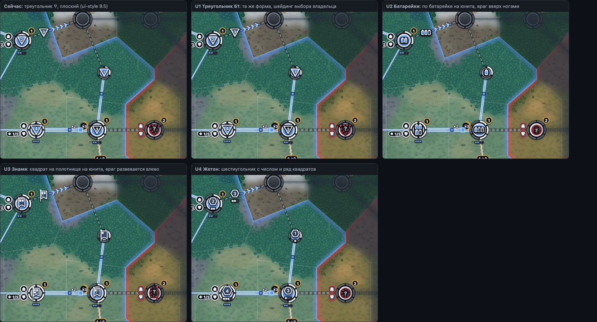 | 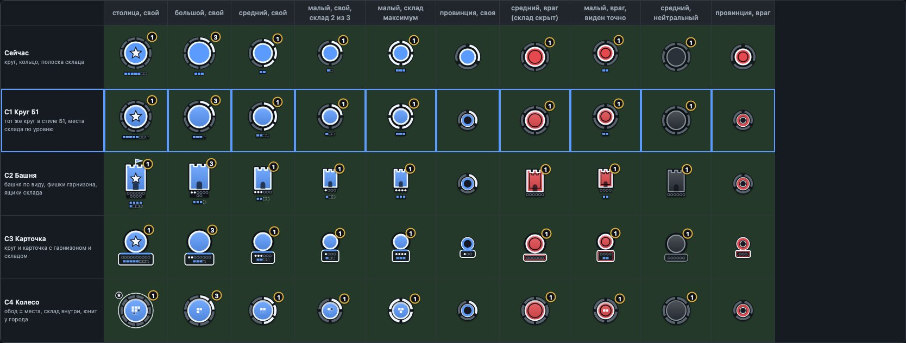 |

| Barracks and "Defense" (samples) | Icons and menu |
|---|---|
| 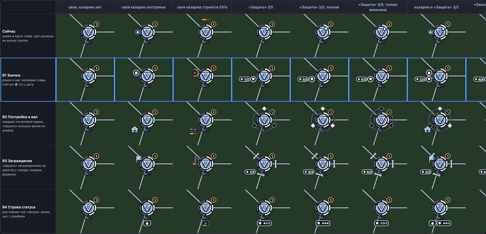 | 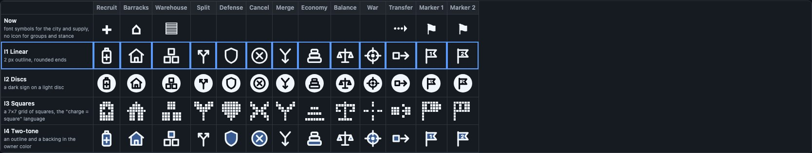 |

FPS prices: estimates from the measurement of section 24.4 (the ratio to flat drawing); the HUD menu icons do not affect the map FPS. A detailed table for each variant (what changes in PixiJS and Svelte, risk, days) is in issue #337 and on the mockup page.

### 28.1 The owner's decision

**The choice was received on 2026-10-21** (the owner accepted all the recommendations; the decision field: issue #337).

- [x] Units: **U1** as the basis; the row of charge squares from U4 on top of U1: **yes** (a square per charge: filled = charged, empty = discharged; "+N" for long rows, as with arena chips)
- [x] Cities: **C1** (including the hollow province ring and the dotted warehouse places)
- [x] Barracks and "Defense": **B1 "Icons"** (B2 "Building and rampart" a possible later step, **postponed**)
- **[decided] B2, B3, B4 (#516, item 1):** stay as now (owner, 2026-10-30, #516); a later rework would be a separate effort.
- [x] Menu icons: **I1 "Line"**

---

## 29. Shots in the fight on the map: animation variants (#339)

**Status: [accepted] 2026-10-21 (section 29.4).** Issue #339 is closed; implementation: #351 (FX3, the common part), #352 (SH1). Basis: the owner's choice of 2026-10-21 on scene 4 (section 27.3): the FX3 "Expressive" effects, strength medium, arena AR1; the owner wants the shots themselves to look better and "not so banal".

Mockup: [`mockups/fight-shots.html`](mockups/fight-shots.html): self-contained, opens from a file, no network; the same fight scene and the same map style as in `orders-style.html` (BL1 with border highlighting, T2, F1, R1, arena AR1), the fight engine is the same (the DEC-24 and DEC-32 rules round by round, checked against the table on the page). Six rows of the "Shot" switch: the current FX3 and five new ones. Switches: strength (weaker, medium, stronger), one fight or three at once, five fight scenarios (forest: a bonus against a real one, cancellation, bounce; forest: the bonus kills, capture; plains: the defender's silent charge; mountains: the defender's bonus; edge: the meeting point), the distance between groups (in FX3 they stood 46 units apart, shots need more: 110 by default), slow motion ×0.25 for analysis, grayscale, scale 60% / 100% / 200%, "all side by side", the AR1 arena on and off, a time slider and "scenario rounds" buttons (a frame 0.5 s before the round tick). "Reduced motion" is not needed for the fight animation (the owner), it is absent from the mockup. A frame by address, for example `fight-shots.html#v=5&s=hold&p=1&t=5.42`.

| Cancellation (frame 5.42 s, all variants side by side) | Kill (9.82 s) |
|---|---|
| 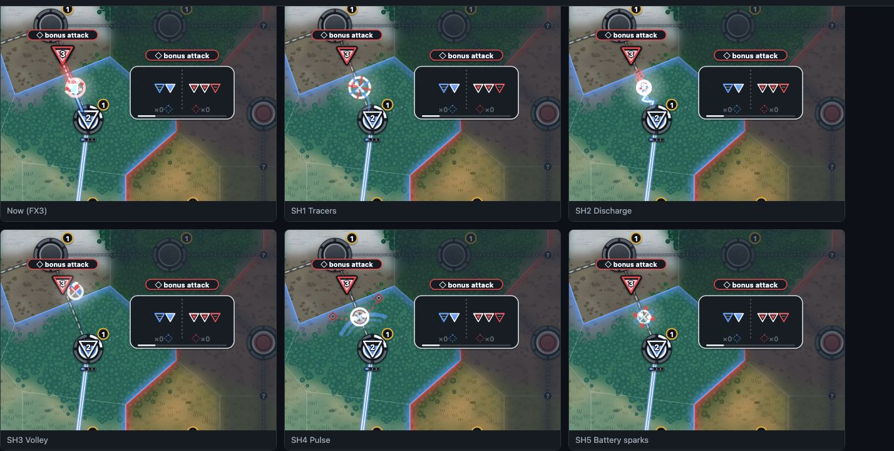 | 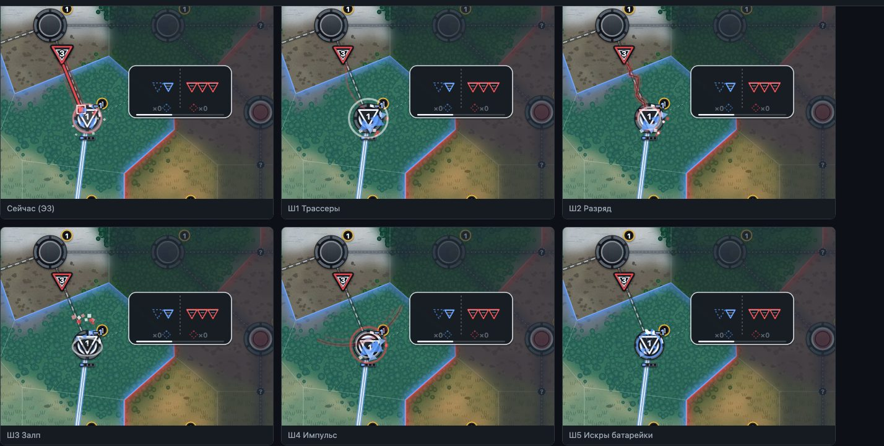 |

| Three fights at once, SH5 | Grayscale, cancellation |
|---|---|
| 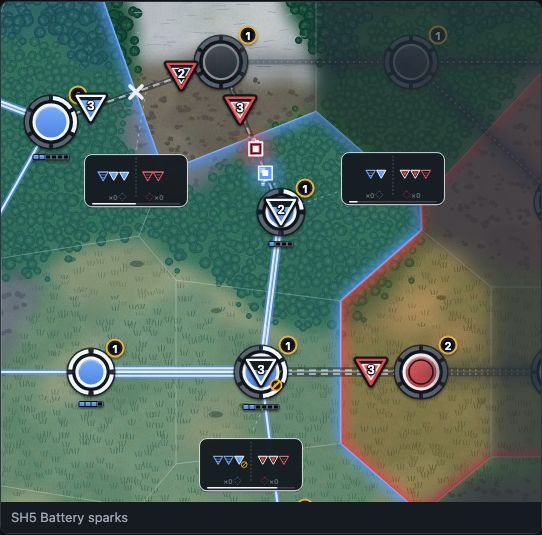 | 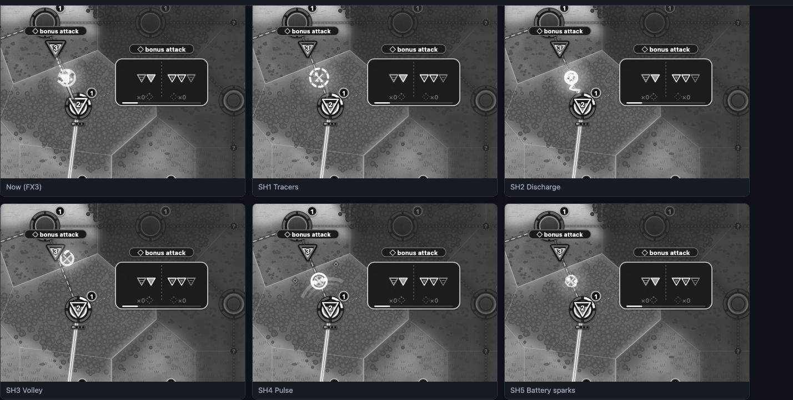 |

### 29.1 What every variant must distinguish (by the round rules)

The same in all variants (this set is also what is checked in grayscale; a shape, not only color, AGENTS.md, 7.4):

| State | Sign |
|---|---|
| a real shot | a solid square ■ in the side's color (a charge, section 21), spends a charge |
| a bonus (virtual) shot | a hollow diamond ◇, a thinner and paler body, a plate "◇ bonus attack" at the shooter (and in the AR1 arena) |
| cancellation (a shot against a shot) | both shots meet in the middle (equal speed, after 0.3 s instead of 0.6 s), a collision, a cross of two small strokes; nobody is hit |
| killing a unit | the shot arrives, ▽ fragments in the loser's color, "−N" |
| a silent charge (DEC-24, item F2: plains) | an amber sign on the group, a dim dashed ring for a round tick, no projectile, no flash; the caption "silent" in the first round |
| bounce, capture | as in FX3: a dashed arrow back, a wave and a flag |
| side | color and shape: the opponent has a double outline on the shot head and a dark core of the body |

Time: a round is 2 s (DEC-32); a wind-up of 0.35 s before the tick, the flight of a killing shot 0.6 s, fading and fragments up to 1.0 s after the hit, "−N" 1.0 s; everything ends at 1.6 s, the wind-up of the next round from 1.65 s (checked on the page). The data is the same as for the arena: `last_round` (shots, bonus ones, losses) and the field of silent ones (section 27.2); the client does not compute the outcome, it shows the fields.

### 29.2 Table of variants

The frame price: **a calculation of the page, not a measurement.** A dry run of the "three fights" scene counts what the same frame would put on the PixiJS side (a Graphics primitive 1, a sprite from a pool 0.5, text 2, a `ParticleContainer` particle 0.05), and ties it to FX3 from #339 (the worst frame 1.10-1.25, taken 1.18; the average about 1.03). Common to all: an effects layer, pools, one particle atlas and two `ParticleContainer`s for all fights (an ordinary one and an additive one; the blend mode is set by the container), four baked head textures (a square and a diamond, your own and the opponent's), glows as sprites with a baked gradient, no filters; about 1.5 days for everything common, it is included in the estimate of FX3. Whether anything else is needed: no DEC, no protocol (except the silent-ones field, already in the list of #329), no simulation.

| Variant | What changes in PixiJS | Frame price, three fights (calculation) | Risk | Estimate |
|---|---|---|---|---|
| Now (FX3) | a straight tracer with an outline and a glow, a ring, a flash, sparks, small square fragments | worst 1.18, average 1.03 (Graphics 18, sprites 5, particles 11) | looks like one more line; cancellation does not differ from a hit | chosen, 3 days |
| SH1 Tracers | a Bezier curve, a tail as a tapering polygon with a gradient, a head sprite, sparks; counter shots bend to different sides and meet; a bonus one: an empty tail and echo diamonds | 1.17 / 1.03 (17, 4, 16) | low; the most familiar look; the gradient fill of a polygon in Pixi: `FillGradient`, check with a prototype | M, 3 days |
| SH2 Discharge | lightning: a polyline of 9 points with a grain per shot (the shape does not jitter, WCAG 2.3.1), three stroke passes, branches; a bonus one: a chain of hollow diamonds and a dash; counter ones converge into a "knot" | 1.27 / 1.04 (30, 6, 8) | medium: the most expensive and the brightest with three fights, hides the token at the hit place | M-L, 3-4 days |
| SH3 Volley | a ballistic arc, a shadow sprite on the ground, an aiming dashed arc; a collision in the air, fragments fall; a scorch mark | 1.15 / 1.03 (11, 8, 24) | medium: the upward arc goes onto neighboring nodes, worse at 60%; "artillery" against the battery theme | M-L, 4 days |
| SH4 Pulse | a fan of three arcs (`Graphics`), interference rings on cancellation, a push of the group by 8 units on a hit | 1.18 / 1.03 (20, 1, 16) | medium: there is no "head", the square and the diamond do not read, real and bonus are held only by solid and dashed; stands out of the language of icons | M, 3 days |
| SH5 Battery sparks (**recommendation**) | a cell ■ (the same square as a charge in the warehouse) with a tail of sparks: particles of one container; wind-up: sparks are drawn to the group; cancellation: a "short circuit", the cells burst into small ones; kill: sparks upward and a dashed ghost of the lost ▽ | 1.13 / 1.02 (11, 3, 34): cheaper than FX3 | low-medium: the most particles (in one container); in grayscale the sparks drown in the glow, the difference is held by the head shape (checked) | M, 3-4 days |

### 29.3 Recommendation

**SH5 "Battery sparks":** it is the only variant that grows out of the theme of the game (a battery unit, a charge as energy), it uses the already settled language (■ charge, ◇ bonus, the row of charge squares in #337), gives a cancellation that looks like a collision ("a short circuit") and not like one more line, and by the calculation costs no more than FX3 (the weight is in particles, not in Graphics). A fallback: **SH1 "Tracers"** (the most familiar and reliable, but the most banal). **SH2 "Discharge"** is the most spectacular, but the most expensive and noisy with three fights; take it if "wow" matters most and you are ready to spend frame time. Strength "medium": FX3 from #339 is already chosen, "stronger" in SH5 adds sparks and the size of flashes.

### 29.4 The owner's decision

**The choice was received on 2026-10-21** (the owner, by the mockup `fight-shots.html`; recorded in the decision field of issue #339):

- [x] Shots: **SH1 "Tracers"** (not the recommended SH5: the owner's decision)
- [x] Strength: **"Stronger"** (a coefficient of 1.6 on the length and brightness of the trails and the number of sparks; the price of FX3 about +40%; replaces the former "medium" from 27.3)
- [x] The distance between groups in a fight on the map: **as now (46)**

**Risks recorded next to the choice:**

1. At a distance of 46 the tracer track is short, the bend is almost invisible. If the shot does not read, **lengthen the trail (the tail, the fading path), not move the groups apart**: the placement of groups stays as now.
2. A tail as a polygon with a gradient on `FillGradient` in `pixi.js` 8.21 must be **checked with a prototype** before implementation (a CSP without `unsafe-eval`, the frame price on integrated graphics).
3. "Stronger" costs about +40% to the price of FX3 ("dangerous for weak graphics"): a measurement with a prototype before the main work, a fallback knob: the strength constant (#351, #352).

Implementation: #351 (FX3: the effects infrastructure, fight events, strength), then #352 (the SH1 shots).

**[decided] SH2-SH5 (#516, item 3):** stay as now (owner, 2026-10-30, #516); a later rework would be a separate effort.

### 29.5 The shot counter (#516, item 5) [decided]

No counter for now. The variants CT1-CT4 and the current look are in [`mockups/shot-counter.html`](mockups/shot-counter.html) (the decision page of the postponed variants: [`mockups/postponed-516.html`](mockups/postponed-516.html)). **[decided] stay as now (owner, 2026-10-30, #516); a later rework would be a separate effort.**

---

## 30. Variant id mapping (old Cyrillic to new Latin)

Since 2026-10-27 (#401) all variant ids are Latin. The rule: **the Cyrillic prefix is replaced by the Latin one, the numbers and the sub-numbers are kept**
(the table gives every prefix; for example, sub-id 2-3 of block BL2 keeps its number). The new prefixes are two letters and do not collide with the ids that were already Latin
(D1-D3 directions, K1-K14 and R1-R9 of section 3, T1-T3, F1-F3, U1-U4, C1-C4, B1-B4, I1-I4 of section 28, V1-V3 arena views, packages A-F, priorities P0-P2).

| Old (Cyrillic) | New (Latin) | What it names | Where |
| --- | --- | --- | --- |
| А1, А2, А3 | AR1, AR2, AR3 | views of the fight arena (A1 chips, A2 chips 2×4 large, A3 batteries) | section 27, `orders-style.html`, `fight-shots.html` |
| Б1, Б2, Б3, Б4 | BL1, BL2, BL3, BL4 | blocks of map style round 2: shading, textures, fog, roads | section 26, `map-style-2.html` |
| Б1-0, Б1-1, Б1-2 | BL1-0, BL1-1, BL1-2 | shading variants (now, restrained, pronounced) | section 26 |
| Б2-0, Б2-1, Б2-2, Б2-3 | BL2-0, BL2-1, BL2-2, BL2-3 | texture variants (now, T1, T2, T3) | section 26 |
| Б3-0, Б3-1, Б3-2, Б3-3 | BL3-0, BL3-1, BL3-2, BL3-3 | fog variants (now, haze, memory, line of sight) | section 26 |
| Б4-0, Б4-1, Б4-2, Б4-3 | BL4-0, BL4-1, BL4-2, BL4-3 | road variants (now, lanes, plates, tube) | section 26 |
| Г1, Г2, Г3 | GH1, GH2, GH3 | the ghost of an order before the server's `ack` (dashes, dispatch ring, target marked) | section 27 |
| К6-К11 | K6-K11 | not a new id: the Cyrillic letter К was a typo for the Latin K of section 3.1 | section 3.1 |
| Л1, Л2, Л3, Л4 | SC1, SC2, SC3, SC4 | the scheduled order ribbon (charged tube, thin ribbon and a ring, hatching, chevrons) | section 27 |
| П1, П2, П3, П4 | OR1, OR2, OR3, OR4 | the look of an ordinary order arrow (tube, route, road highlight, light) | section 27 |
| Р1, Р2, Р3 | CR1, CR2, CR3 | how counter and crossing ribbons are separated | section 27 |
| С1, С2, С3 | IN1, IN2, IN3 | own order against the opponent's intent (size sign, two tiers, crosshair) | section 27 |
| Сл1, Сл2, Сл3, Сл4 | LY1, LY2, LY3, LY4 | layers: ribbon over the road, the border and the haze (glass, over the haze, gap, hollow) | section 27 |
| У1-У20 | IM1-IM20 | the improvements of section 4 | sections 4, 13, 14, 16, 17 |
| Ф1, Ф2, Ф3, Ф4 | EF1, EF2, EF3, EF4 | the look of an enemy figure in the vision zone (DEC-33) | section 27 |
| Ш1, Ш2, Ш3, Ш4, Ш5 | SH1, SH2, SH3, SH4, SH5 | the look of shots in a fight (tracers, discharge, volley, pulse, battery sparks) | section 29 |
| Э1, Э2, Э3, Э4 | FX1, FX2, FX3, FX4 | the style of fight effects on the map (quiet, staff, expressive, symbols) | sections 9.9, 27 |

Not renamed: the ids that were already Latin and mean something else: **A1 and A2 of DEC-32** (the display of the bonus shot in `fight-arena.html`: A1 an arrow and a caption, A2 a history strip), V1-V3 (arena views), D1-D3, T1-T3, F1-F3, R1-R9, K1-K14, U1-U4, C1-C4, B1-B4, I1-I4.
In the code comments of the mockups the Latin spellings E1-E3 (for IN1-IN3, the target marker of an intent), E3 (for FX3) and A1, A3 (for AR1, AR3) were also unified to the new ids.

---

## 31. Start menu redesign (#471)

Status: **[awaiting the owner's decision]**. The owner asked for the redesign before the release on 2026-10-28 (the item "Start menu: redesign" of #252 and #282 section 2), so the postponement of section 23 does not apply to it. It supersedes the proposal of section 13.2 for the menu and the welcome screen once chosen; sections 13.3 to 13.9 stay as the default for the other screens until then.

Mockup: [`mockups/start-menu.html`](mockups/start-menu.html), frames in [`mockups/img/start-menu/`](mockups/img/start-menu/). It shows the current look (**Now**) and four variants for the same 15 states: welcome (and its error), menu for a guest, an account in calibration k/5 (DEC-34) and a rated account, the account menu, a match in progress, the queue (searching, long wait with the bot offer, opponent found, confirmed), the queue ban with the time left, a network error, and the bot, friend, lobby and replays places.

| Id | Variant | Client effort | Risk |
| --- | --- | --- | --- |
| Now | the 420 px card, four equal buttons | none | no main action, no ban time, no calibration |
| A | **Front**: the real pool map as the postcard, a text rail with one huge Play, the queue shown on the map | M, 2-3 days | low to medium |
| B | **Capital**: the menu is a small map, the capital is Play, the cities are the modes | L, 4-5 days | medium to high |
| C | **Ledger**: type and hotkeys, a list and a detail pane, no picture | S, 1-1.5 days | low (weakest first impression) |
| D | **Versus**: your triangle against an empty "?" slot, one selector, one Play, settings inline | L, 4-5 days | medium (biggest refactor) |

No variant needs a DEC, a protocol change or a server change. Optional inputs that do not depend on the choice: the rating in `GET /api/me` and a match list for the Replays row (LB-01, #78), the "How to play" screen (#72). **Recommendation: A**, with C as the fast fallback; the reasons, the list of what the implementation touches and the questions to the owner are in #471.

**Owner's decision (2026-10-29):** variant **S "Split"**: the small text rail, the list at the left, the profile of the chosen row at the right, the own profile by default. The six questions of #78 got no answer, so the client uses these defaults (each changeable later):

| # | Question | Default |
| --- | --- | --- |
| 1 | Menu rows | **Leaderboard** (key T) and **Replays** (key R), two rows |
| 2 | What Replays opens | the own profile with its match history scrolled into view |
| 3 | Record blocks | two: ranked and calibration, all matches |
| 4 | Other players' profiles | the ranked matches only (kinds `rated` and `calibration`) |
| 5 | Guest profiles | open from an opponent link, a "Guest" chip, no rating |
| 6 | Own rank beyond the top 100 | a pinned own row with the real rank |

Implementation (superseded by section 41, #629: the split screen, the profile panel and the rail are gone): `apps/client/src/board/` (`LeaderboardScreen`, `BoardList`, `ProfilePanel`, `MatchRow`, `ReplayChip`, `SplitFrame`), dev scenes `?menu=board-*`, `profile-*`, `replays` (`src/dev/boardScenes.ts`). The rail has a "Menu" way back (Esc) instead of the dimmed Play of the Dock; the corner chip keeps the account menu and shows the rating; "Preparing" is a chip, only a ready replay is a button.

---

## 32. Progress indicators: the CP bar and the cells of builds and recruiting (#430, #439)

Status: **[accepted]**, the owner's decision of 2026-10-28 (issue #430, mockup [`mockups/progress-style.html`](mockups/progress-style.html), frames in [`mockups/img/progress/`](mockups/img/progress/)). Implemented in #439 (client only: no DEC, no protocol change, no `SIM_VERSION` or `PROTOCOL_VERSION` bump).

| Element | Choice | Where in the code |
| --- | --- | --- |
| CP bar in the HUD | **C "Track"**: one notched pill with a head marker on the growing end; at the cap a dashed amber ring and the word `MAX` | `hud/TopBar.svelte`, `hud/topBar.ts` (`cpTrack`) |
| Recruit queue at a city | **A "Cells"**: up to `queue_max` cells; queued = dot, in production = hatch with a head line, ready with no room = solid amber cell with a dashed amber ring, free slot = dashed frame (selected city only) | `render/progressLayout.ts`, `bakedShapes.ts` (`queueMarkSpec`), `cityView.ts` |
| Barracks and warehouse build at a city | **A "Cells"**: one wide cell and a kind badge (house = barracks, stacked squares = warehouse); both builds use the one plate because they share the build slot | `progressLayout.ts` (`buildMark`), `bakedShapes.ts` (`buildMarkSpec`) |
| Progress stopped by a fight in the city (DEC-25, item 9) | the dashed amber ring round the first queue cell, the hatch keeps how far the unit got | `cityView.ts` (`fights` of the snapshot) |
| Warehouse charges at a city | unchanged: C1 of #348 (section 9.4) | |

**Data (AGENTS.md 7.1).** Everything comes from the snapshot and `ruleset_public`: `recruit_queue`, `recruit_progress`, `recruit_waiting`, `building` (`kind`, `done_tick`) and `fights` of the view; `recruit.unit_ticks`, `recruit.queue_max`, `city_upgrades`. The only derivations are the share done (`progress / unit_ticks`, the build's elapsed ticks over its duration) and the choice of what to draw: a city shows free slots when it is selected, own, has a queue in the view and (with the city development) the barracks, the same test as the city menu (`cityChoices.ts`). Whether a unit is ready or the production stands is the server's `recruit_waiting` and the presence of a fight in that node.

**Cost.** The plates are baked sprites, one texture per look. The key holds the cell states and the width of the growing part in whole pixels (12 of them in a queue cell, 32 in the build cell), so a look is made once and shared by every city; textures nobody shows are dropped with the cache's limit. The pulse of the ring is the alpha of one sprite. No filter per object, no `Graphics` redraw per snapshot.

**Checked in grayscale and at 60%** (`mise run shots`: `progress-gray-60.png`, the scene `progress` in a 768 x 480 window with a grey filter, and `progress-selected.png`). Each state has its own pattern, so none needs the hue: a dot (queued), a hatch with a head line (in production), a solid cell (ready), a dashed frame (free slot), a dashed ring (needs a look). At 60% a queue cell is about 10 x 6 px: the dot, the solid cell and the dashed ring still read, the hatch reads as a half-filled cell with a lighter head; the same legibility as the mockup's own grayscale-60 frame (`progress-grayscale-60.png`). The stack of the build plate over the queue plate stays clear of the VP badge (upper right) and the barracks mark (left).

**Not part of this section:** variants B, D of the CP bar and B, C, D of the progress marks stay in the mockup; the look of units and planned orders (#431); the row of squares at a group (#433).

---

## 33. Planned orders, unit tokens, cities and provinces (#431)

Status: planned orders **[accepted]** 2026-10-29: ODb Low relief (round 3); **units and cities [accepted] 2026-10-29: they stay as they are now** (U1 with the #508 fill and dividers, C1), none of rounds 1 to 4 is chosen; provinces moved to section 35. The owner asked for this round before the release on 2026-10-28 (issue #431, the cities and provinces part added the same day), so the postponement of section 23 does not apply to it. Until the choice, sections 9.4, 9.5 and 9.7 stay as they are; #433 (the row of squares) waits for the units part.

### 33.1 Round 1 (superseded by round 2 for the choice)

Mockup: [`mockups/tokens-cities-orders.html`](mockups/tokens-cities-orders.html), frames in [`mockups/img/431/`](mockups/img/431/), kept unchanged. Variants: orders O1 Slim arc, O2 Medallion, O3 Beads, O4 Rail and target; units U1+U4 Row, UB, UC, UD; cities CA Tidy, CB Banner, CC Citadel, CD Skyline; provinces P1 Pip, P2 Plot, P3 Pennant, P4 Field. The owner's feedback of 2026-10-29 (recorded in #431): **orders**: the current look is the favourite; no thinner orders, nothing that loads the interface (like O3), only experiments with the existing look (opacity, fill, textures), no overlaps, nothing that looks unfinished; in O1 the head stood apart from the line, which must not happen. **Units**: round 1 changed only the fill and the charge display; other shapes and a richer look are wanted, in the neutral setting (the battery look stays rejected). **Cities** and **provinces**: leave the plain circle, richer structure and textures.

### 33.2 Round 2 (superseded by round 3 for the choice)

Mockup: [`mockups/tokens-cities-orders-r2.html`](mockups/tokens-cities-orders-r2.html), frames in [`mockups/img/431-r2/`](mockups/img/431-r2/). The same shell as round 1 (the `ridge` fragment at zoom 0.45, 0.7, 1.0, 1.5, the 9 s clock, the state matrices, grayscale, reduced motion, the frame in the address, the DEC-35 fog with the owner's display decision of 2026-10-29). Textures are SVG patterns in the mockup; in the client each look is one baked texture (SpriteCache, AGENTS.md 7.2), and each variant card gives its bake and FPS cost.

| Element | Variants (besides Now) | Recommendation |
| --- | --- | --- |
| Planned orders (refinements of the shipped ribbon only; head and body one outline in every variant) | OA Clean, OB Glass, OC Hatch, OD Embossed | OA (second: OC) |
| Units (new shapes, neutral setting) | UA Counter, UB Pennon, UC Pawn, UD Blocks, UE Regiment, UF Carved ▽ | UE (second: UA) |
| Cities (beyond the circle; fixed slots for every chosen mark) | CA Bastion, CB Districts, CC Emblem plate, CD Terrain base, CE Curtain wall | CE (second: CA) |
| Provinces (lighter than cities, no dark centre, readable round a token) | PA Furrowed plot, PB Field patches, PC Palisade, PD Waystone, PE Hamlet | PA (second: PB) |

Rules the round keeps for every variant: the new order variants stop the head at the rim of the target sign (own) or on the target ring (the opponent's, a ring open at the bottom for the caption) and start the tail outside the badges of the source; the bonus pill sits on the outer side of the arc; the opponent's tail mark is a double ring (the ui-style 21 fix). Units show the charge without colour (filled vs empty place), exactly up to 8 units and in proportion above, with the number on the token. Cities place the #439 cells above the sign, the B1 column on the left, VP at the upper right, the capital star badge at the upper left where the shape alone does not carry the capital, the C1 warehouse places under the sign and the caption under them. No variant needs a DEC, a protocol change or a simulation change. The table with pros, risks, bake and FPS cost and estimates is in #431 and on the page.

| Scene, recommended set | Scene, Now |
| --- | --- |
| 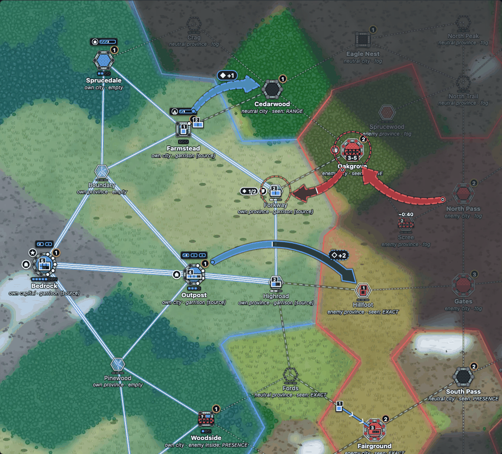 | 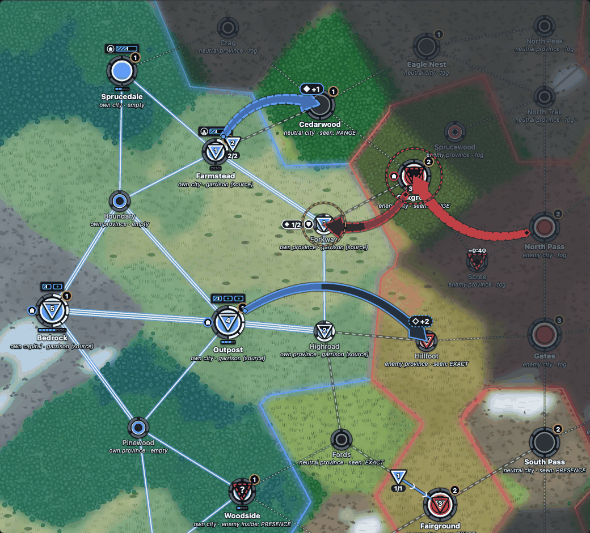 |

The owner's feedback of 2026-10-29 on round 2 (recorded in #431): **orders**: the direction is OD Embossed, show variations of it; **units**: more variants, but no squares or blocks, no banners, no pawns, nothing borrowed from chess or war-game counters, no recognizable setting for now; **cities**: the CE Curtain wall direction without the medieval setting, variants in that direction; **provinces**: a rework consistent with the new cities.

### 33.3 Round 3 (orders chosen; units, cities, provinces superseded by round 4)

Mockup: [`mockups/tokens-cities-orders-r3.html`](mockups/tokens-cities-orders-r3.html), frames in [`mockups/img/431-r3/`](mockups/img/431-r3/). The same shell as round 2, plus the switch **compare with the round 2 pick**: in the matrices it draws the round 2 pick next to every new variant (OD, CE, PA; for units Now, since no round 2 unit was picked), and it adds a second scene with the round 2 picks.

| Element | Variants (besides Now and the round 2 pick) | Recommendation |
| --- | --- | --- |
| Planned orders (variations of OD) | ODa Deep relief, ODb Low relief, ODc Fixed light, ODd Chamfer, ODe Pressed delay, ODf Engraved enemy, ODg Set (ODc + ODe + ODf) | ODg (second: ODc) |
| Units (abstract, setting-free marks) | UG Arc ring, UH Facet, UI Fan, UJ Chevron, UK Strata, UL Orbit, UM Vane | UG (second: UH) |
| Cities (the CE direction, no medieval language) | CF Vertex nodes, CG Segmented rim, CH Bevelled facets, CI Corner brackets, CJ Notched sides, CK Layered plates | CF (second: CG) |
| Provinces (the city rule in small: a triangle, three sides for capacity 3) | PF Three nodes, PG Three sides, PH Facet tile, PI Corner brackets, PJ Notched outline | PF (second: PG) |

The recommended set is one family, "nodes and arcs" (a place is a round mark): ODg + UG + CF + PF, `tokens-cities-orders-r3.html#o=8&u=1&c=2&p=2`. The second set, "cut facets": ODc + UH + CH + PH, `#o=4&u=2&c=4&p=4`.

Rules the round keeps for every variant. **Orders**: body 16, tail 60%, head 38 x 30, the body and the head one closed outline, the tail outside the source badges and the B1 column, the head at the target rim (own) or on the open target ring (the opponent's), the bonus beside the arc; new in round 3: the arc always bulges toward the top of the screen, so it never runs over a caption; the shadow is an offset copy of the shape and the lit edge a stroke clipped to it (no filter); the light comes from the upper left (BL1). **Units**: a charged unit is a filled part of the mark, an uncharged one an empty dark part with a grey line (readable without colour); exact up to 8, a proportion above with the number on the token; the enemy has a second outline outside; no square or block grid, banner, pawn, chess piece, war-game counter or battery. **Cities**: 4, 6, 8 sides by kind and 10 for the capital, a lit mark = your unit stands there, the star badge for the capital, fixed slots (cells above, B1 on the left, VP upper right, the capital badge upper left, the warehouse places under the sign, the caption under them), no wall, tower, crenellation, bastion or gate. **Provinces**: three sides for capacity 3, marks at radius 19-20 outside a token, a light tint or none, no dark centre and no closed ring. With the ▽ token of Now (or UK Strata) a △ province forms a six-pointed star; the round tokens do not. No variant needs a DEC, a protocol change or a simulation change. The table with pros, risks, bake and FPS cost and estimates is in #431 and on the page.

| Scene, recommended set | Scene, second set |
| --- | --- |
|  |  |

**Owner's decision of 2026-10-29** (recorded in #431): **planned orders: ODb Low relief is chosen [accepted]** (OD with a short soft shadow, a faint even inner rim, no grain, with all the round 2 and round 3 fixes; implementation: #519, **done**). For units, cities and provinces none of the round 3 variants is chosen; the owner wants different variants again and allowed research of references and game-dev design guidance in the context of this game.

### 33.4 Round 4

Mockup: [`mockups/tokens-cities-orders-r4.html`](mockups/tokens-cities-orders-r4.html), frames in [`mockups/img/431-r4/`](mockups/img/431-r4/), research notes in [`research/431-r4-references.md`](research/431-r4-references.md) (20 sources: cartography and Bertin's visual variables, proportional symbols, Isotype, transit-map stops and interchanges, relief and settlement symbols, glyph design, preattentive perception, icon and game UI guidance, colourblind-safe design). The same shell as round 3; orders are fixed to ODb in every scene; the compare switch now draws **Now** next to every new variant (nothing was picked in round 3); the header has the three sets; a new matrix puts every unit on every province (the check for unintended figures).

| Element | Variants (besides Now) | Recommendation |
| --- | --- | --- |
| Units | UN Cluster, UO Comet, UP Phase, UQ Spark, UR Twin, US Drop | UP Phase (second: UN Cluster) |
| Cities | CL Interchange, CM Terraces, CN Footprint, CO Orbit, CP Junction | CM Terraces (second: CL Interchange) |
| Provinces | PK Stop, PL Contour, PM Field, PN Orbit, PO Triad | PL Contour (second: PK Stop) |

Sets (one family each): **A Transit** UR Twin + CL Interchange + PK Stop (`#u=5&c=1&p=1`); **B Relief** UP Phase + CM Terraces + PL Contour (`#u=3&c=2&p=2`, recommended); **C Settlement** UN Cluster + CN Footprint + PM Field (`#u=1&c=3&p=3`).

Principles the round derives from the research and keeps for every variant: one visual variable per quantity (kind of place = shape family and a countable step; owner = colour plus outline: single own, double enemy, dashed grey neutral; charge = value or silhouette; size = numeral); the charge on the strongest channel, readable at 0.45 in grayscale; repeated marks exact up to about seven, then a proportion and the numeral; city kinds as graduated, countable classes; layering by weight (provinces lightest, cities medium, units strongest), province marks outside the radius of a token; the fixed slots of round 2 (cells above, B1 on the left, VP upper right, the capital badge upper left, warehouse places under the sign, the caption under them); no rejected shape (battery, square or block grid, banner or flag, pawn or chess piece, war-game counter, wall, tower, crenellation, bastion, gate, a recognizable setting or a borrowing from a known game). Findings of the unit-on-province check: the dots of UN Cluster merge with the dots of PO Triad and PM Field, the beads of UO Comet with the beads of PN Orbit; radial ticks at 120 degrees on a province make a Y (a well-known car badge), so PK uses dots on its rim; UQ Spark starts its rays half a step off the province marks. No variant needs a DEC, a protocol change or a simulation change. The table with pros, risks, bake and FPS cost and estimates is in #431 and on the page.

| Scene, recommended set B | Scene, set A |
| --- | --- |
| 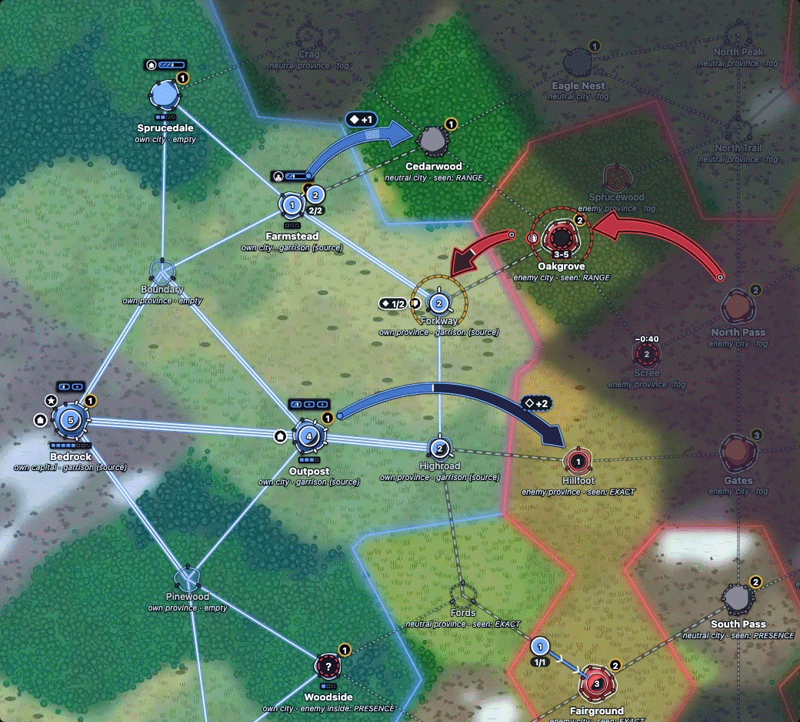 | 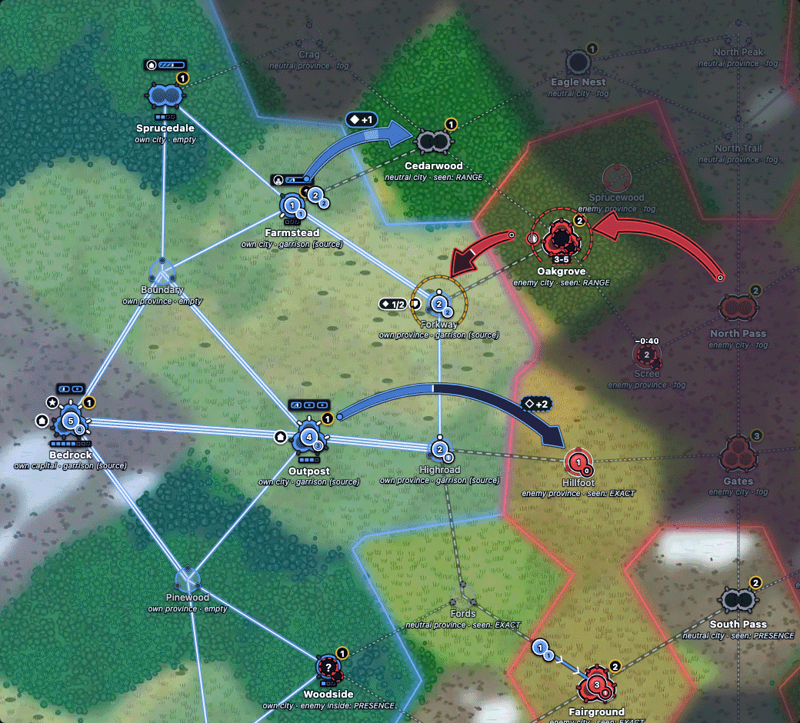 |

**Owner's decision of 2026-10-29** (recorded in #431): planned orders ODb (round 3) stay accepted; **units and cities stay as they are now**; round 4 is not chosen (none of the sets and none of the single variants). The provinces continue in section 35 with a round that fits the current look.

---

## 34. Lobby, invite and bot screens (#473)

Status: **[accepted: variant D "Dock", 2026-10-29]**; the implementation notes are at the end of the section. The owner found these screens too generic after choosing variant A "Front" for the start menu (#471, section 31) and decided on 2026-10-29 to restyle them before the release, so the postponement of section 23 does not apply.

Mockup: [`mockups/lobby-invite-bot.html`](mockups/lobby-invite-bot.html), frames in [`mockups/img/473/`](mockups/img/473/). It shows the current look (**Now**) and four variants for every state of the three screens: the lobby (3 waiting, a long list, loading, empty, joining, taken and refreshed, network error), create (private, public, the map list failed, a server error), the waiting room (link, copied, listed in the lobby, an opponent joined, the opponent ready, you ready, both ready, the invite gone, the invite full) and the bot (choose, starting, a server error). Switches: a guest, a calibrating or a rated account, the queue ban, grayscale, reduced motion, "needs from the server" and "frame anatomy"; the map choice and the bot level can be mixed across variants (`#mapst=t`).

Today the three screens are the plain card of `app.css` on an empty page (`LobbyScreen`, `CreateScreen`, `InviteScreen`, `BotScreen`, `MapChoice`), while the start menu and the queue are the `ScreenFrame`: the real map, a rail, the corner chip. The mockup keeps that frame and changes only what stands in the rail or beside it.

| Id | Variant | Client effort | Risk |
| --- | --- | --- | --- |
| Now | the card on a plain page: selects of ids, equal blue buttons, no hint that the match is unrated | none | generic, leaves the frame |
| R | **Rail**: the mode replaces the menu in the rail (same x, y, width); lobby entries are rows with the enemy triangle, the waiting room is a "versus strip" (you, a dashed road, the seat), the huge verb is the main action | M, 2 to 3 days | low |
| D | **Dock**: the menu rail stays (Play dimmed, the open mode marked), the mode is a panel on the map with thumbnails of the real maps and a Join button per row | M, 3 days | medium (B, I, L in a waiting room, the panel covers the front) |
| P | **Postcard**: R plus a backdrop that follows the choice: the map you pick or the host you point at, the seat shows the host, a bot with its level or a "?", a plate names the map | M to L, 3 to 4 days | medium (hover swaps the backdrop, a random map has no picture) |
| T | **Tabs**: one screen, Friend, Open matches and Bot are the tabs (I, L, B); a thumbnail strip for maps, four cards for the bot levels | L, 4 to 5 days | medium to high (four screens become one) |

No variant needs a DEC, a protocol change or a server change. The only new data is read: `LobbyEntry.age_s` is sent and unused today; the three map files (about 20 KB each) are served by `GET /api/maps/{id}`. The unrated note follows DEC-34 (the rating changes only in queue matches), the pause chip follows DEC-05 (a public match has no pauses). The bot level lines (Bunker, Counter, Strangler, Expander) are client copy about the four bots of `LEVEL_BOTS` in `botmatch.py` and must be kept in step with it.

**Recommendation: R with the thumbnail strip for the map choice** (`lobby-invite-bot.html#v=r&scr=create&st=private&mapst=t`): the smallest change that ends the card look, built on the frame that exists, with the weakest part (the map choice) fixed by the real maps drawn small. P can follow later on top of R. The reasons, what the implementation touches and the questions to the owner (the bot styles, inline errors, new keys, the unrated note, dropping the create step) are in #473.

| R, the lobby | R with the strip, the bot |
| --- | --- |
| 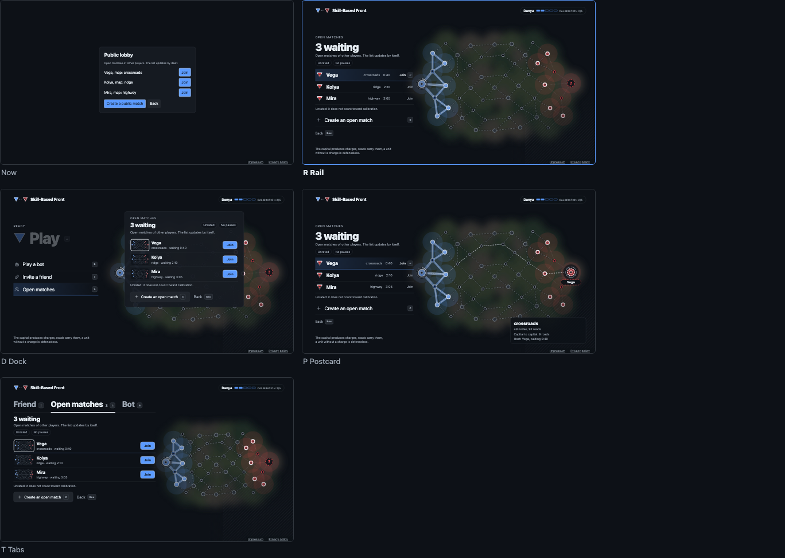 | 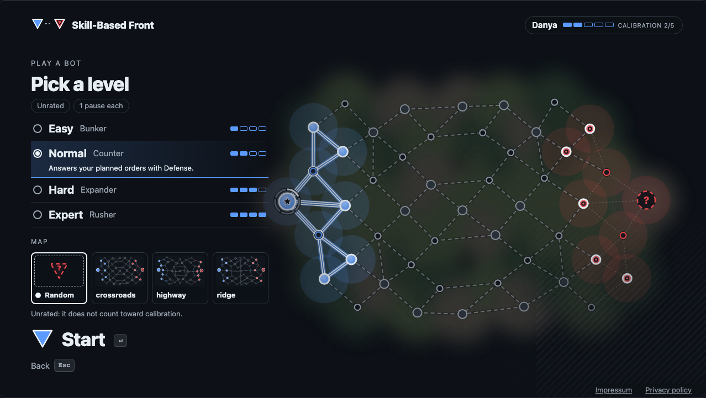 |

Checked in grayscale (`gray-overview-lobby.png`, `gray-overview-bot.png`): no state is carried by colour alone (a selected choice is a filled dot or a white outline, a ready player a filled dot with the word, the level is cells, the seat is the triangle with its outline, an alert is amber with `!` and text).

**Owner's decision (2026-10-29):** variant **D "Dock"**: the menu rail stays, the chosen mode opens as a panel on the map, with the real maps drawn small.

### Implementation of D (#473)

- **Components.** `DockFrame` (the rail with the menu rows, the corner, the panel; used by `LobbyScreen`, `CreateScreen`, `InviteScreen`, `BotScreen`), `MapTiles` and `MapThumb` (the pool maps drawn small from `GET /api/maps/{id}`, kept by `MapCache`), `LevelPicker`, `VersusStrip`, `AccountChip` (the account menu of the corner, shared with `MenuScreen`). Styles in `src/app/dock.css`. Dev scenes `/?menu=lobby-list` and the others of `src/dev/DevDock.svelte` (list in `apps/client/visual/README.md`).
- **The rail** shows the menu as it is: Play is dimmed (a click returns to the menu), the open mode is marked (`aria-current="page"`). The queue lock (DEC-34) adds the amber dashed chip next to the player chip, the dashed ring on the own capital (`phase = banned`), the lock block in the rail and one line in the panel: "The queue is locked. Bots, friends and the lobby stay open."
- **Keys.** B, I and L open the other modes as in the menu (not while a control has the focus). In the waiting room they are off: the rows and the player chip are disabled, the only way out is "Leave" (Esc), which drops the invite. Enter does the main action of the panel (Join, Create the match, Start, Ready); a radio (a map tile, a bot level) does not hold Enter back, so Enter after a choice starts. Arrows move the choice in the lobby and in the tiles and levels; C opens a match of your own in the lobby; Esc is Back.
- **Errors stay on the screen** with an amber line and the choices kept (create, bot start, join, the list); only a lost session (401) goes back to the menu with the notice.
- **"Unrated"** is a chip in every panel and one line per account: a guest, a calibrating account (it does not count toward calibration), a rated one (the rating does not change). The pause chip follows DEC-05 (a public match has none).
- **The bot styles** (Bunker, Counter, Strangler, Expander) stand under the level words (`BOT_STYLES`, `botStyles.ts`); `apps/server/tests/test_bot_styles.py` reads `botStyles.ts` and fails when `LEVEL_BOTS` of `botmatch.py` gives a level another bot.
- **The panel and the front of the map.** The panel stands from x = 552 to 1052 (`DOCK_PANEL_LEFT`, `DOCK_PANEL_RIGHT` in `menuScene.ts`, mirrored in `dock.css`). In a window wide enough (about 1640 px and more) the whole map is laid out to the right of the panel (`dockOwnLeft`); in a narrower one the panel covers the middle of the map, and the own capital stays between the rail and the panel and the enemy capital, with its nick, right of the panel (`menuScene.test.ts` keeps both). Under 1100 px the panel starts at x = 470.
- **Small windows (under 900 x 560, drawn here, not in the mockup).** The same breakpoint as the flowing menu: the rail flows over the picture, the big Play block is hidden, the three mode rows come first and the panel follows below them at full width.

---

## 35. Provinces in the current look, the "Defense" counter and the barracks placement (#431, #349)

Status: **[accepted 2026-10-29]**: provinces **PB Pale dot** (not the recommended PC; #431, implemented in a separate PR), the counter **D1 Diamond pips** and the placement **L1 Left column** (#349, implemented: `defenseLayout.ts`, `defenseSigns.ts`, `defenseView.ts`, `cityView.ts`). Asked for by the owner on 2026-10-29 after the decision of section 33 (units and cities stay as they are), so the postponement of section 23 does not apply to it.

Mockup: [`mockups/provinces-defense.html`](mockups/provinces-defense.html), frames in [`mockups/img/provinces-defense/`](mockups/img/provinces-defense/). The shell of round 4 (the `ridge` fragment at zoom 0.45, 0.7, 1.0, 1.5, the 9 s clock, grayscale, reduced motion, the frame in the address, the DEC-35 fog with the own territory unveiled, the "compare with Now" scene), with ODb orders, and the units, cities and roads drawn **exactly as the client draws them now** (from `bakedShapes.ts`, `shapes.ts`, `cityLayout.ts`, `progressLayout.ts`, `style.ts`, checked against `mise run shots`). Three independent pickers; the scene and every matrix use the current pick of the other two.

| Element | Variants (besides Now) | Recommendation |
| --- | --- | --- |
| 1 Provinces that fit the current look: lighter than a city, no dark centre, capacity 3 outside a token, the side without colour | PA Glass disc, PB Pale dot, PC Place ring, PD Three arcs, PE Dot screen, PF Soft glow | PC Place ring (second: PA Glass disc) |
| 2 The "Defense" counter (DEC-30) instead of the "+N / M" text: 0 of the cap, partial, full, the cap growing, a large cap, no charged units, the enemy (mode only) | D1 Diamond pips, D2 Rim segments, D3 Filling shield, D4 Track, D5 Cells, D6 Side arc | D1 Diamond pips (second: D3 Filling shield) |
| 3 The barracks icon (B1) and the counter on the current city, with the cells, VP, the warehouse places and the caption | L1 Left column, L2 Split sides, L3 Status row | L1 Left column (second: L2 Split sides) |

Findings the round keeps for every variant: **Now shows "Defense" twice** (the public intent shield at the upper left of the city and the shield badge with the pill on the token), and the pill runs over the VP badge and the ring. Every new layout draws **one** Defense sign at the city, from the group's mode where the group is seen and from the public intent elsewhere (the same data as now), and keeps the B1 icons at 16 px on screen at any zoom. The page **checks the marks of every layout sample for overlaps** (ring, cells, VP, barracks, Defense, warehouse places, caption, token): at 0.7 and up L1 and L2 have none; at 0.45 the 16 px floor of the icons and the 20 px floor of the token touch on the small cities in every layout, Now included. The enemy never gets a number (DEC-30 item 5, AGENTS.md 4.4): every counter shows the enemy as the badge alone (D3: a dashed shield, "not known exactly"). The cap of the bonus is the charged units, so it grows when a charge arrives: a row of places (D1, D2, D5, D6) gains a hollow place, a share (D3, D4) drops, which can read as a lost bonus. Only D5 (the hatch of the next +1) needs data the view does not carry: one own-only field in `GroupView` (a protocol change with a fog test). No variant needs a DEC or a simulation change. The tables with pros, risks, bake and FPS cost and estimates are in #431 (provinces), #349 (counter and placement) and on the page.

| Scene, recommended set (PC + D1 + L1) | Scene, Now |
| --- | --- |
|  | 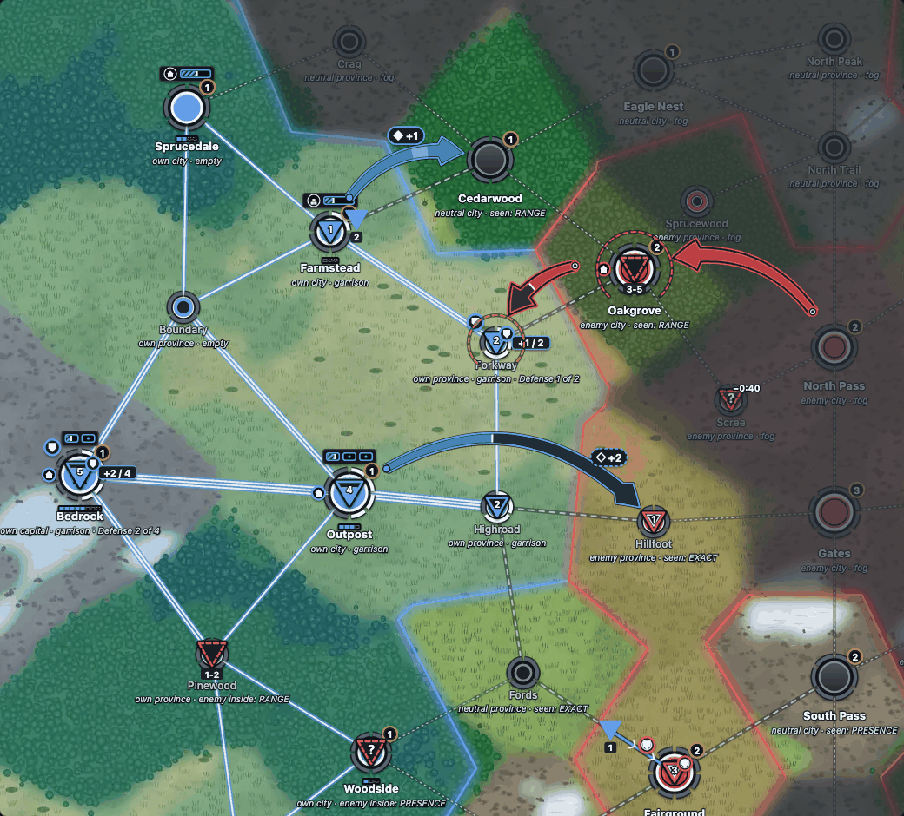 |

**Owner's decision (2026-10-29):** provinces **PB**, the counter **D1**, the placement **L1**; units and cities otherwise stay as they are; orders ODb.

**What the client does now (#349).** One sign of "Defense" per city and side, in the left column outside the capacity ring: the barracks icon (B1, 16 px floor) on top, the sign under it, the counter growing to the left. The sign is the shield badge; an own group with places carries the capsule of diamonds (filled = gathered, hollow = room, a growing cap adds a hollow one; above 6 places "◆ ×N ◇ ×M"); the opponent is the badge alone with its light inner ring, so its bonus never reaches the screen (DEC-30 item 5, AGENTS.md 4.4). It comes from the own group's mode where the group is seen, from the seen modes of the opponent, and from the public intent elsewhere (over the fog, as before). The token of the units in a city has no badge and no "+N / M" pill any more; the shield stays on the corner of a token on a road. The icons grow below zoom 1 so that they are 16 px on screen (`markScale`). The numbers stay in the tooltips and the group radial menu. Everything is baked: one texture per counter row (cap 1 to 6 by bonus gathered), one per width above 6 (the two numbers there are `Text`). The dev scene `defense` shows the matrix (0 of 3, 1 of 3, full, 1 of 2 beside a barracks, 2 of 8, no charged units, the opponent seen with its barracks, the opponent's intent in the fog). At zoom 0.45 the 16 px icons touch the neighbouring city in a dense row (the mockup reported touches at 0.45 in every variant, the previous look included); from 0.7 up nothing overlaps.

---

## 36. Start menu background: animation and a menu map (#474)

Status: **[accepted]** (2026-10-29). The owner asked on 2026-10-28, after choosing variant A "Front" of the start menu (#471, implemented in #489), for a background animation that is more logical and varied (what moves, why, how it relates to the queue state) and for a look at a map drawn only for the menu; on 2026-10-29 he confirmed it before the release, so the postponement of section 23 does not apply to it. Until the choice the client keeps the backdrop of #489 (`MenuBackdrop.svelte`, `menuScene.ts`).

Mockup: [`mockups/menu-background.html`](mockups/menu-background.html), frames in [`mockups/img/menu-background/`](mockups/img/menu-background/). It draws the client's frame (the rail, its shade, the strings of the `?menu=` dev scenes, the fog by the client's `layoutScene`) for six queue states (idle, searching, long wait with the bot offer, found, confirmed, queue locked) and switches the concept, the map, the window size, the season, grayscale, reduced motion and guides (the rail, the title bar line, the fog's top fade, the corner chip, the fog edge); a meter shows the draw time per frame.

| Id | Concept | What moves and why |
| --- | --- | --- |
| Now | the client today | a marching road and growing rings in the queue: they say "something happens", not what |
| BG1 | Living front | game things with game reasons: supply packets, recruits and drills while idle; mobilisation to the front city (a stack ×N that grows with the time waited) and a planned order (ODb) waiting while searching; the own order and the opponent's intent (IN3) meeting once found; a fight in rounds (SH1 tracers) once confirmed; the supply stands while the queue is locked |
| BG2 | Story and scout | idle tells the tagline in four beats (the clause lights up with its beat); while searching a scout walks into the fog and reveals what it sees (DEC-35: own groups are the source of sight); the opponent is found where the scout looks |
| BG3 | Atlas camera | an atlas sheet (names, grid, compass, scale bar) and a slow zoom about the own capital; the queue signs of Now |
| BG4 | Light and seasons | the season by the date tints the terrain; day while idle, dusk and city lamps while waiting, dawn from the enemy side once found |
| BG5 | Set (**recommended**) | BG1 while idle and from found on, the BG2 scout while searching, the BG4 season as a still tint |

Menu map sketches (drawn in the mockup, not map files): **MM1 Valley** (**recommended**: a horizontal valley framed by mountains, the calmest frame for the rail), **MM2 Rising pass** (a diagonal climb), **MM3 Wheel** (a ring round a central city). A menu map would be `maps/menu/<id>.json` in the existing format, built from a half with `gow-maps mirror` so it passes the validator's checks unchanged (only the globs of `maps:validate`, `maps:bake`, `maps:preview` add `maps/menu/*.json`), outside the pool (the server loads `maps/*.json` only), baked like the pool maps and imported by the client at build time instead of `GET /api/maps/crossroads`. No variant needs a DEC, a protocol, server or simulation change. Measured in the mockup (headless Chromium, software rendering, 1280 x 800): 60 fps in every concept and state, 0.09 to 0.37 ms of drawing per frame. The table with pros, risks, cost and estimates and the questions are in #474.

| BG5 on MM1, searching | BG5 on MM1, found |
| --- | --- |
| 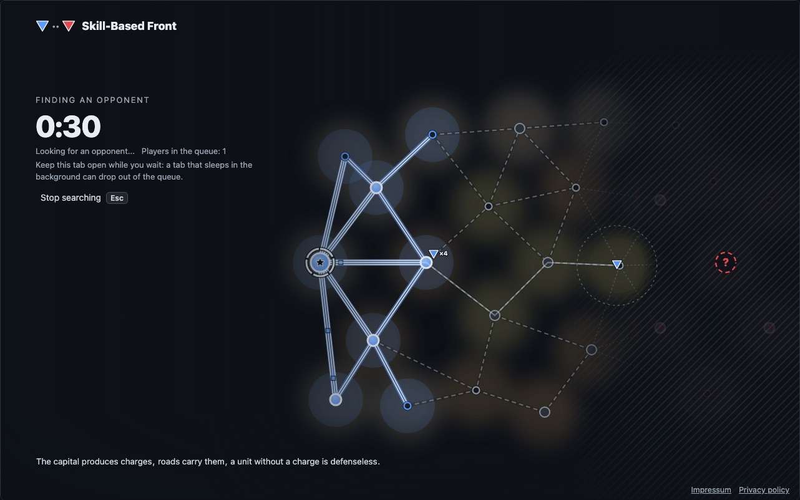 | 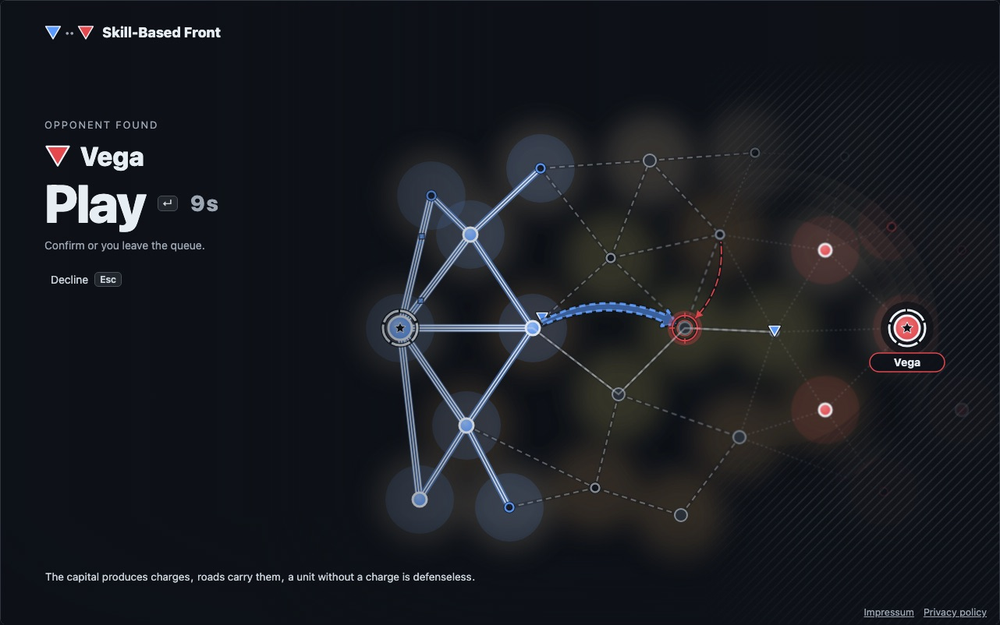 |

**Owner's decision (2026-10-29):** **BG5 "Set" on the menu map MM1 "Valley"**. The season by the date stays a still tint (the default: the owner did not answer the question of a fixed palette), and the 1024 × 640 overlap is fixed with it: beside the rail (windows from 900 px wide) `layoutScene` keeps the own capital at `RAIL_RIGHT` and shrinks the map instead. The map is `maps/menu/valley.json` (built from `maps/menu/src/valley.half.json`, validated and baked with the pool, outside it), bundled by the client (`src/app/menuMap.ts`) in place of `GET /api/maps/crossroads`.

**Implemented** (#527 the map, the 2nd PR of #474 the motion): `MenuBackdrop.svelte` draws four layers, each composited on its own: the map (drawn once, its blurred terrain never repaints), the fog (the scout's sight is a soft hole in it, moved at most 10 times a second), one canvas of motion at 30 fps (`menuMotion.ts`, the places of the story in `menuStory.ts`), the capitals. Idle and from found on BG1 (supply packets, drills, a recruit every 11 s; the own ODb order and the opponent's IN3 intent meet in the middle city; once confirmed a fight in rounds of 2 s with SH1 tracers), the BG2 scout while searching (it walks the front road into the fog edge and waits; the stack at the front grows with the time in the queue), the supply stands while the queue is locked. The season of the month tints the terrain (`menuSeason.ts`; the dev scenes take `&season=`). With reduced motion one still frame per state. Measured on the dev scenes (headless Chromium, software rendering, 1280 × 800, a shared machine): 60 fps in every state before and after.

## 37. Supply lines, terrain and vision, rivers and lakes (#429)

Status: **[accepted: supply lines B Pipes, terrain and vision B Patterns, owner 2026-10-29]**; rivers and lakes moved to section 39 (DEC-36). The owner's feedback of 2026-10-28 asked for nicer supply lines in the Supply view (section 19), a way to see what terrain means for vision (DEC-21, DEC-35), and for rivers and lakes as a natural border between neighbouring cells that have no road (the 6 px strips of #428 were removed in #451). On 2026-10-29 the owner moved the issue before the release, so the postponement of section 23 does not apply. Purely visual: no rule, simulation or server change; where a variant needs data the snapshot or the protocol does not carry today, the table says so.

Mockup: [`mockups/supply-terrain.html`](mockups/supply-terrain.html), frames in [`mockups/img/429/`](mockups/img/429/). It draws the three pool maps (`highway`, `crossroads`, `ridge`: real positions, kinds, terrain, roads, levels) with a made-up mid-game position (two markers, a counter-flow, a transfer, a raided and cut-off city, own groups and enemy groups). Switches: map, zoom (Overview, Map, Region, Close), what to look at (marker 1, marker 2, the capital, the cut-off city), 1 to 3 columns, grayscale, reduced motion, animation, the group the lens looks from, and a "Together" row that mixes one variant of each part. The state is in the address (`#map=highway&z=region&f=front&sv=corr&tv=lens&rv=r2`). **Now** is drawn from the same constants as the client. The page checks the DEC-21 table and examples 1 to 9, the DEC-35 sources, the DEC-28 markers and flows, the DEC-26 levels, DEC-19 cut-off and that no river crosses a road, on all three maps.

| Part | Variants (besides Now) | What the data needs |
| --- | --- | --- |
| Supply lines | A Rails (chevrons inside the road, a tag at the head), B Pipes (level is the bore, flow in the pipe), C Comets (the packet carries direction and size), D Corridor (light up the supplied roads, dim the rest) | the snapshot as is; C's arc needs `starvation.period_ticks` in `RulesetPublic` |
| Terrain and vision | A Chips (a glyph on every city, three sight bars), B Patterns (a terrain map mode), C Lens (select a group, see what it sees), D Card (the public table in the HUD) | `node.detail` is in the snapshot; the table (B legend, D) needs `RulesetPublic.vision` (protocol change) |
| Rivers and lakes | A Plain rivers, B Chains and lakes, C By terrain, D Painted (baked) | A to C derived from `MapFile` in the client; D a sidecar `maps/<id>.decor.json` for `gow-maps bake` |

Finding that shapes the rivers: a river never meets a road, so each lies inside one gap between roads: on the pool maps 32 to 48 of about 125 neighbouring cell pairs have no road, the longest chain is about 340 units. These are streams that close gaps, not long rivers; a long river would have to cross roads, which is a separate decision (and a DEC if it becomes a rule).

**Recommendation:** supply lines **D Corridor** with A's destination tag (the only variant that reads in a still frame at Overview and in grayscale); terrain **C Lens with D Card**, and A Chips at close zoom only; barriers **B Chains and lakes** now, D Painted later from the same geometry. All three are composable. Estimates, costs and risks per variant are in the table of #429.

| Supply, Region | Supply, Overview |
| --- | --- |
| 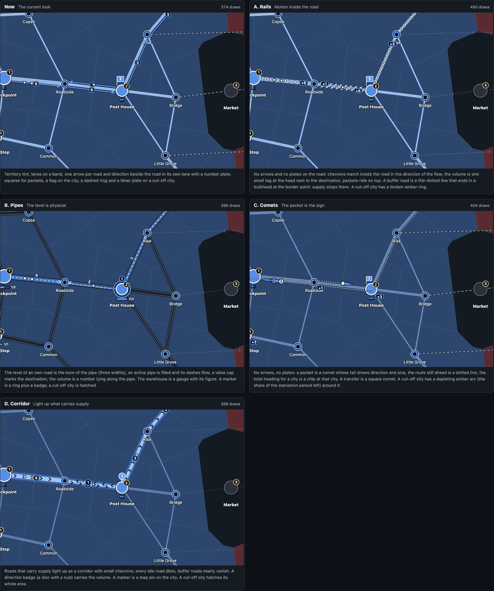 | 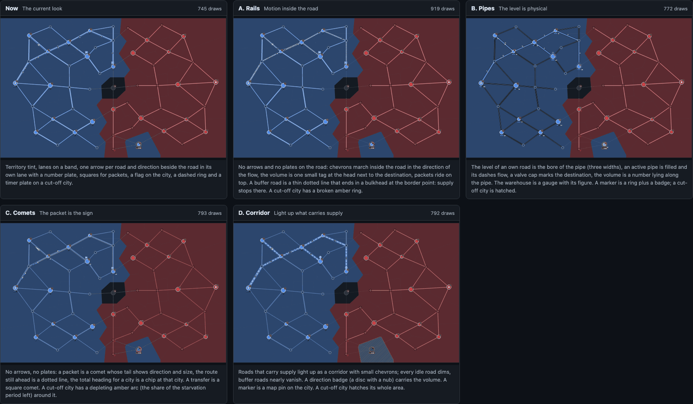 |

| Terrain and vision | Rivers and lakes |
| --- | --- |
| 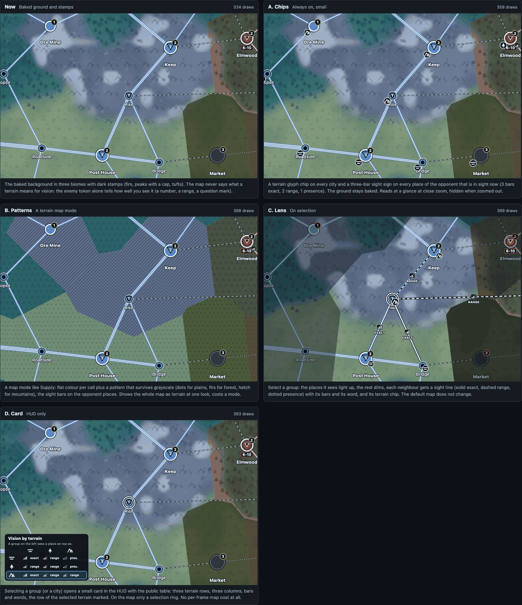 | 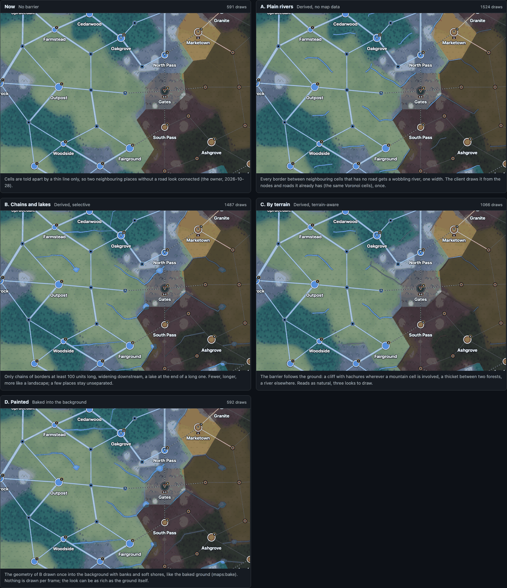 |

Checked in grayscale (`supply-gray-pocket.png`, `terrain-gray.png`): the level is lanes, a bore or a width, never a hue; the sight level is three bars, never a colour; the cut-off city is a ring, an arc or a hatch with the time in digits; the terrain is a glyph or a pattern.

**Owner's decision (2026-10-29):** supply lines **B Pipes** (shipped in #542). Terrain and vision **B Patterns** as a "link" indicator, **without terrain icons** (no glyph on the cities): the terrain map mode on `T` (a flat colour and a pattern per terrain, a three-bar sight sign beside every place you do not own and see now, the vision table of `ruleset_public.vision` as the legend); the sign shows the level the server put in the snapshot, the client computes nothing. Rivers and lakes are not part of this issue: see section 39 (DEC-36).

**Supply lines focus (economy v2, #672, owner's playtest feedback):** the own lines are focused on the «Supply» layer, with no protocol change. An own node whose supply menu is open, the source of a line being drawn, or a selected node shows only the lines that start or end there (a node without lines filters nothing); those legs carry baked chevrons «>» from the source to the target (light on a dark casing, `SUPPLY_LINE`), so the direction reads in a still frame, in grey and with "less motion". The pointer on a «remove line → <target>» sector lights that line (chevrons, a white ring at its target) and draws the other shown lines at `SUPPLY_LINE.dimAlpha`. A focus change redraws the snapshot part of the layer once; nothing per frame. The next line of a factory's round robin is not in the view and is not shown.

---

## 38. Leaderboard and player profile (#78)

Status: **[accepted: variant S "Split", owner 2026-10-29]**. LB-01 adds two screens that do not exist yet, so by the process of section 23 a mockup comes first and the client code after the choice. The server half (`GET /api/leaderboard`, `GET /api/players/{id}`, no protocol change) is a separate PR. Until the endpoints exist the start menu hides the Replays row and the rating in the corner chip (PR #489); the screens bring both back.

Mockup: [`mockups/leaderboard-profile.html`](mockups/leaderboard-profile.html), frames in [`mockups/img/78/`](mockups/img/78/). Three variants, all in the family of the start menu (A) and the lobby screens of #473 (the menu rail kept, the content on the map), for two screens and these states: the leaderboard (top list, empty, loading, network error, rate limited, own row marked in the table, own rank beyond the top 100 pinned under the table) and the profile (the matches, no matches yet, loading, network error, an unknown player). Switches: a guest, a calibrating (2/5) or a ranked account; the profile of yourself, of a ranked player, of a calibrating player and of a guest; the queue ban, grayscale, reduced motion and "needs from the server" (which field of which endpoint feeds each piece). The history shows every replay state: ready, preparing, expired (retention, #515), no replay, players only.

| Id | Variant | Client effort | Risk |
| --- | --- | --- | --- |
| D | **Dock**: the menu rail stays (Leaderboard marked), the board is one card on the map with 6 columns; a nick opens the profile in the same card, Back (Esc) returns | S to M, 2 to 3 days | low |
| W | **Ledger**: the rail shrinks to an icon strip, the card is wide: matches and win share in the board, the history as a full table (map, length, date) | M, 3 to 4 days | medium (a second table layout, the strip is a new language) |
| S | **Split**: the compact list at the left, the profile of the chosen row at the right, the own profile by default; one frame for both screens | M, 3 days | medium (tight at 1280 px, a stacked layout for narrow windows) |

No variant needs a DEC, a protocol change or a new rule. **Recommendation: D** (`leaderboard-profile.html#v=d&scr=board&st=list&acct=rated`): the same pattern as the lobby, invite and bot screens in variant D of #473, so the client gets one panel component for six screens; if #473 ends with another variant, the table, the row, the history line and the replay chip stay and only the container changes. The questions to the owner (menu rows and keys, what the Replays row opens, one or two record blocks, strangers' unrated replays, guest profiles, the own rank beyond 100) are in #78.

| D, the board | D, a player and their replays |
| --- | --- |
| 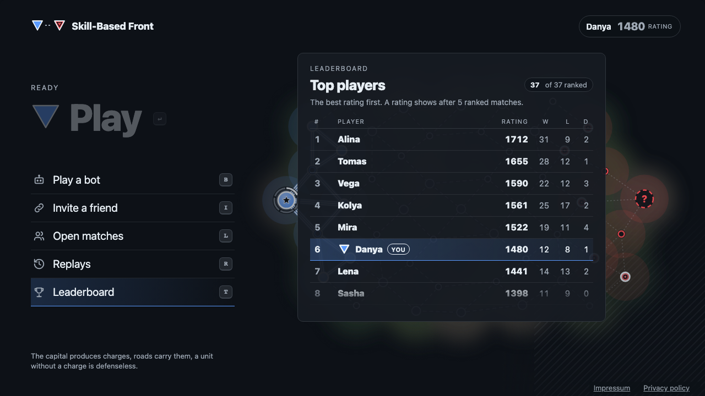 | 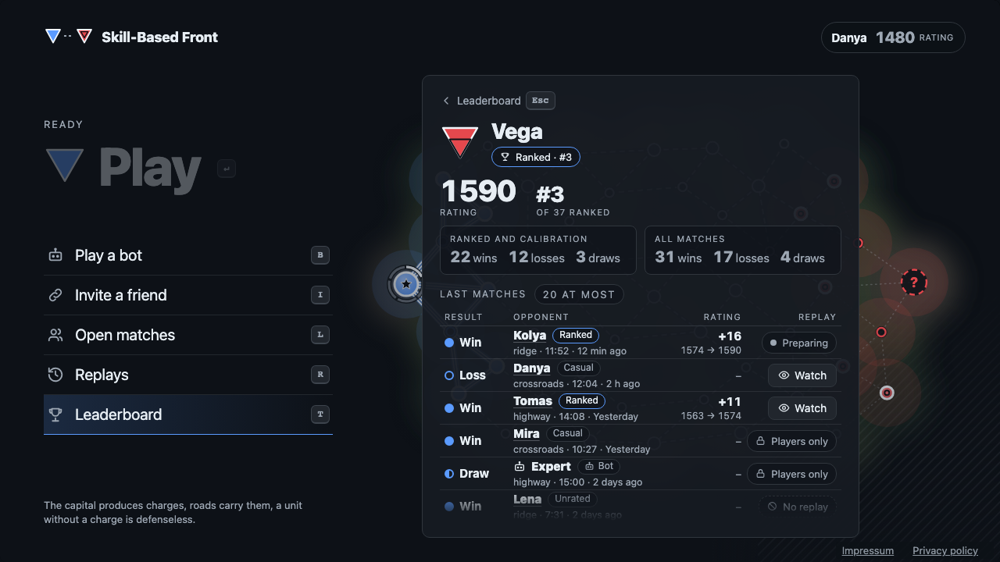 |

Checked in grayscale (`gray-d-board.png`, `gray-d-profile-other.png`): the own row is a band, a triangle and the word You; a result is a filled dot, a ring or a half dot with its word; the replay state is a shape and a word; calibration is cells and "k/5".

**Owner's decision:** awaiting the owner's decision.

## 39. Map geography: water cells, rivers as area borders (#537, DEC-36)

Status: **[accepted]** 2026-10-29 (DEC-36, W4 Painted; the owner's decision at the end of this section). The owner's feedback of 2026-10-29 on the river variants of section 37 (#429): whole cells of sea or lake are allowed, rivers and the borders they form must look better and more natural in the map's style, no sliver of one area may stick into another, and ideally the areas of two nodes touch only where a road links them. That brings water back (DEC-27, item 3 said "no water"), so the decision is recorded as **DEC-36** in `mechanics.md`, section 9, with the format proposal in `map-format.md`. It changes only the picture: no rule, simulation or protocol change.

Mockup: [`mockups/map-geography.html`](mockups/map-geography.html), frames in [`mockups/img/537/`](mockups/img/537/), generator [`mockups/src/map_geography.py`](mockups/src/map_geography.py) (geography of `ridge` in `mockups/src/ridge.geography.json`). The pool map `ridge` re-imagined: the ground baked by the shipped T2 baker from the new areas, the cities, units, roads and ODb orders as the client draws them (the code of section 35), zoom 0.45 to 1.5, Now against the proposal, grayscale, the fog veil, the contact check computed by the page, the moved nodes against the `travel_ticks` tolerance.

| Id | Water look | Client effort (on top of the geography) | Risk |
| --- | --- | --- | --- |
| W1 | **Flat ink**: one water colour, a thin coast line | none if baked | looks like a vector icon on the T2 ground |
| W2 | **Shallows and banks**: light shallows, a pale bank, a darker river thread | none if baked | the bank must stay pale or it reads as a road |
| W3 | **Engraved coast**: three waterlines, double river banks | none if baked | busy at overview, competes with border lines |
| W4 | **Painted (T2 water)**: two-tone water, soft shore, reeds thinning from the bank, flow streaks (removed 2026-10-30, #585) | none (baked) | softest coast in grayscale |

**Recommendation: W4**, baked into `maps/<id>.bg.webp`. The geography itself (water cells, a stream on every road-less border, long rivers with bridges at border points, the client territory drawn from the baked vectors) is the same in all four. Measured on `ridge`: today 48 of 130 touching area pairs have no road, and on 11 percent of the map the tint lies over the ground of another area; in the proposal 0 and 0.

| Proposal, the whole map | Variants at the west lakes |
| --- | --- |
|  |  |

**Owner's decision (2026-10-29):** DEC-36 accepted with **W4 Painted**, with one change to the mockup: **no dark line
where an area border runs along water**. The mockup's W4 darkens a band of land along every coast ("soft shore halo");
next to a narrow stream that band reads as a dark stroke beside the blue water, and the owner wants it gone: the water
itself is the border and stays blue. The baker (`gow-maps bake`) therefore paints the shore only lighter, inside
the water (shallows), never darker on the land, and the client (step 2, #544) draws its thin area line only between two
land areas. Reeds stay sparse and muted so they never line up into a dark edge. The open questions of #537 take
the DEC-36 defaults (long rivers with bridges, about 20 percent water, fixtures without water, before the release).

---

## 40. Supply mode panel, order travel time, city menu icons (#627)

Status: **[accepted]** (the owner, 2026-10-30; element 2 with its highlight 2b the same day): the Supply panel is **S3 "Stepper"** (one pill:
"Supply", Tab, minus, the rear minimum glyph and number, plus; a second pill "Transfer from {city}: pick a destination" with Esc only while
a transfer is picked; no hint, no slider, no legend), implemented in `SupplyBanner.svelte`. The city menu icons are **R5 "Chevrons"**
(rank chevrons with a plus, a watchtower, a depot with a plus; R2 and R3 were liked too): final SpriteCook icons, 96 px PNG in
`apps/client/src/hud/menuIcons/` (`RASTER_ICONS` in `hud/icons.ts`), the direction for generated icons from now on (the owner: the
SpriteCook textures read higher quality). The order time marker: **E4 "Hourglass"** with the road highlight **H10 "Comet"** (the owner,
2026-10-30, element 2b of the mockup), implemented in `OverlayView` (`etaLayout.ts`, `etaRoute.ts`, `ETA_MARK` and `ETA_ROUTE` in `style.ts`):

- While the pointer rests on a node the selected group can reach, the route the server gave (`ReachNode.path`) is a faint thin paper line
  (3, alpha 0.35) on each of its roads from rim to rim, and a comet runs along it to the target every 1.8 s: a head dot and a tail of six
  stretches of 12, fainter toward its end; the head waits at the target while the tail drains in. The comet passes through a city on the
  way (it is not drawn on the city body). Under "less motion" the comet stands still at 70% of the way. Deviation from the mockup: a dark
  casing (`--bg` 0.5, 3 wider) lies under the line and the comet, because an own road has light lanes of its own and the faint paper line
  melted into them in the shots.
- The time: a dark disc (r 17, `--bg` 0.9, a thin paper rim) with the SpriteCook hourglass glyph (24, `src/render/glyphs/hourglass.png`)
  beside the road in the middle of the route (the same place as the old plate, clear of the cities on the way and of their VP badges), the
  seconds beside the disc: away from the nearest city above a flat road, further out on its side beside a steep one. Screen size kept by
  `badgeScale`. The plate with the clock and the band are gone.
- Shown before the click only, as the old marker: after the click the order arrow and its chevrons are the picture (the mockup's E4 also
  shows the remaining time while the group marches; a view has no arrival tick of an order, so that part waits for a protocol change).
- Cost: the line is drawn once per hover change; the comet is one small `Graphics` of seven strokes and a dot, redrawn per frame only while a
  route is shown (once under "less motion"); the disc is drawn once and only moves; no filter.

The owner's review of 2026-10-30: the Supply mode panel has far too much text (title, hint,
slider with a caption, a legend of five entries); the travel-time marker of an order (a highlighted road and a "clock 5 s" pill) is too
plain; recruiting is drawn as a battery, which clashes with "a unit is a battery", and the warehouse icon (squares) is unclear. The first
round under the new process of section 23 (10 variants per element, minimal text, SpriteCook candidates).

Mockup: [`mockups/map-overlays.html`](mockups/map-overlays.html), SpriteCook candidates in [`mockups/assets/map-overlays/`](mockups/assets/map-overlays/)
(asset ids in `spritecook-assets.json`). Element 1 changes only the HUD panel: the supply drawing on the map stays as it is (owner, 2026-10-30).
The variant table and the recommendations are in issue #627.

## 41. Nick entry, main menu, Replays, Leaderboard and queue (#629)

Mockup: `docs/design/mockups/menus-entry.html`. **Owner's decision (2026-10-30):**

| Screen | Variant | What it is in the client |
| --- | --- | --- |
| Nick entry | **N5 Title** | a separate screen: both units, the game title, the nick field with Play beside it, the map blurred and dimmed behind (`ScreenFrame entry`); the nick rule shows only as an inline amber error with the sign (a short nick after the field is left, a bad character at once, "Taken. Try another nick" from the server); "Log in · Create account" links; an invite says "Invited to a match" and Play becomes Join |
| Main menu | **M5 Top tabs** | Play / Replays / Leaderboard / How to play as tabs on the top line (`MenuTabs`, the open tab is bold and underlined); the Play tab keeps the rail: Play (or Return, or Play dimmed with the dashed queue-lock chip), then Play a bot, Invite a friend, Open matches; the Dock screens (#473) stay under the Play tab, How to play is its own tab |
| Replays | **R2 Cards** | the own matches as cards (`ReplaysScreen`, `MatchCard`): the map drawn small from `GET /api/maps/{id}`, the result as a shape and a word, the rating change, the opponent and the kind, the replay state |
| Leaderboard | **L10 Record columns** | one table (`BoardTable`): #, player, matches, W–L–D, the share of wins (a bar and the number), rating; the own row is a band and the own helmet; no match list and no profile on this tab |
| Queue | **Q1 Timer only** | the clock and "Searching", Stop; "Play a bot instead" with an Unrated chip only when the server offers it (60 s); "Keep this tab open" only once the tab was hidden |

Everywhere: no key badges (the keys Enter and Esc keep working), no tagline at the bottom left. The mockup draws the old left rail beside R2 and L10; with M5 the tabs replace that rail, so these two tabs are one wide sheet under the tabs (`SheetFrame`).


---

## 42. Supply flow visualization (#699, economy v2 flow, #697)

Status: **[accepted]** (the owner, 2026-11-03): the chosen variant is at the end of this section; the rule and the data are DEC-43 (`mechanics.md`, section 7). The history of the two rounds follows. How the automatic "flow towards the leaves" supply (`supply-auto-flow.md`, `mvp-4`) is drawn so that a still frame answers: where charges flow and where the flow is idle, who is full or starving, the leaf level and the shift, the chain reaction after a leaf spends, bottlenecks and pockets.

Mockup: [`mockups/supply-flow-visuals.html`](mockups/supply-flow-visuals.html), frames in [`mockups/img/supply-flow-visuals/`](mockups/img/supply-flow-visuals/). Twelve variants (Now plus 0-11 new; Wind was pruned), the Supply and the battle mode of each, a side-by-side comparison in sync, three maps with a six-step story and a free mode, grayscale and less motion. The variant table (blocks, battle-mode look, PixiJS cost, accessibility, estimate) and the recommendation are in #699: **1 Base** (chevrons, the level band, the warehouse status, the request ripple, pinch marks, the pocket hatch, the hover tree) for the Supply mode, with faint chevrons, the starving mark and the Echo ripple in the battle mode; alternatives **6 Transit diagram** and **9 Echo**. Code waits for the owner's choice and for the #697 implementation (`NodeView.front_dist`, `View.me.leaf_shift`).

**Round 2 (#701).** The owner picked **3 Full kit** with changes: no front line (the band goes), the delivery-front territory is lit instead, a hover shows where the city sends its next charge, the dots and the hover path stay. Mockup: [`mockups/supply-flow-visuals-r2.html`](mockups/supply-flow-visuals-r2.html), frames in [`mockups/img/supply-flow-visuals-r2/`](mockups/img/supply-flow-visuals-r2/): three combinable groups (Front T0-T7, Next N0-N6, Path P0-P4). Recommendation in #701: **T1 Bright fill + N2 Ghost dot + P3 Both ways**; the Next marks need an own-only dispatch decision from the simulation (`NodeView.supply_next`, `supply_idle`, `View.me.dispatch_in`), not a client copy of the rule. Status: **[awaiting the owner's decision]**.

**Chosen (owner, 2026-11-03, DEC-43 item E).** Rounds 1 and 2 above are history; this is what the client implements under `supply.model = "flow"` (`mvp-4`):

- **Base (the «Supply» layer): 3 Full kit without the level band.** Chevrons on the downhill roads (bright and running when an own packet is on the road, one dim chevron when idle), the packet dots kept as today, the node status (warehouse squares, the starving `!` triangle, the full lid), the request ripple up the chain after a leaf spends, the pinch marks, the pocket hatch with "no source", the hatched disc on nodes ahead of a shifted level. **No** dashed level band with its "front" tag; the **slope wash is off**.
- **Front: T1 Bright fill.** The level cells (own nodes with `front_dist == leaf_shift`, pulled nodes included) in a stronger own blue with a light lift and a thin rim toward the rear (lightness 2.0:1 against the rest of own land, the rim 5.8:1 carries it in grayscale); baked into the territory layer, redrawn when the level or the land changes; a `−` / `+` fades it cell by cell over about 0.6 s (an alpha tween; instant under "less motion").
- **Next: N4 Countdown ring, on hover** and **Path: P2 Downstream chain, on hover**: **removed** (owner, 2026-11-03, #728: "it gives no useful information anyway"). A city has no hover marks in any mode, no click-to-pin and no idle plate; the server fields they used (`flow_next`, `flow_idle`, `next_dispatch_tick`, `supply_dispatch_ticks`) stay in the protocol, the client does not read them.
- **Battle mode: alerts only** (owner, 2026-11-03, #728). The normal map shows the starving `!` triangle on a node that is starving or about to (an alert, not supply visualization), the road fortifications and the toll effect, and the ordinary packet dots of the entity layer; **no** T1 level fill and rim, **no** chevrons, no hover marks. The whole supply picture (chevrons, the level fill, the warehouse squares, the pinch and pocket marks) lives in the «Supply» layer only, unchanged there.
- **Leaf shift control:** `−` / `+` in the Supply panel with the value ("front", "−1", "−2"; `View.me.leaf_shift`, `−` disabled at `leaf_shift_max`), and the same on the map pill of the mockup; while the shift is not "front" the HUD keeps it visible. The line drawing UI, the "Auto lines" toggle and the bunker action are hidden under flow; the warehouse upgrade action is hidden when `warehouse.max_level = 0`.
- **Data:** only the own-only fields of DEC-43 item E (`front_dist`, `flow_down`, `flow_next`, `flow_idle`, `flow_pocket`, `leaf_shift`, `leaf_shift_max`, `next_dispatch_tick`); the client computes no part of the dispatch rule (`AGENTS.md`, 7.1).
- **Road fortifications** (DEC-43 item D, #707): the owner's picks of the mockup round 4 (`docs/design/mockups/fortifications.html`): the line **C7 Long run** (a flat stroke along the own side of the border at the road crossing, fine ticks towards the border, over the whole border with the cell the road leads to, trimmed where that border ends or turns by more than 38 degrees; #734), the toll **K6 Beam**, the road pick **P2 Shields** (a 22 px shield marker at each pickable crossing, the ghost and the cost on hover); the radial menu entry "Fortify road" with a flat white shield. The data: `EdgeView.forts` and the events `toll_paid`, `toll_taken`, `road_fort_built`, `road_fort_destroyed` (mechanics.md, DEC-43 item D).

**Implemented (#705, trimmed by #728).** `render/flowLayout.ts` (the picks from the fields), `render/levelLayout.ts` and `MapView.setLevel` (T1, the «Supply» layer only), `render/flowView.ts` (the battle mode: the starving marks), the flow branch of `render/supplyView.ts` (the layer), `hud/LeafShift.svelte` (the control; keys `-` and `=`). #728 took out the battle-mode level fill and chevrons and the whole hover (N4 ring, P2 chain and dimming, idle plate, click-to-pin) with their code and tests. Notes: the request ripple of the "Full kit" is not drawn (it has no field behind it); the bottleneck mark `)(` stands on a downhill road into a province whose warehouse is 1; "starving" is a display class (an empty warehouse on the level with no own packet coming, or an own group short of a charge standing in an empty node).

**Implemented (#707, the client of road fortifications).** `render/fortLayout.ts` and `render/fortView.ts` (the look C7: the run of the own cell's border at the road crossing, found from the territory edges of the node; it covers the whole border with the cell the road leads to, with no length limit (#734: the fixed 170 units of the mockup centred on the crossing stopped a line short of a long border), and ends square where that border ends, turns by more than 38 degrees over 12 units, or has turned by more than 70 degrees in all, so a corner rounded into short steps by a geography does not wrap; the ticks run from end to end in step with the crossing, the build sweeps the whole run; a road between cells that do not touch (test maps only) takes the border with a cell of the same owner, 170 units at most, or a straight stub of 170; two lines whose runs overlap on the ring of the cell lie one behind the other, 20 units further in; the marks grow with the zoom like the construction plate), `render/tollLayout.ts` and `render/tollView.ts` (the toll K6, under 0.8 s, from the events `toll_paid` and `toll_taken`), the sector "Fortify road" (`B`) and the road pick of `match/orderController.ts` (`FortPick` in the overlay). Decisions taken while implementing:

- **Layer.** A new layer `forts` between the roads and the nodes, so the lines lie over the road they cross and under the fog veil. Two flat `Graphics` (halos, lines) for all lines, redrawn only when a line, an owner, a build step (48 per build) or the zoom bucket changes, never per frame; the ghosts of the pick and the "0:05" build timers are separate. No texture is baked: the look has no gradient, blur or rim (the halo is two stacked flat bands inside the cell, so no mask and no filter).
- **Enemy lines in the fog.** The dashed memory ghost of the mockup is dropped: the simulation keeps no memory of enemy lines, so a line is drawn only while `EdgeView.forts` lists it. An enemy line being built (no tick) is a dashed outline; an own one shows its progress (a sweep along the run and a bright head) and the time left.
- **Pick.** P1 "Ghosts" (the owner's choice over the P2 default): a ghost of the real line on every road of the node that has none of its own yet, with a dark band under it so it reads over a cell line; the hovered one is brighter with the price ("1.5 CP", `ruleset_public.fort.cost`). The ghost is a target of its own (16 px on screen), a click on the road itself works too; Esc or a click anywhere else cancels, there is no caption.
- **Toll.** The beam leaves the middle of the tick tips; the group that paid (`toll_paid`, by its id) or the enemy figure on the road nearest the line (`toll_taken`, which has no group id) is hit: ring, flash, sparks, one flung square per lost charge, the token pops, "-N" rises. The viewer's loss has the dashed amber ring and a plate with a down triangle and an amber frame; the opponent's is a plain plate. With "less motion" only the ring and the plate stay, still.
- **Feed.** The four events have lines in the journal (`eventText.ts`); a capture already has its toast, so none of them toasts.
- **Not done.** The "Counter" of the mockup (charges taken so far by a line) has no server field and was left out. The replay viewer shows no lines: the frames file has no buildings (`docs/design/replay-frames.md`).


## 43. Playtest UX batch (#762)

Small fixes from the `mvp-4` playtest of 2026-11-05, straight into code (no mockup: color, spacing and states of existing controls).

- **Hover.** The area of the city or province a click would pick or aim at (a selection, a menu, the target of the selected group) gets a faint paper wash and a rim along its edge (`HOVER_AREA`, one `Graphics` in the `territory` layer, redrawn when the hovered node changes); an own group under the pointer gets a faint copy of the selection frame (`HOVER_FRAME`). Nothing is lit where a click does nothing, nor during a pick of its own (a road to fortify, a line, a transfer). The reading of the hit is the one of the click (`OrderController.overlay().hover`).
- **Split and send.** A click at a target the server's `reach` lists under `split` (the stack limit, DEC-20) opens the split menu at the size that fits there (`ReachSplit.units`, the server's number; the slider goes no higher), the menu names the target and its button reads "Split and send"; the part is ordered there as soon as `group_split` names it, as the order was at the click (Shift: planned). The hint over such a target says so. Without a size (0) the old hint and an ordinary order stay.
- **Factory counter.** Economy v2: the factory glyph and own/max next to the CP (builds under way counted, as `factory.max` counts them); at the max a dashed frame and the words of the tooltip.
- **City menu.** By the rule of the menu (a sector with nothing to do is not drawn), "Factory" is not drawn at the factory max (the counter says why) and "Fortify road" not in a node whose every road has its line, built or being built; an empty menu draws nothing. Hiding was chosen over a dimmed sector with a reason: a sector carries no reason text (`CityRadial.svelte`) and both states have a visible reason elsewhere (the counter, the lines on the map).
- **CP shortage.** While the CP do not pay for the move to the hovered target (the price of `ruleset_public.cost`), and for 1.6 s after a move was refused with `NOT_ENOUGH_CP`, the CP track and number turn `--enemy` red, a solid ring pulses round the track and the alert icon stands before the number. The refused arrow of such a move is the cut-off arrow (`GHOST_CP`): bolder, red, crossed out on the middle of its last road with a white cross on a dark halo, held for 1.1 s and faded over 0.5 s (other refusals keep the 0.5 s shake and fade).
- **Plan bonus.** (Superseded by #797, section 46: no stepper; the plan banner is gone, section 47.) The plan bar names the order, its key and how the bonus is set ("Shift + wheel over the target sets the bonus, +1 at first"); while a planned order is being made (Shift or the switch) the pill gets a thick own-colour frame and the words "Planned order: turn the wheel over the target".

## 44. The cue of undo (#764)

`X` with nothing selected takes back the last move, planned order or recruit, one step per press. A small change of look, straight into code; no mockup. What went shows on the map at its place, never in a toast, because a group turned back that fails to retake its node dies (DEC-24, item G3) and a few presses of `X` can walk into that.

- **The place.** A dashed ring closes in on the group (or on the city that lost its recruit) over 0.45 s, and a round-arrow sign on a dark disc stands at its upper right corner; the cue lasts 1.1 s and fades over its last 40%.
- **The rollback.** The dashed arrow of the cancelled order, from the group along the nodes it still had ahead (`OrderView.path`), runs back into the group over the same 0.45 s.
- **Nothing to undo.** The same sign, dimmer and crossed out, beside the pointer (the middle of the canvas when the pointer is off it): no toast, no sound, nothing sent.
- **Not by color alone.** All of it is paper with a dark casing: the dashes, the ring and the sign tell it, and it reads the same in grey scale (`undo-*-gray.png`). With "less motion" nothing runs: the arrow and the ring stand still and only fade.
- **Not on the Supply layer.** It shows no groups, so the cue would have nothing to mark: `X` with nothing selected does nothing there.

## 45. Advantage and disadvantage badges (#791, variant 8 "Chevrons" of #776) **[accepted]**

The owner's decision of 2026-11-06 and 2026-11-07 (mockup `docs/design/mockups/unit-badges.html`, the choice in #776): the badge is variant 8 "Chevrons", a count by strokes, on helmets (the only unit look since 2026-11-07, #801); the arena follows "On chips".

- **The shape.** Up to three chevrons stacked `0.46` of their size apart: ^ up, green `--badge-up`, an advantage; v down, red `--badge-down`, a disadvantage. Above three one chevron and the number, `9+` above nine. Every stroke lies on a dark outline (`--bg`, the stroke plus 2.6 units), so the mark reads on every terrain, on the own blue and on the enemy red. The direction tells it, the colour only repeats it (AGENTS.md 7.4).
- **Baked.** `chevronBadgeSpec` in `bakedShapes.ts`, one texture per key `direction, count, size`: two directions, ten counts (1 to 9 and `9+`), two sizes (map 11 units, chip 9 px), at most 40 keys. No filter per object. The self-shot of a burned chip (`selfShotSpec`) is one more key.
- **On the map: terrain only.** The mark of a node's defender is computed by the server (`NodeView.terrain_mark`, DEC-24 F2, `mechanics.md` DEC-32 item 14): mountains up, plains down, for the owner's charged garrison standing in the node with no fight there; an attacker, a discharged group, a group on a road and a neutral node never carry one; the enemy's only where the view shows its charges (`exact`). No sum of bonuses, no planned order bonus on the map. It sits at the top right corner of the icon in the city, beside the number and clear of the VP badge (the corner of the helmet was kept free for it, #784).
- **In the arena: on the chips.** Every chip with a bonus shot left (`FightView.virtual_left`: a planned order, mountains) has chevrons up at its top right corner; the badges sit on the chips nearest the middle of the plate and are taken from the last of them when a virtual shot fires, so the others never move; with more bonus than living chips the last one carries the rest as a count. The penalty (`FightView.mute`) is pinned to the first chip of its side and never jumps: the arena keeps the most it saw for the fight. Under item F2 that chip stays charged and silent with its badge to the end; under `combat.terrain_burn` (DEC-45) it shoots itself in the first round (a red ring with six rays over 0.6 of a round, still under "less motion"), its charge goes out on that very chip and the badge goes (`burned_0/1`, `FightRound.burned`).
- **What the arena dropped** ("On chips" of #776): the row of the bonus stock `◇ ×N` under each half (the badges count it), the amber crossed sign on a silent chip (the chevrons down are it) and the caption "bonus attack" over the plate (the bonus tracer stays on the map, with the chevron of a bonus for a head since #797). The plate is 12 px lower (`PLATE.halfHeight` 36). The amber sign of the fight effects on the map (FX3, #351) stays.
- **Contrast** (`design:accessibility-review`, WCAG 1.4.11, 3:1 for graphics). The mark on its outline: green 10.5:1, red 5.8:1. The outline on the brightest background pixel within 40 units of a node of `artery`: mountains 5.2:1, forest 4.0:1, plains 7.8:1; on the terrain mode fills 2.4:1 to 5.6:1 and on the own blue 6.8:1, the enemy red 4.8:1, where the bare colour would fail (red on enemy red 1.2:1). In grey green and red are 0.53 and 0.27 in luminance; the direction holds under every colour vision deficiency (Machado 2009: green against red ΔE 131, protanopia 40, deuteranopia 15, tritanopia 135).
- **Count on real maps** (#791, bot matches under `mvp-4-stances`, player 0 sampled every minute): on `crossroads` (46% plains) 1 to 9 own marks and 1 to 7 enemy marks, at most 5 red own ones; on `highway`, `narrows`, `ridge` 1 to 6 own and 0 to 2 enemy. Not a wall of red: no filter.
- **Legend** in the help panel (`?`): `help.legend.badgeUp`, `help.legend.badgeDown` (or `help.legend.badgeDownBurn` under `combat.terrain_burn`), reviewed with `design:ux-copy`.
- **Collisions.** The undo cue (section 44) also uses the upper right corner of a group, for 1.1 s; a road token never carries a badge, so the shield of "Defense" is not in the way.

## 46. Chevrons for every bonus, the badges over the outline, the bonus only by the wheel (#797) **[accepted]**

The owner's feedback of 2026-11-07 on #791 and #793.

- **The badges over the outline.** The selection and hover outlines of a unit (the `intents` layer) ran over its badge. The badges are drawn by the render layer `badges` (a PixiJS `RenderLayer` right above `intents`, under `effects`): a token stays the parent of its badges (position, scale, fade, visibility, the «Supply» mode hiding the groups), the layer only draws them later. The arena badges are in `effects` already, above every map outline.
- **One sign for a bonus.** Every bonus is the green chevron up of the advantage badge on its dark outline (section 45), never a diamond: the plan pill of a planned order ("^ +N"), the Shift counter over the target, the plan banner (its gathering row: green chevrons gathered, hollow ones still asked for), the tooltip of a group ("Plan bonus +N" behind the chevron), the help legend, the counter of "Defense" (economy v1), How to play. In HTML it is `BonusChevron.svelte`; in a plate drawn with `Graphics` `drawBonusChevron` (`bonusChevron.ts`, redrawn only when the plate is); the particles no longer carry it (section 48: a bonus tracer has an octagram head, and its sparks are squares). Hollow is a light contour with a dark inside: filled and hollow differ by shape, not by colour alone.
- **Diamonds kept.** The captures on the replay timeline and in its legend (a diamond in the side's colour, section 13.7): a capture, not a bonus. The map `diamond` is a name.
- **The bonus only by the wheel.** No global setting: the `[` `]` keys of the plan bonus (economy v2), the stepper of the plan banner and their help lines are gone (`[` `]` stay the rear minimum on the «Supply» layer of economy v1). The bonus belongs to one Shift hover: it starts at +1 over every new target, after Shift goes up and after a new selection; Shift + wheel steps it within 1 and the charged units of the group (at most 9); a Shift click with no wheel step sends `bonus: 1`.

## 47. Playtest feedback of 2026-11-07 (#811)

- **No plan banner.** The bottom-left pill of a planned order ("Planned order", its key, "Shift + wheel over the target sets the bonus", and the gathering row with "Release now") is gone. Shift + hover + wheel over a target is unchanged and the counter over the target says the bonus; the help panel keeps its Shift lines; a gathering plan is let go by `F` or the sector of the group menu, which show its progress.
- **A plain tooltip for a gathering group.** The tooltip of an own group whose plan gathers its bonus shows only the charges, like any other own group: no "Plan bonus +N of M" block and no paragraph of the rule.
- **The last shots land on something.** When a fight ends and a side's token goes at once (it died or retreated), the tracers of the last round used to end in empty space. The place keeps a faded helmet of that side (`leaverLayout.ts`, drawn by `EffectsView`) until the last shot lands, then it fades with the afterglow of the tracers. Not drawn for a side whose token still stands. Presentation only: the places are the remembered tokens, the times are shares of a round.
- **The recruit plate (not a bug).** The yellow dashed rectangle above a city that the owner saw is the cell of the recruit queue (section 32): a solid amber cell with a dashed amber ring means a unit is ready and the city has no room for it (DEC-25); up to `recruit.queue_max` cells (3) stand side by side, one per queued unit.

## 48. The bonus shot and the fight outcome (#812) **[accepted]**

The owner's choice of 2026-11-07 on the mockup [`mockups/fight-bonus-and-outcome.html`](mockups/fight-bonus-and-outcome.html) (round 3 of the bonus shot, the outcome plates). Client only: no protocol, simulation or ruleset change.

- **The bonus shot: variant 7 "Octagram".** A bonus tracer is an ordinary tracer (path, tail, glow, dark underlay, timing, the owner's colour, sparks and the hit burst with the dashed ring and the paler flash) with a different head: an outer square 1.3 times the inner one, lighter than the side's colour and turned 45 degrees, an inner square in the side's colour, a small light square in the middle (the opponent's: dark), the two big ones turning against each other (`octaAngles`, a pure function of the age of the round: about 4.2 and 3.3 rad per second of a 2 s round). The two big squares are baked sprites (`octagramSpec` in `bakedShapes.ts`, per part, side and colour, via `SpriteCache` like the helmets and badges): the colour in the usual gradient under a dark outline, a light rim, a soft highlight inside (the opponent's has the second, dark contour instead, as its real head), a small light square in the middle (the opponent's: dark on a light rim). The head swells from 55 % to full size at the start of the flight and the turn eases in from a still start. Pooled sprites in a layer above the particles, no filter, no `Graphics` per shot. The rows of the kill feed are baked too (`feedRowSpec`: the arena plate's shadow, rim and fill, a thick or a thin outline). The shape (two turning squares) tells the bonus, the tail's colour the side. The bonus is not tied to its source: terrain, plan and bunker look the same. The chevron is not shot anywhere any more; the sparks of a bonus hit are squares, bigger than a real shot's.
- **The arena is unchanged.** Chips, badges, the bar and the plate of a fight going on keep their look and behaviour.
- **The outcome: variant 9 "Kill feed".** Replaces the two tinted plates with `−0` and `−2` and the word pill above them. `render/fightView.ts` (`drawFeeds`) and `render/feedLayout.ts`: for each `fight_ended` event within 3 s two rows (118 by 34 px, `FEED` in `style.ts`) beside the node, the own one above. A row is a dark plate, the baked helmet chip of the side (the opponent's faces left, as in the arena), `−N` (the losses of the whole fight, as in the event) and, on the winner's row only, the glyph of `fightResult` (flag for `captured`, shield for `held`). The winner is told by a thick light outline and the glyph, the other row by a thin grey outline, so nothing rests on colour alone (the chip's shape and the side of the pair also tell who is who). A fight nobody won (both retreated) has no outline and no glyph, as in the mockup. The verdict is read from `winner` and `captured` of the event, nothing is computed. The feed slides in from the side of the node's far edge over the first 8 % of its life (not with "less motion"), then fades in the last 30 %.
- **Several fights ending together.** The feeds are placed one by one by `layoutFeeds` (scaled-world px, like `arenaLayout.ts`): the default spot is up and to the right of the node; if it is taken by another feed, a plate of a fight going on, another city or the edge of the screen, the search tries the other side of the node and blocks above and below it and takes the cheapest. At most six feeds at once.
- **Left out on purpose.** The bonus source is not drawn, and the blinking of the unit's chevron badge on a bonus shot (an option of the mockup) is not done.

## 49. City capture: the Fitted flood (#819) **[accepted]**

The owner's choice of 2026-11-08 on the mockup [`mockups/city-capture.html`](mockups/city-capture.html) (round 2, variation 2 "Fitted"; round 1 picked the Flood direction). Client only: no protocol, simulation or ruleset change. It replaces the 450 ms cross-fade, the wave over the cell and the white ring of a capture (#508); the small flag, the toast, the sound, the edge marker of a lost city and the kill feed stay as they were.

- **When.** On the snapshot that already shows the new owner (`MapScene` sees the owner change, AGENTS.md 7.1, 7.3), never earlier. A picture that jumped (a replay scrubbed back or more than 2 s ahead, a reconnect) and the «Supply» mode draw the new owners at once.
- **The front** (`captureLayout.ts`, `floodView.ts`): the new owner's tint grows from the city in the shape of the node's own area (the area's outline scaled from the city, so the front reaches the whole border at the same moment) in 1.0 s, ease-out quad, with a soft edge of 18 % of the way. The field is worked out per pixel by a small shader from the area's reach round the city (256 rays, the farthest crossing of each, smoothed: an inlet or a river mouth does not tear the front). The old tint goes under the front by a mix, not by stacking two tints.
- **The layers join as the front reaches them** (`CAPTURE` in `style.ts`): the city body flips in the first 120 ms (the old baked body fades over the new one); the territory fill follows the front; the cached border glow before and after the capture are both kept as textures for the length of the flood and mixed by the same field, so the new glow arrives with the front and the map's own glow is masked out over the area and its neighbours meanwhile; the border lines of the area cross-fade when the front reaches the border (just inside it), the neighbours' lines a moment later (just outside it); each road of the node shows its new look from the city outward as the front runs along it (a cut 1.15 times as fast as the front); what is left outside the area (the neighbours' side of the border) settles from 0.86 to 1.12 s. The capacity ring, the warehouse bar and the units switch at once, as before.
- **The light.** A soft rim of the new owner's colour rides just inside the front (a mix toward the colour by 0.42 of a Gaussian band, plus a tenth of it added), fading in over the first 8 % and out over the last 22 %; it lies over the border lines and under the roads, the cities and the veil. At the city one flash of the particle glow (alpha 0.55, 0.32 s, 3.4 city radii) and a ring of the owner's colour leaving it (0.5 s), in the `effects` layer.
- **The enemy's captures are calmer**: no flash, the rim and the ring at half.
- **In fog** the same flood plays under the fog veil, which dims it; ownership is public, nothing extra is drawn or hidden.
- **Two captures at once** each run their own flood (own field, own clock); the glow of a neighbour shared by two goes to the first, so nothing is drawn twice.
- **A capital.** When the match ends by the capture of a capital (`match_end.reason = capital_captured`), the result screen opens 1.7 s after `match_end` (`CAPITAL_RESULT_DELAY_MS`: 0.2 s until the last snapshot is drawn, the 1.0 s flood, 0.5 s on the settled frame); the snapshot buffer lets the render time run on to the last snapshot once the match is over. Every other end opens the result at once.
- **Replays** play the same flood: the viewer draws the owners of its frames through the same scene.
- **"Less motion"**: a 0.2 s cross-fade of the fill, the glow and the border lines, the roads at once, no travel and no light; the flag stays.
- **Cost.** Per capture three meshes of the area's outline (fill, glow, rim) with a tiny shader, triangulated once; only a few uniforms change per frame. Two world-sized glow textures at half resolution live for the length of the flood; nothing has a filter, the glow cache is drawn once at the start as before. The border lines and the roads of the node are restroked per frame while the flood runs, as the old cross-fade did.
- **Looking at it.** A frozen dev scene can show a capture under way: `?flood=<ms>,<node>:<owner before>,...` (`0`, `1` or `n` for nobody), for example `/?scene=artery&flood=300,4:1`; `mise run shots` takes `capture-*.png` this way.

## 50. Out-of-game style, round 1 (#826) **[decided: Lapis, 2026-11-08]**

The owner asked on 2026-11-08 for a complete new style for everything outside the match, in two rounds: round 1 shows at most five complete directions, the owner picks or steers one, round 2 refines it, and the chosen style is later carried into the match (the match may lose its glow or change to match; the finished game has one style). This round follows that brief instead of the "12 or more variants that fit the existing style" of section 23.

Mockup: [`mockups/out-of-game-style.html`](mockups/out-of-game-style.html) (fonts and their licences in [`mockups/assets/out-of-game-style/fonts/`](mockups/assets/out-of-game-style/fonts/)), frames in [`mockups/img/out-of-game-style/`](mockups/img/out-of-game-style/). Nineteen screens with 55 states, the opening scene with play, pause, scrub and replay, a side-by-side compare, 100 % and 200 % zoom, grayscale and reduced motion. The opening scene and the menus use the start menu map (`maps/menu/valley.json`) and the client's helmets (`units/helmet.ts`).

| Id | Direction | Type | In short |
| --- | --- | --- | --- |
| I | Lapis | Cinzel, EB Garamond | imperial epigraphy: black stone, cut capitals, incised rules, Roman numerals |
| II | Atlas (**recommended**) | Cormorant Garamond, Alegreya, Alegreya SC | a historical atlas: paper plates with a neatline, an inset map, a gazetteer; the opening is lamplight on the atlas at night |
| III | Ordre | Big Shoulders Stencil, Barlow Semi Condensed, JetBrains Mono | a staff briefing: numbered sheets, boxed fields, stamps, a gridded map on the table |
| IV | Raster | Archivo | the Swiss grid: 12 columns, rules, numbers as structure, the map as a diagram |
| V | Nocturne | Bodoni Moda, Public Sans | restrained dark strategy, the nearest to the game today: the real map full screen, solid graphite panels |

The opening scene (all directions, defaults until the owner decides): about 6.6 s, four fights light the map at the left and right edges and fade from the edge of their light to its centre, the letters of the title appear one by one, the title moves up and the nick field with Log in and Create an account appears; skippable by a click or a key, once a session and not after a match, one still frame with a 0.5 s fade under reduced motion. All fonts are SIL OFL 1.1 and self-hosted (`font-src 'self'`). No direction needs a DEC, a protocol, simulation or server change. Atlas and Raster are light outside the match, which section 22 ("one dark theme") does not allow without the owner's decision. The table of costs and risks, the checks and the questions are in #826.

The owner picked **I Lapis** on 2026-11-08 (with the title rule and the letter assembly of Atlas; dark only: the light Atlas and Raster and the Ordre look are rejected). Round 2 is section 51.

## 51. Out-of-game style, round 2: Lapis in depth and the match map (#826) **[decided: the Lapis set, the map III Intaglio, 2026-11-08]**

Mockup: [`mockups/out-of-game-style-r2.html`](mockups/out-of-game-style-r2.html) (two sections, Screens and Match map; compare up to four, zoom, grayscale, reduced motion), frames in [`mockups/img/out-of-game-style-r2/`](mockups/img/out-of-game-style-r2/), the baked backgrounds in [`mockups/assets/out-of-game-style-r2/`](mockups/assets/out-of-game-style-r2/).

What changed from round 1 by the owner's feedback: the title is Cinzel with the Atlas rule under it and the Atlas letter assembly; five fights light the edges at staggered, irregular moments, each with its own rise, hold and fade, eased in and out in size and strength; the opening scene plays once a browser session, is skipped by a click or a key, never after a match and is off (a still frame) under reduced motion; nothing under Play and no line at the foot of the main screen; overlay windows (dialogs) sit on the same blurred stone as Profile and Replays; the result screen has the new stats (units killed, units lost, cities and provinces captured, attacks won X of Y, defenses held X of Y, length).

The match map, on the pool map narrows at minute 6 (territory, roads, cities and provinces, fog, both sides' helmets charged and empty, a fight with its tablet, two scheduled orders, the HUD and an alert). Every background is baked by the production baker (`gow_maps.bake`, `gow_maps.geo`) with the variant's palette, detail drawers and one post step; the pieces come in the current style or in Lapis ("Pieces" swaps them on any background):

| Id | Variant | Terrain | Bake change |
| --- | --- | --- | --- |
| 0 | Current | the T2 painted map | none (reference; 0′ is a frame of the real client on narrows) |
| I | Fresco | the painted map graded down: less saturation, lower value, warm, a plaster tooth | one grade step after `render` |
| II | Inlay | pietra dura: one polished stone per terrain (verde, giallo, malachite, granite, white marble, petrol water), fitted with fine dark joints | hard-edged areas, stone generators, joints, inlaid bridges |
| III | Intaglio | tinted stone, each terrain carved with its own sign (furrows, drilled points, crowns, chevrons), water-lining along the shores | palette, six detail drawers, the water-lining |
| IV | Mosaic | tesserae in terrain colours, dark rows along shores and terrain changes | a tessellation step; WebP quality 80 to stay under 0.5 MB |

Lapis pieces (shared by I to IV): the helmets keep their silhouettes and facing, the charge is the fill level with a cut level line; cities keep their discs and capacity rings in ivory on cut stone; VP is a gilt lozenge; own roads are an inlaid band of the owner's stone; territory has no glow: a groove with the owner's rule inside, doubled on the own side, toothed on the enemy's; the fog takes the colour out, darkens and hatches; the enemy's scheduled order is hatched; names in Cinzel.

The owner accepted this Lapis set outside the match and picked **III Intaglio** for the map on 2026-11-08; the pieces of the match go to round 1 of the in-game style (section 52).

**Implemented (#842):** `gow_maps.bake` and `gow_maps.geo` bake III Intaglio for every map (`mise run maps:bake`, now with the fixtures too): the palette and the six carved signs of the round 2 script, the dark stone water with the engraved water lines (drawn over the grain, as in the script) and the cut coast. The reeds and the light shallows of W4 are gone. The client no longer dims the baked picture (`BACKDROP_DIM` stays for the flat fallback).

## 52. In-game style, round 1: variants on the Intaglio map (#829) **[awaiting the owner's decision]**

This round carries Lapis into every element of a match, on the fixed Intaglio background. Mockup: [`mockups/in-game-style.html`](mockups/in-game-style.html) (the fonts and the background are the round 2 assets), frames in [`mockups/img/in-game-style/`](mockups/img/in-game-style/). Eight scenes (whole map, front close-up, city menu, group menu, fight arena and kill feed, capture, HUD with alerts and tooltips, a specimen sheet of every piece), a side-by-side compare of all six variants, zoom, grayscale, reduced motion and a time scrubber; shots, the bonus octagram, packets, the bounce, the gathering of a scheduled order, the kill feed and the Fitted flood play. The arena keeps its structure; the octagram and the kill feed (section 48) and the flood (section 49) keep their behaviour; only the material changes.

| Id | Variant | Pieces | Fog and owner territory | Estimate |
| --- | --- | --- | --- | --- |
| 0 | Current | today's pieces (reference) | grey-blue veil, hues and tint lost | 0 |
| I | Lapidary | ivory cut into black stone, crisp offset shadows, lit lips | colour out, darkened, hatched; owner borders kept over the fog | 6 to 7 days |
| II | Cloisonné | gilt wire edges, blue and cinnabar enamel with a glassy band | smoked glass; owner tint kept over the fog | 7 days |
| III | Engraved | line and hatching: a charge solid, none hatched; land hatched by owner (own horizontal, enemy 45 degrees), stronger along land borders | ruled crosshatch; owner hatching kept through the fog | 7 to 8 days |
| IV | Relief | lapis and porphyry in relief: on raised and lit, off sunk | 40 % of the colour kept, no tint | 7 days |
| V | Planar | flat matte colour, hairline rules, cut corners | hue kept under a flat veil; owner tint kept | 4 to 5 days |

Common to I to V: no glow anywhere; the amber fight sign is a ring of small cut wedges, a buffer road a row of cut lozenges, a road in fog fine beads (no dashes); an unknown enemy figure is an open shape (hatched, wired, stippled, sunk or outlined); the ghost of a sent order is the ribbon's outline only; a road fortification is a crenellated line (the wall of cartography); a road upgrade lays its work along the road; a shot is a tapered sliver with a fading tail and its hit throws fragments; the flood front is the variant's line on the scaled area outline. The HUD is the round 2 stone strip in each variant's material, the radial menus are sectors of that material. All keep the baked sprites and `SpriteCache` keys and add no per-object filter. Recommendation in #829: I Lapidary with the fog of II (the owner tint kept under the fog).

## 53. In-game style, round 2: Engraved in depth (#829) **[awaiting the owner's decision]**

The owner picked **III Engraved** of round 1 (section 52): line and hatching, the owner told by colour and hatch direction (own horizontal, the enemy 45 degrees), kept through the fog. Round 2 goes deep on it, with two binding rules: only the mechanics of `rulesets/mvp-5.toml`, and as little text in the match as possible. Mockup: [`mockups/in-game-style-r2.html`](mockups/in-game-style-r2.html) (round 1 is unchanged). Frames: [`mockups/img/in-game-style-r2/`](mockups/img/in-game-style-r2/). The mockup has nine topics with their variants (0 is the client today), a compare of every variant, grayscale, reduced motion, a time scrubber with the story marked on it, a map zoom (50 to 250 %), and the combined scenes of the picks (whole map, front, city menu, group menu, fight, capture, Supply view, zoom proof).

| Topic | Variants (0 is the client today) | Pick |
| --- | --- | --- |
| a CP indicator | 1 Ruled cells, 2 Rule and needle, 3 Roundels | 1: a cell per CP. What you have is solid, the next CP is ruled in line by line, and the price of a hovered order is a bracket (red with a down chevron over the CP you lack). |
| b Reverse of the global cancel (X) | 1 Rewind, 2 Cancelled plate, 3 Pull back | 1: the order winds back into the group and a three-quarter ring turns back round it. A refunded recruit sends its CP back to the gauge. |
| c Road fortifications as one line | 1 Frontier wall, 2 Ring wall, 3 Bastion trace | 1: the land border of the cell is cut into one piece per road. Built neighbours are one stroke (a short river mouth is bridged), open ends get a bar, and the shore stays open. A build grows from the road crossing. A capture breaks the line into lengths that sink. |
| d Fight on the map | 1 Burin, 2 Etched arc, 3 Volley | 2: a fine arc cut from the shooter with a lozenge head; a hit throws six cuts and a ring of stipple. The octagram bonus head and the kill feed are kept, as engraved cartouches. |
| e Scheduled order fill | 1 Eased steps, 2 Glide, 3 Segments | 3: the asked bonus as segments, each easing full over 0.9 s behind a burin front. The gathered charge flies from the warehouse into the ribbon. No pill. A tween between server values, never a guess ahead. |
| f Supply view (Tab) | 1 Hachure slope, 2 Streams, 3 Schematic | 1: the own field as hachure, dense at the rear and light at the front. The level is a contour line with ticks, the nodes ahead are crosshatched, the downhill roads carry engraved Vs (running with a packet), and a spill opens two arcs. |
| g Menu icons and buildings | 1 Line, 2 Cut and plots, 3 Seal and ring towers, 4 Cut and ring towers | 4: cut silhouette icons; the radial shows icons, prices and keys, and the hovered name in the hub. Barracks, factory and the recruit queue are towers and cells on the city's ring, which read better at whole-map zoom than plots on the ground. |
| h Arrows | 1 Burin, 2 Band, 3 Quill | 2: two rails with the owner's hachures drifting to the head. A ghost is the outline alone; a refusal for CP is red and crossed. |
| i Path on hover | 1 Ruled route, 2 Beads, 3 Shadow order | 1: each road of the server's `ReachNode.path` between two hairlines, rim to rim, with chevrons to the target and the time beside it. No protocol change. |

**Line weights under zoom** (the round 1 risk). A stroke is never thinner than one device pixel. Hatches live in zoom buckets of a power of two: inside a bucket the pattern scales with the map, and towards the next bucket the in-between lines fade in, so the pitch halves without a jump. The fine inner hatch of the pieces keeps a pitch of at least 3 css px. In PixiJS this is a baked tiling texture per bucket with mipmaps, plus one crossfaded tile. The zoom proof scene shows the naive round 1 drawing against these rules from 45 % to 210 %.

**Dropped as not in mvp-5:** the bunker (no `[bunker]`), road levels and road upgrades (economy v2 has none), the warehouse levels (`warehouse.max_level = 0`; warehouses are 6, 3 and 1), the Defense mode, transfers, front markers, the rear minimum, supply lines, the help legend panel, the alert sentences (now a sign, a place and the enemy coming), and the nicks in the top bar.

Common to all picks: no glow, every coloured mark on a dark casing, and a charge always solid against hatched.


## 54. In-game style, round 3: the Engraved picks and the open topics (#829) **[awaiting the owner's decision]**

The owner's round 2 picks (section 53) are applied: CP **Rule and needle**, undo **Rewind**, forts **Frontier wall**, plan fill **Eased steps**, menus **Cut and ring**. Round 3 polishes them and opens the topics the owner asked to see more of. Mockup: [`mockups/in-game-style-r3.html`](mockups/in-game-style-r3.html) (rounds 1 and 2 are unchanged). Frames: [`mockups/img/in-game-style-r3/`](mockups/img/in-game-style-r3/). The page has 17 topics, each with its round 2 look (or the client today) as the first variant. It also has compare, grayscale, reduced motion, a scrubber with the story marked, a map zoom and a frame camera in the address (`fc=x,y,zoom`). The combined scenes are the whole map, the front (a fight where both sides fire and one where only one side does), the fight, the capture, the Supply view, the city menu and the group menu. A scene compare shows the round 2 picks against the round 3 picks.

| Topic | Variants (the first is round 2 or today) | Pick |
| --- | --- | --- |
| a CP | Round 2, Double frame, Paper bar | Double frame. Nothing runs past the scale. At the cap an engraved double frame with lozenge serifs closes round the bar, and a CP burnt at the cap shows nothing. |
| b Undo | Round 2, Rewind fixed | Rewind fixed. The order winds back behind a double barb that points at the group, and the ring's head leads the way it turns. |
| c Forts | Round 2, Through the border points | The wall lies on the own border band, and near each road it bends to cross that road at its border point (`border_permille`, where the toll is taken). The road passes through a gate with two posts, so the wall never runs over a road. Built neighbours are one stroke, open ends get a bar, and the shore stays open. Zoomed out, the wall keeps its screen weight (ticks at least 4 px apart). |
| d Fight | Round 2, Cross cut, Shatter, Parry | Cross cut. See the fight data below. |
| e Plan fill | Round 2, Eased steps with slots | Eased steps with slots: the pill shows one chevron slot per asked bonus, solid when gathered. |
| f Supply | Round 2 Streams, Canal, Chain, Pulse | Canal: every downhill road carries one channel width from ring to ring. The amount is the packets themselves, and the hachures run only while the road carries. |
| g Menus | Round 2, Cut and ring | Cut and ring with the new fortify icon (l). |
| h Arrows | Round 2 Burin, Cased, Cased running, Heavy core | Cased running: a paper casing outside the dark one, the owner's colour between the hairlines, and a burin point running to the head. It reads on forest, plains, mountains, water, fog and the enemy's land. |
| i Path | Round 2 Shadow order, Cased shadow, Cased running, Node rings | Cased running, hollow: the shadow of the arrow pick along `ReachNode.path`. |
| j Capture | The jump, Walk in, Walk in and plant, Through the gate | Walk in: a 0.6 s walk from the gate, and the flood starts as the unit crosses the ring. |
| k Builds | Round 2, Courses, Pips | Courses. One course of the tower is laid per paid charge, and the charge flies from where it was paid (the warehouse or the group). Then the owner's hatch and a ruled time arc show the build time. A unit made by the recruit queue drops into the city. Towers keep a minimum screen size. |
| l Fort icon | Today, Gate, Gate and toll | Gate: a stretch of the frontier wall cut by the road, two posts, ticks outward. |
| m Bounce | Today, Hook, Retrace, Chevrons home | Retrace: the way home as an amber burin outline that shortens as the group walks. Only own bounces are shown, because `fight_group` with `bounce` goes to the owner only. |
| n Fog | Round 2, Ruled veil, Stipple veil | Ruled veil: one run of fine rules on grey land, with the owner hatch and borders kept. The edge of sight is a double line with ticks into the fog, and the memory keeps its outline and age. |
| o Map | Round 2, Border band, Even hatch | Border band: no hatch inside the land and a stronger band along the land borders, so the terrain reads clean. |
| p City highlight | Round 2, Rings, Corners | Rings: each state is its own stroke round the capacity ring. Selected is a double ring, hovered a single ring, a valid target cut ticks with the time, under attack an amber notch towards the enemy, a fight the wedges, the capital crenels, and cut off a broken amber ring. |
| q Tips and alerts | Round 2 Cartouche, Ribbon, Leader | Leader: tips are tags tied to their object by a ruled leader, and alerts hang as strips under the top bar. The text is only a place name or a number. |

**The fight, from the data the client already has.** A round arrives as `fight_round` (and as `FightView.last_round`), and each side has `shots`, `virtual`, `spent`, `losses` and `burned`. With `shots_per_round = 1` (mvp-5), the client lays a round out from these alone (AGENTS.md 7.1):

- The pairs that met and cancelled number `shots[p] - losses[1 - p]`. This is the same for both sides (DEC-07 rule 2, `play_round`: `shots = cancel + kills`).
- The hits by side `p` number `losses[1 - p]`. A surplus shot always kills, and a shot with no unit left is not made, so every non-cancelled shot is a hit.
- Shot `i` of side `p` is a bonus shot (the octagram head) when `i < virtual[p]` (virtual first, B4).
- `burned[p]` is the charges the terrain takes from side `p` at the start of the round, before the shots (DEC-45). It is drawn first: the charge sinks into the plains.

A pair flies one shallow arch from its two ends and meets at its top. A hit flies the whole arch into the unit, and a small hatched helmet drops away. No field is missing. With `shots_per_round > 1`, which shots of a side are the bonus ones among its pairs and hits is not stated by the event. The simulation spends them together in one round, so the client may draw the bonus shots first.

**The winner's jump.** The server puts the attacker in the node at contact (its location is the node; `FightMember.edge` and `from_node` keep the road it came by) and does not move it at the capture. The jump is the client's layout. The own icon always stands in the middle of the city, and the opponent's icon stands at a fixed spot right of the ring (`nodeMarkerPoint`) while an own icon is there, whatever road it came by (`iconPoint`). So an enemy attacker appears beside the city, not on its road, and snaps to the middle on the frame the last own defender is gone. An own attacker walks into the middle at its arrival, and the enemy defender is pushed beside it at once. The fix is client only: stand the attacker at the gate of its road (an own group: the edge of its previous snapshot; an enemy: the edge figure last seen arriving), and on `fight_ended` with `captured` tween it from the gate into the middle (0.6 s). The flood starts as it crosses the ring. No server or protocol change is needed. If the road should also be exact for an enemy arriving out of sight, it could be added to `FightView` (the attacker's `from_node`), but this is not needed for mvp-5, because the defended node's half of the road is in sight.

Common to all: no glow, every coloured mark on a dark casing, a charge solid against hatched, and only the mechanics of mvp-5.

**Implemented (#842):** map O1 Border band and fog N1 Ruled veil with the line weights of round 2 (`apps/client/src/render/engraving.ts`, `veilView.ts`). The band is a textured fill of strips 13 units deep along the land borders (no tint inside the land; the «Supply» mode keeps its flat tint); the border is engraved (cut, rule, the own second rule, the enemy beads); the thin line between areas is a faint cut. The veil greys a copy of the picture under the hidden areas, lays the dark veil and the rules over them in the fog layer, draws the band and the borders of the hidden areas again over it, and the ticked edge of sight. The hatch and the rules are one small tiling texture each with mipmaps, in zoom buckets, the lines in between faded into the same tile, their screen width kept; every hairline is at least one device pixel (rounded up to a quarter octave). No filter, no mask: the redraws happen only when the owners, the hidden set, the zoom bucket or the hairline floor change. The fog covers the hidden land only, not the water beside it (the mockup veils the water by its nearest land).

## 55. In-game style, round 4: the locked set and the last open topics (#829) **[awaiting the owner's decision]**

The owner's round 3 picks are locked into one set. Mockup: [`mockups/in-game-style-r4.html`](mockups/in-game-style-r4.html) (rounds 1 to 3 are unchanged). Frames: [`mockups/img/in-game-style-r4/`](mockups/img/in-game-style-r4/). The page opens on **Combined**: every locked pick together in the canonical scenes (whole map; the front with a Parry fight and both walls on one border; the capture with Walk in; the Supply view with Canal; cities building and recruiting; a city menu open; hover cards revealing; the group menu). Compare in Combined sets the open topics as in round 3 against my round 4 picks. Controls: compare, grayscale, reduced motion, **Slow ×5**, a scrubber, map zoom and a frame camera in the address.

**Locked** (the owner's picks): CP Double frame, undo Rewind fixed, fight Parry, plan fill Eased steps with chevron slots, Supply view Canal, menus Cut and ring, arrows Cased running, path Cased running, capture Walk in (0.6 s), fog Ruled veil, map Border band, tips and alerts Leader, bounce Chevrons home. Two of them needed work:

| Topic | Change |
| --- | --- |
| a CP | The bar is a tween between two values the server sent, never ahead of them. A spend retracts the bar over 0.32 s, and the spent length drops away below it as a hatched sliver (0.5 s). An income sets the ruled quantum solid from the left behind a burin edge (0.3 s). The numeral rolls down on a spend and up on an income (0.26 s). At the cap the double frame is drawn in from its two serifs (0.36 s), and the first spend undraws it (0.2 s). Reduced motion: every change is a jump. |
| k Builds | The payment and the recruits are Pips and the build time is Courses. While charges are owed, the tower on the ring is a dotted plan, and the owed charges are pips on a short arc just outside it. Each pip turns solid as its `build_paid` lands (the charge flies in from the warehouse or the group). Paid in full, the pips run into the tower, and the build time lays it in four courses from `done_tick`, the course under way eased in behind a burin point. The recruit queue stays the small helmets of the Pips look, after the barracks tower. The tower is a third larger than in round 3, so the courses read at play zoom. The factory tower moves to the left of the ring, so its pips clear the warehouse and the name. |

**Open** (my pick in bold):

| Topic | Variants (the first is round 3) | Pick |
| --- | --- | --- |
| c Forts | On the border point, Set back, **Set back with two masonries**, Own first, Split band | Each wall keeps to its owner's half: it runs 6 units inside the land border, and its gate stands 6 units short of the border point on the owner's side. Two walls of one road are two gates with a strip between. The own wall is a battlement with square gate towers, and the enemy's is a palisade of stakes with round posts, so they differ in grey too. The enemy's walls are always drawn first. Zoomed out, the offset and the masonry keep their screen size. Open ends stop in a tower of their masonry. |
| l Fort icon | Gate, Crenels, **Gatehouse**, Wall in plan, Wall on the road | Gatehouse: the battlement with an arched gate, no road. It reads as a fortification at 16 px in both the cut and the line style, and it is the wall and its gate of the map. The plan views (without and with the road) blur at 16 px. |
| p City highlight | Rings, **Fine rings**, Milled bezel, Sight, Octagon | Fine rings: the round 3 rings redrawn on one weight system, a 1 px ink line on a 2.6 px casing at R + 5, 8 and 11. Selected is two rings with four lozenges, hovered one ring, a valid target a ring of ticks with the time, under attack an amber arc with chevrons marching in, being captured the fight wedges with an amber arc, the capital a crenellated ring, and cut off a broken amber ring. |
| r Reveal | Pop (today), **Engrave**, Cut, Press, Unfold | Engrave. The leader is ruled out from the object (60 ms), and the double rule runs round the frame from the leader's foot both ways while the plate darkens (40 to 150 ms). Then the items ink in one by one, 16 ms apart, 70 ms each. Out takes 100 ms: the plate and the items fade, the rule runs back, and the leader goes last. One motion for the unit card, the city card, the plan card, the fight panel and the alert strip. A unit card waits 120 ms of hover first. Reduced motion: an 80 ms fade. Filmstrip: `36-r-reveal-filmstrip.jpg`. |
| u Charges | Dot rows, Tally, Ring arc, **Battery**, Numerals | Battery: the cells sit in a cased battery with its terminal (a unit is a battery). In the radial, the warehouse is the battery and the price is a bracket over the cells it takes. Charges still owed are ghost cells past the end: they are not a refusal, since a build is paid from the warehouse, then from the groups (DEC-41, item 7). The unit card shows one helmet and a battery of its units. |

**Code impact.** Everything is client work: `hud/` (the CP widget, the cards, the radial prices, one reveal helper), `render/` (`fortLayout` and `fortView` with the offset and the two masonries, `cityView` for the towers, pips, courses, batteries and highlights), and `bakedShapes.ts` (the masonry, the battery and the highlight sprites, a bounded set of keys). No DEC, protocol, simulation or server change. The walls use `border_permille` and the node's cell as round 3 did. The pips and the courses use `building.owed`, `build_paid` and `done_tick`. The recruits use `recruit_queue`. The CP motion uses the two values of consecutive snapshots.

**Estimate.** Round 3 came to 15.75 days. Round 4 adds 1 day to the forts (3 in all), 0.5 day for the CP motion, 0.5 day for the combined builds (2 in all), 1 day for the reveal and 1.5 days for the batteries. The fort icon (0.25 day) and the highlights (1 day) stay at their round 3 estimates. The whole locked set, with my picks for the open topics, comes to about 20 days of client work.

## 56. Out-of-game style, round 3: the fog intro, the layouts and the menu edges (#826) **[awaiting the owner's decision]**

The owner's feedback on round 2 (section 51) is applied in [`mockups/out-of-game-style-r3.html`](mockups/out-of-game-style-r3.html) (rounds 1 and 2 are unchanged). Frames: [`mockups/img/out-of-game-style-r3/`](mockups/img/out-of-game-style-r3/). The page has four independent switches (intro, layout, edges, captions), a compare mode (A and B side by side, or every layout, every edge or every intro at once), grayscale, reduced motion, zoom, a replayable intro with a scrubber, and the state in the address (`#s=main&st=cal&i=b&l=1&e=2&sp=0&cmp=layouts`). Every screen of round 2 is there in every layout; the main screen, Play a bot, Invite a friend, Open matches and the Leaderboard come first in the side list.

**Removed captions (base).** "Unrated: it does not count toward calibration." (Play a bot), "The server picks" (the Random map tile), the node counts under the map tiles ("29 nodes" and the rest, pool and generated), "One of a kind" (the Random generated tile) and "One of a kind, not mirrored: the two sides differ. Never rated." (the note beside "Generated, unrated"), on Play a bot and Invite a friend. Nothing replaces them. The **Spare** captions variant also drops the other purely explanatory sublines (the mode descriptions, the bot level descriptions, the dock intros, the sheet sublines, "Keep this tab open", the tutorial hint and the result hints); data sublines ("3 waiting", "Map: crossroads", "The invite expires in 14 min.") stay.

**Intro.** The fights at the edges, the Cinzel title, the Atlas rule, once a session, the skip and the reduced-motion still frame are round 2's. The letters now come out of fog one at a time in a fixed irregular order (M, N, R, F, S, I and so on, never left to right), each over 1.6 to 2.2 s with most of them overlapping; the scene is 7.0 s.

| Id | Intro | How the letter appears | Client cost |
| --- | --- | --- | --- |
| A | Mist | it thickens out of a 12 px blur that clears only as it firms up | CSS per letter (opacity, blur, 6 px settle) |
| B | Grain (**pick**) | density builds up: clumps of the stone first, then the grain fills in, until the letter is solid | one canvas over the title, a noise threshold per pixel while the letters form, then the DOM title |
| C | Drift | the same density build-up against fog banks that drift to the right, under a faint low mist that thins and lifts | as B, plus two layers of a cached mist image |

**Layouts** (round 2 is 0):

| Id | Layout | Menu and player | Play and the ways to play | A way to play, opened |
| --- | --- | --- | --- | --- |
| 0 | Round 2 | top bar; nick and status at the right | Play, then a numbered list | rail and panel |
| I | Codex (**pick**) | a left rail: the stacked brand, the menu with Roman numerals, the player at the foot with calibration cells | Play, then three tablets in a row | sub-tabs over one panel (Ranked, Play a bot, Invite a friend, Open matches) |
| II | Ledger | top bar; the player as a seal with cells | one framed list: Play is its first row | the row opens in place; Play stays as a slim first row |
| III | Plinth | a light bar over the full map; the player compact at the right | the map is the hero; a stone plinth at the foot holds the ways and Play | a drawer rises from the plinth; Start sits where Play was |
| IV | Triptych | menu centred over the tablets; nick only (calibration moves to the Play tablet) | three tablets: the bot levels, Play, invite and open matches | the chosen tablet widens, the others fold to labelled spines |

**Edges** (independent of the layout; 0 is round 2's plain incised rules). All are CSS: a `::before` frame of 1 px gradient rules and small SVG corner drawings (`img-src data:`), no filter, no glow.

| Id | Edges | Panels | Buttons | Rules |
| --- | --- | --- | --- | --- |
| I | Chamfer | corners cut at 45 degrees, the cut incised twice | chamfered, an inner cut on Play | plain |
| II | Double rule (**pick**) | two incised rules with a lozenge where they turn (the CP frame of section 54a) | an inner rule on Play | doubled |
| III | Ansate | one firm frame with a fine inner rule | Play, the dialogs and the log-in sheet carry ansae (the dovetail handles of a Roman tablet) | plain |
| IV | Brackets | incised corner brackets, no outline | small ivory corner marks | terminal ticks at the ends |

Checks: a script renders every screen state in every layout under edges II and III (with spare captions) and finds nothing leaving the board or its framed panel. Text on the panel stone: ivory 11.1 to 14.4:1, secondary 5.6 to 7.3:1, own 5.2 to 6.7:1, enemy 4.5 to 5.9:1, the rail numerals 4.2 to 5.5:1, button rules 3.0 to 3.9:1. The stone texture's light clouds are cut to a third so they never read as soft lights. Calibration is cells (filled, open) plus the words. The intro frame costs about 2.7 ms on average at 1x and 9.7 ms at 2x in headless Chromium (A is 0.3 ms cheaper); building the noise fields once takes 20 to 50 ms before the scene. No DEC, protocol, simulation or server change.

## 57. In-game style, round 5: builds, the reveal and charges (#829) **[awaiting the owner's decision]**

The last refinements before implementation. Mockup: [`mockups/in-game-style-r5.html`](mockups/in-game-style-r5.html) (rounds 1 to 4 are unchanged). Frames: [`mockups/img/in-game-style-r5/`](mockups/img/in-game-style-r5/). The page opens on **Combined**: every locked pick with my round 5 picks, in the scenes of round 4 (whole map, front, capture, Supply view, cities building and recruiting, a city menu, hover cards revealing, the group menu). Compare in Combined sets round 4 as drawn against round 5. Controls as in round 4: compare, grayscale, reduced motion, Slow ×5, a scrubber, map zoom and a frame camera in the address.

**Locked after round 4** (the owner): forts Set back, two masonries; city highlight Fine rings; everything locked in round 4's Combined view.

**Open** (my pick in bold):

| Topic | Variants (round 4 first where one exists) | Pick |
| --- | --- | --- |
| a CP | Round 4 timing, **Slower, eased in and out** | The round 4 design. Every move eases in and out (easeInOutSine, CSS `cubic-bezier(0.37, 0, 0.63, 1)`): the bar retracts over 0.7 s (was 0.32 s), the spent sliver sinks and fades over 1.0 s (was 0.5 s), an income sets solid behind the burin edge over 0.8 s (was 0.3 s), the numeral rolls over 0.5 s (was 0.26 s; the old numeral is gone by 60 % of the roll, the new one inks in from 30 %), the double frame is drawn in over 0.7 s and undrawn over 0.4 s. Changes that overlap add up: the bar is the sum of the running tweens, so quick spends never jump. Reduced motion: jumps. Filmstrip: `20-a-cp-filmstrip.jpg`. |
| k Builds (buildings only) | Round 4 Pips then Courses, **Crown arc**, Two arcs, Tower dial | Crown arc: one arc over the tower, concentric with the city ring. While charges are owed, they sit on the arc as lozenges (the charge's own mark), hollow, each solid as its `build_paid` lands; the tower is a light dotted plan. Paid in full, the lozenges run into the tower (0.35 s), and from `done_tick` the build time is one continuous motion: the arc fills from its start behind a burin point and the tower fills from its base behind a ruled line, in step, its bed joints rising with it. No steps. Built: the arc fades (0.5 s) and a ring opens from the tower. Two arcs keeps the payment on an inner arc (each charge eases its stretch in as it lands) and the time on an outer one; Tower dial sweeps a three-quarter dial round the tower like a clock hand. The recruit queue stays the small helmets of round 4; forts keep the wall growing from its gate. Filmstrip: `24-k-builds-pick-filmstrip.jpg`. |
| l Fort icon | Round 4 Wall on the road, **Per size** | Wall on the road drawn on its own pixel grid at 16, 24 and 32 px, every edge axis-aligned and rendered with crisp edges: two merlons a side at 32, one at 24, a one-pixel crenel at 16 where the square towers carry the read; the road runs through the gate (2 px wide at 24 and 32, 1 px at 16). Cut style: a ruled fill on a 2 px pitch (2.5 px at 32) inside the casing and the ink line. `28-l-forticon-sizes.jpg` shows each size magnified 4x. |
| r Reveal | Round 4 Engrave, **Burin**, Wash, Proof and ink, Scroll | Burin. The leader is ruled out from the object first (80 ms), then a burin point runs along the top and bottom rules from left to right (60 to 380 ms) and cuts the double frame as it goes; the plate darkens and the items ink in just behind it (a soft edge of 40 px, or 30 % of a narrow card), so each item appears as the burin passes it. In about 440 ms, against Engrave's 190 ms. Out: a 160 ms fade, the leader last. One motion for the unit card, the city card, the plan card, the fight panel and the alert strip; a unit card still waits 120 ms of hover. Reduced motion: a 100 ms fade. Wash (340 ms) is the calm fallback. Filmstrip: `30-r-reveal-filmstrip.jpg`. |
| u Charges | Dots, **Lozenges**, Lozenge and socket, Die faces, Beads on the ring | Lozenges: one mark per charge, each in its own casing (no backing strip, no bar, no fraction): filled in stock, hollow for an empty place. The same marks in the city's warehouse, on the city card and in the radial price, where the marks are the charges a build costs: filled those the warehouse holds, hollow those the groups standing there will pay (DEC-41, item 7). Rows past four are set in threes (the capital's six read as two threes). The lozenge is the charge's own mark already: the one that flies from a warehouse to a build and the owed charges of a build. The unit card keeps its helmets (the owner): a charged unit a filled helmet, a discharged one empty, polished a size up and set in threes. Battery is dropped. Sheet: `35-u-charges-compare.jpg`, grayscale `37-u-charges-gray.jpg`. |

**Checks.** Every frame looked at in headless Chromium, including grayscale (`03`, `26`, `37`), 50 % and 250 % zoom (`10`, `11`) and reduced motion (`12`). Filled against hollow marks differ by fill and outline, not colour: the own fill is 8.4:1 against the casing, the hollow outline 15.4:1 against its dark ground; the casing keeps every mark 3.5:1 off the map. The build arc's filled part is a thick own stroke and its empty part a hairline, with a burin head between. The radial items carry their price in the `aria-label`.

**Code impact.** Client only. `hud/`: the CP widget timings and the sum of running tweens; the shared reveal helper becomes a left-to-right wipe (a CSS `mask-image` gradient animated across the card with a small burin element on the rules; `prefers-reduced-motion` gives the fade); the radial price markup as marks. `render/`: `cityView` draws the warehouse as marks and the build arc and continuous tower fill (`building.owed`, `build_paid`, `done_tick`). `bakedShapes.ts`: the filled and hollow lozenge (two keys), the arc casing. The fortify icon as three hand-drawn SVGs in the icon set. No DEC, protocol, simulation or server change.

**Estimate.** Round 4 came to about 20 days. Round 5: CP 0.25 day more (1.25 in all), builds the same 2 days, the fort icon 0.25 day more (0.5), the reveal the same 1 day, charges 0.5 day less than the battery (1 day). The whole locked set with my round 5 picks comes to about 20 days of client work.

**Implemented (#847, part 2 of 6): the pieces, the cities, the charges and the builds.** The map's own and enemy colours are the `ENGRAVED` tokens now (`render/style.ts` and `render/engraving.ts` read `theme/tokens.ts`), with the Engraved `INK`, `CASING`, `DARK_PLATE` and `CUT`; the old dark and white of the parts not restyled yet (roads, arrows, plates) stay.

- **Helmets** (`bakedShapes.ts`): a dark casing under the dome and the strap, the dome on the dark plate hatched at 45 degrees in the side's colour, the charge solid from the bottom (a crop of one baked fill, so it eases without new textures), the strap, the brim and the edge in ink; the number and the "?" in EB Garamond (`render/pieceFont.ts` swaps the family in once the font is loaded). Unknown numbers and memories: a see-through plate and a beaded outline (the memory dimmed by its alpha, as before). No ink line at the level: the hatch against the solid fill carries it. The Defense shield and the advantage chevrons are on the Engraved casing.
- **Cities and provinces:** the disc on a dark cut with an ink ring, the enemy's two inner ink rings, a neutral one hatched in its grey, the dark plate when units stand there (the capital star shows on an empty capital); the province a dark disc with the owner's dot and ink rings. The capacity ring: a solid ink arc per own unit standing there, two ink hairlines per free place. The VP badge is the gilt lozenge, on the ring at its upper right (`vpBadgeAt`).
- **Warehouse:** one cased lozenge per place, filled in stock, hollow for room, set in threes past four (`pieceShapes.warehouseMarksSpec`, `pieceLayout.lozengeRow`); a warehouse level not built yet (economy v1) is a faint hollow one.
- **Towers and builds** (`pieceLayout.ts`, `pieceShapes.ts`, `cityView.ts`): the barracks (upper left) and the factory (left) stand on the ring, own and the enemy's next door (DEC-31), the owner's hatch in an ink outline; their scale is `max(1.35, 1.7 / zoom)` rounded up to a quarter octave. A build is the Crown arc: while charges are owed (`owed` against the price, `city_upgrades.barracks_charges` and `factory.cost`, passed in `CityDevelopment`), the lozenges on the arc are hollow and turn solid as paid, the tower a dotted plan; paid in full, the arc and the tower fill with the build time from `done_tick` by the render tick of the frame (continuous); built, the arc fades (0.5 s) and a ring opens from the tower (0.6 s). The warehouse build of economy v1 and the bunker build keep their plates of #439.
- **Recruit queue:** a small helmet per unit on the ring after the barracks tower (55k Pips), the first filling with its production (eased between snapshots), the queued ones hatched, the selected city's free slots beaded, the dashed amber ring round the first when it waits for room or a fight stops it.
- **Fine rings** (`overlayView.ts`): selected (two ink rings over a dark band, four lozenges at R + 5 and R + 8), hovered (one ring at R + 6), a reachable target (16 ink ticks), a target that needs a split first (a dashed amber ring). The selected and the hovered helmet: a casing with two ink hairlines, one fainter hairline.
- **The unit card** (`hud/ChargeTip.svelte`): a helmet per unit, filled when charged, the dark dome when not, set in threes (`HelmetIcon` with `engraved`).

Not done here: the lozenges running into the tower when paid in full, their pop as each lands, and the charge flying from the warehouse or the group to the build (the event `build_paid` carries `warehouse` and `units`, so a later piece can draw the flight from it), the capital's crenellated ring and the "cut off" ring (not in the Combined view), the Burin reveal (part 6).

**Implemented (#851, part 3 of 6): orders on the map.** One arrow, Cased running (54h, `render/casedArrow.ts`, the mockup's `burinArrow` B2): a paper casing outside the dark one, the owner's colour between two ink hairlines, a barbed head, and a burin point (an ink lozenge) running to the head every 46 units at 30 units a second; every hairline at least one device pixel. It draws:

- **own ordinary orders** (`intentView.ts`): from the ring of the city the order began in along the server's path to `R + 6` of the target, the walked part as ink dots, a Fine ring in the own colour round the target (`R + 5`);
- **ghosts** (`overlayView.ts`): a sent order is the hollow arrow (no core, the own hatch across it, the head dark and hatched) until the snapshot shows the order, along the route of the `reach` answer it was given on and then the `ack`'s (`orderBook.track` keeps the route; the client finds no path); a sent plan is the outline of its ribbon; a refusal shakes and fades; a refusal for CP is the red arrow with a dark lozenge and an ink X at 62 % of it;
- **the path on hover** (54i): the hollow arrow along `ReachNode.path`, drawn out in 0.35 s, its burin points running; it replaces the comet of H10 and the planned preview of #793 (the hourglass ETA mark stays).

**Ribbons** of scheduled orders take the Engraved material (`ribbonAt`): a dark plate under the owner's hatch (own horizontal, the enemy's at the angle of its Border band), an ink outline; own the prepared share solid behind a burin front with an ink lozenge, a dot at the tail; the enemy's a second contour inside and a ring in a ring at the tail. The ribbon is the mockup's shape (body 13.2, tail 82 %, head 31 x 22); the cast shadow, the departure pulse and the running sheen are gone. The target of an enemy order is the Fine rings 'att' mark: an arc at `R + 8` facing the way the ribbon comes in, a tick at each end, amber with three chevrons marching in over an own city, the enemy's colour elsewhere; the enemy's head stops outside it.

**Plan fill, Eased steps with slots** (53e, 54e, `render/planFill.ts`): each bonus the server reports eases in over 0.9 s from 0.25 s after the snapshot (a tween between two server values, never ahead), while the charge flies from the first empty place of the warehouse row into the tail (0.5 s, an arc up). The pill is a thin Engraved panel with a chevron slot per asked bonus, solid as gathered; economy v1 keeps "+N" with one chevron.

**Bounce, Chevrons home** (54m): three amber chevrons on a casing run ahead of an own bounced group to the ring of the node it left, while it walks the road home. **Undo, Rewind fixed** (54b): the cancelled order winds back into the group (0.55 s) behind a double barb that points at the group, and a three-quarter ring winds round the group or the city (from 0.3 s), its head leading the turn; "nothing to undo" a crossed quarter ring at the pointer. Less motion: nothing runs (the burin points and chevrons stand, the fill and the path jump, the undo ring stands wound and fades).

Not done here: the un-drawing of a cancelled ribbon from its head (the undo mark has no kind, so a cancelled plan winds back as an arrow along its path), the CP mote of an undone recruit (part 6, the HUD).

## 58. Style foundation: fonts, tokens, primitives and the CP mark (#841) **[implemented]**

The first implementation piece of the decided Lapis (#826, sections 51 and 56) and Engraved (#829, sections 53 to 57) styles. Later pieces restyle the screens, the HUD and the map on top of it.

**Fonts.** Cinzel (cut capitals: titles, labels, buttons, place names) and EB Garamond (text and numerals, upright and italic), self-hosted Latin subsets in `woff2` with their SIL OFL licences beside them (`apps/client/src/theme/fonts/`), `@font-face` in `app.css` (`font-src 'self'`, `font-display: swap`). The root font is `var(--font-text)`. A PixiJS text waits for `document.fonts.load()` of its family.

**Tokens.** One `:root` block in `app.css`, mirrored by `apps/client/src/theme/tokens.ts` (`LAPIS`, `ENGRAVED`, `HATCH`, `LINE`, `RADIUS`, `DURATION`, `EASE`, `FONT`, the JS easings) and kept in step by `tokens.test.ts`:

| Group | CSS custom properties |
| --- | --- |
| Lapis | `--stone-bg`, `--stone-panel`, `--stone-raised`, `--stone-tex` (the stone texture of round 3, `theme/stone.webp`), `--ink`, `--ink-soft`, `--ink-dim`, `--rule`, `--rule-faint`, `--line`, `--cut`, `--lit`, `--lit-faint`, `--frame-lozenge`, `--own-lapis`, `--enemy-lapis` |
| Engraved | `--plate`, `--casing`, `--own`, `--enemy`, `--neutral`, `--neutral-fill`, `--segment-empty`, `--vp`, `--warn`, `--badge-up`, `--badge-down`, `--hatch-own` (horizontal), `--hatch-enemy` (45 degrees) |
| Lines, corners, type | `--line-hair`, `--line-casing`, `--frame-gap`, `--radius` (0: cut stone), `--font-display`, `--font-text` |
| Motion | `--ease-engrave` (easeInOutSine), `--ease-settle`, `--ease-travel`; `--t-cp-spend` 700 ms, `--t-cp-sliver` 1000, `--t-cp-income` 800, `--t-cp-roll` 500, `--t-cp-frame-in` 700, `--t-cp-frame-out` 400, `--t-reveal-leader` 80, `--t-reveal-in` 550 (the Burin reveal slowed by the owner), `--t-reveal-out` 160, `--t-reveal-hover` 120, `--t-reveal-reduced` 100, `--t-capture-walk` 600, `--t-build-run` 350, `--t-build-done` 500, `--t-plan-step` 900, `--t-intro` 7000 |

The older names of section 6 (`--bg`, `--surface`, `--surface-2`, `--border`, `--text`, `--text-dim`, `--paper`, `--you`, `--ok`) are aliases of the new tokens, so the screens not yet restyled take the new look.

**Primitives** (`apps/client/src/theme/`, global classes in `theme/primitives.css`):

| Primitive | Component | Classes |
| --- | --- | --- |
| Double rule frame (round 3 edges II): two incised rules, a lozenge where they turn | `RuleFrame.svelte` (`as`, `stone`) | `.rule-frame`, a doubled rule `.rule-double`, a stone panel `.stone-panel` |
| The blurred stone overlay of Profile, Replays and the dialogs (the blur is the overlay's backdrop only) | `StoneOverlay.svelte` (`label`, `kind` window or sheet, `role`, `onclose` on Escape) | `.stone-overlay`, `.stone-window` |
| Buttons: primary (ivory tablet with an inner rule), secondary (two rules), danger | `LapisButton.svelte` (`variant`, `size` sm, md, lg, `danger`) | `.lapis-btn.primary`, `.lapis-btn.secondary`, `.sm`, `.lg`, `.danger` |
| Section label in cut capitals, with its doubled rule | `SectionLabel.svelte` (`as`, `rule`) | `.lapis-label`, `.lapis-section` |

**The CP mark.** Command points have a sign of their own, a Roman standard (vexillum): a pole, a crossbar and a banner with a cut-in foot, ivory on the dark casing. It is never the charge lozenge (section 57u), and the two differ in shape also in grey. One geometry (`theme/cpMark.ts`, `CP_MARK`) for the SVG (`CpMark.svelte`, decorative unless given a `label`) and for a PixiJS bake (stroke the polygons with the casing, then fill with the ink). It is the CP sign of the top bar now; the CP prices of the radials take it in the HUD piece.

**Dev scenes.** `?menu=style` (every token and primitive, the CP mark at 12, 14, 16, 24 and 48 px beside the charge lozenge) and `?menu=style-overlay` (the stone overlay over the main menu), shot by `mise run shots` as `screen-style*.png`.


## 59. Out-of-game screens in Lapis (#845) **[implemented]**

The first out-of-game piece of #826 on the foundation of section 58: every screen before and after a match takes the Lapis set of round 2 (section 51) in layout "0 Round 2" with round 3's edges II "Double rule" and the Spare captions (section 56). The opening scene (intro B Grain) is the next piece; the menu map art is #839.

- **Frame** (`app/front.css`, used by `ScreenFrame`): the bar of 72 px with the brand in Cinzel, the tabs in cut capitals (the open one ivory with a small triangle under it) and the player in the corner (the nick in capitals, the standing in italics: Guest, Calibration 3/5, the rating), over a doubled rule. The map behind is dimmed and shaded from the left.
- **Main**: a data line over Play (Unrated as a guest, Calibration, match k of n, Ranked queue, Match in progress), Play as the ivory tablet with its inner rule (`LapisButton` primary lg), the queue lock as an amber chip under it, then the three ways to play numbered I to III over doubled rules. Nothing else under Play, no line at the foot.
- **Dock** (`app/dock.css`, `DockFrame`): the rail keeps a quiet Play (two rules, the way back) and the numbered ways, the open one ivory with a pointer; the panel is stone in the Double rule frame: a label, the title, the chips (Unrated, the pauses) with a data line, the content, the actions. Play a bot shows the four levels in a row (lozenges for the difficulty, the level, the style in italics); the map tiles have the graph and the id only; open matches are ruled rows (host, map, wait, Join); the waiting room has the link field and the two seats.
- **Sheets** (`board/sheet.css`): the Leaderboard and the Replays stand on the blurred stone over the map; the own row has a lapis band, the helmet and a "You" badge; a replay is a card under a doubled rule with the result as a shape and a word.
- **Result**: the verdict in 104 px capitals with the helmets of the outcome, the reason, the score as a tug, the server's totals (units, places, attacks and defenses "won X of Y", length), the rating or the calibration cells; the DEC-34 reason of an unrated match stays.
- **Dialogs**: the log-out warning of a guest is a dialog on the blurred stone (`StoneOverlay`).
- **Entry**: the title in Cinzel with the Atlas rule and the interpunct, the nick with Play on one incised line; Log in and Create an account open a framed sheet. This is the final still frame the intro piece animates into.

Spare captions removed: the mode and bot level descriptions, the dock intros (`create.intro`, `create.introPublic`, `lobby.intro`, `lobby.emptyNote`), every "Unrated: ..." line under the panel (`dock.unrated.*`), "The server picks", the node counts, "One of a kind ...", "Keep this tab open", the calibration hint of the result, the sublines of the sheets and the guest hint under Play.

## 60. The opening scene of the entry screen (#849) **[implemented]**

The second out-of-game piece of #826: intro B "Grain" of round 3 (section 56) on the still entry screen of section 59. Code: `app/introScene.ts` (the timeline, a pure function of the time), `app/introGrain.ts` (the grain canvas), `app/introPlayer.ts` (it drives the screen's own elements), `WelcomeScreen.svelte`.

- **Letters**: the twelve letters come out of the dark in the mockup's fixed order (M, N, R, F, S, I ..., never left to right), each over 1.6 to 2.2 s with uneven, overlapping onsets. A 2D canvas inside the title holds the letters (the ivory with its cut lips, measured per character from the real title, so kerning and place are the title's own); each pixel shows once the letter's progress passes its threshold (60 % clumps of a smooth noise, 40 % a per-pixel grain, a soft 0.16 band), so the density builds up from clumps to the solid letter. When the last letter is solid the real title takes over in the same pixels.
- **Timeline** (7.55 s since #839; it was 5.4 s): the five fights at the edges from 0.38 s to 5.5 s, the letters from 2.75 s to 6.15 s, the rule and the interpunct grow from 3.7 s over 2.35 s, the title rises from 5.95 s over **1.6 s** (the mockup: 0.7 s; slower by the owner), from 1.67 times its size with its middle at 47.5 % of the window to its place; the dark stage fades from 5.55 s to 7.4 s; the nick with Play comes in at 6.9 s, Log in and Create account (and the language) 0.14 s later, each over 0.42 s. Skip shows from 0.6 s until the form comes in.
- **When**: the first entry of the page only (never after a match or a log-out), once a browser session (`sessionStorage` `sbf.introSeen`; a storage that throws means no scene), never under `prefers-reduced-motion`; skipped by any key, a pointer press or the Skip button; a resize shows the still screen. It waits for the fonts (`document.fonts.load`, at most 2.5 s). The form is `inert` until it has come in; the nick field takes the focus at the end.
- **The fights at the edges** (added by #839, section 64): the five fights of the mockup's first 2.75 s light the edges of the menu map, and the letters start at 2.75 s as in the mockup (#849 had started them after a 0.6 s dark beat). The scene is 7.55 s.
- **Tests and shots**: the e2e players mark the scene seen; `/?menu=welcome-intro&t=<s>` freezes a moment (`mise run shots`: `screen-intro-<s>.png`).

## 61. In-game style 4/6: fights and captures (#856) **[implemented]**

The fight and capture topics of the Combined view of round 5 (sections 54d, 54j, 55), on top of pieces 1 to 3. Code: `render/parryLayout.ts` and `render/parryView.ts` (the shots), `render/walkLayout.ts` (Walk in), the Engraved specs of `bakedShapes.ts` (chips, arena plate, feed rows, octagram), `fightView.ts` (arena and feed), `floodView.ts` (the front), `effectsView.ts` (the ring and the flag).

- **Parry**: a round is laid out from `fight_round` alone (pairs `shots[p] - losses[1-p]`, hits `losses[1-p]`, bonus when `i < virtual[p]`, `burned` first). An etched shot is a casing with a hairline of the side's colour fading to its tail and a lozenge head (the engraved octagram for a bonus shot). A pair flies one arch from both ends and glances at its top (two curls back home, four ink ticks, an ink square for a bonus); a hit bursts into twelve ticks and a small hatched helmet drops away; a burned charge sinks below the token with three amber ticks. Timings as the mockup at 2 s a round (burn 0.42 s, meet 0.3 s, hit 0.5 s, fx 0.62 s, 0.14 s apart). No glow, sparks or additive particles: the wind-up glow and the contact ring of #351 are gone. Less motion: no shots (the arena and the losses tell the round).
- **Arena**: a cartouche (double rule, notched corners, a rule between the halves), chips as the Engraved helmets (charged solid, discharged hatched, dead a stippled outline), the bar a ruled line with quarter ticks, the passed part solid ink with a burin point; an ink leader with a lozenge foot down to the ring (to the meeting point of a road fight, an amber lozenge there). The "+N" and the losses in EB Garamond.
- **Kill feed**: the outcome of #812 kept; each row a cartouche, the winner's with the heavy double rule and the ink glyph (flag taken, shield held, arrows bounced), the other a thin faint rule; the losses in EB Garamond.
- **Walk in**: the attacker of a node fight stands at the gate of the road it came by (the road it was last seen walking in on; after a reload the road to a neighbour of its own; else the old side slot), the defender in the middle. On `fight_ended` with `captured` the winner waits for its last shot to land, then walks into the middle in 0.6 s (`DURATION.captureWalk`, ease in-out). The flood, the city's flip and the flag wait until it crosses the ring (42 % of the walk). Less motion: it jumps in at that moment. The capital's result waits 3 s (it was 1.7).
- **Capture**: no territory fill (the map has none since #842): the new owner's border band is revealed behind the front, which is engraved (a 1.2 px hairline of the owner's colour on a casing and a fainter ink line behind it); a ring of the owner's colour on a casing leaves the city (0.5 s); no flash. The flag: an ink pole on a casing, the pennant hatched in the owner's colour.
- **Shots**: `parry-<tick>.png`, `parry-pair-<tick>.png`, `walk-<tick>.png` (scenes `walk_fight`, `walk_pair`, `walk_capture` at a run of `?at=` ticks), `capture-*.png`.

## 62. In-game style 5/6: road forts and the supply Canal (#858) **[implemented]**

The fort and supply topics of the Combined view of round 5 (sections 54c, 54f, 55c, 57l), on top of pieces 1 to 4. Code: `render/wallLayout.ts` and `render/fortView.ts` (the walls), `render/tollLayout.ts` and `render/tollView.ts` (the toll), `render/canalLayout.ts` and `render/supplyView.ts` (the Canal), `mapView.ts` (the supply picture), `theme/fortIcon.ts` and `theme/FortIcon.svelte` (the icon).

- **Set back, two masonries**: each wall keeps to its owner's half, 6 units inside the land border along the border with the cell its road leads to (the run of #734), and the road passes through its gate where the wall meets it, short of the border point on the owner's side (a slanting road moves and widens the gate). The own wall is a battlement (a band of the own colour on a casing, square merlons towards the border, square gate towers), the enemy's a palisade (pointed stakes, round posts); an ivory hairline runs on the city side. The enemy's walls are drawn first. Built walls of one node whose stretches of the ring meet (closer than 26 units) are one stroke round the corner; open ends stop in a tower of their masonry. Zoomed out the offset and the masonry keep their screen size (`wallScale`, up to 2.5x). The time left of a build is not written: an own build grows from its gate both ways over a row of points with a lozenge at each growing end; an enemy wall being built is its points and its gate towers in outline. A capture breaks the walls of the node into lengths that sink outwards and fade from the middle (1.2 s), once the winner has walked in (`floodDelayMs`, #856); less motion: they are gone. The pick shows the ghost walls (casing and ink outlines) and the price as the CP mark and the number beside the hovered gate. Only `EdgeView.forts` is drawn: no memory of an enemy wall.
- **Toll**: a strike of three hairlines (an ivory core on a casing between two of the colour of the wall's owner) from the gate to the group (0.31 s), then the engraved hit (seven cuts, every other in ink, and an ink ring, 0.66 s; the token swells) and the tag "−N" with a down chevron on a thin dark plate, rising 6 units and fading over the last quarter (1.1 s in all). No glow. Less motion: the tag alone, still.
- **Fort icon "Wall on the road", per size**: drawn on its own grid at 16, 24 and 32 px with crisp edges and a ruled fill (`theme/fortIcon.ts`); `Icon.svelte` draws it for `fortify`, so the radial menu has it now.
- **Supply Canal**: the «Supply» view keeps the map's picture, its band and its fog; the own land is darkened (#0e0c09 at 0.35) and the own nodes ahead of the level are crosshatched in the own colour (two hatches at ±45°, fading over 0.6 s when the level moves). Every downhill road (`flow_down`) is a canal from ring to ring: a casing, two ink rails, the own hachures across (faint and still on an idle road, running downhill at 11 units a second while an own packet is on it, redrawn in half-unit steps), a cut V at the receiving ring. The level nodes get a ring of the own colour on a casing and an ink ring outside it. The cities keep their ring, warehouse lozenges, towers and bunker (no gauge, no squares); the starving sign, the pocket and the enemy's presence stay. A packet is a square of the own colour on a casing with an ink outline, turned along its road, on the canal and on the normal map (no tail). The economies before the flow keep their pipes (#429) on the same picture.
- **Not done**: the spill arcs of a full factory and the burn mark of a full capital (the mockup's story; `charges_produced.spill` and `charge_burned` would drive them), the pinch mark of a one-slot province and the leaf shift control's level icon (the HUD piece).
- **Shots**: `forts`, `forts_geo`, `forts_toll`, `forts_supply`, `flow_supply`, `flow_shift` and `zoom-NN` (scene shots), `fort-menu.png` and `fort-pick.png`.

## 63. In-game style 6/6: the in-match interface (#860) **[implemented]**

The last piece of #829: the HTML interface of a match in the Engraved look of the Combined view of round 5 (sections 53a, 53g, 54a, 54g, 54q, 55a, 55r, 57a, 57r, 57u), on the tokens and the CP mark of section 58.

- **Top bar** (`hud/TopBar.svelte`): a dark strip 52 px high under a double rule; numbers in EB Garamond (VP and clock 27 px), signs instead of words. Left: the CP mark and the CP gauge, the factory counter (the cut factory icon and `n/max`, a dashed frame at the max), the stance chip under `[stances]` (the cut stance icon, the capital's next charge as a small upright cell ruled from the bottom, the key `Q`). Middle: the engraved helmets, the VP and a ruled tug (mine solid, the enemy's hatched at 45 degrees, a tick at the half); no nicks (they stay in the accessible name). Right: the clock and square framed buttons with engraved glyphs only (pause, sound, help, exit; their names are the accessible names). The last minute is amber, heavier and a size up.
- **CP gauge "Double frame"** (`hud/CpGauge.svelte`, `hud/cpMotion.ts`): the numeral (23 px) and a scale of 150 px from 0 to the cap with a tick every half CP; the value a solid bar over a casing, the next quantum ruled in upright (the DEC-44 progress, under `[stances]` only), a notch over its end and a needle under the value. Nothing runs past the scale; at the cap an engraved double frame with lozenge serifs is drawn in (0.7 s, 120 ms after the income) and undrawn (0.4 s). A spend retracts the bar over 0.7 s and the spent length sinks and fades as a hatched sliver (1.0 s); an income sets solid behind a burin edge (0.8 s); the numeral rolls down on a spend and up on an income (0.5 s, the old one gone by 60 %, the new one from 30 %); every move easeInOutSine. The bar is the server's value minus the rest of every running change, so overlapping changes add up and nothing jumps; it never runs ahead of the server. A frame loop runs only while a change eases (at most 1 s after a snapshot) and moves the SVG through attributes; the frame and the roll are CSS. The price of a hovered move is a bracket under the scale (`OrderUi.cpPrice`), red with a down chevron when the CP do not pay for it. Reduced motion: jumps.
- **Radial menus "Cut and ring"** (`hud/Radial.svelte`): sectors of dark ink with a hairline, a double frame (a rule outside the ring and one in the hole), the cut icons of round 5 (`theme/cutIcons.ts`, `CutIcon.svelte`; the fortify icon stays `FortIcon`), the price and the key in a small square; the hovered sector ruled in the own colour and its name in cut capitals in the hub over the ring. Every CP price is the figure and the CP mark, every charge price one lozenge per charge (`hud/marks.ts`, the map's `LOZENGE`), filled for those the warehouse holds and hollow for those the groups standing there pay; never the lozenge for CP. The stance menu shows its rates as signs (the figure with the CP mark, the figure with one lozenge, "/min"); its current stance carries a lozenge over the icon. The words (name and price) are each sector's accessible name. The explanatory captions under the stance and group menus are gone.
- **Tips "Leader" with the Burin reveal** (`hud/MapTip.svelte`, `hud/tipPlace.ts`): every map tip is a tag up and to the right of the point the pointer rests on, in a double rule, tied to it by an ink leader with a lozenge foot; it turns left or below at the window's edge. It shows after 120 ms of rest: the leader is ruled out (80 ms), then a burin point runs along the top and bottom rules from left to right and the tag inks in behind it (a CSS mask with a soft edge, 470 ms, so about 550 ms in all); out a 160 ms fade. Reduced motion: a 100 ms fade both ways. The unit card keeps its engraved helmets.
- **Alerts "Leader"** (`hud/AlertStack.svelte`): strips hung from the top bar's rule: the amber alert lozenge, the place in cut capitals, then numbers in EB Garamond: an incoming attack the enemy helmet, the number of orders and the seconds to the first departure; an overcrowded city the own helmet, `units/capacity` and the seconds to the loss; `+N` more cities. The sentence is the strip's accessible name; the `Space` key sits under the strips.
- **Leaf shift** (`hud/LeafShift.svelte`): `Tab`, `−`, the level sign (two own rules under two faint ones), the value (`0`, `−1`, ...), `+`, in an Engraved plate; no word.
- **Toasts, the start banner, the key hints and the match dialogs** (forfeit, transfer): the same plate and double rule; the dialogs are a stone panel with a Cinzel title and Lapis buttons.
- **Legibility**: the small text of the HUD in EB Garamond was too thin at 10 to 12 px. Numbers are now never under 15 px (tips 15, alerts 17, prices 16, toasts 15); words under 12 px are cut capitals in Cinzel only for a key cap (10 to 11 px, letter-spaced), never a sentence. Lining, tabular figures everywhere.
- **Not done**: the edge alerts stay the arcs at the screen edge (the mockup's side strip "BARROW ◆ ▶" would need a new layout of the edge); the CP mote of an undone recruit flying to the gauge; the help sheet (out of the match's minimal text, unchanged).

## 64. Out-of-game art in the Engraved look (#839) **[implemented]**

After the in-game pieces (sections 61 to 63, #844 to #861) every picture outside the match that shows the map takes the match's Engraved look, on the out-of-game screens of section 59. The pieces reuse the match's numbers and pure layout code (`render/style.ts`, `render/territory.ts`, `render/regionLayout.ts`, `render/cityLayout.ts`, `units/helmet.ts`), drawn in SVG and a 2D canvas: no PixiJS outside the match.

- **The menu map** (`app/MenuBackdrop.svelte`, `menuPieces.ts`, `MenuCityMark.svelte`, `menuMap.ts`): the soft terrain blobs and the glowing discs are gone. The ground is the menu map's own baked Intaglio (`maps/menu/valley.bg.webp`, 80 KB, fetched once), graded darker by the season of the date (`menuSeason.groundMatrix`: summer the bake, spring greener, autumn warmer, winter grey) and fading into the stone at its edges. The start territory is the Border band (own horizontal, the enemy's at 45 degrees) with the engraved border (a dark cut, the owner's rule, a second rule or a row of beads) on the areas of the map's vector file; roads are the match's at level 1 (an own road a band of the owner's colour under a light lane, a buffer road dashed lanes on a casing, dotted in the fog); cities are the engraved discs on their rings of places (all room), provinces the dark plate with the owner's dot, the capitals with the dark star; the names in small cut capitals (the Lapis plate). The fog is the Ruled veil's plate and fine dark rules with the soft left edge; the scout's sight is the edge of sight (a double hairline on a casing with ticks into the fog). The motion is Engraved too: helmets, packets (a square on a casing, no tail), the planned orders as the hatched ribbons of either side with the amber target over the meeting city, the etched shots and their hits. A map laid out large keeps its pieces at most 0.8 of their match size on the screen.
- **Geometry of the menus** (`menuScene.ts`): the rail of #845 (128 px from the left, 64 under 1280 px, 540 px wide) puts the own capital at `railRight`; the Dock panel (334 px to 64 px short of the right edge, at most 960 wide) leaves room for the whole map right of it from about 1880 px; otherwise the map of the main screen lies under the translucent panel. The result screen dims the map to 0.45 under its numbers.
- **The entry screen**: the whole menu map covers the window (`layoutEntry`, the mockup's layout: Highhold at 64 px and Stormcrown at 1104 px of 1280), sharp and dim (0.36), no fog and no blur.
- **The opening scene** (`introBattles.ts`, `introPlayer.ts`): the five fights of the mockup at the edges: the stage is a canvas with soft elliptical pools cut into the dark, the map behind is lit to its full strength while they are on (`lit`), two engraved helmets stand in each pool and three etched shots fly, the loser dims; the letters start at 2.75 s (section 60).
- **Map cards** (`app/MapThumb.svelte`, `map/thumbnails.ts`): the lobby's map tiles and the replay cards show the map's own ground (`maps/<id>.thumb.webp`, 200 px wide, about 2 KB, bundled) under the graph: ink roads on a casing, the cities as discs of the side's colour on a dark cut, the capitals with the dark star, provinces as dark dots in the owner's ring.
- **Map previews** (`gow_maps.preview`): the dark plate, the map's baked ground darkened under the graph, ink labels on a dark halo, the Engraved own and enemy colours; a palette PNG of about 250 KB. `maps:preview` runs after `maps:bake`.
- **How to play** (`howto/HowToPlay.svelte`, `PicCity.svelte`): the pictures keep their content (economy v1, with its notice) in the Engraved pieces: own roads with a lane, the cut road dashed on a casing, packets, engraved cities and the capital's star, the planned order as the hatched ribbon, the gilt VP lozenges; the helmets of the examples are the engraved ones.
- **Helmets outside the match** (`UnitMark`, `UnitCell`, `SideMark`): the engraved helmet (Play, the queue, the result, the boards, the replays).

## 65. Softness of the lines and of the map texture (#865) **[decided: medium for both, 2026-11-09]**

After playing the whole new style (#829, #839, #863) the owner found the picture too sharp: light hairlines of one device pixel on a dark ground, and a noisy carved texture. Four levels of each direction (0 current, 1 slight, 2 medium, 3 strong) were compared on the same frames (fight, fog, borders, walls, orders; zoomed in and the whole map, at 2x device pixels); the owner picked **medium for both**. No blur and no filter: only colours, alphas, the hairline floor and the bake.

- **Lines** (`render/softness.ts`, `SOFT`, read by `style.ts`, `engraving.ts` and the sprite cache): the ink of the map pieces and marks (`INK`, `ENGRAVE.ink`) is `#ccc0a6`, darker and warmer than the ivory `#ece4d1` of the interface text (which keeps it); the light map lines (border rules and beads, the cut, the area line, road lanes, the edge of sight) at x0.74 of their alpha; the hatches (the Border band, the fog veil rules, the hatched arrows and ribbons) at x0.66; the thinnest stroke is 1.3 device pixels instead of 1 (`hairWidth`, `hairFloor`, `SpriteCache.hair`), so a line shimmers less when the map moves.
- **Texture** (`gow_maps.bake.SOFT`, a `Softness`): the carved signs keep 62 % of their contrast over the toned stone, the film grain x0.45, the fine mottle of the stone x0.5, the water lines and the coast cut x0.66 (`gow_maps.geo`). Every background, thumbnail and preview is baked with it (the menu map too); the files got smaller (about 300 KB instead of 440 KB for a pool map).
- The rejected levels: slight `#dcd2bc`, x0.86, x0.82, 1.15 px and 80 %, x0.7, x0.75, x0.82; strong `#baad92`, x0.62, x0.52, 1.5 px and 45 %, x0.25, x0.3, x0.5 (strong washed the band and the roads out and made the ground look out of focus).

## 66. The menu and entry backgrounds: full-bleed maps, a muted entry, the capture loop (#866) **[implemented]**

The owner's four requests on the backgrounds of section 64. Code: `app/menuMap.ts` (the two worlds), `app/menuCaptures.ts` (the loop), `app/menuPaint.ts` (the map layer), `app/menuMotion.ts`, `app/MenuBackdrop.svelte`.

- **No numbers over units**: the "×N" of the gathering stack and the "−1" of a hit are gone from both backgrounds; the cut burst of a hit stays.
- **Two maps** (`maps/menu/`): `marches` (48 nodes, generated from seed 112 and renamed, 1904 × 1256) behind the main screen, the queue, the Dock screens, the result, the boards and the replay viewer; `valley` (25 nodes) behind the entry screen and its opening scene (the five fights stand on its roads).
- **Full bleed** (`layoutScene`): the map covers the window at 1.1 times the scale that just covers it and is cropped; the enemy capital stands 110 px from the right edge in the fog (now 180 px solid, was 250), the front road as near the middle of the free band as the cover allows. The own capital lies at the left under the shade of the screens, which darkens the map towards the left edge (the Lapis gradient of out-of-game-style-r2). The Dock screens no longer move the map out from under the panel.
- **A front in mid game**: the owners the backgrounds draw are not the start owners of the map files but a front through the middle (`MenuWorld.owners`), one neutral city on the front road where the orders of a found pair meet (Wheatgate on the main menu).
- **The capture loop** (`menuCaptures.ts`): a fixed script of captures of cities and provinces on the front, each as the match draws one (#856, #857): the group walks from its city to the gate of the one it takes, the garrison shows in the middle, two rounds (the first two shots glance off, the second lands and the garrison fades), the winner walks in 0.1 s after the last shot in 0.6 s, and as it crosses the ring the flood starts: the new owner's Border band shows inside a front that grows from the city to the border (the hairline of the owner's colour on a casing, a fainter ink line behind it), the roads of the city take their new look from its end, the ring of the owner's colour leaves the city and the flag stands 1.6 s; the opponent's capture at half strength (`calm`), its pieces fading into the fog. 6.8 s a capture.
- **No seam**: every node a capture takes is taken back later in the loop (main menu: Raven Rise, Amber Common, Haywell over 48 s, the front swinging forward, back and forward; entry: Long Meadow, Barley, Cold Pass over 48 s of its clock), and each capture runs on its own clock, `(g - at) mod period`: nothing is under way at the turn of the loop and the owners there are the owners at its start, so the picture never jumps (the frames across the seam differ only by the moving supply packets).
- **The map layer** is one canvas (`menuPaint.ts`): the baked ground graded by the season once into a canvas of its own (no SVG filter), the territory, the roads, the cities and provinces and their names (the capitals stay on their SVG layer); it is drawn whole once and, while a capture floods, only in the box round its area and the roads of its city. The motion stays its own canvas at 30 frames a second; a hidden tab gets no frames; reduced motion shows one still frame without captures.
- **The muted entry**: the entry's picture at 0.3 (was 0.36), its motion layer at 0.6 and its clock at 0.7 of the main menu's, so the Grain title stays the focus.
- **Dev and shots**: `/?menu=<id>&bt=<s>` freezes the picture at a second of its clock (`screen-capture-<id>-<s>.png` of `mise run shots`); the backdrop says `data-map="ready"` once its map layer is drawn with its ground and its fonts; `mise run perf` also measures the main-thread cost of the menu picture (task and script ms a second).

