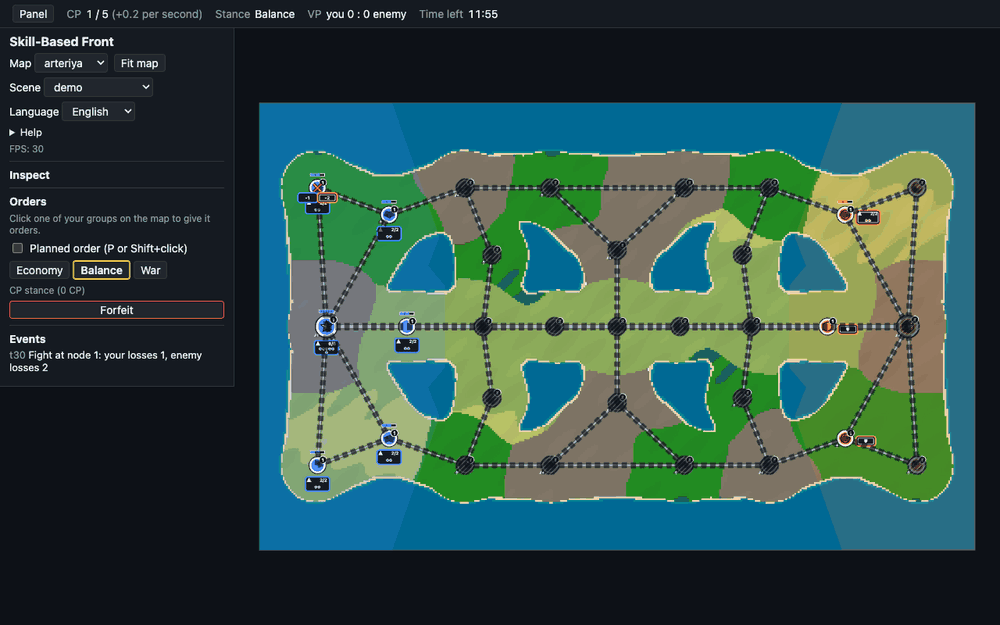
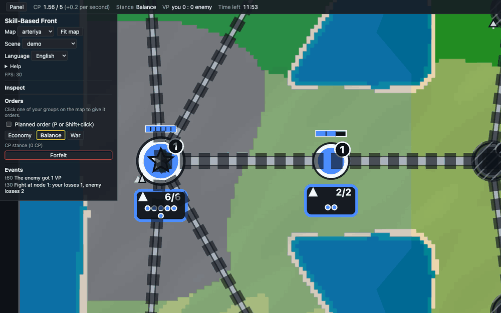
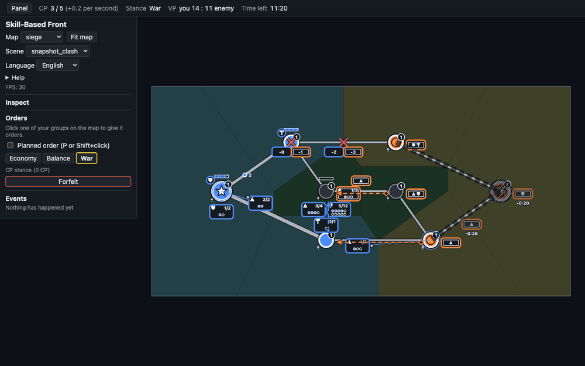
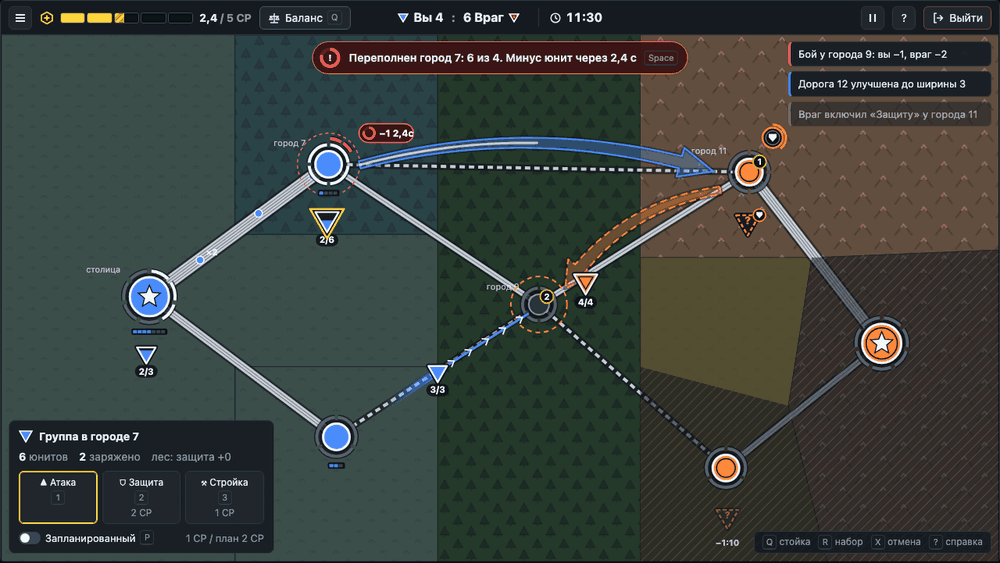
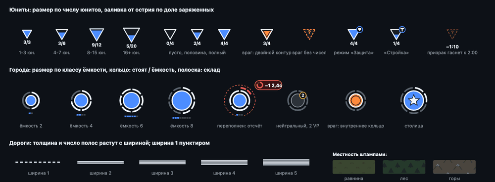
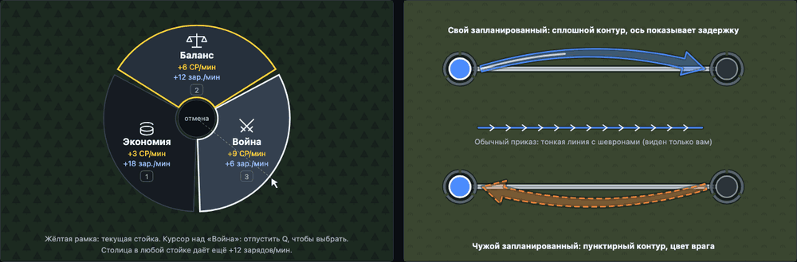

# Визуальный стиль клиента: исследование и гайд

Issue: #202. Статус: **[предложено]**, реализация в волне 3 (раздел 12).

Документ отвечает на замечания владельца после плейтеста клиента (Svelte 5 HUD + PixiJS 8 карта):
что изменить на карте и в интерфейсе, как это должно выглядеть в числах и что реализовать в каком
пакете работ. Правила игры документ не меняет: источник правил по-прежнему `mechanics.md`.

Макет: [`mockups/ui-style.html`](mockups/ui-style.html) (самодостаточный файл, открыть в браузере).
Картинки макета и снимки «до» лежат в [`mockups/img/`](mockups/img/).

Содержание:

1. Что сейчас и что не так
2. Исследование: переносимые приёмы
3. Принципы
4. Палитра и токены
5. Типографика
6. Иконки, шрифты и лицензии
7. Карта: визуальный язык
8. Интерфейс: упрощение HUD
9. Радиальное меню стойки
10. Предупреждение об истощении
11. Что нужно от протокола
12. Пакеты работ волны 3
13. Вопросы владельцу

---

## 1. Что сейчас и что не так

| Обзор (dev-экран, карта `arteriya`) | Приближение |
|---|---|
|  |  |



Замечания владельца и их причина в текущем коде:

| Замечание | Причина сейчас | Решение |
|---|---|---|
| Юниты мелкие, в движении их не видно | Плашка 54×32 в мировых единицах без нижней границы экранного размера: на «вписать карту» это около 30 px, текст 10 px; движущаяся плашка ничем не выделена | 7.5: треугольник с минимальным экранным размером, след движения |
| Юниты должны быть перевёрнутыми треугольниками | Плашка с текстом и точками (`shapes.ts`, `Token`) | 7.5 |
| Значок местности в углу города не читается | Глиф 10×10 у города (`mapView.ts`, `TERRAIN_GLYPH`); фон запечён пиксельными биомами без легенды | 7.2: штампы местности по всей области города |
| Запланированные приказы: большие стрелки как в HOI4 | Пунктир 3 px с маленьким наконечником (`ARROW_*` в `style.ts`) | 7.7 |
| Стойка радиальным меню по клавише | Три кнопки в боковой панели (`OrdersPanel.svelte`) | 9 |
| CP полосой прогресса | Текст `CP 0.04 / 5 (+0.2 per second)` в `StatusBar.svelte` | 8.2 |
| Ёмкость города с одного взгляда | Видна только полоска склада у своих городов, ёмкость числом в панели «Инспектор» | 7.4: размер города по классу ёмкости и кольцо гарнизона |
| Улучшенные дороги почти не отличаются | Толщина `2 + 2·w` растёт на 2 единицы за ширину (около 1.4 px на экране при «вписать карту»), а дорога в тумане ещё и рубится тёмным пунктиром, поэтому все ширины выглядят одинаковыми «шпалами» | 7.3 |
| Предупреждение об истощении с отсчётом | В протоколе нет счётчика переполнения; есть только событие `attrition` после потери | 10, 11 |
| Пакеты должны плавно въезжать в город | Пакет доезжает до центра узла, лежит поверх значка и исчезает скачком | 7.6 |
| Призраки «последний раз видели» гаснут через 2 мин | Призрак висит, пока в `Seen` есть память, с постоянной прозрачностью 0.62 | 7.8 |
| Кнопка выхода в верхней панели | «Сдаться» внутри панели приказов, отдельного выхода нет | 8.2, 8.5 |
| Упростить интерфейс | Боковая панель 300 px открыта всегда: dev-селекторы, язык, длинная текстовая легенда, FPS, инспектор, приказы, журнал | 8.1 |

---

## 2. Исследование: переносимые приёмы

Только то, что применимо к графу городов 1v1 в реальном времени. Чужие ассеты не копируются:
берём приёмы, а не картинки. Пометка «не проверено» значит, что утверждение видно только
в выдаче поиска, а первоисточник не открылся.

**Hearts of Iron IV.** Боевой план рисуется как линия фронта плюс широкая стрелка наступления.
Состояние стрелки передаётся стилем линии: до исполнения сплошная и неподвижная, при исполнении
пунктирная и анимированная, без назначенных дивизий «призрачная»
([Battle plan](https://hoi4.paradoxwikis.com/Battle_plan)). Режимы карты перекрашивают ту же
геометрию, а местность на крупном масштабе даётся плоскими цветами
([Map modes](https://hoi4.paradoxwikis.com/Map_modes)). В режиме снабжения уровень железной дороги
показан маленьким числом в чёрном кружке на линии, а запас идёт одной порядковой шкалой от
«много» до «штраф» ([Supply](https://hoi4.paradoxwikis.com/Supply)).
Для нас: широкая полупрозрачная стрелка запланированного приказа, состояние стилем контура,
ширина дороги числом в кружке при наведении.

**Into the Breach.** Показ намерений противника заложен в основу дизайна: каждая потеря должна
читаться как собственная ошибка игрока ([интервью Subset Games](https://gamedeveloper.com/game-platforms/road-to-the-igf-subset-games-i-into-the-breach-i-)).
Цели атак помечены прямо на клетках, порядок исполнения показан отдельно
([разбор](https://pixeltwelve.com/guides/into-the-breach-beginner-guide-enemy-attacks-grid)).
Один кадр должен объяснять ситуацию в три прочтения: крючок, второй слой, детали по запросу
([Gigazine](https://gigazine.net/gsc_news/en/20180501-game-design-subway-legibility)).
Для нас: намерения противника той же грамматикой, что и свои, плюс отметка цели и отсчёт.

**Mini Metro.** Переполнение станции нарастает ступенями: сначала пассажиры дрожат, потом станция
пульсирует и вокруг неё заполняется круговой таймер
([Untapped Cities](https://www.untappedcities.com/build-your-own-subway-system-with-mini-metro-game/)).
Форма станции кодирует тип, линии контрастны, фон низкоконтрастный и «растворяется», второстепенная
информация вынесена к краям ([разбор визуального дизайна](https://mechanicsofmagic.com/2023/04/22/visual-design-of-games-mini-metro/)).
Для нас: кольцо ёмкости города и круговой отсчёт истощения, приглушённая местность.

**Supremacy 1914 / Conflict of Nations.** Разработчики после фокус-группы завели отдельную работу над
читаемостью карты: размер подписей, границы, контраст юнитов и карты, наложение подписей и юнитов
([новость разработчиков](https://www.playsupremacy.com/en/news/1914/focus-group-update)).
Для нас: проверять контраст и наложения сразу, на максимуме групп.

**The Battle of Polytopia.** Низкополигональный стиль хорошо читается в начале, но обозреватель
отметил, что к концу партии с ростом числа юнитов картинку трудно разбирать
([Wikipedia, раздел отзывов](https://en.wikipedia.org/wiki/The_Battle_of_Polytopia)).
Для нас: стресс-тест читаемости на поздней партии, а не на стартовой позиции.

**Northgard.** Карта разбита на области со своими ресурсами и лимитом построек, это прямой аналог
нашей ёмкости ([Wikipedia](https://en.wikipedia.org/wiki/Northgard)). В обзоре консольной версии
критикуют «россыпь крошечных символов» и неудобные радиальные меню
([Xbox Tavern](https://www.xboxtavern.com/northgard-review/)).
Для нас: крупные символы и простое радиальное меню на три пункта.

**Diplomacy (цифровые доски).** Грамматика приказов: держать, идти, поддержать. В jDip толщина
стрелки движения пропорциональна поддержке, а неудавшийся приказ перечёркивается красным крестом
([jDip](https://jdip.sourceforge.net/history/v1.0.html), [формат приказов](https://diplom.org/dpjudge/docs/format.html)).
Для нас: толщина как величина (дороги), красный крест на отскоке (уже есть в метке боя).

**Радиальные меню.** Выбор зависит от направления, а не от расстояния; крупные цели рядом
с курсором; заметно быстрее линейного меню ([Pie menu](https://en.wikipedia.org/wiki/Pie_menu)).
Marking menus (Kurtenbach и Buxton): опытный пользователь выбирает жестом «вслепую», не дожидаясь
меню ([Autodesk Research](https://www.research.autodesk.com/publications/user-learning-and-performance-with-marking-menus/)).
Практика в играх: выбор отпусканием клавиши, мёртвая зона в центре, пункты никогда не
переставляются ([300Mind](https://300mind.studio/blog/radial-menus-in-game-design/)).

**Доступность цвета.** Важная информация не передаётся одним цветом; пара синий и оранжевый
различима при трёх частых видах дальтонизма, а разница светлоты добавляет запас
([Game Accessibility Guidelines](https://gameaccessibilityguidelines.com/ensure-no-essential-information-is-conveyed-by-a-fixed-colour-alone/)).
Палитра Okabe-Ito ([источник](https://siegal.bio.nyu.edu/color-palette/)) и схемы Пола Тола
([khroma](https://cran.stat.unipd.it/web/packages/khroma/vignettes/tol.html)) дают проверенные пары.

**Рельеф на картах.** Штрихи по направлению склона (Lehmann, 1799;
[Hachure map](https://en.wikipedia.org/wiki/Hachure_map)) и процедурные «эскизные» штрихи
([Andy Woodruff](https://andywoodruff.com/blog/hachures-and-sketchy-relief-maps)) читаются
без цвета. Для нас: тёмные штампы низкого контраста поверх приглушённого фона.

Не проверено (первоисточник недоступен): точные размеры и прозрачность стрелок HOI4,
длительность таймера переполнения в Mini Metro (в выдаче поиска около 10 с), облик значков
Conflict of Nations и цветовые схемы Polytopia. На решения гайда это не влияет: числа ниже
подобраны под наш масштаб карты, а не скопированы.

---

## 3. Принципы

1. **Карта отступает, юниты выступают.** Местность и территория приглушены и низкоконтрастны;
   юниты, стрелки и тревоги самые контрастные элементы кадра.
2. **Форма плюс цвет, всегда** (AGENTS.md, 7.4). Владелец: цвет и одинарный или двойной контур.
   Заряд: залитая или пустая часть фигуры. Тревога: красный цвет, пульс и обратный отсчёт.
3. **Одна величина, одна переменная.** Число юнитов задаёт размер треугольника, доля заряженных
   задаёт заливку, ёмкость задаёт размер города, ширина дороги задаёт толщину. Числа в подписях
   дублируют фигуру и появляются по запросу.
4. **Намерения противника той же грамматикой, что и свои** (Into the Breach). Свою стрелку от
   чужой отличает контур, а не новый тип знака.
5. **Интерфейс по запросу.** Постоянно на экране только верхняя панель. Карточка выделения
   появляется, когда что-то выбрано; справка по `?`; события короткими тостами.
6. **Минимальный экранный размер.** Значимый символ карты не мельче 20 px на экране при любом
   масштабе камеры.

---

## 4. Палитра и токены

Значения ниже становятся единственным источником цветов: в CSS как переменные `:root`
(`app.css`), в PixiJS как константы `style.ts`. Тёмная тема одна: светлой темы у матча нет.

| Токен | Значение | Где |
|---|---|---|
| `--bg` | `#0d1117` | фон канваса, обводки на карте, «чернила» штампов |
| `--surface` | `rgb(22 27 34 / 92%)` | панели HUD |
| `--surface-2` | `#21262d` | кнопки |
| `--border` | `#30363d` | рамки панелей |
| `--text` | `#e6edf3` | основной текст |
| `--text-dim` | `#8b949e` | подписи, единицы измерения |
| `--paper` | `#f0f6fc` | белые контуры фигур, глифы на карте |
| `--you` | `#4c8dff` | свои: города, юниты, заряды, стрелки |
| `--enemy` | `#ff8a3d` | противник |
| `--neutral` | `#8b949e` (контур), `#2b3139` (заливка) | нейтральные города |
| `--accent` | `#ffd33d` | выделение, CP, текущая стойка |
| `--danger` | `#ff5d5d` | бой, истощение, переполнение |
| `--vp` | `#e3b341` | кант значка VP |
| `--terrain-plains` | `#3a4630` | подложка равнины |
| `--terrain-forest` | `#25392b` | подложка леса |
| `--terrain-mountains` | `#4a453e` | подложка гор |

Правила:

- **Свои всегда синие.** Сейчас цвет привязан к id игрока: за игрока 1 ты оранжевый. Предлагаю
  в живом матче красить относительно себя (`owner === me` даёт `--you`), а в реплее оставить цвет
  по id. Второй канал тоже относительный: свои с одинарным контуром, противник с двойным.
- Синий `#4c8dff` и оранжевый `#ff8a3d` различаются и по тону, и по светлоте; оба читаются на
  тёмных панелях. Красный `--danger` никогда не обозначает игрока.
- **Контраст с запечённым фоном.** Фон `maps/*.bg.png` яркий (пиксельные биомы, снег). Поверх него
  кладётся затемнение `--bg` с альфой 0.3, затем штампы местности; символы карты имеют тёмную
  обводку 3-6 единиц (как сейчас `HALO`, `ARROW_OUTLINE`). Так белые контуры читаются и на снегу.
- Жёлтый `--accent` занят под выделение, CP и текущую стойку. Заряды всегда цвета владельца.

---

## 5. Типографика

- Шрифт: системный стек `system-ui, -apple-system, 'Segoe UI', Roboto, 'Noto Sans', sans-serif`.
  Ноль файлов и ноль запросов, кириллица есть везде. Свой шрифт подключаем, только если на
  плейтесте разница между ОС станет заметна (раздел 6).
- Все числа HUD: `font-variant-numeric: tabular-nums`, чтобы CP и таймер не прыгали.
- Размеры: 12 px подсказки, 13 px вторичный текст и тосты, 14 px основной, 16 px полужирный
  для счёта VP и таймера. Без размеров меньше 11 px.
- Подписи на карте (PixiJS `Text`): 11-12 px на экране, полужирные, с тёмной обводкой 3 px
  (как `GHOST_AGE_STROKE` сейчас); подпись живёт в «таблетке» `--bg` с альфой 0.88, когда лежит
  на пёстром фоне.

---

## 6. Иконки, шрифты и лицензии

Ограничения: CSP `img-src 'self' data:`, `font-src 'self'`, `style-src 'self'` (`apps/client/csp.ts`),
никаких внешних запросов; новая npm-зависимость только с обоснованием (AGENTS.md, 0.5).

Сравнение наборов (лицензии сверены с официальными источниками):

| Набор | Лицензия | Что требует | Вывод |
|---|---|---|---|
| [Lucide](https://lucide.dev) | ISC, плюс MIT для иконок из Feather ([LICENSE](https://github.com/lucide-icons/lucide/blob/main/LICENSE)) | сохранить оба уведомления | **выбран для HUD** |
| [Tabler Icons](https://tabler.io/icons) | MIT ([LICENSE](https://github.com/tabler/tabler-icons/blob/main/LICENSE)) | сохранить уведомление | запасной |
| [Phosphor](https://phosphoricons.com) | MIT | сохранить уведомление | запасной |
| [game-icons.net](https://game-icons.net) | CC BY 3.0 ([about](https://game-icons.net/about.html)) | атрибуция автора для **каждой** иконки | не берём сейчас: учёт авторов на каждый значок |
| [Kenney](https://kenney.nl/assets) | CC0 ([support](https://kenney.nl/support)) | ничего (логотип Kenney использовать нельзя) | запасной для растровых ассетов |
| [Material Symbols](https://fonts.google.com/icons) | Apache 2.0 | сохранить уведомление | не нужен |

Решение:

- **HUD: Lucide, без npm-пакета.** Нужно около 12 значков: меню, CP, таймер, выход, пауза,
  справка, три стойки, три режима, набор. Их `path` копируются в один компонент `Icon.svelte`
  (словарь имя → разметка SVG, цвет через `currentColor`). Это статическая разметка в шаблоне,
  без `{@html}`; CSP не затронут. В шапке файла: ссылка на Lucide и текст лицензии ISC/MIT.
  Пакет `lucide-svelte` не берём: ради 12 значков зависимость не окупается.
- **Карта: свои фигуры в PixiJS `Graphics`.** Треугольники, кольца, штампы местности и стрелки
  простая геометрия, их чище рисовать кодом (как сейчас `drawModeGlyph`). Если нужен глиф
  из SVG, в PixiJS 8 есть `GraphicsContext.svg(svgString)` (метод есть в
  `pixi.js/lib/scene/graphics/shared/GraphicsContext.d.ts`).
- **Атрибуция.** Файл `apps/client/THIRD_PARTY_NOTICES.md` с полными текстами лицензий
  (Lucide; шрифт, если появится) и раздел «Лицензии» на странице правовой информации
  (`LegalPage.svelte`, строки в `i18n/legal`). Добавление любого ассета без записи в этот файл
  считается ошибкой ревью.
- **Шрифт (только если понадобится):** Inter ([rsms.me/inter](https://rsms.me/inter/), OFL,
  кириллица, табличные цифры `tnum`), один variable `woff2` с подмножеством latin + cyrillic
  в `apps/client/public/fonts/`. CDN Inter не используем.

---

## 7. Карта: визуальный язык





Размеры в мировых единицах карты (`docs/design/map-format.md`: города примерно в 100 единицах друг
от друга), если не сказано «px на экране».

### 7.1 Слои

Порядок слоёв не меняется (AGENTS.md, 7.2): фон → территория → дороги → узлы → группы →
намерения → туман → эффекты. Добавляется только содержимое:

- `background`: запечённый фон, затемнение `--bg` с альфой 0.3, штампы местности;
- `nodes`: кольца ёмкости и полоска склада переезжают сюда целиком;
- `groups`: пакеты под треугольниками, следы движения под пакетами;
- `effects`: отсчёт истощения и метки боя.

### 7.2 Местность на карте

- Значок местности в углу города убирается.
- Ячейка города (Вороной, уже считается в `voronoi.ts`) заполняется **штампами** тёмными
  «чернилами» `--bg`: лес: ёлочки (треугольник плюс ствол), горы: пики-шевроны с белой шапкой,
  равнина: редкие пучки травы. Альфа штампов 0.22 (равнина), 0.32 (лес), 0.38 (горы):
  местность читается, но не спорит с юнитами.
- Штамп рисуется один раз в `GraphicsContext`, превращается в текстуру
  (`renderer.generateTexture`) и раскладывается спрайтами по сетке с шагом 34×30 (лес),
  52×40 (горы), 30×26 (равнина), со смещением каждого второго ряда. Сдвиг сетки задаётся
  от id узла, поэтому картинка одинакова при каждом запуске. Штамп не ставится ближе 30 единиц
  к центру города и 12 к оси дороги, чтобы не лезть под символы.
- В карточке города и в справке рельеф назван словом и числом: «Горы: защита +1, вход 70%»
  (числа из `ruleset_public`).

Альтернатива: запекать штампы в `maps/*.bg.png` через `gow-maps bake`. Дешевле в рантайме, но
требует правки Python-инструмента и перезапекания карт; рантайм-штампы проще менять. Выбираем
рантайм, бюджет кадра проверить на `arteriya` (60 FPS, AGENTS.md, раздел 12).

### 7.3 Дороги, ширина 1..5

| Ширина | Толщина | Внутри | Вид |
|---|---|---|---|
| 1 | 4 | пунктир 7/5 | тропа |
| 2 | 7 | 1 тёмная полоса | две колеи |
| 3 | 10 | 2 полосы | |
| 4 | 13 | 3 полосы | |
| 5 | 16 | 4 полосы | магистраль |

- Толщина `1 + 3·w`, обводка `--bg` с альфой 0.6 шире на 5. Число тёмных продольных полос
  `w - 1`: ширина читается и толщиной, и узором, без цвета.
- Заливка `#c4cbd4` одна для всех дорог: владелец дороги виден по территории, отдельный цвет
  дороги только добавит шум.
- При наведении на дорогу: кружок с числом ширины посередине (приём HOI4) и подсказка
  «+0,5 ёмкости, +25% скорости пакетов, 1 CP» (уже есть строка `orders.roadHint`).
- Стройка на дороге: участок с бегущей штриховкой `--accent` поверх дороги до конца стройки.

### 7.4 Города и ёмкость

- **Размер по классу ёмкости** (ёмкость публична для всех узлов, DEC-04): радиус 13 при ёмкости
  до 2, 17 при 3-4, 21 при 5-6, 25 при 7 и больше. Город растёт, когда игрок улучшает дороги.
- **Кольцо ёмкости** на расстоянии радиус + 8: столько сегментов, сколько ёмкость, толщина 4
  с тёмной подложкой 7. У своих городов белых сегментов столько, сколько юнитов стоит в городе
  (точные числа есть только для `EXACT`); у чужих и нейтральных все сегменты серые, кольцо
  показывает только размер. При ёмкости больше 10 сегменты заменяются сплошной дугой с засечкой
  на каждой пятёрке.
- **Переполнение:** лишние юниты красными сегментами на втором кольце снаружи, пунктирный красный
  круг и отсчёт (раздел 10).
- **Склад:** сегментная полоска под кольцом, сегментов столько же (одно число ёмкости ограничивает
  и гарнизон, и склад), залитые цвета владельца.
- **Владелец:** заливка цветом плюс контур: свой белый контур 3, противник белый контур и тёмное
  внутреннее кольцо, нейтральный серый контур 2.
- Столица: белая звезда внутри. VP: тёмный кружок радиусом 8.5 с кантом `--vp` и числом,
  справа сверху.

### 7.5 Юниты: перевёрнутые треугольники

- **Фигура:** перевёрнутый равносторонний треугольник ▽ (вершина вниз), центр в центроиде.
- **Размер по числу юнитов**, ступенями: сторона 24 (1-3 юнита), 30 (4-7), 36 (8-15),
  42 (16 и больше). Неизвестное число (враг без чисел): 30.
- **Заряд как уровень:** от острия вверх заливается подобный треугольник цвета владельца;
  его **площадь** равна доле заряженных (`k = sqrt(charged / units)` по высоте). Пустая часть
  тёмная `#161b22`. Полностью разряженная группа выглядит пустым треугольником.
- **Владелец:** свой белый контур 2.4; противник белый контур плюс внутренний тёмный контур на 62%
  размера; враг без чисел (DEC-04, `PRESENCE`): пунктирный контур цвета врага и «?» внутри.
- **Режим:** «Атака» обычное состояние и не рисуется. «Защита» и «Стройка»: кружок радиусом 8
  на правом верхнем углу с глифом щита или молотка.
- **Подпись** «заряжено/юнитов» в тёмной таблетке под острием: всегда у выделенной группы и под
  курсором, у остальных своих групп при масштабе камеры от 0.6; у врага только там, где
  `Seen` даёт точные числа.
- **Минимальный размер на экране:** сторона не меньше 20 px при любом масштабе
  (`scale = max(1, 20 / (side · camera.scale))`). Область попадания мышью не меньше 28 px.
- **Движение:** треугольник не поворачивается (как фишка на штабной карте). За ним след: линия
  ширины 10 и длины 40, градиент от цвета владельца с альфой 0.7 до нуля. Полосы встречного
  движения разносятся на 18 единиц от оси дороги (сейчас 13, треугольники крупнее плашек).
- Выделение: жёлтый контур того же треугольника в 1.45 раза больше.

### 7.6 Пакеты снабжения

- Пакет: кружок радиусом 5 цвета владельца с белым контуром 1.6, на оси дороги (не на полосе
  юнитов). При двух зарядах и больше: подпись «×N».
- Положение уже считается по времени из `depart_tick` и `arrive_tick` (`packetProgress`),
  рывков по ходу нет. Меняется только конец пути: когда пакет входит в круг города
  (расстояние до центра меньше радиуса города + 8), он за оставшийся путь уменьшается до 30%
  и гаснет до нуля, «въезжая» в значок. Сегмент склада, который он пополнил, коротко вспыхивает.
- Пакеты рисуются под треугольниками и над дорогами.

### 7.7 Приказы и намерения

Три вида линий, отличимых без цвета:

| Что | Вид | Кто видит |
|---|---|---|
| Обычный приказ (свой) | тонкая линия 3 с белыми шевронами каждые 26 единиц | только свой игрок |
| Запланированный приказ (свой) | широкая лента, **сплошной** контур | оба |
| Запланированный приказ противника | широкая лента, **пунктирный** контур 9/5 | оба |
| Отправлен, ждёт снапшота | как сейчас: пунктир с прозрачностью 0.85 | свой игрок |

Ленточная стрелка в духе HOI4 (макет: [стрелки](mockups/img/mock-radial.png), правая половина):

- Ось: квадратичная кривая от края города-источника (отступ радиус + 16) до края цели
  (радиус + 20), изгиб 12-18% длины хорды влево по ходу. Для своего приказа ось идёт по
  `order.path` со скруглёнными углами; для намерения противника есть только `origin` и
  `target` (путь клиент не считает, AGENTS.md, 7.1), поэтому ось одна дуга.
- Тело шириной 16, хвост сужается до 60%. Наконечник шириной 38 (2.4 тела) и длиной 30 (1.9 тела).
- Заливка цветом владельца с альфой 0.32, контур 2.2 с альфой 0.95, под всем тёмная обводка 6
  с альфой 0.45 (читается на снегу).
- Задержка: по оси от хвоста растёт светлая полоса, доля прошедшей задержки
  `planned_delay_ticks` (нужно поле в `ruleset_public`, раздел 11). Когда группа выступила,
  контур становится пунктирным и «бежит» (анимация штриха), как исполняемый план в HOI4.
- Цель запланированного приказа противника: пунктирное кольцо цвета врага радиусом радиус + 20
  вокруг города-цели.
- Намерения без цели («Защита», стройка): кружок радиусом 13 над городом с глифом и дугой
  отсчёта задержки вокруг.
- Стрелка не масштабируется под минимальный экранный размер, но тело не тоньше 8 px на экране.

### 7.8 Туман и призраки

- Скрытые города и дороги как сейчас: затемнение плюс штриховка (уже не только цвет).
- Призрак «последний раз видели»: треугольник противника пунктиром и подпись возраста «−1:10».
- **Угасание:** до 60 с альфа 0.6, от 60 до 120 с линейно до 0, после 120 с призрак не рисуется.
  Константы `GHOST_FADE_START_S = 60` и `GHOST_HIDE_S = 120` в `style.ts`. Это только показ:
  память остаётся в `PlayerView`, правило тумана не меняется. В карточке скрытого города
  по-прежнему пишется «последний раз видели 3:10 назад».

### 7.9 Бой

Метка боя остаётся: красный крест и потери обеих сторон. Отскок атакующего (атака без победы)
дополнительно рисуется коротким красным крестом на ребре, как неудавшийся приказ в jDip.

---

## 8. Интерфейс: упрощение HUD

### 8.1 Что убрать и куда перенести

| Сейчас (боковая панель 300 px) | Станет |
|---|---|
| Заголовок, выбор карты и сцены, FPS | только на dev-экране, в меню ☰ |
| Язык | меню ☰ |
| «Вписать карту» | меню ☰ и клавиша `Home` |
| «Справка» с длинной текстовой легендой | оверлей по `?`: картинка-легенда (как лист легенды макета) и таблица клавиш |
| Инспектор | карточка выделения, только когда выбрано |
| Панель приказов: подсказка, флажок «Запланированный», кнопки стойки | карточка выделения (режимы, переключатель «Запланированный» с `P`); стойка уходит в радиальное меню |
| «Сдаться» | кнопка «Выйти» в верхней панели |
| Журнал событий | тосты справа сверху (3 последних, гаснут через 6 с) и выдвижной журнал по клику |
| Кнопка «Панель» | не нужна |

### 8.2 Верхняя панель

Высота 44 px, сетка из трёх колонок:

```
┌────────────────────────────────────────────────────────────────────────────────────┐
│ ☰  ⬡ [██][██][▨ ][  ][  ] 2,4 / 5 CP  [⚖ Баланс Q] │ ▽ Вы 4 : 6 Враг ▽ │ ◷ 11:30 │  ⏸  ?  [⇥ Выйти] │
└────────────────────────────────────────────────────────────────────────────────────┘
```

- **CP:** полоса из `cap / 100` сегментов (5 при `mvp-0`), каждый сегмент 1 CP, частично
  заполненный сегмент заштрихован. Справа число «2,4 / 5 CP». На потолке полоса подсвечивается
  и в подсказке пишется «CP на потолке: излишек сгорает» (DEC-02). Под курсором: скорость
  регенерации в текущей стойке.
- **Стойка:** «чип» с иконкой, названием и `Q`; клик открывает радиальное меню у чипа.
- **Счёт VP:** «Вы 4 : 6 Враг» с треугольниками своего цвета и формы (одинарный и двойной контур).
- **Таймер** с иконкой часов, 16 px полужирный, табличные цифры.
- **Справа:** пауза (только в приватных матчах, как сейчас), `?`, «Выйти».

### 8.3 Карточка выделения

Слева снизу, ширина 340 px, только при выделении:

- группа: число юнитов и зарядов, место и рельеф с модификатором; три кнопки режимов с клавишами
  1/2/3 и ценой; переключатель «Запланированный» (`P`) с ценой обычного и запланированного хода;
- город: владелец, ёмкость «стоят / ёмкость», склад, рельеф, VP; кнопка набора (`R`) с ценой;
- дорога: ширина, что даст улучшение.

### 8.4 Подсказка клавиш и справка

Справа снизу постоянная строка из 4 клавиш: `Q` стойка, `R` набор, `X` отмена, `?` справка.
Оверлей `?` закрывается `Esc` или повторным `?`.

### 8.5 Выход

«Выйти» открывает диалог: «Выйти из матча? Это сдача: матч закончится вашим поражением.»
Кнопки «Сдаться и выйти» (красная) и «Остаться» (фокус по умолчанию). Это существующая команда
`Forfeit` (сейчас `orders.forfeit()`); отдельный «выход без сдачи» не нужен: закрытая вкладка уже
даёт окно переподключения `GOW_RECONNECT_WINDOW_S` (DEC-05). После конца матча кнопка ведёт
сразу в меню.

---

## 9. Радиальное меню стойки



- **Клавиша `Q`** (свободна: сейчас заняты `Esc`, `P`, `X`, `1`-`3`, `R`; рядом с `1`-`3`).
- **Удержание:** нажать и держать `Q`, меню открывается с центром под курсором (если курсор вне
  канваса: в центре экрана). Указатель в сектор, отпустить `Q`: стойка выбрана. Отпустить в
  мёртвой зоне радиусом 28 px: отмена.
- **Короткое нажатие** (меньше 200 мс): меню остаётся открытым; выбор кликом или клавишами
  `1`/`2`/`3` (пока меню открыто, они выбирают стойку, а не режим группы); `Esc` закрывает.
- Клик по чипу стойки в верхней панели открывает то же меню у чипа.
- **Геометрия:** три сектора по 116° с зазором, внешний радиус 150 px, внутренний 34 px.
  Порядок по оси «экономика ↔ война» и **никогда не меняется**: «Экономия» слева снизу,
  «Баланс» сверху, «Война» справа снизу. Наведённый сектор светлее с белым контуром, текущая
  стойка в жёлтой рамке.
- **Содержимое сектора:** иконка, название, номер клавиши и два числа, вычисленные из
  `ruleset_public` (это отображение чисел рулсета, как цена приказа, а не логика игры):

| Стойка | CP в минуту | Зарядов в минуту от стойки |
|---|---|---|
| Экономия | +3 | +18 |
| Баланс | +6 | +12 |
| Война | +9 | +6 |

  Расчёт для `mvp-0`: квант `cp.per_period = 100` раз в `period_ticks = 50` (12 раз в минуту);
  доля в заряды `stance_to_charges_pct` 75/50/25, курс `charges_per_cp = 2`. Подпись внизу
  меню: «Столица в любой стойке даёт ещё +12 зарядов/мин» (`passive_amount` раз в
  `passive_period_ticks`).
- **Перезарядка смены:** `stance_cooldown_ticks = 100` (10 с). Пока она идёт, секторы приглушены,
  в центре дуга отсчёта и «через 7 с». Нужно знать, когда смена снова разрешена (раздел 11);
  без этого поля меню просто отправляет команду и показывает отказ сервера тостом.
- Смена стойки бесплатна (`orders.cost.stance = 0`), поэтому подтверждения нет.
- **Доступность:** `role="menu"`, секторы `menuitemradio` с `aria-checked`; всё управляется
  с клавиатуры (`Q`, `1`-`3`, `Esc`).

---

## 10. Предупреждение об истощении

Правило (mechanics.md, раздел 9; SIM-07): пока стоящих в городе юнитов владельца больше ёмкости,
счётчик `Node.over_ticks` растёт; на `capacity.attrition_ticks`-м тике подряд (30 тиков, 3 с)
гибнет один юнит, и отсчёт начинается заново. После захвата действует отсрочка `grace_ticks`
(5 с). Значит, отсчёт короткий и повторяется каждые 3 с, пока город переполнен.

Показ, по нарастанию (приём Mini Metro):

1. **На карте:** лишние юниты красными сегментами снаружи кольца ёмкости, пунктирный красный
   круг вокруг города пульсирует (альфа 0.5 ↔ 1, период 0.8 с).
2. **Отсчёт у города:** красная таблетка справа сверху: круговая дуга, которая заполняется
   за `attrition_ticks`, и текст «−1 2,4с». Во время отсрочки после захвата дуга серая и текст
   «отсрочка 3с».
3. **В HUD:** баннер под верхней панелью «Переполнен город 7: 6 из 4. Минус юнит через 2,4 с»
   с клавишей `Space`: камера переезжает к городу. При нескольких городах баннер один, с числом
   («Переполнено городов: 2») и переходом к ближайшему по отсчёту.
4. Событие `attrition` (уже есть в протоколе) даёт тост «Город 7: потерян юнит от переполнения».

Клиент сам не считает переполнение и отсчёт (AGENTS.md, 7.1): числа приходят от сервера (раздел 11).

---

## 11. Что нужно от протокола

Правила игры и `SIM_VERSION` не меняются: добавляются только поля показа. Каждое изменение
протокола: `PROTOCOL_VERSION`++, перегенерация `protocol.gen.ts`, а новое поле вида игрока
(`PlayerView` и `NodeView`) приходит вместе с тестом тумана (AGENTS.md, 4.4 и 10).

| Поле | Где | Зачем | Пакет |
|---|---|---|---|
| `economy.stance_to_charges_pct`, `economy.charges_per_cp`, `economy.passive_amount`, `economy.passive_period_ticks`, `orders.stance_cooldown_ticks` | `RulesetPublic` | числа в радиальном меню | C |
| `orders.planned_delay_ticks`, `orders.defense_delay_ticks` | `RulesetPublic` | отсчёт задержки на стрелке и значке намерения | C |
| `stance_ready_tick` (тик, с которого смена разрешена) | `SelfView` | отсчёт перезарядки стойки | C (по желанию) |
| `capacity.attrition_ticks`, `capacity.grace_ticks` | `RulesetPublic` | длина дуги отсчёта | D |
| `attrition_in: int \| None` (тиков до гибели юнита) и `grace_left: int \| None` | `NodeView`, только у своих узлов с переполнением, иначе `None` | отсчёт истощения | D |

`attrition_in` берётся из `Node.over_ticks` в `gow_sim.view.project()`: `attrition_ticks - over_ticks`.
Тест тумана: у узла противника и у нейтрального узла поле всегда `None`, даже если там стоит
своя группа (истощение считается только для гарнизона владельца).

---

## 12. Пакеты работ волны 3

Четыре пакета независимы по файлам; общие только `style.ts` (каждый пакет добавляет свой раздел
констант), словари `i18n` (только новые ключи) и `protocol` (C и D оба повышают
`PROTOCOL_VERSION`: кто мержит вторым, делает rebase и повышает ещё раз). Пункты «ввода и
камеры» разложены по зонам, где они живут в коде: минимальный размер и попадание по юнитам в B,
клавиша `Q` в C, `?`, `Space` и `Home` в D.

Общие критерии для всех пакетов: состояние не передаётся одним цветом; новые строки через `t()`
в ru и en; объекты PixiJS уничтожаются; 60 FPS на `arteriya` в dev-сцене `demo`; эталонные
снимки `apps/client/visual/` обновлены (`pnpm -C apps/client test:visual:update`); Vitest на
чистые функции раскладки.

### A. Карта: местность, дороги, города (`size:M`)

Файлы: `render/mapView.ts`, `render/style.ts` (палитра и раздел карты), новый `render/terrainView.ts`,
`render/entityView.ts` (только перенос полоски склада в новый `render/cityView.ts`), `app.css` (токены).

- [ ] Токены раздела 4 заданы в `app.css` и `style.ts`; цвета на карте и в HUD берутся только из них.
- [ ] Цвет и контур относительны: свои синие с одинарным контуром в живом матче за любого игрока;
      в реплее цвет по id (если владелец согласен, раздел 13).
- [ ] Значок местности у города удалён; ячейки заполнены штампами леса, гор и равнины по 7.2;
      картинка одинакова при перезапуске; штампы не заходят под города и дороги.
- [ ] Поверх запечённого фона затемнение 0.3; белые контуры читаются на снегу (снимок `arteriya`).
- [ ] Дороги по таблице 7.3: толщина `1 + 3·w`, `w - 1` полос, ширина 1 пунктиром; при
      наведении кружок с числом ширины.
- [ ] Радиус города по классу ёмкости, кольцо из сегментов «стоят / ёмкость», сегментная полоска
      склада цвета владельца; при смене ёмкости город перерисовывается.
- [ ] Чистые функции (класс ёмкости, раскладка сегментов, сетка штампов) покрыты Vitest.

### B. Карта: юниты, пакеты, туман (`size:M`)

Файлы: `render/shapes.ts`, `render/layout.ts`, `render/entityView.ts` (группы, враги, пакеты),
`render/fogView.ts`, `render/pick.ts`, `render/camera.ts` (только функция экранного масштаба символов).

- [ ] Группы и сведения о врагах рисуются перевёрнутыми треугольниками по 7.5: размер по ступеням
      числа юнитов, заливка от острия с площадью по доле заряженных, свой и чужой контур,
      «?» для врага без чисел, глиф режима только для «Защиты» и «Стройки».
- [ ] Сторона треугольника не меньше 20 px на экране при любом масштабе, попадание мышью
      не меньше 28 px; тест на `pick.ts`.
- [ ] Подпись «заряжено/юнитов» по правилам 7.5 (выделение, наведение, масштаб от 0.6).
- [ ] Движущаяся группа со следом; полосы встречного движения 18 единиц.
- [ ] Пакеты на оси дороги «въезжают» в город: уменьшение до 30% и угасание внутри круга
      города, без скачка при исчезновении из снапшота.
- [ ] Призраки гаснут по 7.8 (0.6 до 60 с, линейно до 0 к 120 с, после не рисуются); тест
      функции прозрачности от возраста.

### C. Приказы и меню (`size:M`)

Файлы: новый `render/intentView.ts` (рисование намерений и линий приказов выносится из
`entityView.ts` первым коммитом), `render/overlayView.ts`, новый `hud/RadialMenu.svelte`,
`match/keyEvents.ts`, `match/orderController.ts`, `hud/OrdersPanel.svelte` (удаление кнопок
стойки), протокол: `gow_protocol/ruleset.py` (+ `SelfView` по желанию).

- [ ] Запланированные приказы обеих сторон рисуются ленточной стрелкой по 7.7 (размеры, альфа,
      сплошной или пунктирный контур, отсчёт задержки по оси, кольцо цели у намерения врага);
      обычный приказ тонкой линией с шевронами.
- [ ] Свой запланированный приказ идёт по `order.path`, намерение противника дугой
      `origin → target`; клиент не считает путей.
- [ ] Радиальное меню стойки по разделу 9: удержание и короткое нажатие `Q`, мёртвая зона,
      `1`/`2`/`3` и `Esc` внутри меню, фиксированный порядок секторов, текущая стойка отмечена.
- [ ] Числа в секторах вычислены из `ruleset_public`; тест: для `mvp-0` получаются 3/18, 6/12, 9/6.
- [ ] `RulesetPublic` дополнен полями раздела 11; `PROTOCOL_VERSION`++, схема и `protocol.gen.ts`
      перегенерированы, тесты протокола и сервера зелёные.
- [ ] Кнопки стойки убраны из панели приказов; меню доступно с клавиатуры и через чип в
      верхней панели (`role="menu"`, `menuitemradio`).

### D. HUD и информация (`size:M`)

Файлы: `hud/Hud.svelte`, `hud/StatusBar.svelte` (станет `TopBar.svelte`), `hud/SelectionPanel.svelte`
(станет карточкой), `hud/EventLog.svelte` (тосты и журнал), новые `hud/Icon.svelte`,
`hud/HelpOverlay.svelte`, `hud/AttritionAlert.svelte`, новый `render/alertView.ts` (слой `effects`),
`apps/client/THIRD_PARTY_NOTICES.md`, `legal/LegalPage.svelte`; протокол: `NodeView`,
`gow_sim.view.project()` и тест тумана.

- [ ] Боковой панели нет: верхняя панель по 8.2 (меню ☰, полоса CP из сегментов, чип стойки,
      VP с фигурами, таймер, пауза, `?`, «Выйти»), карточка выделения по 8.3 только при выделении.
- [ ] «Выйти» с диалогом по 8.5 отправляет `Forfeit`; фокус по умолчанию на «Остаться».
- [ ] События тостами (3 последних, 6 с) и выдвижным журналом.
- [ ] Оверлей `?` с картинкой-легендой и таблицей клавиш; `Home` вписывает карту; `Space`
      ведёт камеру к переполненному городу.
- [ ] Иконки Lucide в `Icon.svelte` без npm-пакета; лицензии в `THIRD_PARTY_NOTICES.md` и
      в разделе «Лицензии» правовой страницы.
- [ ] `NodeView.attrition_in` и `grace_left` (раздел 11) с тестом тумана; `PROTOCOL_VERSION`++.
- [ ] Предупреждение об истощении по разделу 10: сегменты, пульс, дуга отсчёта у города,
      баннер в HUD; Vitest на форматирование отсчёта.
- [ ] `fitMap` учитывает новые отступы HUD (верхняя панель и карточка), как сейчас `oninsets`.

Порядок: пакеты можно делать параллельно. Если делать по одному, то A и B первыми (они больше
всего меняют картинку и снимки), затем C и D.

---

## 13. Вопросы владельцу

Решения по умолчанию записаны выше; если владелец ответит иначе, меняется только этот гайд
до начала волны 3.

1. **Относительные цвета** (свои всегда синие). По умолчанию: да, в живом матче; в реплее по id.
2. **Клавиша меню стойки** `Q`. По умолчанию: `Q` с удержанием и коротким нажатием.
3. **Угасание призраков** через 2 минуты только на экране (память остаётся в виде игрока).
   По умолчанию: да; если нужно правило «память живёт 2 минуты», это изменение mechanics.md
   и `SIM_VERSION`.
4. **Выход равен сдаче.** По умолчанию: да, с подтверждением.
