# Визуальный стиль клиента: исследование и гайд (v2)

Issues: #202 (v1, PR #207), #208 (v2). Статус: **[предложено]**, реализация в волне 3 (раздел 16).

v1 отвечал на 21 замечание владельца после плейтеста и опирался на текстовые источники.
v2 добавляет визуальное исследование (мудборд, раздел 2), критику всех наших экранов (раздел 3)
и проактивные улучшения сверх списка владельца (раздел 4), пересобирает пакеты волны 3
(раздел 16). Правила игры документ не меняет: источник правил по-прежнему `mechanics.md`.

Макет: [`mockups/ui-style.html`](mockups/ui-style.html) (самодостаточный файл, открыть в браузере).
Снимки нашего клиента и картинки макета лежат в [`mockups/img/`](mockups/img/). Чужие скриншоты
и ассеты в репозиторий не кладём: в мудборде только ссылки и наши описания.

Содержание:

1. Решения владельца и что изменилось с v1
2. Мудборд
3. Критика текущих экранов
4. Проактивные улучшения
5. Принципы
6. Палитра и токены
7. Типографика и масштаб интерфейса
8. Иконки, звуки и лицензии
9. Карта: визуальный язык
10. HUD матча
11. Радиальное меню стойки
12. Предупреждение об истощении
13. Экраны вне матча
14. Звук, доступность, локализация
15. Что нужно от протокола и API
16. Пакеты работ волны 3
17. Вопросы владельцу

---

## 1. Решения владельца и что изменилось с v1

Приняты владельцем (не пересматриваются):

- свои всегда синие, противник всегда красный (в живом матче за любого игрока);
- стойка: радиальное меню на `Q`;
- «Выйти» и двойной `Esc` = сдача с подтверждением;
- призраки «последний раз видели» гаснут на клиенте через 2 минуты;
- улучшение дороги: функция города на `U`, режима «Строительство» нет (DEC-16, #209);
- туман на дорогах противника (DEC-17, #210).

Раунд 3 (#252, #254): всплывающие окна с фактами выглядели как отладка и сняты (У5 и подсказки
города, дороги, стрелки намерения больше не действуют); осталась одна подсказка с зарядами у группы.
Строка-подсказка внизу (`OrderHint`) и оценка боя в HUD сняты, в клиенте нет логики игры совсем.
Время в пути: одно число у целевого узла, пока выбрана своя группа и курсор над достижимым узлом.

Уже заведено и учтено здесь: запланированный приказ только через `Shift`+клик, клавиша `P` уходит
(#213); VP начисляются раз в 30 с (#211); экран «Как играть» (CLI-13, #72); «сочность» и звук
(CLI-12, #71); лидерборд и профиль (LB-01, #78).

Что v2 меняет в v1:

| Было в v1 | Стало в v2 | Почему |
|---|---|---|
| Противник оранжевый `#ff8a3d`, красный для тревог | противник красный `#e5484d`, тревоги янтарные `--warn`, выделение белое | решение владельца; красный теперь значит только «противник» |
| Жёлтый `--accent`: выделение, CP, текущая стойка | CP синие (это ресурс игрока), выделение белым контуром, жёлтый только для VP | жёлтый и янтарный неразличимы при дальтонизме (раздел 6) |
| Переключатель «Запланированный» с `P` в карточке | подсказка «`Shift`+клик: запланированный» и цена обоих вариантов | #213 |
| Основной текст HUD 14 px, подсказки 12 px | основной 15-16 px, минимум 13 px, микроподписи 12 px; масштаб интерфейса 100/125/150% | XAG 101 (раздел 7) |
| Экраны вне матча не рассматривались | раздел 13 и пакет E | плейтест и критика (раздел 3) |
| Звука, онбординга и настроек нет | раздел 14 и пакет F | раздел 4 |
| Метка боя: красный крест | белая вспышка с потерями обеих сторон цветом владельцев | красный занят противником |

---

## 2. Мудборд

Как смотрели: страницы Steam (галереи скриншотов), официальные сайты, разборы разработчиков,
Dribbble и Behance, Interface In Game. Game UI Database за проверкой Cloudflare (её не обходили),
поэтому по ней только описание разделов. «Что берём» описывает приём, а не картинку.

| # | Референс | Что берём |
|---|---|---|
| 1 | Mini Metro ([Steam](https://store.steampowered.com/app/287980/Mini_Metro/), [разбор визуала](https://mechanicsofmagic.com/2023/04/22/visual-design-of-games-mini-metro/)) | Карта занимает весь экран, интерфейс прижат к краям мелкими группами: ресурсы внизу по центру, счёт и часы справа сверху. Фон бледный, сеть читается первой. Тип станции кодирует форма, а не цвет |
| 2 | Mini Motorways ([Steam](https://store.steampowered.com/app/1127500/Mini_Motorways/), [звук](https://gamedeveloper.com/design/turning-road-noise-into-music-mini-motorways)) | Широкая полупрозрачная жёлтая «подсветка» маршрута с номером в кружке поверх дороги: прямой образец нашей ленточной стрелки. Звуки действий подстроены под общий ритм, палитры для дальтоников переключаются как готовые наборы |
| 3 | Into the Breach ([Steam](https://store.steampowered.com/app/590380/Into_the_Breach/), [Gigazine: три прочтения](https://gigazine.net/gsc_news/en/20180501-game-design-subway-legibility)) | Все намерения врага нарисованы на поле до хода. Сегментная полоса ресурса слева сверху. Подсказка клетки справа снизу: название и одна строка эффекта («что будет, если…»). Каждый экран читается в три слоя |
| 4 | The Battle of Polytopia ([Steam](https://store.steampowered.com/app/874390/The_Battle_of_Polytopia/)) | Три числа по центру сверху, подпись мелко над каждым числом («Счёт», «Звёзды (+11)», «Ход»). Круглые кнопки справа снизу с подписью под каждой. Полоса роста под городом из сегментов |
| 5 | Hearts of Iron IV ([Steam](https://store.steampowered.com/app/394360/Hearts_of_Iron_IV/), [Battle plan](https://hoi4.paradoxwikis.com/Battle_plan)) | Широкие полупрозрачные стрелки наступления поверх карты; состояние плана стилем контура. Антипример: плотные панели закрывают половину карты |
| 6 | Bad North ([Steam](https://store.steampowered.com/app/688420/Bad_North_Jotunn_Edition/), [звук](https://gamingaudionews.com/2018/04/26/bad-norths-developers-talk-about-inspiration-behind-audio-and-gameplay/)) | Отряд обозначен флажком-баннером над ним: крупный знак читается при любом масштабе. Почти нет HUD. Принцип звука: «закрой глаза и всё равно понимаешь бой» |
| 7 | Dorfromantik ([Steam](https://store.steampowered.com/app/1455840/Dorfromantik/)) | Счёт справа сверху, остаток ходов в круге справа снизу, задания на карте белыми «пузырями» с числом. Короткий отклик на удачное действие: подскок, звук, подсветка |
| 8 | Against the Storm ([Steam](https://store.steampowered.com/app/1336490/Against_the_Storm/), [Interface hotfix](https://eremitegames.com/interface-hotfix-we-hear-you/)) | Две противоборствующие полосы (синяя и красная) как «перетягивание». Урок хотфикса: минимализм без подписей у иконок провалился, пришлось вернуть подписи, отступы и крупные чекбоксы |
| 9 | Northgard ([Steam](https://store.steampowered.com/app/466560/Northgard/), [экраны лобби](https://interfaceingame.com/games/northgard/)) | Границы территории тонкой светящейся линией цвета владельца по краю области. Создание и вход в матч отдельными чистыми экранами. Антипример (консоль): россыпь мелких символов без подсказок |
| 10 | Old World ([Steam](https://store.steampowered.com/app/597180/Old_World/)) | Вложенные подсказки: термин внутри подсказки открывает свою подсказку. Туман как плотные облака, мини-карта справа снизу, портрет выделенного слева снизу |
| 11 | Songs of Conquest ([Steam](https://store.steampowered.com/app/867210/Songs_of_Conquest/)) | Численность отряда в маленькой тёмной таблетке у фигуры; очередь ходов полосой внизу |
| 12 | Diplomacy is Not an Option ([Steam](https://store.steampowered.com/app/1272320/Diplomacy_is_Not_an_Option/)) | Командная карточка по центру снизу, ресурсы тонкой строкой сверху: всё лишнее у краёв |
| 13 | Age of Empires IV ([учебник](https://ageofempires.com/news/quickstart-guide-age-of-empires-iv), [доступность](https://www.ageofempires.com/age-iv-accessibility/)) | Отдельный раздел «Учиться»: короткие испытания с медалями. Графики по времени на экране итога, масштаб интерфейса 100-150%, раздельная громкость |
| 14 | StarCraft II ([реплеи](https://news.blizzard.com/en-us/article/424210/press-the-replay-button)) | Реплей: шкала с перемоткой, скорость, панели ресурсов и потерь обоих игроков. Режим «свои, союзник, враг» перекрашивает юнитов относительно смотрящего (наш «свои синие») |
| 15 | Clash Royale ([разбор](https://mechanicsofmagic.com/?p=15995)) | Короткий матч 1v1: последняя минута заметно меняет темп и показывается в интерфейсе. Цена на каждой кнопке действия |
| 16 | generals.io ([разбор](https://kam.mff.cuni.cz/~straka/blog/generals.html)) | Браузерная 1v1 на графе с туманом: число армии прямо на клетке, таблица общих итогов сторон |
| 17 | Supremacy 1914 ([звук](https://www.playsupremacy.com/en/forums/1914/1914-news-updates/the-sound-of-supremacy-1914-patch-notes-6096e218), [читаемость](https://www.playsupremacy.com/en/news/1914/focus-group-update)) | Звук карты тише с расстоянием от камеры. Отдельная работа над читаемостью после фокус-группы |
| 18 | Civilization VII ([патч 1.1.1](https://civilization.2k.com/civ-vii/game-update-notes/2025-mar-25-patch-1-1-1/)) | После запуска пришлось усилить полосы здоровья и флажки юнитов и добавить «быстрое перемещение» без анимаций: маркеры должны выигрывать у арта карты |
| 19 | Dribbble: [LoL Gold Diff Timeline](https://dribbble.com/shots/24169430) | Один график разницы вокруг нуля: выше синий, ниже красный; события своих над графиком, чужих под ним; периоды боя заштрихованы. Тот же график годится как шкала реплея |
| 20 | Dribbble: [Overwatch 2 Match Summary](https://dribbble.com/shots/19021291) | Иерархия итога: крупное слово исхода, затем счёт, карта и длительность, затем детали; реплей отдельной кнопкой |
| 21 | Dribbble: [Match Found Interaction](https://dribbble.com/shots/14980810) | Очередь как один элемент по центру: пульсирующее кольцо, таймер вверх, строка статуса, «Отмена» |
| 22 | Dribbble: [VALORANT StatsCenter](https://dribbble.com/shots/20140742) | Ряд из 4-6 крупных чисел с мелкой подписью под каждым (KPI) над подробностями |
| 23 | Dribbble: [Hex Strategy Tactical UI](https://dribbble.com/shots/26852209) | Карточка юнита: имя, полоса, список «ключ: значение»; строка-подсказка над кнопками действий |
| 24 | Dribbble: [NORAD](https://dribbble.com/shots/9592604-NORAD), [Mini Metro Menu](https://dribbble.com/shots/26203344-Mini-Metro-Main-Menu-UI-Replication) | Тёмные панели с контуром вместо теней, акцент только на контуре и ключевом числе. Меню: плоские плашки с одним геометрическим глифом |
| 25 | [Game UI Database](https://www.gameuidatabase.com/), [Interface In Game](https://interfaceingame.com/) | Галереи по типам экранов (таймер, ранг, итог, лобби). Смотреть руками перед реализацией пакета E |
| 26 | [Xbox Accessibility Guidelines 101/102](https://devdocs.xbox.com/build/game-principles/accessibility/xag-deep-dives/xag-101-text-display.md), [Game Accessibility Guidelines](https://gameaccessibilityguidelines.com/full-list/) | Текст на ПК при 1080p не меньше 18 px высоты глифа, масштаб до 200%; контраст 4.5:1 для текста и 3:1 для значков; ничего важного только цветом или только звуком |

Сквозные выводы, на которые опираются разделы 4-16:

1. **Карта на весь экран, интерфейс у краёв** (1, 4, 7, 12). У нас карта занимает около 60% экрана.
2. **Три прочтения** (3): с первого взгляда владелец, счёт и время; вторым слоем CP и стойка;
   третьим подсказки по наведению.
3. **Намерения нарисованы на карте** (2, 3, 5), а тревога «на мой город идут» видна сразу.
4. **Подписи у иконок обязательны** (8, 9). Минимализм без подписей не работает.
5. **Итог матча через время** (13, 14, 19, 20): график и ключевые числа, ссылка в реплей.
6. **Отклик на каждое действие** (6, 7, 2): короткий, со звуком, с выключателем.

---

## 3. Критика текущих экранов

Снимки сделаны на текущем `develop` (рулсет `test-short`, окно 1280×800, русский язык).

| Приветствие | Меню | Лобби |
|---|---|---|
| 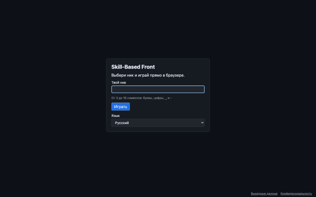 | 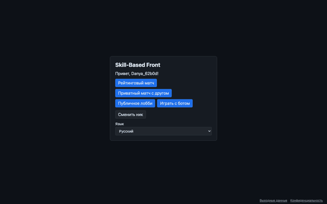 | 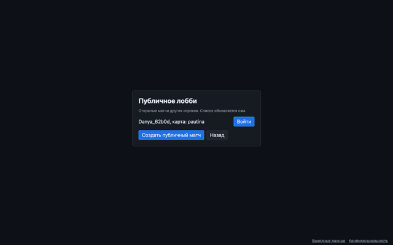 |
| **Очередь** | **Комната ожидания** | **Итог** |
| 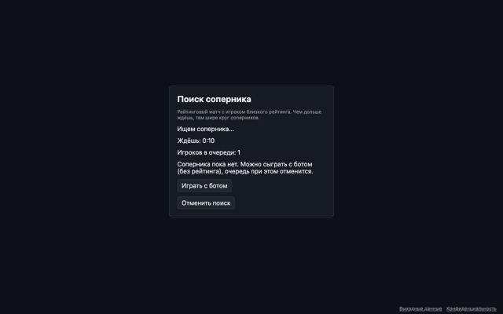 | 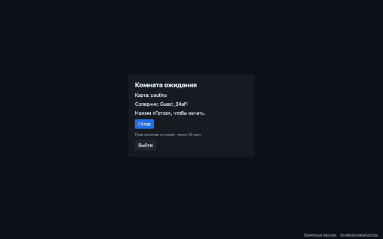 | 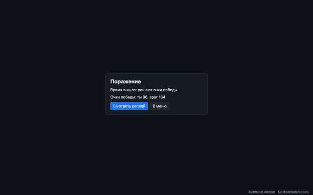 |

| Матч (игрок 1, середина) | Матч за игрока 2 (свои оранжевые) |
|---|---|
| 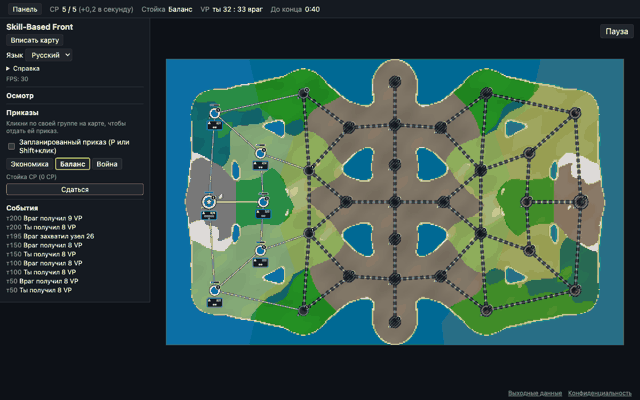 | 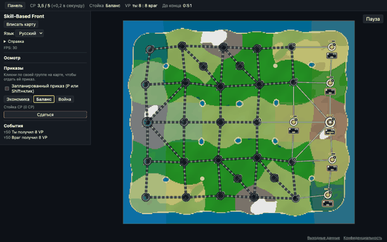 |
| **Реплей** | **Правовая страница** |
| 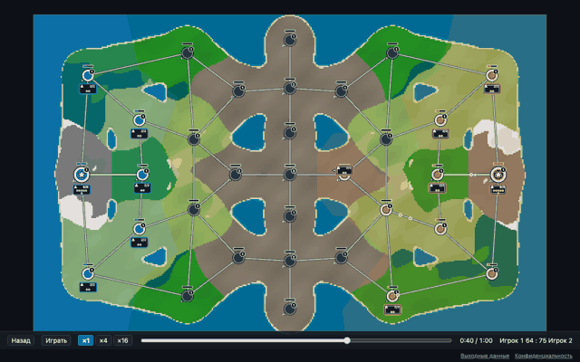 | 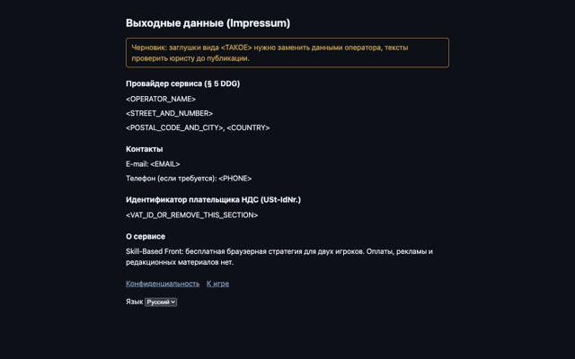 |

Главные проблемы по влиянию (сверху самые важные):

| # | Экран | Проблема | Влияние | Решение |
|---|---|---|---|---|
| K1 | Матч | Карта занимает около 60% экрана: слева панель 300 px, вокруг карты пустые поля; символы мелкие | всё на карте мелкое, главная жалоба плейтеста | 10.1: карта на весь экран, HUD у краёв |
| K2 | Матч | За игрока 2 свои оранжевые, столица справа: «кто я» читается не сразу | путаница в первые секунды | решение владельца (6), заставка старта (У4) |
| K3 | Матч | Лента событий забита «Ты получил 8 VP» и «Враг получил 8 VP» каждые 5 с; бой и захват тонут | важные события не видны | фильтр событий и тосты (У2) |
| K4 | Матч | Туман: три четверти карты покрыты тёмной штриховкой, у городов в тумане тёмные «шары» | карта выглядит грязной, мешает читать свою сторону | 9.8: туман мягче, штриховка только у границы видимости |
| K5 | Матч | Нет имени соперника, нет подсказок по наведению, все числа только в инспекторе | нечем объяснить потерю | У3, У5 |
| K6 | Итог | Слово исхода, причина и счёт строкой; нет хода матча, нет ника соперника, нет «ещё раз» | пиковый момент партии пустой, нет мотивации сыграть снова | 13.6 и У1 |
| K7 | Меню | Четыре одинаковые синие кнопки: нет главного действия; рейтинга и активности нет | новичок не знает, что нажать | 13.2 |
| K8 | Очередь | Только текст; предложение бота появляется ниже тем же стилем; звука «соперник найден» нет | игрок в другой вкладке пропустит подтверждение | 13.4 и У11 |
| K9 | Реплей | «Игрок 1» и «Игрок 2» вместо ников, на шкале нет событий, нет клавиш | реплей не помогает разобрать ошибку | 13.7 и У13 |
| K10 | Комната ожидания | Карта названа id (`pautina`), нет превью; статус готовности строкой | непонятно, на чём играем | 13.5 |
| K11 | Все экраны вне матча | Одна и та же карточка 420 px по центру пустого тёмного экрана; нет фона, логотипа, иерархии | игра выглядит прототипом | 13.1 |
| K12 | Правовая | Выбор языка нативным мелким `select` внизу; ссылки «К игре» теряются | мелочь | 13.8 |
| K13 | Все | Нет состояний загрузки и ошибок, кроме строки текста; нет пустых состояний с действием (кроме лобби) | непонятно, «висит» или ждёт | 13.9 |
| K14 | Матч | Кнопка «Пауза» отдельно справа сверху, «Сдаться» в панели приказов, стойка тремя кнопками | разрозненные элементы | 10.2 (решения владельца) |

Что уже хорошо и остаётся: тёмная тема и спокойная палитра панелей, табличные цифры в статусе,
подтверждение сдачи, ссылка-приглашение с копированием, предложение бота в очереди через 60 с,
состояние заряда точками (не только цветом).

---

## 4. Проактивные улучшения

Сверх 21 замечания владельца. Отобраны по влиянию на первый матч и на желание сыграть снова.
Приоритет: P0 нужно до закрытого плейтеста (REL-01, #88), P1 желательно в MVP, P2 после MVP.
Трудоёмкость: S до дня, M 2-3 дня, L больше. «Нужно»: правила (`mechanics.md`, `SIM_VERSION`),
протокол (`PROTOCOL_VERSION`), API (HTTP), решение владельца. Колонка «Когда»: **сейчас** (волна 3)
или **позже**.

| ID | Улучшение | Почему (раздел 2) | Приор. | Труд. | Нужно | Когда | Пакет |
|---|---|---|---|---|---|---|---|
| У1 | **Экран итога с ходом матча**: крупное слово исхода, ник соперника, длительность, 4 ключевых числа (города в конце, юнитов потеряно, зарядов доставлено, пик VP) и график разницы VP по времени с отметками захватов и боёв; клик по отметке открывает реплей на этом тике | 13, 14, 19, 20, 22 | P0 | M | нет: всё есть в файле кадров (`GET /api/replays/{id}`, `docs/design/replay-frames.md`) | сейчас | E |
| У2 | **Фильтр событий**: начисление VP не попадает в ленту (счёт уже в верхней панели); тосты только для боя, захвата и потери города, истощения, отказа команды; остальное в выдвижном журнале | 1, 3 | P0 | S | нет | сейчас | D |
| У3 | **Ники в матче, итоге и реплее**: «Danya 4 : 6 Guest» в верхней панели, ник соперника на итоге, ники в реплее | 14, 16 | P0 | S | протокол: ники в `welcome`; API: ники в файле кадров или в ответе реплея | сейчас | D, E |
| У4 | **Старт матча**: на 3 с плашка «Ты синий. Твоя столица здесь» и пульсирующее кольцо вокруг своей столицы, камера вписывает карту | 3, 1 | P0 | S | нет | сейчас | D |
| У5 | **Подсказки по наведению с числами** для города, дороги, группы, стрелки намерения: 1 строка заголовка и 2-4 строки «ключ: значение» (ёмкость, склад, рельеф с модификатором, ширина и что даст следующая), термин CP и «ёмкость» с вложенной подсказкой | 3, 10, 23 | P0 | M | нет (числа из вида игрока и `ruleset_public`) | сейчас | D |
| У6 | **Отклик на каждое действие**: принятый приказ: призрак становится сплошным и короткий звук; отказ: призрак трясётся и гаснет, тост с причиной (`rejects.ts` уже переводит коды) и звук отказа | 7, 2 | P0 | S | нет | сейчас | C (карта), F (звук) |
| У7 | **Тревога «на твой город идут»**: намерение противника с целью в твоём городе даёт янтарное кольцо у города и строку в стопке тревог с отсчётом задержки и переходом по `Space` | 3 | P1 | S | `ruleset_public.orders.planned_delay_ticks` (уже в списке раздела 15) | сейчас | C |
| У8 | **Понятный исход боя**: на месте боя белая вспышка 400 мс и две цифры потерь цветами сторон; отскок: короткая стрелка назад по ребру; захват города: волна цвета нового владельца по ячейке | 6, 7, 18 | P1 | M | нет | сейчас | B (часть CLI-12, #71) |
| У9 | **Звук**: 8 событий (приказ принят, отказ, бой рядом, город захвачен, город потерян, истощение, соперник найден, конец матча), общая громкость и выключатель, не больше 4 звуков одновременно, бой вне экрана тише | 2, 6, 17 | P1 | M | зависимость `howler` (разрешена AGENTS.md, раздел 2) и CC0-звуки | сейчас | F (CLI-12, #71) |
| У10 | **Подсказки первого матча**: 5 коротких контекстных подсказок в первом матче против бота (выбери группу, отдай приказ, заряды и столица, `Shift`+клик, стойка `Q`), каждая закрывается и больше не появляется (`localStorage`); «Как играть» (CLI-13) открывается из меню и из `?` | 13, 4 | P1 | M | нет | сейчас | F |
| У11 | **Очередь, которую не пропустишь**: кольцо поиска, таймер вверх, «Соперник найден» звуком и сменой заголовка вкладки (`(!) Соперник найден`), кольцо отсчёта подтверждения | 21 | P1 | S | нет | сейчас | E |
| У12 | **Последняя минута**: таймер становится янтарным и крупнее, один звуковой сигнал на 1:00 | 15 | P2 | S | нет | сейчас | D |
| У13 | **Реплей для разбора**: ники, отметки событий на шкале (бои, захваты, смена стойки), клавиши (`Space` пауза, стрелки ±5 с, `1`/`2`/`3` скорость), график разницы VP над шкалой (тот же, что в У1) | 14, 19 | P1 | M | API: ники (У3) | сейчас | E |
| У14 | **Состояния загрузки, пустоты и ошибки**: скелетон списка лобби, понятное пустое состояние с действием, ошибка с кнопкой «Повторить», подключение к матчу с этапами | 25 | P1 | S | нет | сейчас | E |
| У15 | **Настройки**: масштаб интерфейса 100/125/150%, громкость, «меньше движения» (плюс `prefers-reduced-motion`), язык; в меню ☰ в матче и на главном экране | 13, 26 | P1 | S | нет | сейчас | F |
| У16 | **Индикаторы за краем экрана**: при приближении камеры бой, тревога или намерение противника за краем показывается стрелкой у края экрана | 3 | P2 | S | нет | позже | D |
| У17 | **Мини-карта** | 10 | P2 | M | нет | **не делаем**: карты MVP вписываются в экран целиком (`Home`), индикаторов У16 достаточно | - |
| У18 | **Испытания с медалями** (доставь заряды, выиграй бой запланированным приказом, удержи VP) | 13 | P2 | L | сценарии на сервере или офлайн-режим | позже, после REL-01 | - |
| У19 | **Предпросмотр пути и времени в пути до отправки приказа** | 5, 3 | P2 | M | протокол: запрос пути у сервера (клиент путей не считает, AGENTS.md 7.1); решение владельца | позже | - |
| У20 | **Рейтинг и ник в углу меню**, изменение рейтинга на итоге стрелкой | 22 | P1 | S | API: рейтинг в `/api/me` (LB-01, #78) | вместе с LB-01 | E |

Рекомендация для MVP сейчас: У1-У6 (P0) и У7-У11, У13-У15 (P1). Позже: У16, У18, У19.
Не делаем: У17.

---

## 5. Принципы

1. **Карта на весь экран, интерфейс у краёв.** Постоянно видна только верхняя панель; всё
   остальное появляется по запросу или по событию (Mini Metro, Polytopia).
2. **Три прочтения** (Into the Breach). Первое: кто где, счёт, время. Второе: CP, стойка,
   тревоги. Третье: подсказки по наведению и карточка выделения.
3. **Форма плюс цвет, всегда** (AGENTS.md, 7.4). Свои: синий и одинарный контур. Противник:
   красный и двойной контур. Заряд: залитая или пустая часть фигуры. Тревога: янтарный цвет,
   значок `!`, пульс и обратный отсчёт.
4. **Красный значит только «противник».** Ошибки, отказы и тревоги не красные.
5. **Одна величина, одна переменная.** Число юнитов задаёт размер треугольника, доля заряженных
   задаёт заливку, ёмкость задаёт размер города, ширина дороги задаёт толщину.
6. **Намерения противника той же грамматикой, что и свои.** Свою стрелку от чужой отличает
   контур, а не новый тип знака.
7. **Отклик на каждое действие** за 100 мс: видимый (призрак, подсветка) и по желанию звуковой.
   Ничего важного только звуком.
8. **У каждой иконки подпись или подсказка** (Against the Storm, Northgard).
9. **Минимальный экранный размер.** Значимый символ карты не мельче 20 px на экране.
10. **Движение для отклика, не для украшения**: короткое (150-400 мс), отключается настройкой
    «меньше движения» и `prefers-reduced-motion`.

---

## 6. Палитра и токены

Значения ниже единственный источник цветов: CSS-переменные `:root` (`app.css`) и константы
`style.ts`. Тёмная тема одна.

| Токен | Значение | Где |
|---|---|---|
| `--bg` | `#0d1117` | фон канваса и экранов, обводки на карте, «чернила» штампов |
| `--surface` | `rgb(22 27 34 / 94%)` | панели HUD (почти непрозрачные: XAG 102, жалобы на Humankind) |
| `--surface-2` | `#21262d` | кнопки, поля |
| `--border` | `#30363d` | рамки |
| `--text` | `#e6edf3` | основной текст |
| `--text-dim` | `#9da7b3` | вторичный текст (контраст на `--surface` не ниже 4.5:1) |
| `--paper` | `#f0f6fc` | белые контуры фигур, **выделение**, глифы на карте |
| `--you` | `#5b9bff` | свои: города, юниты, заряды, стрелки, полоса CP |
| `--enemy` | `#e5484d` | противник |
| `--neutral` | `#8b949e` (контур), `#2b3139` (заливка) | нейтральные города |
| `--warn` | `#ffb020` | переполнение, истощение, «на твой город идут», последняя минута |
| `--vp` | `#e3b341` | только значок VP (неподвижный, с числом) |
| `--ok` | `--you` | подтверждения в тостах используют свой цвет, отдельного зелёного нет |
| `--terrain-plains` | `#3a4630` | подложка равнины |
| `--terrain-forest` | `#25392b` | подложка леса |
| `--terrain-mountains` | `#4a453e` | подложка гор |

Проверка палитры (симуляция Machado 2009, полная степень; ΔE в Lab, контраст по WCAG; скрипт
в описании PR к #208):

| Пара | Норма | Протанопия | Дейтеранопия | Тританопия | Вывод |
|---|---|---|---|---|---|
| `--you` / `--enemy` | 102 | 74 | 98 | 123 | различимы всегда |
| `--enemy` / `--warn` | 65 | 62 | 40 | 50 | различимы; тревога всё равно со значком `!` |
| `--warn` / жёлтый `#ffd33d` | 19 | 11 | 8 | 19 | **неразличимы**, поэтому жёлтого акцента в v2 нет |
| пурпурный `#d65cff` / `--you` | 55 | 10 | 11 | 71 | отклонён как цвет тревоги |

- Контраст на `--bg`: `--you` 6.8:1, `--enemy` 4.8:1, `--warn` 10.3:1: все выше 3:1 для значков
  (WCAG 1.4.11).
- **В градациях серого** (ахроматопсия) синий и красный близки по светлоте (яркость 0.33 и 0.22),
  поэтому одинарный и двойной контур обязательны. Проверка: Chrome DevTools, Rendering, «Emulate
  vision deficiencies», режим Achromatopsia; стороны должны различаться по контуру.
- **Реплей:** если смотрит участник матча, его сторона синяя; иначе игрок 1 синий, игрок 2
  красный, и подпись с ником рядом.

---

## 7. Типографика и масштаб интерфейса

- Шрифт: системный стек `system-ui, -apple-system, 'Segoe UI', Roboto, 'Noto Sans', sans-serif`.
  Свой шрифт (Inter, OFL) только если на плейтесте разница ОС станет заметна.
- Размеры при масштабе 100%: 16 px основной текст экранов и карточки выделения, 15 px HUD,
  13 px вторичный, 12 px только подписи клавиш и микроподписи над числами. Счёт VP и таймер
  18 px полужирный. Заголовок экрана 24 px, слово исхода на итоге 40 px.
  Основание: XAG 101 требует на ПК при 1080p не меньше 18 px высоты глифа; CSS `font-size`
  больше высоты глифа, поэтому 15-16 px в CSS близко к нижней границе, а не с запасом.
- Масштаб интерфейса 100/125/150% (У15): `html { font-size }` и размеры HUD в `rem`; карта
  не масштабируется, её символы держат минимальный экранный размер (9.5).
- Все числа HUD `font-variant-numeric: tabular-nums`.
- Подписи на карте (PixiJS `Text`): 12-13 px на экране, полужирные, с тёмной обводкой 3 px, в
  «таблетке» `--bg` с альфой 0.88 на пёстром фоне.
- Над числом мелкая подпись (приём Polytopia): «CP», «VP», «Время» 12 px `--text-dim`.

---

## 8. Иконки, звуки и лицензии

Ограничения: CSP `img-src 'self' data:`, `font-src 'self'`, `media-src` по `apps/client/csp.ts`,
никаких внешних запросов; новая зависимость только с обоснованием (AGENTS.md, 0.5).

| Набор | Лицензия | Что требует | Вывод |
|---|---|---|---|
| [Lucide](https://lucide.dev) | ISC, плюс MIT для иконок из Feather ([LICENSE](https://github.com/lucide-icons/lucide/blob/main/LICENSE)) | сохранить оба уведомления | **выбран для HUD** |
| [Tabler Icons](https://tabler.io/icons) | MIT | сохранить уведомление | запасной |
| [game-icons.net](https://game-icons.net) | CC BY 3.0 | атрибуция автора каждой иконки | не берём сейчас |
| [Kenney](https://kenney.nl/assets) | CC0 ([support](https://kenney.nl/support)) | ничего (логотип Kenney использовать нельзя) | **звуки** (пакеты UI и интерфейсных сигналов) и запасной для растровых ассетов |

- **HUD: Lucide без npm-пакета.** Около 16 значков (меню, CP, таймер, выход, пауза, справка,
  три стойки, «Защита», набор, дорога, звук, настройки, реплей, копировать) копируются в
  `hud/Icon.svelte` (словарь имя → разметка SVG, `currentColor`), без `{@html}`.
- **Карта: свои фигуры в PixiJS `Graphics`** (треугольники, кольца, штампы, стрелки).
- **Звуки: CC0 (Kenney) или свои**, файлы `.ogg` и `.mp3` в `apps/client/public/sounds/`,
  суммарно до 300 КБ. Лицензию каждого пакета сверить на его странице при добавлении.
  CSP: `media-src` в `csp.ts` не задан, поэтому действует `default-src 'self'`, а загрузка через
  Web Audio идёт по `connect-src 'self'`: свои файлы разрешены. [НЕ УВЕРЕН] использует ли Howler
  для разблокировки звука на мобильных `data:`-URI в `<audio>` (тогда нужен `media-src 'self' data:`);
  проверить: `grep -n "data:audio" node_modules/howler/dist/howler.js` и прод-сборка
  `pnpm build && pnpm preview` с консолью браузера.
- **Атрибуция:** `apps/client/THIRD_PARTY_NOTICES.md` (Lucide, звуки, шрифт если появится) и
  раздел «Лицензии» на правовой странице. Ассет без записи в этом файле считается ошибкой ревью.

---

## 9. Карта: визуальный язык

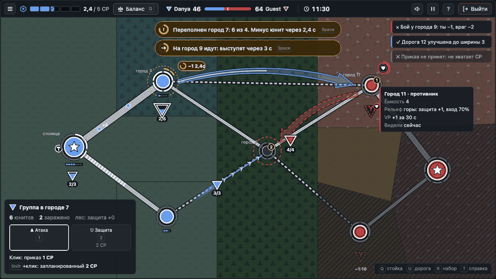

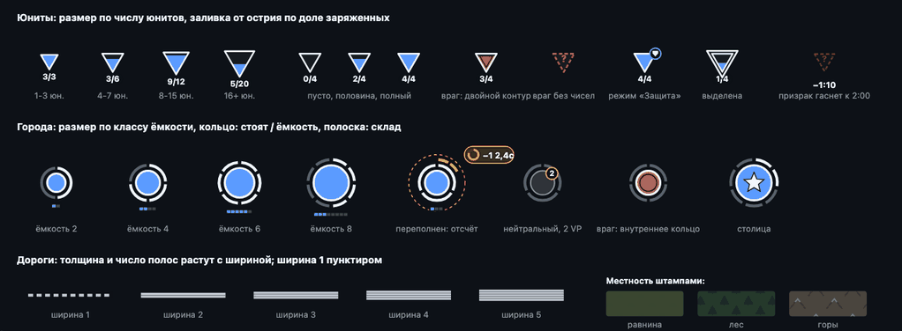

Картинки выше сняты с [`mockups/ui-style.html`](mockups/ui-style.html). Размеры в мировых единицах карты (города
примерно в 100 единицах друг от друга), если не сказано «px на экране».

### 9.1 Слои

Порядок слоёв не меняется (AGENTS.md, 7.2): фон → территория → дороги → узлы → группы →
намерения → туман → эффекты. Добавляется только содержимое:

- `background`: запечённый фон, затемнение `--bg` с альфой 0.3, штампы местности;
- `territory`: граница области владельца светлой линией 2 px цвета владельца (Northgard);
- `nodes`: кольца ёмкости и полоска склада;
- `groups`: пакеты под треугольниками, следы движения под пакетами;
- `effects`: отсчёт истощения, метки боя, кольцо старта (У4), тревога (У7).

### 9.2 Местность на карте

- Значок местности в углу города убирается.
- Ячейка города (Вороной, `voronoi.ts`) заполняется **штампами** тёмными «чернилами» `--bg`:
  лес ёлочками, горы пиками-шевронами с белой шапкой, равнина редкими пучками травы. Альфа
  штампов 0.22 (равнина), 0.32 (лес), 0.38 (горы).
- Штамп рисуется один раз в `GraphicsContext`, превращается в текстуру
  (`renderer.generateTexture`) и раскладывается спрайтами по сетке 34×30 (лес), 52×40 (горы),
  30×26 (равнина) со смещением каждого второго ряда; сдвиг сетки от id узла (одинаково при каждом
  запуске). Не ближе 30 единиц к центру города и 12 к оси дороги.
- В подсказке города (У5) рельеф словом и числом: «Горы: защита +1, вход 70%» (из `ruleset_public`).

### 9.3 Дороги, ширина 1..5

| Ширина | Толщина | Внутри | Вид |
|---|---|---|---|
| 1 | 4 | пунктир 7/5 | тропа |
| 2 | 7 | 1 тёмная полоса | две колеи |
| 3 | 10 | 2 полосы | |
| 4 | 13 | 3 полосы | |
| 5 | 16 | 4 полосы | магистраль |

- Толщина `1 + 3·w`, обводка `--bg` с альфой 0.6 шире на 5; `w - 1` тёмных продольных полос.
- Заливка `#c4cbd4` одна для всех дорог.
- Дорога противника в тумане (DEC-17) рисуется по последней известной ширине пунктирным краем.
- Наведение: кружок с числом ширины посередине. При выбранном своём городе после `U`: подсказка
  «Ширина 3: +0,5 ёмкости, +25% скорости пакетов, 3 заряда со склада» (числа из `ruleset_public`).
- Идущая стройка: бегущая штриховка `--paper` от города-строителя, длина растёт к тику окончания.
  Чужая стройка видна только вне тумана (DEC-17).

### 9.4 Города и ёмкость

- **Размер по классу ёмкости:** радиус 13 при ёмкости до 2, 17 при 3-4, 21 при 5-6, 25 при 7+.
- **Кольцо ёмкости** на расстоянии радиус + 8: сегментов столько, сколько ёмкость, толщина 4 с
  тёмной подложкой 7. У своих белых сегментов столько, сколько юнитов в городе; у чужих и
  нейтральных все сегменты серые. При ёмкости больше 10 сплошная дуга с засечкой на каждой пятёрке.
- **Переполнение:** лишние юниты сегментами `--warn` на втором кольце снаружи, пунктирный круг
  `--warn` и отсчёт (раздел 12).
- **Склад:** сегментная полоска под кольцом цвета владельца (приём Polytopia: сегменты, а не
  плавная заливка).
- **Владелец:** заливка цветом плюс контур: свой белый контур 3; противник белый контур и тёмное
  внутреннее кольцо; нейтральный серый контур 2.
- Столица: белая звезда внутри. VP: тёмный кружок радиусом 8.5 с кантом `--vp` и числом справа
  сверху.
- Город, который строит дорогу: кружок с молотком слева сверху и штриховка на ребре.

### 9.5 Юниты: перевёрнутые треугольники

- **Фигура:** перевёрнутый равносторонний треугольник ▽.
- **Размер по числу юнитов:** сторона 24 (1-3), 30 (4-7), 36 (8-15), 42 (16+). Неизвестное число: 30.
- **Заряд как уровень:** от острия заливается подобный треугольник цвета владельца, площадь равна
  доле заряженных (`k = sqrt(charged / units)` по высоте). Пустая часть `#161b22`.
- **Владелец:** свой белый контур 2.4; противник белый контур плюс внутренний тёмный контур на
  62% размера; враг без чисел (`PRESENCE`): пунктирный контур цвета врага и «?».
- **Режим:** «Защита» кружком радиусом 8 с глифом щита на правом верхнем углу; «Атака» не рисуется.
- **Подпись** «заряжено/юнитов» в тёмной таблетке под острием (приём Songs of Conquest): у
  выделенной группы, под курсором, у своих групп при масштабе от 0.6, у врага там, где есть точные
  числа.
- **Минимальный размер на экране:** сторона не меньше 20 px, попадание мышью не меньше 28 px.
- **Движение:** без поворота, след линией ширины 10 и длины 40 с градиентом альфы 0.7 → 0;
  встречные полосы разнесены на 18 единиц.
- **Выделение:** белый контур `--paper` того же треугольника в 1.45 раза больше, с тёмным ореолом.

### 9.6 Пакеты снабжения

- Кружок радиусом 5 цвета владельца без контура (пакет меньше и проще города, приём Mini Metro),
  на оси дороги. При двух зарядах и больше подпись «×N».
- Положение по `depart_tick` и `arrive_tick` (`packetProgress`). Внутри круга города
  (расстояние меньше радиуса + 8) пакет уменьшается до 30% и гаснет, «въезжая» в значок; сегмент
  склада коротко вспыхивает.

### 9.7 Приказы и намерения

| Что | Вид | Кто видит |
|---|---|---|
| Обычный приказ (свой) | тонкая линия 3 с белыми шевронами каждые 26 единиц | только свой игрок |
| Запланированный приказ (свой) | широкая лента, **сплошной** контур | оба |
| Запланированный приказ противника | широкая лента, **пунктирный** контур 9/5 | оба |
| Отправлен, ждёт подтверждения | призрак: пунктир с прозрачностью 0.85 | свой игрок |
| Отказ сервера | призрак трясётся 200 мс и гаснет, тост с причиной (У6) | свой игрок |

Ленточная стрелка (HOI4, Mini Motorways):

- Ось: квадратичная кривая от края города-источника (радиус + 16) до края цели (радиус + 20),
  изгиб 12-18% хорды. Свой приказ идёт по `order.path`; намерение противника одной дугой
  `origin → target` (путь клиент не считает, AGENTS.md 7.1).
- Тело 16, хвост сужается до 60%, наконечник шириной 38 и длиной 30.
- Заливка цветом владельца с альфой 0.32, контур 2.2 с альфой 0.95, тёмная обводка 6 с альфой 0.45.
- Задержка: светлая полоса растёт от хвоста (`planned_delay_ticks`, раздел 15). После выступления
  контур пунктирный и «бежит».
- Цель намерения противника: пунктирное кольцо цвета врага радиусом радиус + 20. Если цель в
  твоём городе, кольцо `--warn` и строка в стопке тревог (У7).
- «Защита» без цели: кружок радиусом 13 над городом с глифом щита и дугой отсчёта.
- Тело стрелки не тоньше 8 px на экране.

### 9.8 Туман и призраки

- Туман **мягче**, чем сейчас (K4): скрытые области затемнены `--bg` с альфой 0.45 без штриховки;
  штриховка 45° шириной 24 px только вдоль границы видимости, чтобы граница читалась без цвета.
  Города в тумане рисуются контуром последнего известного владельца, без тёмной заливки.
- Призрак «последний раз видели»: треугольник противника пунктиром и подпись возраста «−1:10».
- **Угасание:** до 60 с альфа 0.6, от 60 до 120 с линейно до 0, после 120 с не рисуется
  (`GHOST_FADE_START_S = 60`, `GHOST_HIDE_S = 120` в `style.ts`). Только показ: память остаётся в
  `PlayerView`.

### 9.9 Бой, отскок, захват (У8)

- Метка боя: белая вспышка-звезда с тёмной обводкой, 400 мс, затем две цифры потерь цветами
  сторон («−2» синим, «−1» красным) держатся 3 с и всплывают на 12 px.
- Отскок атакующего: короткая стрелка назад по ребру цветом атакующего с пунктиром, 1 с.
- Захват города: волна цвета нового владельца от центра по ячейке, 500 мс; тост «Город 7 захвачен».
- При «меньше движения»: без вспышки и волны, только цифры и тост.

---

## 10. HUD матча

### 10.1 Что убрать и куда перенести

| Сейчас (боковая панель 300 px) | Станет |
|---|---|
| Заголовок, выбор карты и сцены, FPS | только на dev-экране |
| Язык, «Вписать карту» | меню ☰ (и `Home`) |
| «Справка» с текстовой легендой | оверлей по `?`: картинка-легенда и таблица клавиш, ссылка на «Как играть» (CLI-13) |
| Инспектор | подсказки по наведению (У5) и карточка выделения |
| Панель приказов: подсказка, флажок «Запланированный», кнопки стойки | карточка выделения (режимы, цена обычного и `Shift`+клик); стойка в радиальном меню |
| «Сдаться» | «Выйти» в верхней панели (решение владельца) |
| «Пауза» отдельной кнопкой справа | в верхней панели рядом с «Выйти» |
| Журнал событий | тосты (У2) и выдвижной журнал |

### 10.2 Верхняя панель

Высота 48 px, три колонки:

```
┌──────────────────────────────────────────────────────────────────────────────────────────┐
│ ☰  CP ▮▮▮▯▯ 2,4/5  [⚖ Баланс Q] │ ▽ Danya  4 ━━━━━━┿━━━ 6  Guest ▽ │ ◷ 11:30 │ 🔈 ⏸ ? [⇥ Выйти] │
└──────────────────────────────────────────────────────────────────────────────────────────┘
```

- **CP:** полоса из `cap / 100` сегментов цвета `--you`, частичный сегмент заштрихован; число
  «2,4/5». На потолке подсказка «CP на потолке: излишек сгорает» (DEC-02).
- **Стойка:** чип с иконкой, названием и `Q`; клик открывает радиальное меню.
- **Счёт VP «перетягиванием»** (Against the Storm): ники, числа и общая полоса, синяя часть слева,
  красная справа, засечка посередине. Под ником треугольник своей формы (одинарный и двойной контур).
- **Таймер** 18 px с иконкой; в последнюю минуту `--warn` (У12).
- **Справа:** звук вкл/выкл, пауза (только приватные), `?`, «Выйти».

### 10.3 Карточка выделения

Слева снизу, ширина 340 px (при масштабе 100%), только при выделении. Структура (Hex Strategy UI):
заголовок с фигурой, строка ключевых чисел, кнопки действий с ценой и клавишей, строка-подсказка.

- группа: юнитов, заряжено, место и рельеф; «Атака» `1`, «Защита» `2` с ценой; строка «Клик:
  приказ 1 CP. `Shift`+клик: запланированный 2 CP» (#213);
- город: владелец, «стоят / ёмкость», склад, рельеф, VP; набор `R` и улучшение дороги `U` с ценой;
- дорога: ширина, что даст следующий уровень и цена в зарядах.

### 10.4 Тосты, тревоги, подсказки клавиш

- **Тосты** справа сверху: до 3, гаснут через 6 с, рамка слева цветом смысла (свой, противник,
  `--warn`, нейтральный) и значок. Начисление VP тостом не показывается (У2).
- **Стопка тревог** по центру под верхней панелью: переполнение (раздел 12) и «на твой город
  идут» (У7); одна строка на тип с числом, `Space` ведёт камеру к ближайшей.
- **Строка клавиш** справа снизу: `Q` стойка, `U` дорога, `R` набор, `?` справка; скрывается
  через 3 матча (счётчик в `localStorage`), остаётся в `?`.
- **Выход:** диалог «Выйти из матча? Это сдача: матч закончится вашим поражением.» с кнопками
  «Сдаться и выйти» и «Остаться» (фокус по умолчанию); двойной `Esc` открывает тот же диалог.

---

## 11. Радиальное меню стойки

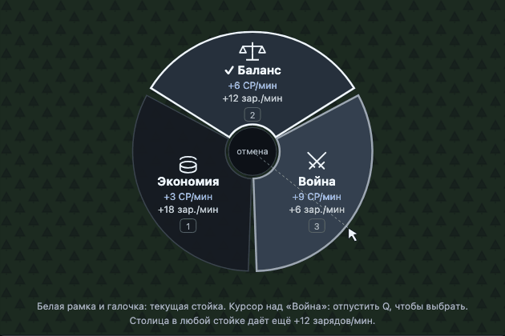

- **Клавиша `Q`.** Удержание: меню с центром под курсором, выбор отпусканием в секторе, отмена в
  мёртвой зоне радиусом 28 px. Короткое нажатие (меньше 200 мс): меню остаётся открытым, выбор
  кликом или `1`/`2`/`3`, `Esc` закрывает. Клик по чипу стойки открывает то же меню у чипа.
- **Геометрия:** три сектора по 116° с зазором, внешний радиус 150 px, внутренний 34 px.
  Порядок фиксирован: «Экономия» слева снизу, «Баланс» сверху, «Война» справа снизу. Наведённый
  сектор светлее с белым контуром; текущая стойка с белой рамкой и галочкой. В центре название и
  эффект наведённого сектора (приём Marioni).
- **Подписи у секторов обязательны** (Against the Storm): иконка, название, клавиша, два числа:

| Стойка | CP в минуту | Зарядов в минуту от стойки |
|---|---|---|
| Экономия | +3 | +18 |
| Баланс | +6 | +12 |
| Война | +9 | +6 |

  Расчёт для `mvp-0`: `cp.per_period = 100` раз в `period_ticks = 50` (12 раз в минуту); доля в
  заряды `stance_to_charges_pct` 75/50/25, курс `charges_per_cp = 2`. Подпись внизу: «Столица
  в любой стойке даёт ещё +12 зарядов/мин».
- **Перезарядка смены** `stance_cooldown_ticks = 100` (10 с): секторы приглушены, в центре дуга
  отсчёта. Без поля `stance_ready_tick` меню отправляет команду и показывает отказ тостом.
- **Доступность:** `role="menu"`, секторы `menuitemradio` с `aria-checked`; всё с клавиатуры.

---

## 12. Предупреждение об истощении

Правило (mechanics.md, раздел 9; SIM-07): пока стоящих в городе юнитов владельца больше ёмкости,
`Node.over_ticks` растёт; на `capacity.attrition_ticks`-м тике подряд (30 тиков, 3 с) гибнет один
юнит, отсчёт начинается заново. После захвата отсрочка `grace_ticks` (5 с).

Показ, по нарастанию (Mini Metro):

1. Лишние юниты сегментами `--warn` снаружи кольца ёмкости, пунктирный круг `--warn` пульсирует
   (альфа 0.5 ↔ 1, 0.8 с; при «меньше движения» без пульса).
2. Таблетка у города: дуга, заполняющаяся за `attrition_ticks`, значок `!` и «−1 2,4с»; во время
   отсрочки дуга серая и «отсрочка 3с».
3. Строка в стопке тревог: «Переполнен город 7: 6 из 4. Минус юнит через 2,4 с», `Space` ведёт
   камеру; при нескольких городах одна строка с числом.
4. Событие `attrition` даёт тост «Город 7: потерян юнит от переполнения» и звук (У9).

Клиент не считает переполнение и отсчёт (AGENTS.md, 7.1): числа приходят от сервера (раздел 15).

---

## 13. Экраны вне матча

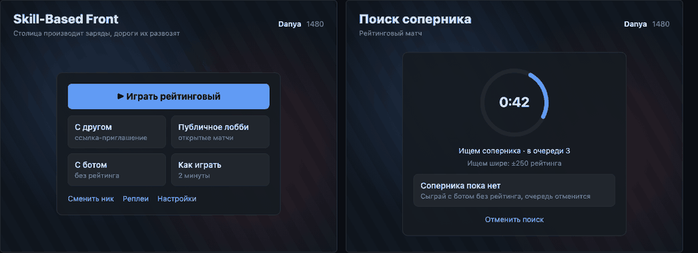

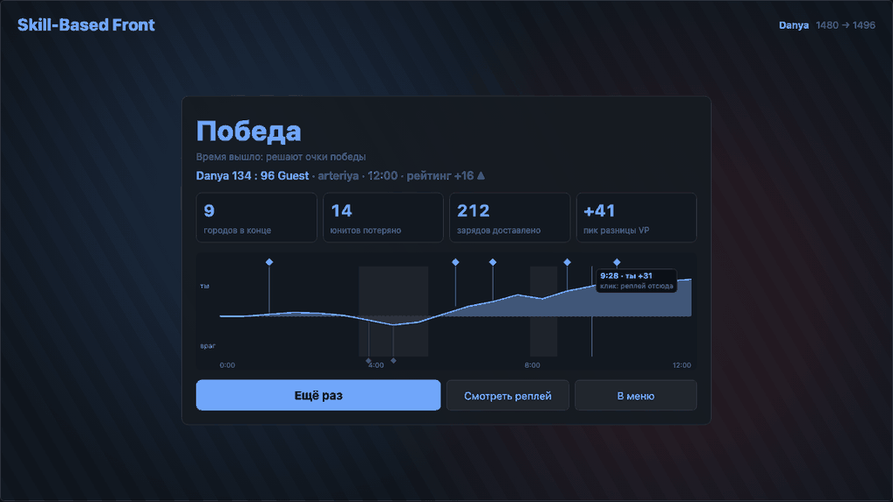

### 13.1 Общий каркас

- Фон всех экранов вне матча: запечённый фон одной из карт (`/api/maps/{id}/background.png`) с
  затемнением `--bg` 0.75 и лёгким размытием (CSS `filter: blur(2px)`), без анимации. Своя
  картинка, внешних ассетов нет.
- Слева сверху название игры (24 px, полужирный) и строка-девиз из CLI-13 «Столица производит
  заряды, дороги их развозят, юнит без заряда беззащитен». Справа сверху ник, рейтинг (У20),
  язык, звук, настройки.
- Содержимое в панели шириной 480 px (`--surface`, контур `--border`, радиус 10), не 420 px
  посреди пустоты. Кнопки: одна главная (заливка `--you`), вторичные контуром, третичные ссылкой
  (Kare Kapmaca, Mini Metro Menu).
- Правовые ссылки внизу справа, как сейчас.

### 13.2 Приветствие и меню

- Приветствие: поле ника 44 px высотой, кнопка «Играть» во всю ширину, подсказка формата ника
  под полем 13 px, ошибки там же `--warn` со значком.
- Меню: **одна главная кнопка «Играть рейтинговый»** во всю ширину; ниже сеткой 2×2 карточки
  «С другом», «Публичное лобби», «С ботом», «Как играть» (иконка, название, строка пояснения);
  ниже ссылки «Сменить ник», «Реплеи» (после LB-01). Если матч идёт: баннер «Матч идёт:
  вернуться» над всем остальным.

### 13.3 Лобби

- Список карточек: ник, карта с маленьким превью (`maps/<id>.preview.png` или фон), возраст
  записи «2 мин»; кнопка «Войти» справа. Пусто: картинка-заглушка из символов карты, текст и
  главная кнопка «Создать публичный матч». Загрузка: 3 строки-скелетона (У14).

### 13.4 Очередь (У11)

- По центру кольцо поиска 160 px (вращающаяся дуга `--you`; при «меньше движения» неподвижная),
  внутри таймер вверх 24 px; под ним «Ищем соперника» и «В очереди: 1».
- Расширение окна поиска строкой «Ищем шире: ±250 рейтинга» (если сервер начнёт это отдавать;
  сейчас в `QueueStatus` поля нет, без него строки нет).
- Предложение бота отдельной карточкой со своей главной кнопкой, а не ещё одной кнопкой в столбике.
- «Соперник найден»: кольцо заполняется отсчётом подтверждения, звук, заголовок вкладки
  `(!) Соперник найден`, главная кнопка «Играть».

### 13.5 Комната ожидания

- Превью карты 320×180 слева, справа название карты словом (не id), ниже два «места»: ты и
  соперник, каждый с ником и чипом «Готов» или «Ждём». Ссылка-приглашение с кнопкой
  «Копировать» крупно, пока соперника нет; «Выйти» ссылкой.

### 13.6 Итог (У1)

Иерархия (Overwatch 2 Match Summary, VALORANT):

1. Слово исхода 40 px («Победа» цвета `--you`, «Поражение» `--enemy`, «Ничья» `--text`) и
   причина строкой ниже.
2. Строка «Danya 96 : 134 Guest · arteriya · 12:00», изменение рейтинга стрелкой (если рейтинговый).
3. Ряд из 4 чисел с подписью: «Городов в конце», «Юнитов потеряно», «Зарядов доставлено», «Пик VP».
4. График разницы VP по времени (LoL Gold Diff): выше нуля синяя заливка, ниже красная; отметки
   захватов своих над графиком, чужих под ним; наведение показывает время и значения; клик открывает
   реплей на этом тике.
5. Кнопки: «Ещё раз» (главная: тот же режим, бот или очередь), «Смотреть реплей», «В меню».

Данные: файл кадров (`GET /api/replays/{id}`) уже содержит `p` (CP, VP), `n` (владелец узла) и
`g` (группы) каждые 0,5 с и все события. Подсчёт итоговых чисел это отображение файла, а не
логика игры. Пока файл не готов (секунды после матча), блоки 3 и 4 показывают скелетон, блоки 1, 2
и 5 видны сразу из `match_end`.

### 13.7 Реплей (У13)

- Сверху ники сторон и счёт VP той же «перетяжкой», что в матче.
- Снизу шкала с отметками событий (бои точками, захваты ромбами цветом стороны) и график разницы
  VP высотой 40 px над шкалой.
- Клавиши: `Space` пауза, `←`/`→` ±5 с, `1`/`2`/`3` скорость ×1/×4/×16, `Home` вписать карту.
- «Вид глазами одной стороны» не делаем: в файле кадров нет памяти тумана (`replay-frames.md`).

### 13.8 Правовая страница

Тот же каркас 13.1, текст шириной 680 px, 16 px, межстрочный 1.5; язык в шапке, а не внизу.

### 13.9 Загрузка, пустота, ошибки (У14)

| Состояние | Вид |
|---|---|
| Ожидание до 1 с | ничего |
| 1-10 с (список лобби, реплей, итог) | скелетон той же формы, что содержимое |
| Подключение к матчу | этапы строкой: «Загружаем карту → Подключаемся → Ждём первый кадр» |
| Пусто | картинка из символов карты, одно предложение, одна главная кнопка |
| Ошибка | значок `!` `--warn`, что случилось простыми словами, кнопка «Повторить» и «В меню» |

---

## 14. Звук, доступность, локализация

### 14.1 Звук (У9)

- Библиотека `howler` (разрешена AGENTS.md, раздел 2; обоснование: спрайты, единая громкость,
  автозапуск после жеста пользователя). Альтернатива без зависимости: Web Audio API напрямую; выбор
  в PR пакета F.
- События и характер: приказ принят (короткий щелчок), отказ (глухой «тук»), бой в кадре (удар),
  город захвачен (восходящие две ноты), город потерян (нисходящие), истощение (тихий сигнал),
  соперник найден (яркий сигнал), конец матча (аккорд победы или поражения).
- Не больше 4 звуков одновременно; одинаковые события в пределах 150 мс сливаются; бой вне
  кадра на 50% тише (Supremacy 1914). Громкость и выключатель в настройках и в верхней панели.
- Ничего важного только звуком: у каждого звука есть видимый отклик (GAG).

### 14.2 Доступность

- Палитра проверена на три вида дальтонизма (раздел 6); ахроматопсия держится на контурах.
- Контраст текста 4.5:1, значков и границ 3:1 (XAG 102, WCAG 1.4.11), считать против самого
  светлого места фона за панелью (снег на `arteriya`).
- Масштаб интерфейса 100/125/150% (раздел 7).
- «Меньше движения»: настройка плюс `prefers-reduced-motion`; отключает пульс, вспышки, волны,
  бегущий пунктир; цифры и тосты остаются.
- Фокус клавиатуры виден на всех кнопках (контур `--paper` 2 px); радиальное меню и диалоги
  доступны с клавиатуры.

### 14.3 Локализация

- Замер словарей: 263 общих ключа, русский в сумме на 3% **короче** английского, но короткие
  подписи длиннее до 1,7 раза («Выходные данные» и «Impressum», «Ссылка-приглашение» и «Invite
  link», «Случайная карта» и «Random map»). Ломаются узкие места: чипы, кнопки, сектора меню.
- Правило: у кнопок и чипов `min-width` и перенос по словам, без фиксированной ширины;
  обрезка `text-overflow` только у ников.
- Проверка: псевдолокаль (английские строки +40% символами с диакритикой) в dev-режиме, снимок
  всех экранов в ней (W3C: короткие строки растут сильнее длинных).

---

## 15. Что нужно от протокола и API

Правила и `SIM_VERSION` не меняются: только поля показа. Изменение протокола: `PROTOCOL_VERSION`++,
перегенерация `protocol.gen.ts`; новое поле вида игрока только с тестом тумана (AGENTS.md, 4.4 и 10).
HTTP API: перегенерация `openapi.json` и `api.gen.ts`.

| Поле | Где | Зачем | Пакет |
|---|---|---|---|
| `economy.stance_to_charges_pct`, `economy.charges_per_cp`, `economy.passive_amount`, `economy.passive_period_ticks`, `orders.stance_cooldown_ticks` | `RulesetPublic` | числа в радиальном меню | C |
| `orders.planned_delay_ticks`, `orders.defense_delay_ticks` | `RulesetPublic` | отсчёт на стрелке, тревога У7 | C |
| `stance_ready_tick` | `SelfView` | отсчёт перезарядки стойки | C (по желанию) |
| `capacity.attrition_ticks`, `capacity.grace_ticks` | `RulesetPublic` | дуга отсчёта истощения | D |
| `attrition_in: int \| None`, `grace_left: int \| None` | `NodeView`, только свои узлы с переполнением | отсчёт истощения | D |
| `nicks: tuple[str, str]` (по id игрока) | `WelcomeMsg` | ники в верхней панели и на итоге (У3) | D |
| `nicks` (по id игрока) | файл кадров (`gow_server.frames`, необязательный ключ, `format` не меняется) | ники в реплее и на графике итога | E |
| рейтинг в `GET /api/me` | HTTP API | ник и рейтинг в меню (У20) | LB-01 (#78) |
| тик окончания своей стройки, видимая стройка противника | вид игрока | штриховка стройки | реализация DEC-16/17 (#209, #210) |

`attrition_in` берётся из `Node.over_ticks` в `gow_sim.view.project()`: `attrition_ticks - over_ticks`.
Тест тумана: у узла противника и нейтрального узла поле всегда `None`. Ники соперника не секрет
(они видны в комнате ожидания и очереди), но в `PlayerView` их не кладём: они приходят один раз в
`welcome`.

---

## 16. Пакеты работ волны 3

Волна 3 начинается после реализации DEC-16 и DEC-17 (#209, #210) и #213 (они меняют
`OrdersPanel.svelte`, `orderController.ts`, `shapes.ts`).

Шесть пакетов. Общие файлы: `render/style.ts` (каждый пакет добавляет свой раздел констант),
`app.css` (токены задаёт A, остальные только добавляют классы в своих компонентах), словари
`i18n` (только новые ключи), протокол (C, D и E повышают `PROTOCOL_VERSION`: кто мержит позже,
делает rebase и повышает ещё раз).

Общие критерии для всех пакетов: состояние не передаётся одним цветом; новые строки через `t()`
в ru и en; объекты PixiJS уничтожаются; 60 FPS на `arteriya` в dev-сцене `demo`; эталонные
снимки `apps/client/visual/` обновлены; Vitest на чистые функции; «меньше движения» отключает
анимации пакета; контраст новых элементов проверен (раздел 14.2).

### A. Карта: палитра, местность, дороги, города (`size:M`)

Файлы: `app.css` (токены), `render/style.ts` (палитра и раздел карты), `render/mapView.ts`,
новые `render/terrainView.ts` и `render/cityView.ts`, `render/entityView.ts` (только перенос
полоски склада), `render/fogView.ts` (только мягкий туман 9.8).

- [x] Токены раздела 6 в `app.css` и `style.ts`; цвета на карте и в HUD только из них.
- [x] Свои синие с одинарным контуром, противник красный с двойным в живом матче за любого игрока;
      в реплее по правилу раздела 6.
- [x] Штампы местности по 9.2, значок местности у города удалён, картинка одинакова при перезапуске.
- [x] Затемнение фона 0.3; граница территории линией владельца (9.1).
- [x] Дороги по 9.3 (толщина, полосы, кружок ширины при наведении, стройка штриховкой, чужая
      дорога в тумане по последней ширине).
- [x] Города по 9.4 (размер по ёмкости, кольцо, склад сегментами, переполнение `--warn`).
- [x] Туман по 9.8 (без сплошной штриховки, штриховка у границы видимости).
- [x] Снимок экрана в режиме Achromatopsia (DevTools): стороны различимы по контуру; приложен к PR.

Сделано в #222. Отличия от текста пакета: стройка осталась DEC-16 «перекладинами» цвета `--paper` без бегущей анимации
и без роста длины (в протоколе нет тика начала стройки); туман города не рисует диск на городе, затемняется ячейка
Вороного; цвета в `app.css` заменены токенами, компоненты HUD (пакет D) со своими литералами переведёт D; подсказка
«Ширина N: +…» при `U` относится к HUD (D), на карте только кружок ширины. Снимок Achromatopsia получен фильтром
`grayscale(1)` на канвасе (в встроенном браузере нет эмуляции дефектов зрения DevTools).

### B. Карта: юниты, пакеты, призраки, бой (`size:M`)

Файлы: `render/shapes.ts`, `render/layout.ts`, `render/entityView.ts` (группы, враги, пакеты),
`render/pick.ts`, `render/camera.ts` (только экранный масштаб символов), новый
`render/effectsView.ts` (вспышка боя, отскок, волна захвата).

- [x] Треугольники по 9.5 (размер, заливка по заряду, контуры, «?», «Защита», подпись, выделение
      белым).
- [x] Сторона не меньше 20 px на экране, попадание не меньше 28 px; тест на `pick.ts`.
- [x] След движения, полосы встречного движения 18 единиц.
- [x] Пакеты по 9.6, без скачка при исчезновении из снапшота.
- [x] Призраки гаснут по 9.8; тест функции прозрачности от возраста.
- [x] Бой, отскок и захват по 9.9 (У8); при «меньше движения» только цифры.

Реализовано в #224. Отступления: отскок рисуется только для своих групп (сервер шлёт `fight_group` только владельцу, путь врага клиент не угадывает, AGENTS.md 7.1); вспышка сегмента склада при въезде пакета в город не сделана.

### C. Приказы, намерения, радиальное меню (`size:M`)

Файлы: новый `render/intentView.ts` (вынос из `entityView.ts` первым коммитом),
`render/overlayView.ts`, новый `hud/RadialMenu.svelte`, `match/keyEvents.ts`,
`match/orderController.ts`, `hud/OrdersPanel.svelte` (удаление кнопок стойки); протокол:
`gow_protocol/ruleset.py` (+ `SelfView` по желанию).

- [x] Стрелки по 9.7: ленточная для запланированных обеих сторон, тонкая с шевронами для
      обычных; свой по `order.path`, чужой дугой; отсчёт задержки по оси.
- [x] Призрак: подтверждение по `ack` делает его сплошным, отказ: тряска 200 мс и угасание (У6);
      событие для звука отдаётся через `orderUi` (подписка пакета F).
- [x] Тревога «на твой город идут» (У7): кольцо `--warn` у цели и запись в общий список тревог
      (`match/alerts.svelte.ts`, создаёт C, рисует D).
- [x] Радиальное меню по разделу 11; тест: для `mvp-0` получаются 3/18, 6/12, 9/6.
- [x] `RulesetPublic` дополнен полями раздела 15; `PROTOCOL_VERSION`++, артефакты перегенерированы.

Сделано в #226. Отличия от текста пакета: `SelfView.stance_ready_tick` не добавлен (по желанию в гайде): перезарядку
стойки показывает отказ сервера в панели «Приказы», дуга отсчёта в меню не рисуется. Тост отказа остаётся
сообщением панели «Приказы» (тосты делает D). Стопка тревог D пока заменена строками `hud/AlertStrip.svelte`
(тот же `match/alerts.svelte.ts`, `Space` ведёт камеру к следующей тревоге), D заменит её своим компонентом.
Время выступления запланированного приказа считается как `created_tick + orders.planned_delay_ticks` (поле
`depart_tick` в `OrderView` на провод не уходит). Тревога использует только публичные намерения противника и
владельцев городов (DEC-04, DEC-17), времени прибытия клиент не вычисляет: после выступления строка говорит
«уже в пути». Бег пунктира привязан к тику кадра, а не к часам, поэтому замороженная сцена неподвижна.
Заодно исправлены самоссылки `--surface-2` и `--border` в `app.css` (остались после #222).

### D. HUD матча (`size:L`)

Файлы: `hud/Hud.svelte`, `hud/StatusBar.svelte` (станет `TopBar.svelte`), `hud/SelectionPanel.svelte`
(карточка), `hud/EventLog.svelte` (тосты и журнал), `hud/eventText.ts` (фильтр), новые
`hud/Icon.svelte`, `hud/Tooltip.svelte`, `hud/HelpOverlay.svelte`, `hud/AlertStack.svelte`,
`hud/MenuSheet.svelte` (меню ☰), `hud/StartBanner.svelte`, новый `render/alertView.ts`,
`apps/client/THIRD_PARTY_NOTICES.md`, `legal/LegalPage.svelte` (раздел «Лицензии»); протокол:
`NodeView`, `WelcomeMsg.nicks`, `gow_sim.view.project()` и тест тумана.

- [x] Боковой панели нет; верхняя панель по 10.2 (CP сегментами `--you`, чип стойки, VP
      «перетяжкой» с никами, таймер, звук, пауза, `?`, «Выйти»).
- [x] Карточка выделения по 10.3 (без `P`, цена обычного и `Shift`+клик).
- [x] Подсказки по наведению по У5 для города, дороги, группы, стрелки; задержка 300 мс.
- [x] Тосты и журнал по 10.4; начисление VP не попадает в ленту (тест на фильтр, У2).
- [x] Стопка тревог: переполнение (раздел 12) и записи пакета C; `Space` ведёт камеру.
- [x] Старт матча по У4 (плашка 3 с и кольцо вокруг своей столицы).
- [x] «Выйти» и двойной `Esc` с диалогом по 10.4, отправляют `Forfeit`.
- [x] Последняя минута по У12.
- [x] Оверлей `?` с легендой и клавишами, ссылка на «Как играть»; `Home` вписывает карту.
- [x] `MenuSheet.svelte` с языком и «Вписать карту» и пустым местом под настройки (их наполняет F).
- [x] Иконки Lucide в `Icon.svelte`; лицензии в `THIRD_PARTY_NOTICES.md` и на правовой странице.
- [x] `NodeView.attrition_in`, `grace_left` и `WelcomeMsg.nicks` с тестами; `PROTOCOL_VERSION`++.
- [x] `fitMap` учитывает новые отступы HUD.

Сделано в #228 (поверх #226/#227). Отличия от текста пакета: `StatusBar.svelte` удалён, верхняя панель
`TopBar.svelte`; карточка выделения собрана из `SelectionPanel.svelte` (факты, оценка боя) и
`OrdersPanel.svelte` (действия, цены режимов, «Клик: приказ … Shift+клик: …»), флажок «Запланированный» остался
в карточке; стойка только в чипе и радиальном меню, сдача только через «Выйти» (кнопка стойки и «Сдаться» из панели
приказов убраны). Подсказки по наведению ждут 300 мс покоя указателя; для стрелки намерения в `pickAt` добавлен
необязательный список осей лент (только для наведения, клик их не находит, `PickHit` получил вид `intent`).
`vp_awarded` перенесён в скрытые виды событий (ни тоста, ни журнала). Сообщение «Принято» для приказов убрано:
принятый приказ виден на карте, отказ приходит тостом. Пауза: кнопка в верхней панели показывается в любом матче, а не
только в приватном (в `welcome` нет признака приватности), сервер отвечает отказом тостом. Ссылка «Как играть»
в справке пока неактивна (страницы CLI-13 нет). Звук: переключатель верхней панели хранит выбор (`sbf.sound`), сам
звук делает пакет F. Строка клавиш: счётчик матчей в `sbf.hints.matches`/`sbf.hints.last` (записано на странице
конфиденциальности). Протокол: `PROTOCOL_VERSION` 8; `NodeView.attrition_in`/`grace_left` (только свои города,
тест тумана `test_fog_overcrowding_countdown_is_never_shown_for_foreign_nodes`), `WelcomeMsg.nicks` (бот: `Bot`),
`RulesetPublic.capacity`. Предупреждение об истощении: плашка у города рисуется `render/alertView.ts` из тех же
чисел сервера; `Space` водит камеру сначала к переполненным городам, потом к целям атак. В `MenuSheet` оставлено
пустое место под настройки F (`data-slot="settings"`), в dev-режиме там же выбор карты и сцены и FPS. Добавлена
dev-сцена `overflow` (производная от `snapshot`) с эталонами. Двойной `Esc` (600 мс) открывает диалог выхода, первый
`Esc` по-прежнему снимает выбор; `J` открывает журнал событий.

### E. Экраны вне матча (`size:L`)

Файлы: `app/*.svelte` (кроме `MatchScreen.svelte` и `LiveMatch.svelte`), новые `app/ScreenFrame.svelte`
(каркас 13.1), `app/ResultSummary.svelte`, `app/VpDiffChart.svelte`, `app/resultStats.ts`
(чистые функции над файлом кадров), `replay/ReplayViewer.svelte`, `replay/ReplayScreen.svelte`,
`legal/LegalPage.svelte` (только каркас; раздел «Лицензии» добавляет D отдельным блоком), `app.css`
(классы каркаса); сервер: `gow_server/frames.py` (`nicks`), тест реплея.

- [ ] Каркас 13.1 на всех экранах вне матча; одна главная кнопка на экран.
- [ ] Меню, приветствие, лобби, комната ожидания по 13.2, 13.3, 13.5 (превью карты, название словом).
- [ ] Очередь по 13.4 (кольцо, таймер, карточка бота, звук и заголовок вкладки при найденном
      сопернике; звук через API пакета F, без него только заголовок).
- [ ] Итог по 13.6: слово исхода, ники, 4 числа, график разницы VP с отметками, клик в реплей;
      скелетон, пока файл кадров не готов; Vitest на `resultStats.ts` по образцу `siege.frames.json`.
- [ ] Реплей по 13.7: ники, отметки событий, график над шкалой, клавиши.
- [ ] Состояния загрузки, пустоты и ошибки по 13.9.
- [ ] `nicks` в файле кадров (необязательный ключ), тест сервера.

### F. Онбординг, звук, настройки (`size:M`)

Файлы: новые `src/audio/` (`sound.ts`, `sounds.ts`), `src/settings/` (`settings.svelte.ts`:
громкость, масштаб, «меньше движения», в `localStorage` через `try/catch`), `src/onboarding/`
(`hints.svelte.ts`, `HintBubble.svelte`), `hud/MenuSheet.svelte` (только блок настроек),
`apps/client/public/sounds/`, `apps/client/package.json` (`howler`, если выбран),
`apps/client/THIRD_PARTY_NOTICES.md` (блок звуков).

- [ ] Звуки по 14.1: 8 событий, лимит одновременных, слияние, тише вне кадра; выключатель и
      громкость; всё работает при запрещённом автозапуске (первый жест пользователя).
- [ ] Настройки по У15; масштаб через `rem` (проверка снимками при 150%); «меньше движения»
      доступно другим пакетам как `settings.reducedMotion`.
- [ ] Подсказки первого матча по У10: 5 подсказок по событиям (выделение, первый приказ, первая
      доставка пакета, первый `Shift`+клик, первая смена стойки), каждая один раз; сброс в настройках.
- [ ] Лицензии звуков в `THIRD_PARTY_NOTICES.md`; CSP проверен прод-сборкой (`pnpm build && pnpm preview`).
- [ ] Закрывает звуковую часть CLI-12 (#71); «Как играть» (CLI-13, #72) остаётся своим issue.

Порядок: A и B первыми (больше всего меняют картинку и снимки), затем C и D, затем E и F.
E и F можно делать параллельно с A-D: они не трогают файлы карты и HUD матча (кроме блока
настроек в `MenuSheet.svelte`, который создаёт D).

---

## 17. Вопросы владельцу

Решения по умолчанию записаны выше; если владелец ответит иначе, меняется только этот гайд.

1. **Экран итога и «Ещё раз»** (У1): кнопка повторяет тот же режим (бот того же уровня или
   очередь). По умолчанию: да.
2. **Подсказки первого матча** (У10): показывать в первом матче любого режима или только против
   бота. По умолчанию: только против бота.
3. **Звук** (У9): включён по умолчанию с громкостью 60%. По умолчанию: да.
4. **Строка клавиш** скрывается после 3 матчей. По умолчанию: да.

---

## 18. UI раунд 2, часть 1 (#247, трекинг #236)

Реализовано решениями владельца 2026-10-12; **заменяет** разделы 10.3 (карточка выделения), журнал
событий и меню матча из 10.1 и 10.4, радиальные меню из раздела 11 (теперь один компонент).

| Что | Как сейчас |
|---|---|
| Камера | Сдвиг **правой** кнопкой мыши (и средней), колесо: масштаб у курсора. Левая кнопка только выбирает и отдаёт приказы. Контекстное меню браузера на карте отключено. `H` (или `Home`): вписать карту |
| Карточка выделения | Убрана (`SelectionPanel`, `OrdersPanel`). Раунд 3 (#252, #254): подсказок с фактами и строки внизу (`OrderHint`) тоже нет, оценка боя снята; остались заряды у группы при наведении и число времени в пути у целевого узла |
| Меню города | Клик по своему городу: радиальное меню с центром на круге города (следует за камерой): «Нанять» (`R`) и «Дороги» (`U`). Клавиши делают то же без меню |
| Меню группы | Второй клик по уже выбранной своей группе (первый только выбирает, чтобы кольцо не мешало приказу): малое радиальное меню на группе: «Разделить» (`S`, ползунок количества), «Слить» (`G`), «Отмена» (`X`), «Защита» (`D`, вкл или выкл) |
| Радиальные меню | Один компонент `hud/Radial.svelte` для стойки, типа дороги, снабжения, города, группы и деления. Наведение подсвечивает сектор (по углу, как в CS:GO), недоступный сектор тусклый. Закрываются той же клавишей, что открыла, `Esc`, кликом по тому же объекту, а модальные (стойка после касания `Q`, тип дороги, снабжение, деление) ещё и кликом вне меню |
| Стойка | `Q`: меню статично в центре экрана, выбор курсором (удержание и отпускание, или касание и клик) |
| `Esc` | Снимает выделение и закрывает меню. Двойной `Esc` открывает диалог выхода только когда ничего не выделено и нет открытых меню |
| Журнал и меню матча | Убраны. Язык выбирается до игры (приветствие, меню, правовые страницы). В режиме разработки выбор карты и сцены в `DevPanel` |
| Иконка юнитов | Одно число: всего юнитов; заряды это заливка треугольника; точные «заряжено из» в подсказке |
| Приказ | Стрелка от места начала приказа к цели по пути сервера, юнит идёт по ней, пройденная часть дороги бледнеет. Шлейфа у юнита нет |
| Переполнение и голод | Янтарное пульсирующее кольцо города и маленькие значки: `!` и секунды до потери юнита; `✂` и секунды до голода (DEC-19, кольцо штриховое). Льгота после захвата: тонкое серое кольцо. Штриховая рамка и сегменты переполнения убраны. Кольцо и значок не только цветом: пульс, штрих, знак |
| Индикатор за краем | Дуга у края экрана (как метка попадания в шутере) в сторону своего города вне поля камеры, когда его берёт противник, в нём бой или на него направлен запланированный приказ. Сплошная дуга: событие (6 с), штриховая: приказ. Данные только те, что игрок видит законно (события своих городов, публичные намерения) |

Вне этого пакета (часть 2, после DEC-21 и DEC-23): названия городов, вид города по виду узла и VP,
выбор кликом в любом месте области, радиальное меню выбора группы, индикатор склада над городом.
