# Skill-Based Front — план MVP

## Что такое MVP

Два игрока находят друг друга через публичное лобби, очередь матчмейкинга или инвайт-ссылку и играют полную партию 1v1 в браузере по сети. Рейтинговые матчи меняют рейтинг Glicko-2, есть лидерборд, игра против бота и реплей с полным раскрытием. Балансом управляет набор правил (рулсет), проверенный турниром ботов и внутренним плейтестом.

## Что не входит в MVP

- Строительство новых рёбер игроками (mechanics.md §8) — после MVP.
- Режимы доставки «пакеты / прокачка», трофеи со складов, обзор от размера группы.
- Запасные модели правил (вогнутая экономика, порог VP, бонус за финальное удержание) — реализуются, только если их потребует BAL-02.
- Процедурная генерация карт (только ручные карты и скрипт отзеркаливания), украинская локализация.
- FFA и командные режимы; только 1v1.
- Полноценные аккаунты и OAuth — только гостевая идентичность с возможностью «апгрейда» позже.
- Steam, мобильные устройства, чат, живые зрители, турниры, монетизация.
- Редактор карт с интерфейсом — только CLI-инструменты.

## Главные принципы плана

- **Сначала механика, потом пиксели и метаигра.** Баланс-гейт BAL-02 проверяет глубину механики на ботах, внутренний плейтест PT-01 — на людях. Полировка клиента (CLI-12, CLI-13) зависит от BAL-02, вся метаигра (M5) — от PT-01.
- **Правила доопределены до уровня тестов.** Бой задан таблицей разобранных примеров (DEC-07); тесты SIM-09 — это ровно эта таблица.
- **Открытые вопросы закрываются в начале и быстро.** У каждого DEC-issue уже есть значение по умолчанию; подтверждение занимает пару часов и нужно до SIM-01. Дальше числа меняются только правкой рулсета.
- **Числа — данные.** Все параметры правил живут в `rulesets/*.toml`; балансировка — это правка файла и перезапуск турнира.
- **Два параллельных трека.** Трек A (Python) ведёт симуляцию, ботов и сервер; трек B (TypeScript и инструменты) — карты, клиент и инфраструктуру. Клиент начинается на данных карты до готовности протокола (CLI-03).
- **Каждый issue ≤ 5 дней и имеет проверяемые критерии приёмки.**

## Вехи

| Веха | Цель | Issues | P0 | Оценка, чел.-дней |
|---|---|---|---|---|
| **M0 — Фундамент** | Репозиторий, инструменты, CI и документы готовы; открытые вопросы дизайна получили значения по умолчанию. | 12 | 12 | 9.75 |
| **M1 — Ядро симуляции** | Все правила MVP реализованы в чистой детерминированной симуляции без графики и сети. | 21 | 21 | 44.5 |
| **M2 — Боты и баланс-гейт** | Турнир ботов показывает, что механика не схлопывается в одну стратегию. | 7 | 7 | 17 |
| **M3 — Сервер матча** | Авторитарный сервер проводит матч между двумя WebSocket-клиентами с туманом войны. | 15 | 15 | 21.75 |
| **M4 — Веб-клиент и внутренний плейтест** | Два человека играют полную партию в браузерах; есть игра против бота и просмотр реплея; внутренний плейтест дал «go». | 16 | 13 | 31.5 |
| **M5 — Метаигра** | Публичное лобби, очередь матчмейкинга, рейтинг Glicko-2 и лидерборд. | 7 | 7 | 12.75 |
| **M6 — Релиз MVP** | Игра развёрнута по https, проходит e2e и аудит, проведён закрытый плейтест. | 9 | 7 | 15 |
| **Итого** | | 87 | 82 | 152.25 |

### Критерии выхода из вех

**M0 — Фундамент**

- CI зелёный на пустых пакетах Python и клиента.
- docs/design/mechanics.md и AGENTS.md лежат в репозитории.
- Значения по умолчанию всех DEC записаны в mechanics.md; DEC-01…DEC-04, DEC-07, DEC-08 подтверждены.

**M1 — Ядро симуляции**

- Полная партия прогоняется headless с простыми контроллерами.
- Хэши состояния совпадают в разных процессах с разными PYTHONHASHSEED.
- Зеркальный старт с зеркальными командами даёт зеркальное состояние (нет преимущества стороны в коде).
- Каждый разобранный пример из DEC-07 — отдельный проходящий тест.

**M2 — Боты и баланс-гейт**

- Турнир на 1000 матчей воспроизводим и укладывается в 20 минут на 8 ядрах.
- BAL-02 закрыт: критерии гейта пройдены, итоговый рулсет зафиксирован.

**M3 — Сервер матча**

- Два скриптовых клиента играют матч по инвайту от начала до конца; итог совпадает с headless-прогоном.
- Переподключение восстанавливает вид игрока; реплей записывается и воспроизводится.

**M4 — Веб-клиент и внутренний плейтест**

- Ручной чек-лист QA-01 пройден на двух разных компьютерах.
- PT-01 закрыт с решением «go».

**M5 — Метаигра**

- Рейтинговый матч из очереди меняет рейтинг обоих игроков и появляется в лидерборде и профилях.

**M6 — Релиз MVP**

- REL-01 закрыт с достигнутыми критериями успеха.

## Оценка сроков

- Всего: **152.25 идеальных человеко-дней** (87 issues), из них P0 — 144.25.
- При двух разработчиках, работающих параллельно по трекам, расчётная длительность — **≈ 78 рабочих дней** (трек A — 75 дн., трек B — 77.25 дн.).
- Это «идеальные» дни полной занятости. Для работы по вечерам и выходным умножайте на 2–3; на итерации баланса (BAL-02) и плейтест (PT-01) заложите запас.
- Закрытый плейтест (REL-01) заканчивается на **≈ 75-й день**; после него в расчёте остаются только P1/P2-задачи, от которых релиз не зависит.
- Критический путь по зависимостям без учёта людей — 48 дней:

  INF-01 → DOC-01 → DEC-07 → SIM-01 → SIM-02 → SIM-03 → SIM-04 → SIM-05 → SIM-09 → SIM-10 → SIM-14 → SIM-15 → BOT-01 → BOT-03 → BOT-05 → BAL-01 → BAL-02 → PT-01 → RAT-01 → MM-01 → LB-01 → REL-01

## Расчётный график

Раскладка по двум трекам (день 0 — старт). Разработчик A — Python-трек, B — TypeScript и инструменты; issues с треком `any` отданы тому, кто свободен раньше.

```mermaid
gantt
  title План MVP (идеальные дни от старта)
  dateFormat YYYY-MM-DD HH:mm
  axisFormat %j
  section Разработчик A
  INF-01 : inf01, 2026-01-01 00:00, 24h
  DOC-01 : doc01, 2026-01-02 00:00, 24h
  INF-02 : inf02, 2026-01-03 00:00, 24h
  DEC-07 : dec07, 2026-01-04 00:00, 24h
  DEC-03 : dec03, 2026-01-05 00:00, 6h
  DEC-08 : dec08, 2026-01-05 06:00, 6h
  SIM-01 : sim01, 2026-01-05 12:00, 24h
  SIM-02 : sim02, 2026-01-06 12:00, 60h
  SIM-03 : sim03, 2026-01-09 00:00, 24h
  SIM-04 : sim04, 2026-01-10 00:00, 60h
  SIM-05 : sim05, 2026-01-12 12:00, 60h
  SIM-07 : sim07, 2026-01-15 00:00, 60h
  SIM-09 : sim09, 2026-01-17 12:00, 108h
  SIM-06 : sim06, 2026-01-22 00:00, 24h
  SIM-10 : sim10, 2026-01-23 00:00, 60h
  SIM-08 : sim08, 2026-01-25 12:00, 108h
  SIM-14 : sim14, 2026-01-30 00:00, 60h
  SIM-15 : sim15, 2026-02-01 12:00, 60h
  BOT-01 : bot01, 2026-02-04 00:00, 24h
  SIM-16 : sim16, 2026-02-05 00:00, 60h
  SRV-01 : srv01, 2026-02-07 12:00, 24h
  SRV-02 : srv02, 2026-02-08 12:00, 60h
  BOT-04 : bot04, 2026-02-11 00:00, 60h
  PRO-03 : pro03, 2026-02-13 12:00, 24h
  SRV-03 : srv03, 2026-02-14 12:00, 60h
  BAL-01 : bal01, 2026-02-17 00:00, 24h
  BAL-02 : bal02, 2026-02-18 00:00, 108h
  SRV-06 : srv06, 2026-02-22 12:00, 24h
  DEC-05 : dec05, 2026-02-23 12:00, 6h
  SRV-04 : srv04, 2026-02-23 18:00, 24h
  SRV-08 : srv08, 2026-02-24 18:00, 24h
  DEC-06 : dec06, 2026-02-25 18:00, 6h
  SIM-17 : sim17, 2026-02-26 00:00, 60h
  PT-01 : pt01, 2026-03-01 06:00, 24h
  RAT-01 : rat01, 2026-03-02 06:00, 24h
  MM-01 : mm01, 2026-03-03 06:00, 108h
  LOB-01 : lob01, 2026-03-07 18:00, 60h
  MOD-01 : mod01, 2026-03-10 06:00, 24h
  QA-04 : qa04, 2026-03-11 06:00, 24h
  LEG-01 : leg01, 2026-03-12 06:00, 24h
  OPS-04 : ops04, 2026-03-13 06:00, 24h
  REL-01 : rel01, 2026-03-14 06:00, 60h
  QA-03 : qa03, 2026-03-16 18:00, 24h
  section Разработчик B
  INF-03 : inf03, 2026-01-02 00:00, 60h
  DEC-01 : dec01, 2026-01-04 12:00, 6h
  DEC-02 : dec02, 2026-01-04 18:00, 6h
  DEC-04 : dec04, 2026-01-05 00:00, 6h
  MAP-01 : map01, 2026-01-05 06:00, 24h
  MAP-02 : map02, 2026-01-06 06:00, 60h
  INF-05 : inf05, 2026-01-08 18:00, 24h
  PRO-01 : pro01, 2026-01-09 18:00, 60h
  INF-04 : inf04, 2026-01-12 06:00, 24h
  MAP-03 : map03, 2026-01-13 06:00, 24h
  PRO-02 : pro02, 2026-01-14 06:00, 24h
  MAP-04 : map04, 2026-01-15 06:00, 60h
  SIM-11 : sim11, 2026-01-17 18:00, 24h
  SIM-12 : sim12, 2026-01-18 18:00, 24h
  CLI-01 : cli01, 2026-01-19 18:00, 60h
  SIM-13 : sim13, 2026-01-22 06:00, 24h
  CLI-03 : cli03, 2026-01-23 06:00, 60h
  CLI-02 : cli02, 2026-01-25 18:00, 24h
  CLI-04 : cli04, 2026-01-26 18:00, 108h
  CLI-06 : cli06, 2026-01-31 06:00, 60h
  CLI-07 : cli07, 2026-02-02 18:00, 60h
  BOT-03 : bot03, 2026-02-05 06:00, 108h
  BOT-02 : bot02, 2026-02-09 18:00, 60h
  DB-01 : db01, 2026-02-12 06:00, 24h
  ID-01 : id01, 2026-02-13 06:00, 24h
  BOT-05 : bot05, 2026-02-14 06:00, 24h
  SRV-07 : srv07, 2026-02-15 06:00, 60h
  SRV-05 : srv05, 2026-02-17 18:00, 24h
  SRV-09 : srv09, 2026-02-18 18:00, 60h
  CLI-08 : cli08, 2026-02-21 06:00, 60h
  CLI-09 : cli09, 2026-02-23 18:00, 60h
  CLI-05 : cli05, 2026-02-26 06:00, 24h
  CLI-10 : cli10, 2026-02-27 06:00, 24h
  QA-01 : qa01, 2026-02-28 06:00, 24h
  OPS-01 : ops01, 2026-03-01 06:00, 60h
  OPS-02 : ops02, 2026-03-03 18:00, 24h
  RAT-02 : rat02, 2026-03-04 18:00, 24h
  OPS-03 : ops03, 2026-03-05 18:00, 60h
  LB-01 : lb01, 2026-03-08 06:00, 60h
  QA-02 : qa02, 2026-03-10 18:00, 60h
  CLI-13 : cli13, 2026-03-13 06:00, 24h
  MAP-05 : map05, 2026-03-14 06:00, 60h
  CLI-12 : cli12, 2026-03-16 18:00, 60h
  CLI-11 : cli11, 2026-03-19 06:00, 24h
```

*Ось — номер идеального рабочего дня (001 — первый день). Календарные даты условные.*

## Риски и как их снижаем

| Риск | Признак | Что делаем |
|---|---|---|
| Механика окажется плоской | BAL-02 не проходит за таймбокс или PT-01 даёт «no-go» | Остановить M5; обсудить отложенные механики (новые рёбра, обзор от размера, запасные модели правил) |
| Код даёт преимущество одной стороне | Преимущество стороны в отчёте BOT-05 | Двухфазное движение, симметричные бои (DEC-07), тест зеркальности в SIM-05 |
| Python медленный для турнира или сервера | SIM-14 не укладывается в бюджет шага | Профилирование; упрощение маршрутизации снабжения; кэш ёмкости; в крайнем случае — горячие функции на Cython/mypyc |
| Кривая обучения TypeScript у разработчика B | CLI-issues растягиваются вдвое | CLI-03 (карта из JSON) делать параллельно с сетевым слоем; держать клиент «тупым»; парное ревью |
| Мало игроков для матчмейкинга | Очередь пустует | Бот-соперник (SRV-06), инвайты и лобби как основной путь; очередь — дополнительный |
| Разрастание объёма из открытых вопросов | Новые механики просятся в MVP | Всё новое — флагом в рулсете и только после BAL-02 |
| Утечки тумана войны | QA-04 или игроки находят скрытое в WebSocket | Единая функция `project()`, property-тесты SIM-14 и SIM-17, аудит QA-04 |

## Список issues

### M0 — Фундамент

| ID | Задача | Приоритет | Размер | Трек | Зависит от |
|---|---|---|---|---|---|
| INF-01 | Монорепозиторий: новая структура и архив прототипа на Pygame | P0 | S | any | — |
| DOC-01 | Дизайн-документы, ADR и инструкция для агентов в репозитории | P0 | S | any | INF-01 |
| INF-02 | Python-инструменты: ruff, pyright strict, pytest, hypothesis, границы импортов | P0 | S | A | INF-01 |
| INF-03 | Каркас веб-клиента: pnpm, Vite, Svelte 5, TypeScript strict, PixiJS 8, целевой CSP | P0 | M | B | INF-01 |
| INF-04 | CI в GitHub Actions для Python и клиента | P0 | S | any | INF-02, INF-03, INF-05 |
| INF-05 | Шаблоны issue и PR, метки, соглашения по веткам и коммитам | P0 | S | any | INF-01 |
| DEC-01 | Решение: как появляются новые юниты | P0 | XS | any | DOC-01 |
| DEC-02 | Решение: модель экономики и стойка CP | P0 | XS | any | DOC-01 |
| DEC-03 | Решение: условие победы и длина партии | P0 | XS | any | DOC-01 |
| DEC-04 | Решение: правила видимости в MVP | P0 | XS | any | DOC-01 |
| DEC-07 | Решение: разрешение боя (таблица разобранных примеров) | P0 | S | any | DOC-01 |
| DEC-08 | Решение: режимы и запланированные приказы | P0 | XS | any | DOC-01 |

### M1 — Ядро симуляции

| ID | Задача | Приоритет | Размер | Трек | Зависит от |
|---|---|---|---|---|---|
| MAP-01 | Формат карты и загрузчик | P0 | S | B | INF-02, DOC-01 |
| MAP-02 | Валидатор карт | P0 | M | B | MAP-01 |
| MAP-03 | Скрипт отзеркаливания половины карты | P0 | S | B | MAP-02 |
| MAP-04 | Пул карт MVP: три карты с разным характером | P0 | M | B | MAP-02, MAP-03 |
| SIM-01 | Ruleset: все числа и флаги правил как данные | P0 | S | A | INF-02, DOC-01, DEC-01, DEC-02, DEC-03, DEC-04, DEC-07, DEC-08 |
| SIM-02 | Модель состояния и каноническая сериализация | P0 | M | A | SIM-01, MAP-01 |
| SIM-03 | Видимость: какие узлы и рёбра видит игрок | P0 | S | A | SIM-02 |
| SIM-04 | Команды: типы, валидация и применение на границе тика | P0 | M | A | SIM-02, SIM-03 |
| SIM-05 | Движение по графу | P0 | M | A | SIM-04 |
| SIM-06 | Экономика: CP, стойка и производство в столице | P0 | S | A | SIM-02 |
| SIM-07 | Склады, ёмкость городов и истощение | P0 | M | A | SIM-02 |
| SIM-08 | Снабжение: пакеты, пропускная способность, перезарядка | P0 | L | A | SIM-05, SIM-06, SIM-07 |
| SIM-09 | Бой по таблице DEC-07 | P0 | L | A | SIM-05, SIM-07 |
| SIM-10 | Приказы: запланированные, режим «Защита», отмена | P0 | M | A | SIM-04, SIM-09 |
| SIM-11 | Режим «Строительство»: улучшение дорог | P0 | S | any | SIM-04, SIM-07 |
| SIM-12 | Рекрутинг юнитов | P0 | S | any | SIM-04, SIM-07 |
| SIM-13 | Победа: VP, захват столицы, таймер, тай-брейк | P0 | S | any | SIM-09 |
| SIM-14 | Проекция: PlayerView | P0 | M | A | SIM-03, SIM-05, SIM-10, SIM-11 |
| SIM-15 | Движок матча и headless-прогон | P0 | M | A | SIM-08, SIM-10, SIM-11, SIM-12, SIM-13, SIM-14 |
| SIM-16 | Детерминизм и реплеи | P0 | M | A | SIM-15 |
| SIM-17 | Property-based тесты инвариантов (Hypothesis) | P0 | M | any | SIM-15 |

### M2 — Боты и баланс-гейт

| ID | Задача | Приоритет | Размер | Трек | Зависит от |
|---|---|---|---|---|---|
| BOT-01 | Интерфейс контроллера, базовые боты и вариативность от seed | P0 | S | A | SIM-15, MAP-04 |
| BOT-02 | Боты-стратегии: Expander и Turtle | P0 | M | any | BOT-01 |
| BOT-03 | Боты-стратегии: Rusher, Strangler и Reactive | P0 | L | any | BOT-01 |
| BOT-04 | Турнирный харнесс и анализатор матчей | P0 | M | A | BOT-01, SIM-16 |
| BOT-05 | Баланс-отчёт | P0 | S | any | BOT-02, BOT-03, BOT-04 |
| BAL-01 | Баланс: первый прогон и вердикт | P0 | S | A | BOT-05, DEC-01, DEC-02, DEC-03, DEC-04, DEC-07, DEC-08 |
| BAL-02 | Баланс-гейт: итерации (таймбокс 5 дней) | P0 | L | A | BAL-01 |

### M3 — Сервер матча

| ID | Задача | Приоритет | Размер | Трек | Зависит от |
|---|---|---|---|---|---|
| SRV-01 | Каркас сервера FastAPI | P0 | S | A | INF-02 |
| DB-01 | Хранилище: SQLAlchemy 2, Alembic, SQLite в режиме WAL | P0 | S | any | SRV-01 |
| ID-01 | Гостевая идентичность и ники | P0 | S | any | DB-01 |
| PRO-01 | Протокол: схема сообщений и JSON-фикстуры | P0 | M | any | SIM-02, DEC-04 |
| PRO-02 | Генерация TypeScript-типов и проверка дрейфа схемы | P0 | S | B | PRO-01, INF-03, INF-04 |
| PRO-03 | Протокол: конвертеры между симуляцией и сообщениями | P0 | S | A | PRO-01, SIM-14 |
| SRV-02 | MatchRunner и MatchManager: тик-цикл матча | P0 | M | A | SIM-15, SRV-01 |
| SRV-03 | WebSocket матча: аутентификация, чтение, запись, команды | P0 | M | A | SRV-02, PRO-03, ID-01 |
| DEC-05 | Решение: разрыв соединения и паузы | P0 | XS | any | DOC-01 |
| SRV-04 | Переподключение и политика разрыва | P0 | S | A | SRV-03, DEC-05 |
| SRV-05 | Приватный матч по инвайт-ссылке | P0 | S | any | SRV-03 |
| SRV-06 | Матч против бота | P0 | S | A | SRV-02, BOT-02 |
| SRV-07 | Реплеи: запись и файл кадров для просмотра | P0 | M | any | SRV-02, SIM-16, DB-01 |
| SRV-08 | Интеграционный тест: два скриптовых клиента играют матч | P0 | S | A | SRV-04, SRV-05 |
| SRV-09 | Жизненный цикл матча | P0 | M | any | SRV-05, DB-01 |

### M4 — Веб-клиент и внутренний плейтест

| ID | Задача | Приоритет | Размер | Трек | Зависит от |
|---|---|---|---|---|---|
| CLI-01 | Сетевой слой клиента | P0 | M | B | PRO-02, INF-03 |
| CLI-02 | Буфер снапшотов и интерполяция | P0 | S | B | CLI-01 |
| CLI-03 | Рендер карты и камера | P0 | M | B | INF-03, MAP-01 |
| CLI-04 | Рендер групп, зарядов, складов, пакетов и намерений | P0 | L | B | CLI-02, CLI-03 |
| CLI-05 | Туман войны на клиенте | P0 | S | B | CLI-04 |
| CLI-06 | Выбор и перемещение: обычные и запланированные приказы | P0 | M | B | CLI-04 |
| CLI-07 | Остальные команды: деление, слияние, режимы, рекрут, стройка, стойка, сдача | P0 | M | B | CLI-06 |
| CLI-08 | HUD | P0 | M | B | CLI-02, PRO-02, SIM-09 |
| CLI-09 | Экраны и навигация | P0 | M | B | CLI-01, ID-01, SRV-05, SRV-06 |
| CLI-10 | Просмотр реплея | P0 | S | B | SRV-07, CLI-04 |
| CLI-11 | Английская локализация и выбор языка | P1 | S | B | INF-03 |
| QA-01 | Первый живой матч: ручной чек-лист | P0 | S | any | CLI-05, CLI-07, CLI-08, CLI-09, CLI-10, SRV-04, SRV-06, SRV-08, SRV-09 |
| PT-01 | Внутренний плейтест: решение go / no-go | P0 | S | any | QA-01, BAL-02 |
| MAP-05 | Бейкер фона карт из legacy-генератора | P2 | M | B | MAP-01 |
| CLI-12 | Обратная связь и «сочность» | P2 | M | B | CLI-04, BAL-02 |
| CLI-13 | Экран «Как играть» | P0 | S | B | CLI-09, BAL-02 |

### M5 — Метаигра

| ID | Задача | Приоритет | Размер | Трек | Зависит от |
|---|---|---|---|---|---|
| RAT-01 | Рейтинг Glicko-2 | P0 | S | any | DB-01, PT-01 |
| DEC-06 | Решение: какие матчи рейтинговые | P0 | XS | any | DOC-01 |
| RAT-02 | Обновление рейтинга по итогам матчей | P0 | S | any | RAT-01, SRV-09, PT-01, DEC-06 |
| LOB-01 | Публичное лобби | P0 | M | any | SRV-09, CLI-09, PT-01 |
| MM-01 | Очередь матчмейкинга | P0 | L | any | RAT-01, SRV-09, SRV-06, CLI-09, PT-01 |
| LB-01 | Лидерборд и профиль игрока | P0 | M | any | RAT-02, CLI-10, MM-01 |
| MOD-01 | Базовая защита от злоупотреблений | P0 | S | any | ID-01, PT-01 |

### M6 — Релиз MVP

| ID | Задача | Приоритет | Размер | Трек | Зависит от |
|---|---|---|---|---|---|
| OPS-01 | Docker-образы и docker compose | P0 | M | B | SRV-01, INF-03 |
| OPS-02 | Caddy: TLS, WebSocket, статика, заголовки безопасности | P0 | S | B | OPS-01 |
| OPS-03 | Развёртывание на VPS, бэкапы и безопасный деплой | P0 | M | B | OPS-02, DB-01 |
| OPS-04 | Наблюдаемость: логи, метрики, ошибки | P1 | S | any | SRV-02, OPS-01 |
| QA-02 | E2E Playwright: матч по инвайту в двух браузерах | P0 | M | B | QA-01, OPS-01 |
| QA-03 | Нагрузочный тест | P1 | S | any | SRV-08, OPS-03 |
| QA-04 | Аудит безопасности и утечек тумана | P0 | S | any | SRV-03, CLI-01, OPS-02, SIM-17, MOD-01 |
| LEG-01 | Правовой минимум для публичного сайта | P0 | S | any | OPS-03, CLI-09 |
| REL-01 | Закрытый плейтест MVP | P0 | M | any | QA-02, QA-04, OPS-03, LB-01, MM-01, LOB-01, LEG-01, SRV-08, CLI-13 |

## Как завести issues в GitHub

Issues уже заведены в `DastinovDS/Skill-Based-Front`; соответствие ID → номер issue лежит в `docs/mvp/issue_map.json`. Повторный запуск нужен только после правки плана.

1. Установить и авторизовать GitHub CLI: `gh auth login`.
2. Проверить план без изменений: `python docs/mvp/import_github_issues.py --repo DastinovDS/Skill-Based-Front` (по умолчанию dry-run).
3. Создать метки, вехи и issues: `python docs/mvp/import_github_issues.py --repo DastinovDS/Skill-Based-Front --apply`.
4. Скрипт идемпотентен: уже созданные issues (по префиксу `[ID]` в заголовке) пропускаются; во втором проходе ссылки `SIM-03` в телах дополняются реальными номерами `#NN`. Соответствие сохраняется в `docs/mvp/issue_map.json`.
5. Ветки — `feature/<номер>-<slug>`, коммиты — `<type>(<scope>): <сообщение> (#<номер>)` (см. AGENTS.md).
