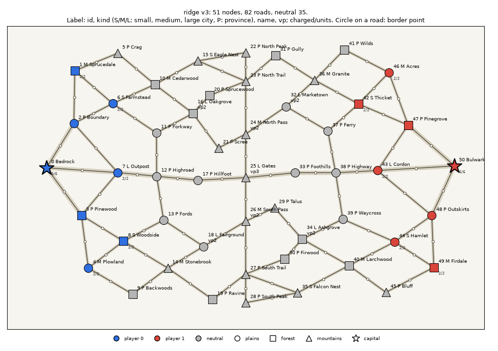
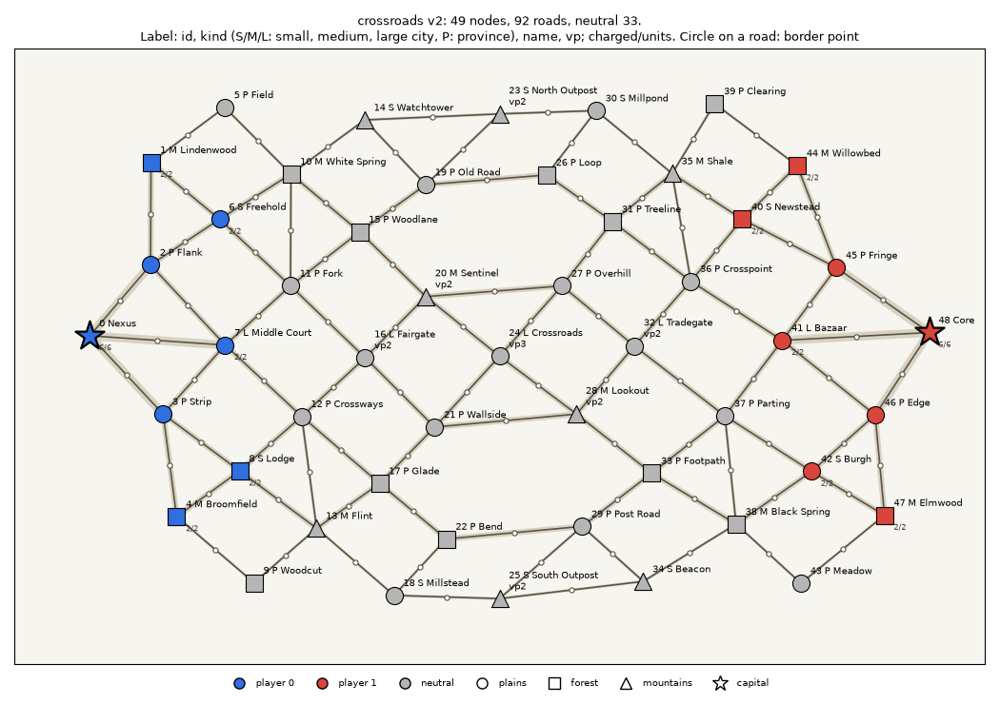
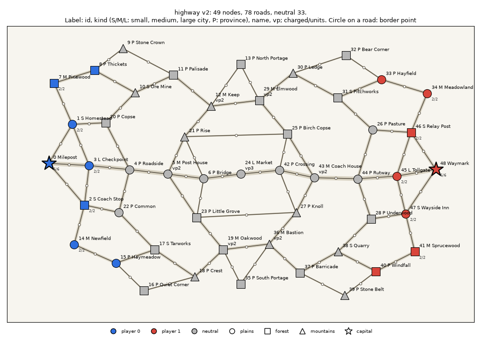
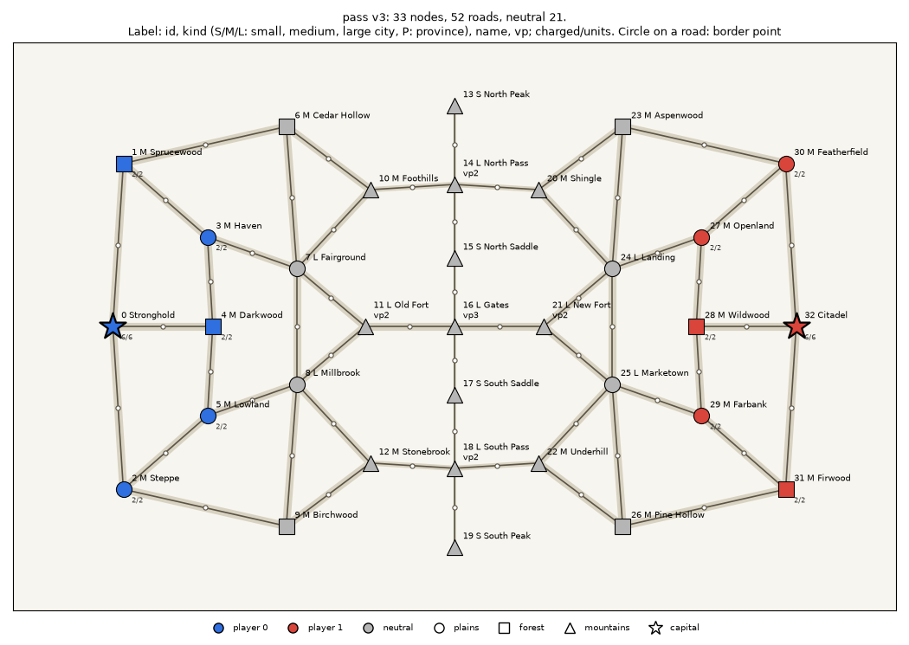
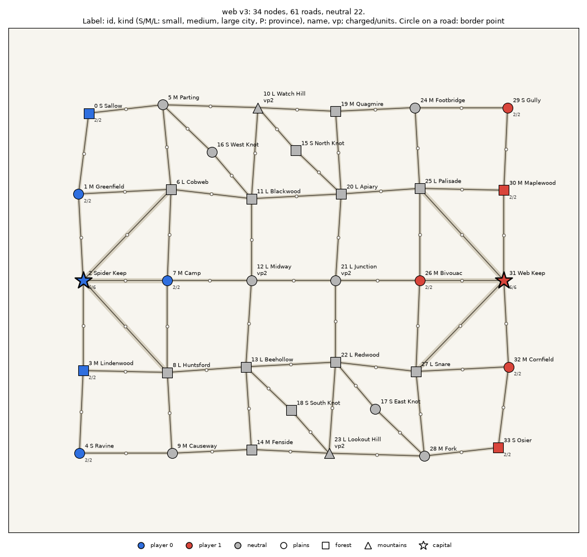
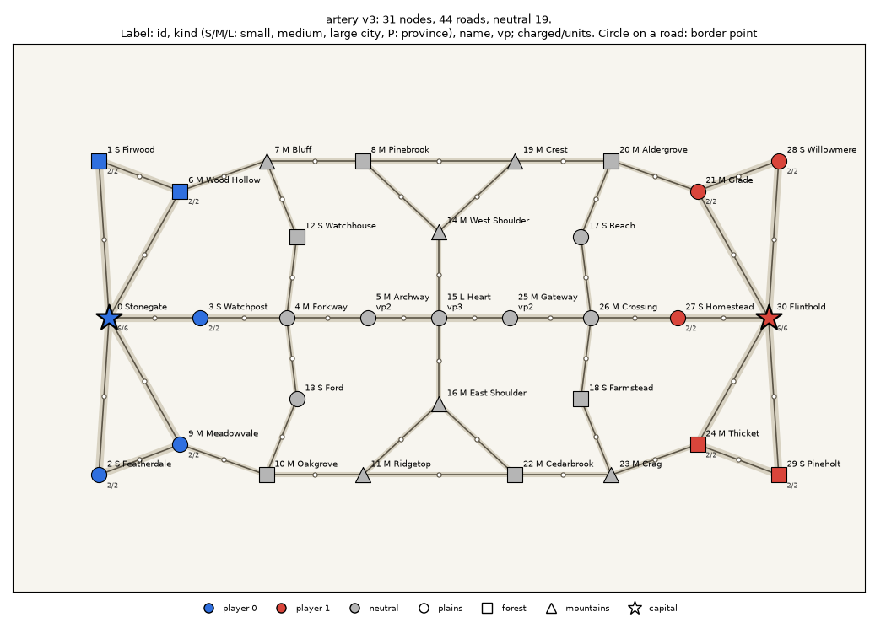

# Maps

Six maps with rule symmetry (MAP-04, #16; DEC-27): the graph and the attributes of nodes and roads are mirrored,
the sides swap places by the `mirror` table, so every map is fair for both sides.
The pool of the server (`maps/*.json`: lobby, queue, bot matches, `GET /api/maps`, the default of `mise run tournament`)
holds the three DEC-27 maps (#266): 49..51 nodes, about half of the nodes are provinces (DEC-23), the coordinates of the
mirrored half are free, the picture is not rotated. The three MVP maps (31..34 nodes, no provinces,
the picture rotated by 180°) left the pool (#372, owner decision) and are test fixtures in `maps/fixtures/`
(with their previews, backgrounds and halves in `maps/fixtures/src/`): many tests and the client dev scene `artery`
stand on their graphs. The server does not serve them (it loads `maps/*.json` without subdirectories), the validator
still checks them, and they are frozen: `maps:preview`, `maps:bake` and `maps:mirror` work on the pool only. The menu map
`menu/valley.json` (#474) is drawn behind the start menu by the client, which bundles it; it is outside the pool too, built
from `menu/src/valley.half.json`, validated, previewed and baked with the pool (`docs/design/map-format.md`, "The menu map"). The format:
[`docs/design/map-format.md`](../docs/design/map-format.md).

Map ids and the names of cities and provinces are English (part 3 of the switch of the repository to English, #390): the names
are chosen by meaning, not transliterated, and the text below quotes them as they are in `maps/*.json`. The ids were Russian
before: `arteriya` is now `artery`, `pautina` is `web`, `hrebet` is `ridge`, `perekrestki` is `crossroads`, `trakt` is `highway`,
`pereval` is `pass`. Historical data keep the old ids (`docs/balance/*.jsonl`, the golden replays with their own copies of the
maps, the frames files of old matches); a bot or replay log recorded on an old id cannot be replayed on the renamed map (the
`map_hash` of a map changes with every edit). The baked backgrounds did not change: the renamed maps keep the bake seed of the old
name (`PINNED_SEEDS` in `tools/maps/src/gow_maps/bake.py`).

Next to a map lie the preview `<id>.preview.png` (for people) and the background `<id>.bg.webp` (MAP-05, #70, #344; the server
serves it, the client draws it). After any map edit: `uv run gow-maps preview maps/*.json` and
`uv run gow-maps bake maps/*.json` (or `mise run maps:bake`). The background has the texture T2 "Thinning"
(`ui-style.md`, 26.3), WebP no larger than 0.5 MB, baking one map takes up to 10 s. A map with an authored geography
`src/<id>.geo.json` (DEC-36, #537) gets water cells, streams and long rivers with bridges in the look W4 Painted, and the
bake writes the vector file `geo/<id>.json` next to the background; a map without one is all land (DEC-27, #269).
The three pool maps and the menu map have a geography (#545), the fixtures stay land only:

| Map | Water (seas and lakes, plus rivers and streams) | Long rivers | Bridges | Nodes moved |
|---|---|---|---|---|
| `ridge` | 18.0 % + 2.2 %: seas in the north-east and south-west corners, two bays, four lakes | 4 | 10 | none |
| `crossroads` | 17.6 % + 2.0 %: seas in the north-west and south-east corners, two bays, four lakes | 4 | 13 | none |
| `highway` | 16.3 % + 2.8 %: seas in the four corners and a northern bay, four lakes | 4 | 10 | none |
| `menu/valley` | 10.6 % + 3.6 %: seas in the four corners and a southern bay (the map is too tight for a lake 60 units off every node) | 2 | 5 | none |

| File | Map id (`meta.name`) | World | Nodes (provinces) | Roads | Own at start | Neutral, of them contested | Path capital → capital |
|---|---|---|---|---|---|---|---|
| `ridge.json` | "ridge" | 2000 × 1240 | 51 (26) | 82 | 8 each (6 cities, 2 provinces) | 35, contested 11 (22%) | 8 roads |
| `crossroads.json` | "crossroads" | 2000 × 1240 | 49 (22) | 92 | 8 each (6 cities, 2 provinces) | 33, contested 11 (22%) | 9 roads |
| `highway.json` | "highway" | 2000 × 1240 | 49 (26) | 78 | 8 each (6 cities, 2 provinces) | 33, contested 11 (22%) | 9 roads |
| `fixtures/pass.json` | "pass" | 1600 × 1000 | 33 | 52 | 6 each | 21, contested 7 (21%) | 8 roads |
| `fixtures/web.json` | "web" | 1140 × 1000 | 34 | 61 | 6 each | 22, contested 14 (41%) | 5 roads |
| `fixtures/artery.json` | "artery" | 1600 × 1000 | 31 | 44 | 6 each | 19, contested 7 (22%) | 7 roads |

A "contested" node: no starting owner, and its distances (in roads) to the two capitals differ
by at most 1 (the `neutral_space` check of the validator, threshold 20%).

Common to all maps:

- the capitals stand in mountains (mechanics.md, section 7: the capital is the only source of supply);
- at the start each player has a capital (6 units, all charged, warehouse 6) and 5 cities (2 units each,
  warehouse 2, a small city has warehouse 1; the DEC-27 maps also give each 2 own provinces without a garrison);
  neutral cities and provinces are empty; a city's starting warehouse is no larger than the warehouse of the ruleset
  `rulesets/mvp-2.toml` (`city_upgrades`, DEC-26, item 5): `gow-maps validate --ruleset
  rulesets/mvp-2.toml` flags an excess as `[warehouse]` (#379; `mise run maps:validate`);
- every node has a name (DEC-23, item 4; the preview labels it after the kind); the border point is in the middle of all
  roads (`border_permille` 500), the preview draws it as a small circle;
- all roads start at level 1 (DEC-22); the upgrade limit `max_level` (at most 3) sets the character
  of a map (on the pool maps no road is limited to level 1: flank and rim roads go up to 2, #422); roads affect only supply: there is no road type, an upgrade only speeds up
  delivery (DEC-26);
- a city's capacity is set by its kind `kind` (capital 10, large 8, medium 6, small 4, DEC-22);
  the rule by which three maps got their kinds before the DEC-23 rework: `docs/design/map-format.md`,
  "Node kinds in the MVP maps (before DEC-23)"; the preview labels the kind with a letter (S, M, L);
- `vp` 1, key cities in the center have 2 to 3 (from each capital there are at least two paths without shared roads
  to each such city).

## DEC-27 maps

Drawn with one technique: a half (`maps/src/<name>.half.json`) sets the graph, the attributes and
the coordinates of the left side, each node has `mirror_x`, `mirror_y` that set the place of the copy on the right. Both
sides are slightly bent by a smooth field of offsets (neighboring nodes shift alike), so the lengths
of mirrored roads differ little and pass the `travel_ticks` tolerance of 15% (DEC-27, item 4), and the picture
on the right does not repeat the picture on the left. The world is 2000 × 1240: the area per node is the same as in the MVP maps.
Provinces (DEC-23): positions without a warehouse and VP, capacity 3; they host forks, approaches to passes
and flank trails. The size check: `size` (45..55) in `tools/maps/tests/test_pool.py`.

### Ridge (`ridge`)



A mountain ridge runs from north to south through the center: peaks, trails and two passes (vp 2) at the edges, in the
center the "Gates" (vp 3). Each pass has an approach through provinces on its own side (Sprucewood,
Scree); to the Gates: the main road through Outpost, Highroad and Hillfoot (up to level 3). Before the ridge
there are two large cities of vp 2 (Oakgrove, Fairground): they are held by whoever reaches the foot first.

Character: a positional map. Mountains give the defender +1 and a slow entry, the ridge is crossed only
through the passes and the Gates; a trail along the crest links the peaks and the passes and can be upgraded once (up to level 2, like the other flank roads). The approach provinces
cut the supply of the cities before the ridge if they are lost.

### Crossroads (`crossroads`)



A rhombic network: each node is linked to two neighbors of the next row, provinces stand at the
forks between cities. The center: "Crossroads" (vp 3), to which each side sends two cities of vp 2
(Fairgate, Sentinel); the northern and southern outposts (vp 2) at the edges are linked by long roads to
both sides. Through the center two more pairs of roads run directly between the sides, bypassing the Crossroads city.

Character: a maneuver map, the most roads in the pool (92): almost any city has a detour,
the front is wide. Whoever distributes troops better and cuts supply through the
forks wins.

### Highway (`highway`)



The main axis over a plain from the capital through Checkpoint, Post House (vp 2) and Bridge to the central "Market"
(vp 3); the axis roads can be upgraded to level 3. From the north and the south run forest and mountain flanks with fortresses
of vp 2 (Keep, Oakwood), linked to the axis by "shoulder" provinces; through the center the flanks are joined by a portage and
two pairs of cross roads that bypass the Market.

Character: a map of one main line with slow flanks, like `artery`, but longer and wider: the axis
is supplied quickly, the flanks allow bypassing and cutting off the forward cities of the axis.

## Pass (`pass`)



A mountain ridge of 7 mountain nodes runs through the center from north to south. It can be crossed only
in three places: the northern pass (vp 2), the central "Gates" (vp 3) and the southern pass (vp 2). The road
through the Gates is upgradable to level 3, through the passes up to 2, the trail along the crest cannot be upgraded.
The peaks of the ridge at its ends are dead-end lookout posts.

Character: a positional map. Mountains give the defender +1 and a slow entry, so an occupied pass
is hard to take head-on. Whoever occupies the passes faster and cuts the enemy's supply
to them wins; the trail along the crest lets troops move between passes without descending into the valley.
Each player has a developed rear (upgrade to 3): the supply near the capital can be sped up.

## Web (`web`)



A 6 × 5 grid of narrow roads (all roads upgrade only to level 2, near the capital to 3) with
diagonals and two "knots" on extra links. About 28 independent cycles: almost any
city has a detour. The central road passes through the center of the map and is mirror-symmetric to itself.

Character: a maneuver map. There are many narrow roads, so supply is slow everywhere, and cutting it
with one strike is impossible: every road has a detour. The two central columns (10 cities) and the knots
are contested, the front is wide, the capitals are closest to each other (5 roads). Whoever distributes
troops better across many directions and finds an unclosed detour wins.

## Artery (`artery`)



One main axis over a plain from the capital through the "Heart" (vp 3) to the enemy capital: the axis
roads upgrade to level 3 (before DEC-22 they started at width 3). Along it from the north and the south run
narrow flanks (level up to 2) through forest and mountains; they are linked to the axis only by a few cross roads and the "shoulders" at the Heart.

Character: a map of one main line. Supply along the axis is fast and plentiful, so the fight for it
decides the match, but a plain gives the defender −1, and the axis is hard to hold. The flanks are slow, but through
them you can bypass and cut off the forward cities of the axis from the capital (two paths
without shared roads lead to the axis cities with vp 2, one of them through a flank).

## How to edit a map

A map of the pool is not edited by hand: you edit a half in `maps/src/`, and a script builds the rest
(the fixtures are frozen: their halves in `maps/fixtures/src/` are only the proof that the files are built by the script).

```bash
# 1. edit maps/src/<name>.half.json and raise meta.version
# 2. build the map and check it with the validator at once
uv run gow-maps mirror maps/src/<name>.half.json -o maps/<name>.json
# 3. redraw the preview and the background
uv run gow-maps preview maps/<name>.json
uv run gow-maps bake maps/<name>.json
# check the whole pool and the fixtures (CI does the same)
uv run gow-maps validate --ruleset rulesets/mvp-2.toml maps/*.json maps/fixtures/*.json
```

The seed of a background comes from the map name and `meta.version`, so raising the version of a new map changes its picture.
The six maps of the pool have their seed pinned in `PINNED_SEEDS` (`tools/maps/src/gow_maps/bake.py`): they were renamed in #390
and keep the pictures they had, whatever their version is.

The test `tools/maps/tests/test_pool.py` checks that every map (`maps/<name>.json`, `maps/fixtures/<name>.json`) is exactly equal to the
result of the script on its half and passes the validator; the MVP maps have 25-40 nodes, the DEC-27
maps also pass the `size` check (45..55 nodes) and the warehouses of `mvp-2` (`warehouse`). The simulation's
symmetry test (`packages/sim/tests/test_symmetry.py`) runs all six maps.

The preview (`<name>.preview.png`) is for people only: the server does not serve it. The map background for the client
lies next to it: `<name>.bg.webp` (MAP-05, #344).
