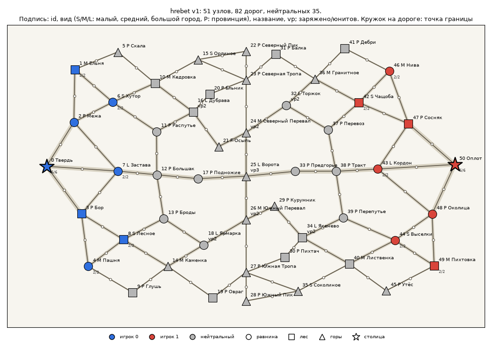
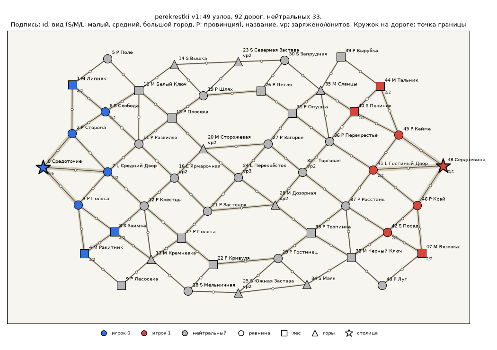
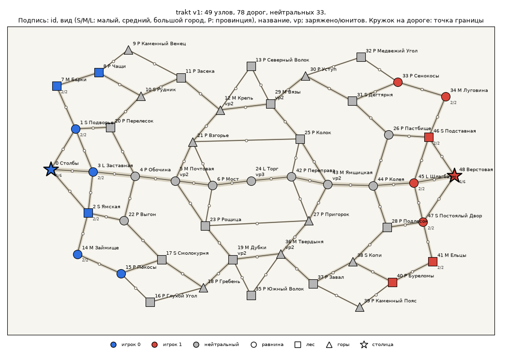
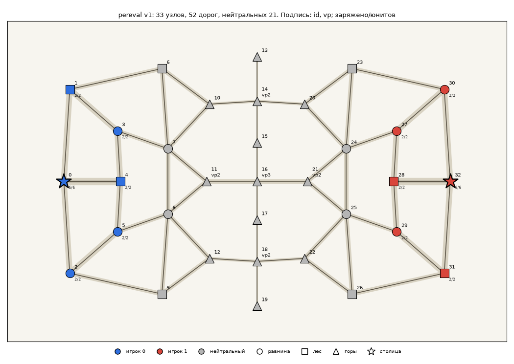
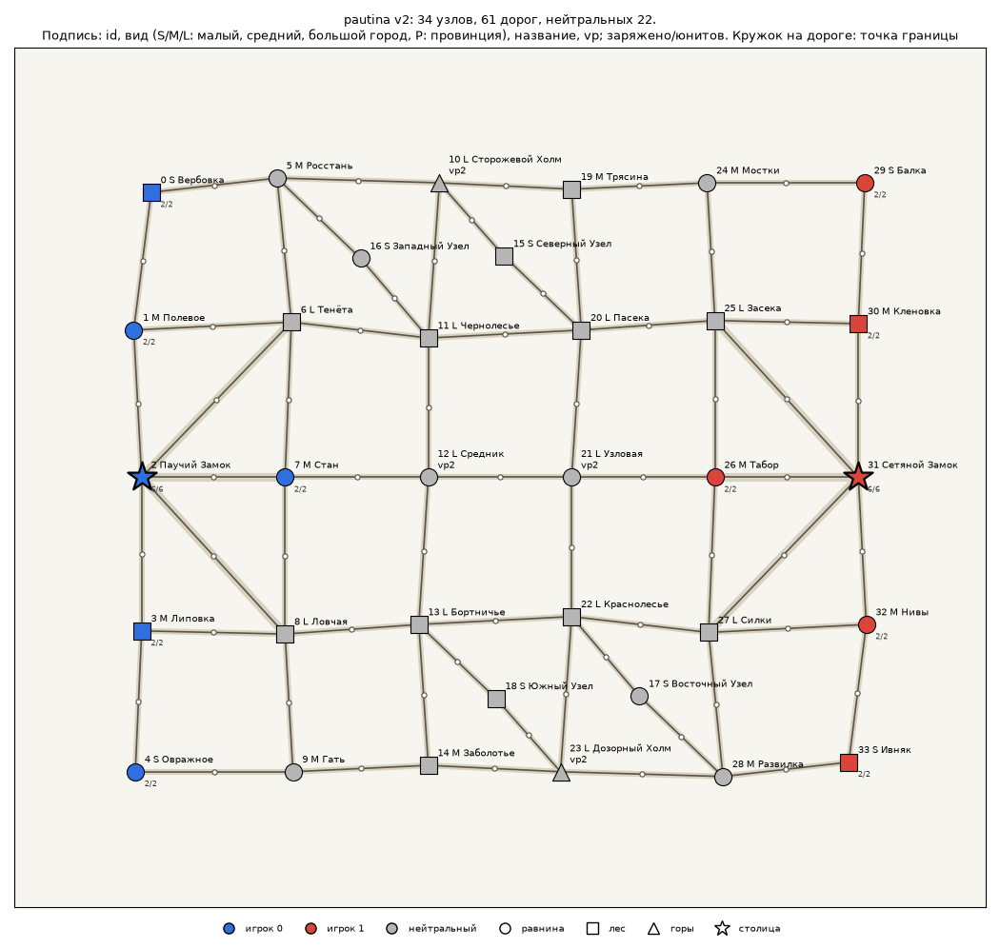
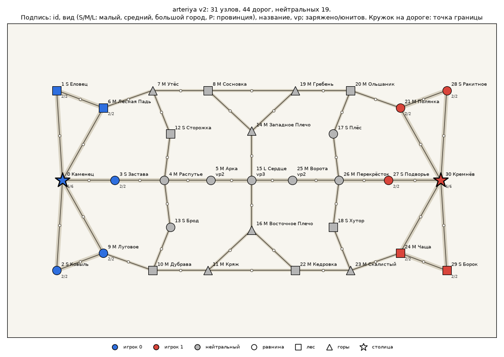

# Карты MVP

Пул из шести карт с симметрией правил (MAP-04, #16; DEC-27): граф и атрибуты узлов и дорог зеркальны,
стороны меняются местами по таблице `mirror`, поэтому каждая карта честна для обеих сторон.
Три карты DEC-27 (#266): 49..51 узел, около половины узлов провинции (DEC-23), координаты
зеркальной половины свободны, картинка не повёрнута. Три карты MVP (31..34 узла, без провинций,
картинка повёрнута на 180°) пока остаются в пуле. Формат:
[`docs/design/map-format.md`](../docs/design/map-format.md).

Рядом с картой лежат превью `<id>.preview.png` (для людей) и фон `<id>.bg.webp` (MAP-05, #70, #344; его
раздаёт сервер, рисует клиент). После любой правки карты: `uv run gow-maps preview maps/*.json` и
`uv run gow-maps bake maps/*.json` (или `mise run maps:bake`). Фон весь суша, без воды (DEC-27, #269), с текстурой
T2 «Прореживание» (`ui-style.md`, 26.3), WebP не больше 0,5 МБ, запекание одной карты до 10 с.

| Файл | Название | Мир | Узлов (провинций) | Дорог | Своих на старте | Нейтральных, из них спорных | Путь столица → столица |
|---|---|---|---|---|---|---|---|
| `hrebet.json` | «Хребет» | 2000 × 1240 | 51 (26) | 82 | по 8 (6 городов, 2 провинции) | 35, спорных 11 (22%) | 8 дорог |
| `perekrestki.json` | «Перекрёстки» | 2000 × 1240 | 49 (22) | 92 | по 8 (6 городов, 2 провинции) | 33, спорных 11 (22%) | 9 дорог |
| `trakt.json` | «Тракт» | 2000 × 1240 | 49 (26) | 78 | по 8 (6 городов, 2 провинции) | 33, спорных 11 (22%) | 9 дорог |
| `pereval.json` | «Перевал» | 1600 × 1000 | 33 | 52 | по 6 | 21, спорных 7 (21%) | 8 дорог |
| `pautina.json` | «Паутина» | 1140 × 1000 | 34 | 61 | по 6 | 22, спорных 14 (41%) | 5 дорог |
| `arteriya.json` | «Артерия» | 1600 × 1000 | 31 | 44 | по 6 | 19, спорных 7 (22%) | 7 дорог |

«Спорный» узел: без стартового владельца, расстояния от него до двух столиц (в дорогах) отличаются
не больше чем на 1 (проверка `neutral_space` валидатора, порог 20%).

Общее для всех карт:

- столицы стоят в горах (mechanics.md, раздел 7: столица — единственный источник снабжения);
- на старте у каждого игрока столица (6 юнитов, все заряжены, склад 6) и 5 городов (по 2 юнита,
  склад 2; у карт DEC-27 у малого города склад 1, у них же по 2 свои провинции без гарнизона);
  нейтральные города и провинции пусты; с `rulesets/mvp-1.toml` (`city_upgrades`, DEC-26) склад
  малого города на старте обрезается до 1, и `gow-maps validate --ruleset rulesets/mvp-1.toml`
  отмечает это как `[warehouse]` (`arteriya`, `pautina`; вопрос владельцу в #265; карты DEC-27
  проверку проходят);
- у каждого узла название (DEC-23, п. 4; превью подписывает его после вида); точка границы на всех
  дорогах в середине (`border_permille` 500), превью рисует её кружком;
- все дороги на старте уровня 1 (DEC-22); предел улучшения `max_level` (не больше 3) задаёт
  характер карты; дороги влияют только на снабжение: типа дороги нет, улучшение только ускоряет
  доставку (DEC-26);
- ёмкость города задана его видом `kind` (столица 10, большой 8, средний 6, малый 4, DEC-22);
  правило, по которому три карты получили виды до переделки DEC-23: `docs/design/map-format.md`,
  «Вид узлов в картах MVP»; превью подписывает вид буквой (S, M, L);
- `vp` 1, у ключевых городов центра 2–3 (к каждому такому городу от каждой столицы ведут минимум
  два пути без общих дорог).

## Карты DEC-27

Нарисованы по одному приёму: половина (`maps/src/<имя>.half.json`) задаёт граф, атрибуты и
координаты левой стороны, у каждого узла `mirror_x`, `mirror_y` задают место копии справа. Обе
стороны слегка изогнуты плавным полем смещений (соседние узлы сдвинуты похоже), поэтому длины
зеркальных дорог отличаются мало и проходят допуск `travel_ticks` 15% (DEC-27, п. 4), а картинка
справа не повторяет картинку слева. Мир 2000 × 1240: площадь на узел как у карт MVP.
Провинции (DEC-23): позиции без склада и VP, ёмкость 3; на них стоят развилки, подходы к перевалам
и тропы флангов. Проверка размера: `size` (45..55) в `tools/maps/tests/test_pool.py`.

### «Хребет» (`hrebet`)



С севера на юг по центру идёт горный хребет: вершины, тропы и два перевала (vp 2) по краям, в
центре «Ворота» (vp 3). К каждому перевалу со своей стороны ведёт подход по провинциям (Ельник,
Осыпь), к Воротам: главная дорога через Заставу, Большак и Подножие (до уровня 3). Перед хребтом
два больших города vp 2 (Дубрава, Ярмарка): их держит тот, кто первым выйдет к подножию.

Характер: позиционная карта. Горы дают защитнику +1 и медленный вход, хребет переходят только по
перевалам и Воротам; тропа по гребню связывает вершины и перевалы, но не улучшается (уровень 1). Провинции подходов
режут снабжение городов перед хребтом, если их потерять.

### «Перекрёстки» (`perekrestki`)



Ромбическая сеть: каждый узел связан с двумя соседями следующего ряда, провинции стоят на
развилках между городами. Центр: «Перекрёсток» (vp 3), к нему с каждой стороны ведут два города vp 2
(Ярмарочная, Сторожевая); северная и южная заставы (vp 2) на краях связаны длинными дорогами с
обеими сторонами. Через центр напрямую идут ещё две пары дорог между сторонами в обход Перекрёстка.

Характер: манёвренная карта, больше всего дорог в пуле (92): у почти любого города есть обход,
фронт широкий. Выигрывает тот, кто лучше распределяет войска и перерезает снабжение через
развилки.

### «Тракт» (`trakt`)



Главная ось по равнине от столицы через Заставную, Почтовую (vp 2) и Мост к центральному «Торгу»
(vp 3); дороги оси улучшаются до уровня 3. С севера и юга идут лесные и горные фланги с крепостями
vp 2 (Крепь, Дубки), с осью их связывают провинции-«плечи»; через центр фланги соединены волоком и
двумя парами поперечных дорог в обход Торга.

Характер: карта одной главной линии с медленными флангами, как «Артерия», но длиннее и шире: ось
быстро снабжается, фланги позволяют обойти и отрезать передовые города оси.

## «Перевал» (`pereval`)



Через центр с севера на юг идёт горный хребет из 7 горных узлов. Перейти его можно только в трёх
местах: северный перевал (vp 2), центральные «ворота» (vp 3) и южный перевал (vp 2). Дорога
через ворота улучшается до уровня 3, через перевалы — до 2, тропа вдоль гребня не улучшается.
Вершины хребта на концах — тупиковые наблюдательные посты.

Характер: позиционная карта. Горы дают защитнику +1 и медленный вход, поэтому занятый проход
трудно взять в лоб. Выигрывает тот, кто быстрее займёт проходы и перережет противнику снабжение
к ним; тропа по гребню позволяет перебрасывать войска между проходами, не спускаясь в долину.
Тыл у каждого игрока развитый (улучшение до 3): снабжение у столицы можно ускорить.

## «Паутина» (`pautina`)



Решётка 6 × 5 узких дорог (все дороги улучшаются только до уровня 2, у столицы до 3) с
диагоналями и двумя «узлами» на лишних связях. Около 28 независимых циклов: почти к любому
городу есть обход. Центральная дорога проходит через центр карты и зеркальна сама себе.

Характер: манёвренная карта. Узких дорог много, поэтому снабжение везде медленное, а перерезать
его одним ударом нельзя: у каждой дороги есть обход. Две центральные колонны (10 городов) и узлы
спорные, фронт широкий, столицы ближе всего друг к другу (5 дорог). Выигрывает тот, кто лучше
распределяет войска по многим направлениям и находит незакрытый обход.

## «Артерия» (`arteriya`)



Одна главная ось по равнине от столицы через «сердце» (vp 3) к столице противника: дороги
оси улучшаются до уровня 3 (до DEC-22 они начинали с ширины 3). Вдоль неё с севера и юга идут
узкие фланги (уровень до 2) через лес и горы; с осью их связывают лишь несколько поперечных дорог и «плечи» у сердца.

Характер: карта одной главной линии. По оси снабжение идёт быстро и много, поэтому бой за неё
решает партию, но равнина даёт защитнику −1, и держать ось трудно. Фланги медленные, зато через
них можно обойти и отрезать передовые города оси от столицы (к городам оси с vp 2 ведут два
пути без общих дорог, один из них — через фланг).

## Как править карту

Карта не редактируется руками: правится половина в `maps/src/`, остальное собирает скрипт.

```bash
# 1. поправить maps/src/<name>.half.json и повысить meta.version
# 2. собрать карту и сразу проверить её валидатором
uv run gow-maps mirror maps/src/<name>.half.json -o maps/<name>.json
# 3. перерисовать превью и фон
uv run gow-maps preview maps/<name>.json
uv run gow-maps bake maps/<name>.json
# проверить весь пул (это же делает CI)
uv run gow-maps validate maps/*.json
```

Тест `tools/maps/tests/test_pool.py` проверяет, что каждая `maps/<name>.json` в точности равна
результату скрипта на своей половине и проходит валидатор; карты MVP имеют 25–40 узлов, карты
DEC-27 проходят и проверку `size` (45..55 узлов) и склады `mvp-1` (`warehouse`). Тест зеркальности
симуляции (`packages/sim/tests/test_symmetry.py`) гоняет все шесть карт.

Превью (`<name>.preview.png`) — только для людей: сервер их не раздаёт. Фон карты для клиента
лежит рядом: `<name>.bg.webp` (MAP-05, #344).
